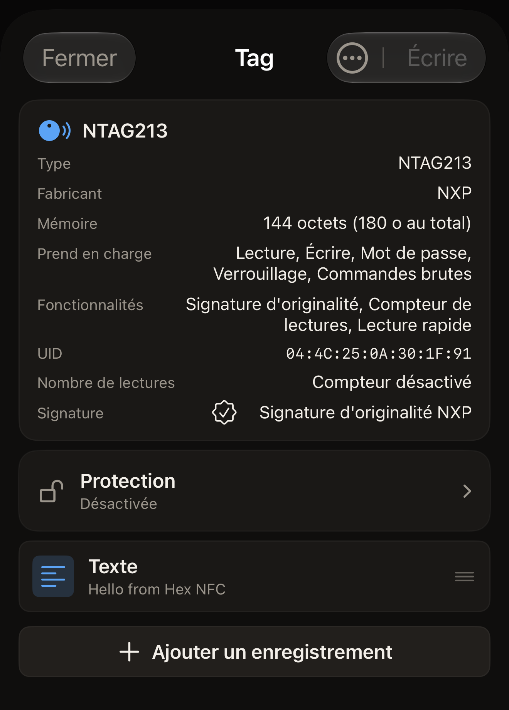

En 5 minutes environ, vous lisez un tag NFC avec Hex NFC et vous voyez ce
qu'il contient, à l'écran et dans l'historique de l'app. Il vous faut un
iPhone et un tag.

## Avant de commencer

- Installez Hex NFC depuis l'[App
  Store](https://apps.apple.com/app/id6801457461) sur un iPhone sous iOS 17
  ou version ultérieure. Il n'y a rien à configurer au premier lancement :
  l'app s'ouvre sur son écran d'accueil. [Questions fréquentes](faq.md)
  indique ce qu'elle coûte et sur quels iPhone elle fonctionne.
- Ayez un tag à portée de main. Un autocollant, une carte ou un porte-clés
  font tous l'affaire.
- Un tag vide convient aussi. L'app le lit et indique qu'il ne contient
  rien.
- Lire un tag ne le modifie en rien. Aucune étape de cette page n'écrit sur
  votre tag.

## Lire votre premier tag

:::::steps
::::step[Ouvrir l'écran de scan]
Hex NFC s'ouvre sur son écran d'accueil, qui présente quatre tuiles sous le
nom de l'app : **Scanner**, **Composer**, **Bibliothèque** et **Avancé**.
Touchez **Scanner**, la tuile en haut à gauche. L'écran de scan s'ouvre et
attend un tag, avec le message « Tenez le tag près du haut de l'iPhone ».
::::

::::step[Tenir le tag contre l'iPhone]
Posez le haut de l'iPhone à plat sur le tag et maintenez-le immobile.
Pendant la lecture, iOS affiche son propre panneau en bas de l'écran. Le
texte de l'app reste visible au-dessus. L'écran de scan affiche
« Lecture… », puis « Tag détecté ». Dès que « Tag détecté » apparaît, l'app
en a fini avec le tag : vous pouvez éloigner l'iPhone. Si aucun tag n'est
lu, l'écran affiche « Échec du scan » et en donne la raison juste en
dessous. Touchez **Réessayer**, puis tenez le tag bien immobile contre le
haut de l'iPhone. [Si un tag ne peut être ni scanné ni
écrit](troubleshooting.md) traite le cas d'un tag qui ne répond pas.
::::

::::step[Lire ce que l'app a trouvé]
Sous « Tag détecté », l'app donne le nom de la puce et compte ce qu'elle a
lu. Un enregistrement est un élément de contenu sur un tag, comme un lien ou
un texte, et un tag qui en contient un affiche « 1 enregistrement trouvé ».
Un tag qui n'en contient aucun affiche « Aucun enregistrement NDEF sur ce
tag ». Cet écran reste affiché environ une seconde. Le nom de la puce et
l'UID du tag réapparaissent sur l'écran suivant : inutile de les retenir
ici. [Scanner un tag](scan-a-tag.md) présente les autres résultats
possibles.
::::

::::step[Ouvrir un enregistrement]
L'écran « Tag » s'ouvre de lui-même. La carte du haut donne le nom de la
puce et comporte une ligne **UID**. Sous la carte, chaque enregistrement
occupe une ligne qui montre son type et un aperçu de son contenu. Touchez
une ligne pour voir l'enregistrement en entier, puis touchez **Annuler**
pour revenir. **Annuler** ferme l'enregistrement sans rien écrire, ni sur le
tag ni dans l'app. Un tag vide affiche « Tag vide » à la place des lignes :
la lecture est complète, ce n'est pas un échec.

:::figure[Après le scan d'un NTAG213, la carte en haut de l'écran « Tag » contient la ligne **UID**, et l'unique enregistrement du tag apparaît plus bas, sous forme de ligne **Texte**.]

:::
::::

::::step[Fermer le tag]
Touchez **Fermer**. L'écran « Tag » se ferme sans rien écrire, et vous
revenez à l'écran d'accueil de Hex NFC.
::::
:::::

## Ce que vous avez appris

Vous savez maintenant lire n'importe quel tag et dire ce qu'il contient.
L'app a conservé ce scan. Touchez **Bibliothèque** sur l'écran d'accueil de
Hex NFC, puis **Historique**, le second des deux onglets en haut de l'écran
« Bibliothèque ». Votre scan figure en tête de liste. Un scan épinglé est
conservé au-delà des limites que décrit [Retrouver un tag scanné
auparavant](scan-history.md). Ouvrir un scan enregistré affiche à nouveau le
même écran « Tag », sans avoir à présenter le tag une nouvelle fois.

## Et ensuite

- Lisez [Scanner un tag](scan-a-tag.md) pour savoir ce que signifie chaque
  résultat de scan, et que faire d'un tag qui demande d'abord un mot de
  passe.
- Lisez [Retrouver un tag scanné auparavant](scan-history.md) pour rouvrir,
  épingler et supprimer les scans enregistrés.
- Lisez [Écrire un lien sur un tag](write-a-link.md) pour placer une adresse
  web sur un tag vide.
- Lisez [Tags compatibles avec Hex NFC](tags-that-work.md) pour voir quelles
  puces l'app reconnaît.
- Lisez [Si un tag ne peut être ni scanné ni écrit](troubleshooting.md)
  quand un tag ne répond pas.
