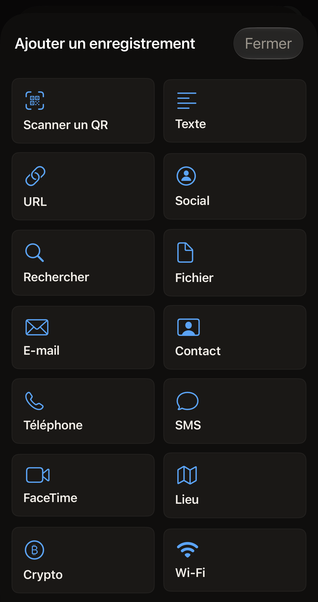
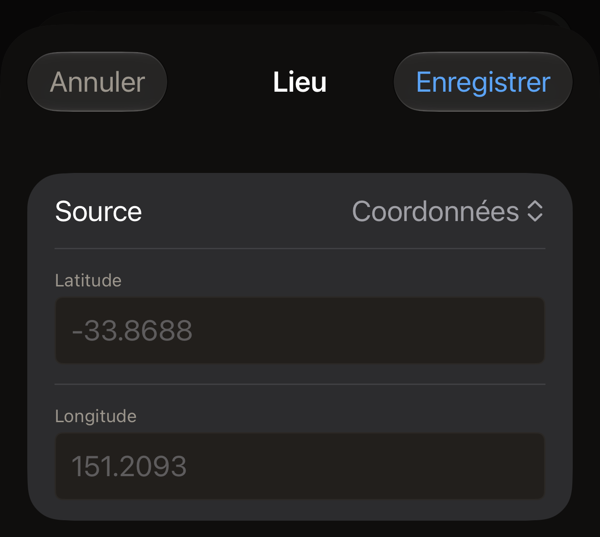

Un tag contient une liste d'enregistrements, et chaque enregistrement a un
type. Scannez un tag avec l'iPhone, ou touchez **Composer** sur l'écran
d'accueil de Hex NFC pour commencer sans aucun enregistrement. Touchez ensuite **Ajouter un
enregistrement** sur l'écran « Tag ». L'app propose 13 types, que [Modifier
les enregistrements d'un tag](edit-records.md) présente pas à pas. Le type
choisi détermine les champs que vous montre l'éditeur d'enregistrement,
ainsi que ce qu'un autre téléphone trouvera en lisant le tag plus tard. Un
tag scanné peut aussi contenir cinq types que l'app sait ouvrir mais ne
propose pas d'ajouter, décrits dans [Types que vous pouvez ouvrir mais pas
ajouter](#types-you-can-open-but-not-add).

:::figure[**Ajouter un enregistrement** propose 13 types d'enregistrement, précédés de **Scanner un QR** pour convertir un code QR en enregistrement.]

:::

## Ce que le type change

Chaque type est une forme prévue pour une information. Un numéro de
téléphone va dans un enregistrement **Téléphone**, et un réseau dans un
enregistrement **Wi-Fi**. L'app convertit ce que vous saisissez en octets,
selon ce que la norme NFC définit pour cette forme. Choisissez le type le
plus proche plutôt que de mettre un numéro de téléphone dans un
enregistrement **Texte** : un téléphone qui lit le tag réagit à la forme,
pas à votre intention.

Ce qui se passe sur le téléphone qui lit le tag dépend de ce téléphone. Un
lien reste un lien partout. Ce n'est pas le cas d'un réseau : comme
l'indique le formulaire **Wi-Fi**, « iPhone ne se connectera pas
automatiquement via NFC, mais les lecteurs Android le feront. Hex NFC écrit
l'enregistrement conformément à la spécification. »

Les enregistrements prennent de la place, et une petite puce en manque vite.
La capacité de chaque puce figure dans [Tags compatibles avec Hex
NFC](tags-that-work.md).

## Texte et liens

:::table[Types d'enregistrement pour le texte, les liens et les recherches]
| Type | Ce que vous remplissez | Ce qui arrive sur le tag |
| --- | --- | --- |
| **Texte** | **Texte**, **Code de langue**, **Encodage** | Vos mots, marqués du code de langue que vous saisissez et écrits dans l'encodage que vous choisissez. |
| **URL** | **URL** | L'adresse telle que vous l'avez saisie. Les préfixes web courants sont stockés sur un seul octet, pour que l'enregistrement prenne moins de place. |
| **Social** | **Plateforme**, **Identifiant** | Un lien de profil, construit à partir de la plateforme que vous choisissez et de l'identifiant que vous saisissez. |
| **Rechercher** | **Moteur**, **Requête** | Une adresse de recherche pour le moteur que vous choisissez, qui contient vos mots. |
| **Fichier** | **Chemin** | Une adresse de fichier. Le formulaire l'explique ainsi : « Stocké sous forme d'URL file://. iOS limite les répertoires accessibles. » |
:::

Un nouvel enregistrement **Texte** commence avec le code de langue en, et la
note du champ indique la forme à utiliser : « ISO 639-1, par ex. en, fr,
ja ». **Encodage** propose deux options, **UTF-8** et **UTF-16**, et un
nouvel enregistrement commence sur **UTF-8**.

Sur la plupart des plateformes, le champ **Identifiant** correspond au nom
qui termine l'adresse de votre profil, et vous le saisissez sans le @ qui le
précède. Six d'entre elles demandent autre chose, car leurs adresses ne sont
pas construites à partir d'un identifiant.

- Pour **Whatsapp**, saisissez le numéro de téléphone que contient un lien
  wa.me, c'est-à-dire le numéro international complet, sans le signe plus.
- Pour **Skype**, saisissez le nom Skype.
- Pour **Steam**, saisissez l'URL personnalisée de l'adresse de votre
  profil.
- Pour **Slack**, saisissez le nom de l'espace de travail qui figure au
  début de son adresse.
- Pour **Facebook** et **Wechat**, saisissez ce que contient leur propre
  lien, qui peut être un nom ou un numéro.

L'app insère ce que vous saisissez dans l'adresse de profil de la plateforme
et n'y change rien d'autre.

**Moteur** propose **Google**, **Google Images**, **Bing**, **Yandex**,
**DuckDuckGo**, **YouTube** et **Wikipedia**. **Plateforme** propose
**Facebook**, **Bluesky**, **X**, **Github**, **Instagram**, **Line**,
**Linkedin**, **Medium**, **Pinterest**, **Skype**, **Slack**, **Snapchat**,
**Soundcloud**, **Steam**, **Telegram**, **Threads**, **Tiktok**,
**Twitch**, **Vk**, **Wechat**, **Whatsapp** et **Youtube**, chacun écrit à
l'écran comme ici.

## Personnes et messages

:::table[Types d'enregistrement pour joindre une personne]
| Type | Ce que vous remplissez | Ce qui arrive sur le tag |
| --- | --- | --- |
| **E-mail** | **À**, **Cc**, **Cci**, **Objet**, **Corps du message** | Une adresse de messagerie qui contient les destinataires, l'objet et le message. |
| **Contact** | **Nom complet** et **Organisation** sous **Identité**, puis **Téléphones**, **E-mails** et **Sites web** sous **Contact** | Une fiche de contact, qu'un téléphone qui lit le tag peut ajouter à son carnet d'adresses. |
| **Téléphone** | **Numéro de téléphone** | Une adresse de téléphone. Un téléphone qui la lit propose d'appeler le numéro. |
| **SMS** | **Destinataire**, **Message** | Une adresse de message qui contient le numéro et le texte à envoyer. |
| **FaceTime** | **Cible**, **Mode** | Une adresse FaceTime, pour la vidéo ou l'audio selon votre choix. |
:::

Six de ces champs acceptent plusieurs entrées : **À**, **Cc**, **Cci**,
**Téléphones**, **E-mails** et **Sites web** se découpent tous à chaque
virgule, c'est pourquoi **À** et **Téléphones** affichent l'indication
« séparés par des virgules ». Si vous laissez **Organisation** vide, ce
champ ne figure pas sur la fiche.

## Lieux, paiements et réseaux

:::table[Types d'enregistrement pour un lieu, un paiement ou un réseau]
| Type | Ce que vous remplissez | Ce qui arrive sur le tag |
| --- | --- | --- |
| **Lieu** | **Source**, puis soit **Latitude** et **Longitude**, soit **URL de la carte** | Une adresse de carte : une paire de coordonnées, ou le lien de carte que vous collez. |
| **Crypto** | **Réseau**, **Adresse**, **Montant**, **Message** | Une adresse de paiement sur le réseau que vous choisissez. **Montant** et **Message** sont omis si vous les laissez vides. |
| **Wi-Fi** | **Nom du réseau (SSID)**, **Mot de passe**, **Authentification**, **Chiffrement**, **Réseau masqué** | Un enregistrement réseau qui contient le nom, le mot de passe et les réglages de sécurité que vous avez choisis. |
:::

**Source** détermine le reste du formulaire **Lieu**. Ce champ propose
**Coordonnées**, **URL Apple Plans** et **URL Google Maps**. **Coordonnées**
affiche **Latitude** et **Longitude**. Saisissez chacune sous forme de
nombre décimal, par exemple `-33.8688` et `151.2093`. La virgule décimale
fonctionne aussi : `48,8566` est lu comme `48.8566`. Les deux autres sources
affichent chacune **URL de la carte** à la place. C'est vous qui fournissez
l'adresse. Copiez le lien depuis l'app de cartes ou depuis le navigateur
dans lequel vous avez trouvé le lieu, puis collez-le dans le champ. Le tag
reçoit le lien exactement tel que vous l'avez collé. Le choix entre ces deux
sources n'est pas du tout écrit sur le tag. Choisissez celle qui correspond
à l'origine de votre lien. L'app ne lit jamais la position de l'iPhone.
Chaque lieu est un lieu que vous saisissez ou collez, ou qui provient d'un
code QR ou d'un tag que vous avez scanné.

:::figure[Quand **Source** indique **Coordonnées**, le formulaire affiche **Latitude** et **Longitude**, chaque champ contenant un exemple en gris tant que vous n'avez rien saisi.]

:::

Un enregistrement **Lieu** a besoin d'une latitude et d'une longitude, ou
d'une URL de carte. Tant qu'il n'en a pas, le formulaire affiche « Saisissez
une latitude et une longitude, ou une URL de carte. D'ici là, cet
enregistrement ne peut pas être écrit sur un tag. », et la ligne de
l'enregistrement sur l'écran « Tag » affiche « Aucun lieu ». Un
enregistrement **Lieu** que vous ajoutez puis quittez avec **Annuler** reste
dans la liste dans cet état. Si vous écrivez sur le tag alors que la liste
en contient un, l'écriture s'arrête avant l'ouverture du panneau de scan d'iOS, avec
le message « Un enregistrement de lieu n'a ni coordonnées ni URL de carte.
Rien n'a été écrit sur le tag. » Remplissez l'enregistrement ou
supprimez-le, puis écrivez à nouveau. **Enregistrer comme préréglage…** se comporte de la même façon : tant que la liste contient un tel enregistrement,
**Enregistrer** reste grisé et le panneau d'enregistrement en explique la
raison. Un préréglage ne peut plus être modifié une fois enregistré : un
préréglage enregistré avec un **Lieu** vide dans une version antérieure de
l'app est donc refusé chaque fois que vous l'écrivez. Recomposez ses
enregistrements sur l'écran « Tag », enregistrez-les comme nouveau
préréglage, puis supprimez l'ancien.

**Réseau** propose **Bitcoin**, **Ethereum**, **Monero**, **Litecoin**,
**Dogecoin** et **Solana**. **Montant** est un champ de texte libre, sans
indication ni contrôle. L'app copie ce que vous saisissez dans le lien de
paiement sans le modifier. Écrivez le montant comme l'écrit le portefeuille
que vous utilisez. Relisez le montant dans ce portefeuille avant que
quiconque n'envoie quoi que ce soit.

Dans le formulaire **Wi-Fi**, **Authentification** indique au départ **WPA2
Personal** et **Chiffrement** indique **AES**, ce qu'utilisent la plupart des
routeurs domestiques. **Authentification** propose aussi **WPA3 Personal**,
**WPA Personal**, **WEP** et **Ouverte**. **Chiffrement** propose aussi
**TKIP**, **TKIP + AES**, **WEP** et **Aucun**. Choisissez la combinaison
qu'indique la page de réglages de votre routeur.

:::warning[Un enregistrement Wi-Fi contient le mot de passe en clair]
Tout téléphone qui lit le tag lit aussi le mot de passe du réseau. Ne placez
un enregistrement **Wi-Fi** que sur un tag que vous acceptez de laisser lire
par n'importe qui.
:::

## Types que vous pouvez ouvrir mais pas ajouter {#types-you-can-open-but-not-add}

Un tag scanné, un préréglage ou une entrée de l'historique peut contenir
cinq types que l'écran **Ajouter un enregistrement** ne propose pas : **Lien
d'app**, **Bluetooth**, **Données**, **Raccourci** et **Brut**. Aucun d'eux
n'a de formulaire propre. Toucher l'un d'eux ouvre un éditeur de texte qui
présente l'enregistrement en JSON, sous la note “Ce type d'enregistrement se
modifie en JSON. Tant que le texte n'est pas un enregistrement valide,
« Enregistrer » conserve la dernière version valide.”

:::table[Ce que les cinq types placent sur un tag]
| Type | Ce qui arrive sur le tag |
| --- | --- |
| **Lien d'app** | Une adresse App Store, écrite sous forme de lien. |
| **Bluetooth** | Un enregistrement d'appairage qui contient l'adresse et le nom d'un appareil. |
| **Données** | Les octets de l'enregistrement, accompagnés de son type de média. |
| **Raccourci** | Une adresse qui exécute un raccourci d'après son nom, avec l'entrée que lui fournit l'enregistrement. |
| **Brut** | Les octets exacts de l'enregistrement, réécrits sans modification. |
:::

L'éditeur s'ouvre avec l'enregistrement déjà rédigé. Les clés qui ont déjà
une valeur sont affichées, et vous modifiez ces valeurs sur place. Une clé
qui n'a pas encore de valeur est absente. Les clés facultatives du tableau
ci-dessous restent absentes tant que vous ne les saisissez pas, en les
écrivant exactement comme elles figurent ici. Laissez `id` et `type` tels
que l'app les a écrits. Voici les autres :

:::table[Les clés de chaque type modifiable uniquement en JSON]
| Type | Clés à remplir |
| --- | --- |
| **Lien d'app** | `appStoreURL`, puis `universalLink` et `displayName` si vous le souhaitez |
| **Bluetooth** | `deviceMAC`, puis `deviceName` si vous le souhaitez |
| **Données** | `mimeType`, et `payload` en base64 |
| **Raccourci** | `shortcutName`, puis `input` si le raccourci accepte une entrée |
| **Brut** | `tnf` sous forme d'un nombre de la liste ci-dessous, puis `typeBytes`, `idBytes` et `payload` en base64 |
:::

Un enregistrement **Données** qui contient le mot Hello en texte simple se
présente ainsi :

```text title="Un enregistrement Données dans l'éditeur JSON"
{
  "id" : "9E2B1C64-6A2F-4D0E-9A52-0B7F1C3D8E44",
  "mimeType" : "text/plain",
  "payload" : "SGVsbG8=",
  "type" : "data"
}
```

Aucun convertisseur ne se cache derrière ce `payload`. La valeur doit être
du base64 que vous produisez ailleurs. Coller votre texte tel quel ne
l'encode pas. Un `payload` qui n'est pas du base64 valide empêche la lecture
de tout l'enregistrement. La note qui suit traite de ce cas.

**Brut** est le type auquel l'app se rabat quand elle lit un enregistrement
qu'elle ne sait pas classer. L'usage habituel est de le réécrire sans
modification. Pour en modifier un, commencez par `tnf`, le nombre
qu'utilise la norme NDEF pour indiquer quel genre de nom contient
`typeBytes`. La valeur est l'un de ces nombres.

- 0 pour un enregistrement vide.
- 1 pour un nom de la liste propre au NFC Forum.
- 2 pour un type de média.
- 3 pour une adresse absolue.
- 4 pour un nom défini par un fabricant.
- 5 pour un type inconnu.
- 6 pour la suite d'un enregistrement qui a été scindé.

`typeBytes`, `idBytes` et `payload` sont chacun en base64, et `idBytes` est
généralement vide.

```text title="Un enregistrement Brut avec un type défini par un fabricant"
{
  "id" : "3F7A9D21-4C88-4B0A-BE13-52C0A7E6D915",
  "idBytes" : "",
  "payload" : "SGVsbG8=",
  "tnf" : 4,
  "typeBytes" : "ZXhhbXBsZS5jb206bm90ZQ=="
}
```

:::note[Le texte que l'éditeur ne peut pas lire est ignoré]
L'éditeur applique votre texte dès qu'il se lit comme un enregistrement.
D'ici là, l'enregistrement garde les valeurs qu'il avait, et aucun message
n'apparaît. Rien dans l'éditeur ne le confirme non plus : vérifiez donc
après avoir touché **Enregistrer**. Sur l'écran « Tag », la ligne de
l'enregistrement affiche une deuxième ligne de texte tirée de
l'enregistrement lui-même.

- Pour **Données**, c'est le type de média.
- Pour **Raccourci**, c'est le nom du raccourci.
- Pour **Lien d'app**, c'est l'adresse App Store.
- Pour **Bluetooth**, c'est le nom ou l'adresse de l'appareil.
- Pour **Brut**, ce sont les premiers octets de la charge utile.

Si cette deuxième ligne n'a pas changé, votre texte n'est jamais devenu un
enregistrement.
:::

## Enregistrer, abandonner ou supprimer un enregistrement

**Enregistrer** conserve vos modifications, et **Annuler** les abandonne.
**Supprimer l'enregistrement** retire l'enregistrement de la liste et ferme
l'éditeur sans demander de confirmation. **Annuler** n'est alors plus
disponible : un enregistrement supprimé de cette façon doit être ajouté à
nouveau. Ces trois boutons agissent sur la copie que détient l'app, jamais
sur le tag. Le tag ne change que lorsque vous écrivez dessus, comme
l'explique [Modifier les enregistrements d'un tag](edit-records.md).

Chaque enregistrement est construit à partir de ce que vous saisissez. Rien
dans l'éditeur d'enregistrement ne lit vos contacts, votre position ou les
appareils Bluetooth qui vous entourent. [Confidentialité et vos
données](privacy.md) indique ce que l'app conserve.

## Ce que devient un tag scanné

L'app range ce qu'elle lit dans le type connu le plus proche. Une adresse de
téléphone, de message, de messagerie, FaceTime, de carte, de paiement, de
raccourci ou de fichier s'ouvre dans le type correspondant, et tout autre
lien s'ouvre comme enregistrement **URL**. Une fiche de contact, un
enregistrement réseau et un enregistrement d'appairage retrouvent chacun
leur propre type. Tout autre type de média devient un enregistrement
**Données**, et tout le reste devient un enregistrement **Brut**, qui se
réécrit octet pour octet.

## Voir aussi

- [Modifier les enregistrements d'un tag](edit-records.md)
- [Écrire un lien sur un tag](write-a-link.md)
- [Enregistrer un tag comme préréglage](presets.md)
- [Matrice de prise en charge des
  puces](../developer/chip-support-matrix.md)
