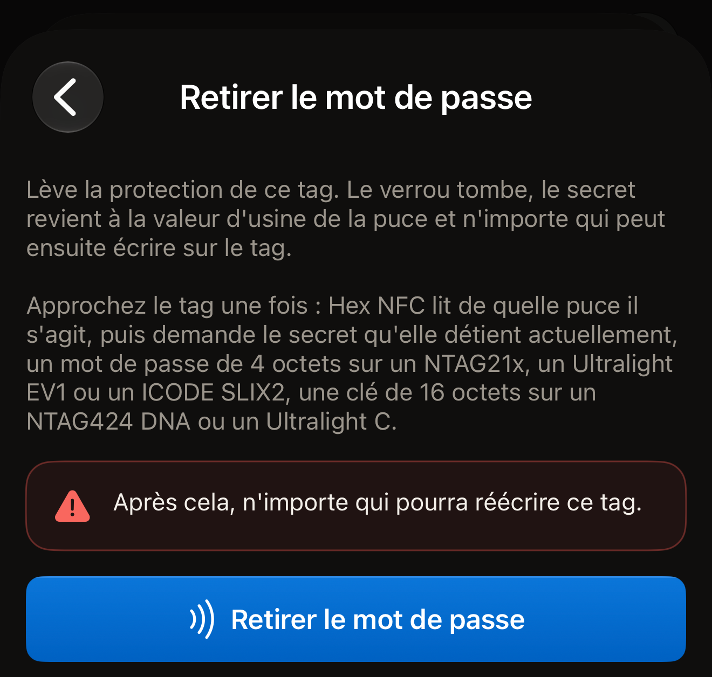
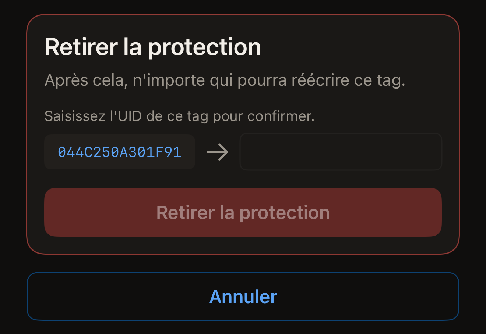
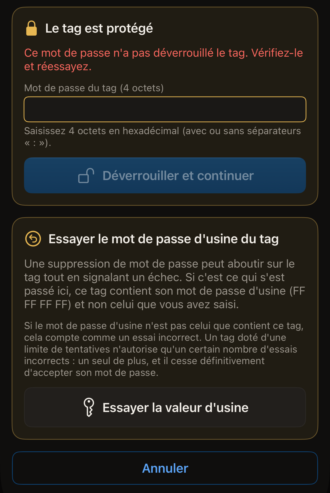

Un mot de passe placé sur un tag peut être retiré, à condition que vous puissiez
encore présenter celui que le tag contient. Une fois qu'il est retiré, n'importe
qui peut lire le tag et écrire dessus, et son mot de passe ou sa clé revient à
la valeur d'usine de la puce.

Avant de commencer, ouvrez Hex NFC sur l'iPhone et scannez le tag pour qu'il
s'affiche sur l'écran « Tag » (consultez [Scanner un tag](scan-a-tag.md)).
Gardez à portée de main le mot de passe qu'il contient. La carte en haut de cet
écran indique la puce sur sa première ligne, au-dessus de l'UID du tag. Ce nom
détermine le type de secret que demande la suppression. Une puce qui ne figure
dans aucun des deux parcours ci-dessous ne porte aucun mot de passe que Hex NFC
puisse retirer, car l'app n'en place jamais sur elle.

## Retirer un mot de passe dans Opérations

Ce parcours couvre toutes les puces que l'app peut protéger. Il ne demande rien
avant le premier passage. Ce passage identifie la puce du tag, puis l'écran
demande le secret que le tag contient actuellement : un mot de passe de 4 octets
sur les puces NTAG21x (NTAG213, NTAG213 TT, NTAG215, NTAG216), MIFARE Ultralight
EV1 ou ICODE SLIX2, et une clé de 16 octets sur un NTAG424 DNA ou un MIFARE
Ultralight C. Le NTAG 210µ n'a pas de mot de passe à retirer. La [matrice de
prise en charge des puces](../developer/chip-support-matrix.md) indique ce que
porte chaque puce.

:::::steps
::::step[Ouvrir Opérations]
Sur l'écran **Tag**, ouvrez le menu en haut à droite, puis touchez
**Opérations…**.
::::

::::step[Ouvrir Retirer le mot de passe]
Touchez **Retirer le mot de passe**.
::::

::::step[Lancer la suppression]
Touchez **Retirer le mot de passe**. L'avertissement au-dessus du bouton indique
ce que coûte la suppression : « Après cela, n'importe qui pourra réécrire ce
tag. »

:::figure[Le bouton **Retirer le mot de passe** à toucher est celui du bas de l'écran, sous l'avertissement.]

:::
::::

::::step[Tenir le tag contre le haut de l'iPhone]
L'app lit l'UID du tag et met fin au passage pour vous laisser saisir.
::::

::::step[Saisir le secret que contient le tag]
Une carte intitulée « Le tag est protégé » demande le secret que le tag contient
actuellement. Saisissez un mot de passe dans **Mot de passe du tag (4 octets)**,
sous la forme de huit caractères hexadécimaux. Sur un NTAG424 DNA, le champ
s'intitule **Clé du tag (AES, 16 octets)**, et sur un MIFARE Ultralight C, **Clé
du tag (3DES, 16 octets)**. Les séparateurs sont ignorés : `FF FF FF FF` et
`FFFFFFFF` sont donc la même valeur.
::::

::::step[Confirmer le tag]
L'écran affiche l'UID du tag à côté du champ, sous « Saisissez l'UID de ce tag
pour confirmer. » Saisissez ces caractères dans le champ, sans séparateurs. La
casse n'a pas d'importance. Touchez **Retirer le mot de passe**, puis tenez à
nouveau le tag contre l'iPhone.
::::
:::::

::include[two-tap-confirmation]

À la fin du second passage, l'écran affiche « Mot de passe retiré. » Le tag est
ouvert. N'importe quel téléphone peut réécrire ses enregistrements. Si le tag
exigeait aussi le mot de passe avant d'afficher quoi que ce soit, cette
protection disparaît en même temps que l'autre.

## Retirer la protection depuis l'écran « Tag »

Sur toute puce que l'app peut protéger, la protection peut aussi être retirée
lors d'une écriture, à condition d'avoir la clé ou le mot de passe que contient
le tag. L'écriture réécrit sur le tag les enregistrements affichés sur l'écran
**Tag**. Après un scan, cette liste correspond à ce que le tag contient déjà :
son contenu est donc conservé, sauf si vous avez vous-même modifié la liste.

:::::steps
::::step[Ouvrir Protection]
Sur l'écran **Tag**, touchez **Protection**.
::::

::::step[Désactiver la protection]
Désactivez **Protéger ce tag avec une clé** sur un tag NTAG424 DNA ou MIFARE
Ultralight C, ou **Protéger ce tag par mot de passe** sur une puce qui accepte
un mot de passe : NTAG21x, MIFARE Ultralight EV1 ou ICODE SLIX2. La note en
dessous indique que la prochaine écriture retire la protection en lecture comme
en écriture et ramène le secret à sa valeur d'usine.
::::

::::step[Conserver la modification]
Touchez **Terminé**.
::::

::::step[Écrire sur le tag]
Sur l'écran **Tag**, touchez **Écrire**, puis tenez le tag contre le haut de
l'iPhone. L'app lit l'UID du tag et vous demande de le ressaisir.
::::

::::step[Confirmer le tag]
Saisissez l'UID affiché à côté du champ, sans séparateurs, en majuscules ou en
minuscules, puis touchez **Retirer la protection**. Tenez à nouveau le tag
contre l'iPhone pour appliquer la modification.

:::figure[La carte **Retirer la protection** affiche l'UID lu par l'app, avec une flèche vers le champ vide où le saisir.]

:::
::::
:::::

L'écriture présente la clé ou le mot de passe que l'app détient déjà pour ce
tag : celui que vous avez saisi sur la carte **Protection**, ou celui que vous
avez utilisé pour le protéger. Pour un tag dont l'app ne détient aucun secret,
l'écriture s'arrête sur « Le tag est protégé » et demande le secret. Le champ
utilisé dépend de la puce :

- Sur un NTAG424 DNA, saisissez-le dans **Clé du tag (AES, 16 octets)**.
- Sur un MIFARE Ultralight C, saisissez-le dans **Clé du tag (3DES, 16
  octets)**.
- Sur un NTAG21x, un MIFARE Ultralight EV1 ou un ICODE SLIX2, saisissez-le dans
  **Mot de passe du tag (4 octets)**.

Touchez ensuite **Déverrouiller et continuer**. Aucun passage supplémentaire
n'est nécessaire, car l'app a déjà lu l'UID du tag. La carte de confirmation s'affiche ensuite. Saisissez l'UID, touchez **Retirer la protection**, puis présentez
à nouveau le tag.

## Si le tag refuse le mot de passe

Sur un NTAG21x ou un MIFARE Ultralight EV1, un passage présente un seul mot de
passe. Un tag qui le refuse cesse de répondre jusqu'à la fin de ce passage.
L'app n'essaie jamais un deuxième mot de passe au cours du même passage.

Quand le tag refuse le mot de passe, la carte « Le tag est protégé » réapparaît
avec le message « Ce mot de passe n'a pas déverrouillé le tag. Vérifiez-le et
réessayez. » Son champ est vide au départ : le mot de passe refusé n'est donc
pas renvoyé, sauf si vous le saisissez. Saisissez le mot de passe, touchez
**Déverrouiller et continuer**, puis présentez à nouveau le tag. **Annuler**
ramène l'écran à son état initial.

Si la suppression échoue pour une autre raison, l'écran propose **Saisir un
autre mot de passe**. Ce bouton ramène l'écran à son état initial, et
l'opération suivante redemande le mot de passe dans un champ vide.

Quand le tag refuse le mot de passe saisi, et que ce mot de passe n'était pas
déjà `FF FF FF FF`, l'app propose un essai précis. Une carte intitulée « Essayer
le mot de passe d'usine du tag » apparaît sous le message d'échec, sur l'écran
**Retirer le mot de passe**. Une suppression peut aboutir sur le tag tout en
signalant un échec. Le tag contient alors `FF FF FF FF` et non le mot de passe
que vous avez saisi. C'est la valeur avec laquelle chaque NTAG21x et chaque
MIFARE Ultralight EV1 sort d'usine. Touchez **Essayer la valeur d'usine** pour
l'envoyer au prochain passage. Tant que ce passage n'a pas eu lieu, l'écran indique quel mot de passe sera envoyé : « Le prochain passage présentera le mot de passe d'usine (FF FF FF FF) et non celui que vous avez saisi. »

:::figure[Après un mot de passe refusé, la carte du mot de passe d'usine se trouve sous la carte « Le tag est protégé », avec **Essayer la valeur d'usine** en bas.]

:::

:::warning
Si le tag ne contient pas la valeur d'usine, ce passage compte comme un essai
incorrect. Un tag doté d'une limite de tentatives n'en autorise qu'un certain
nombre, et un essai de plus le fait cesser définitivement d'accepter son mot de
passe. Consultez [Limiter les essais incorrects de mot de
passe](attempt-limit.md).
:::

Quand la valeur d'usine ouvre le tag, l'app le signale à la fin de l'opération.
Le message est le suivant : « C'est le mot de passe d'usine qui a ouvert ce tag,
donc une suppression précédente avait bien abouti. Le mot de passe que vous
conserviez pour ce tag n'est pas celui qu'il contient. »

## Si la suppression ne se termine pas

Deux passages, ce sont deux occasions pour le tag de s'éloigner trop tôt. L'app
relit la protection du tag avant de signaler quoi que ce soit, si bien que le
message décrit ce que le tag contient désormais :

- « Mot de passe retiré. » est une réussite partout où il apparaît, y compris
  sur un écran qui signale par ailleurs un échec. La relecture a montré que la
  protection a disparu.
- « Ce tag est toujours protégé. Rien n'est perdu : approchez-le à nouveau du
  téléphone pour terminer la suppression du mot de passe. » signifie que la
  relecture a montré que la protection est toujours active. Relancez la
  suppression avec le même mot de passe.
- « Impossible de confirmer si le mot de passe a été supprimé. Approchez à
  nouveau le tag du téléphone pour vérifier. » signifie que le tag est sorti de
  portée avant que l'app ait pu relire sa protection. Relancez la suppression
  pour savoir où en est le tag.

Si aucun des mots de passe dont vous disposez n'ouvre le tag, sa mémoire
protégée reste en l'état. [Protection des tags](tag-protection.md) explique
pourquoi un mot de passe perdu est irrécupérable.

## Voir aussi

- [Protection des tags](tag-protection.md)
- [Protéger un tag par mot de passe](protect-a-tag.md)
- [Limiter les essais incorrects de mot de passe](attempt-limit.md)
- [Si un tag ne peut être ni scanné ni écrit](troubleshooting.md)
