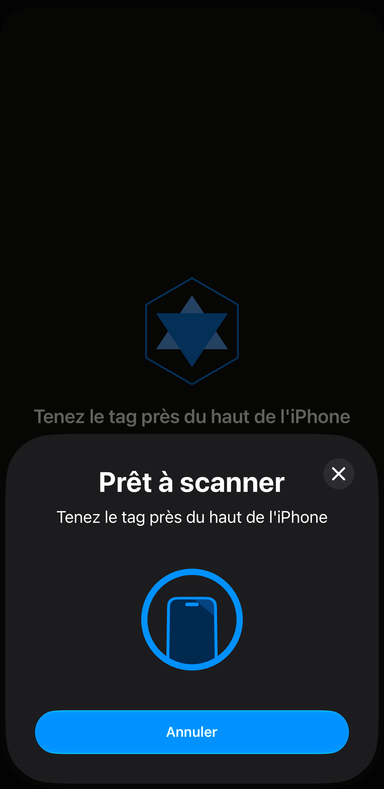
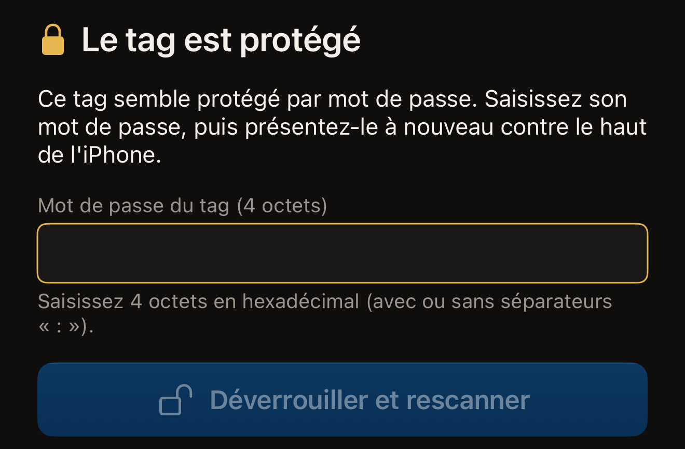
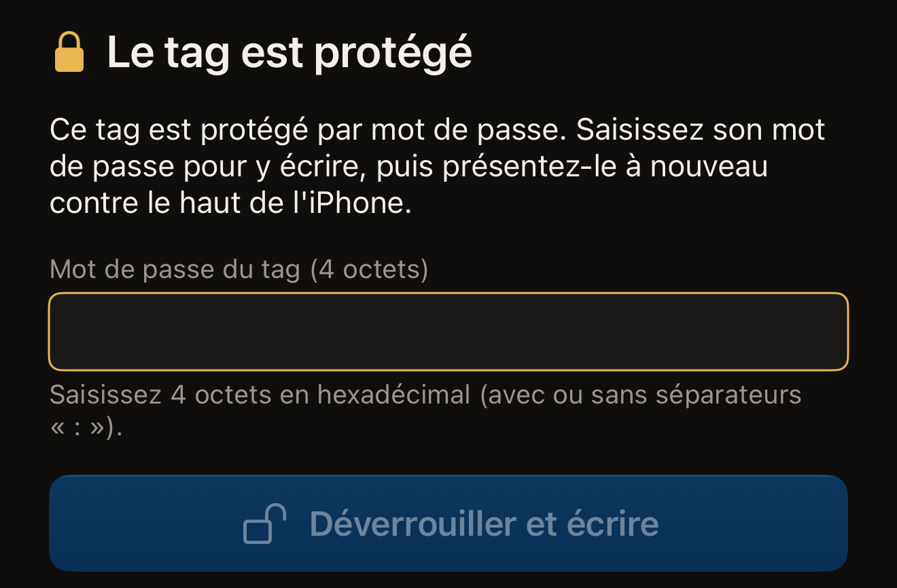

Hex NFC lit un tag en un seul passage. Vous touchez **Scanner**, vous tenez
le tag contre le haut de l'iPhone, et l'app indique quelle puce elle a
trouvée et ce que contient le tag. Un scan ne fait que lire : rien ne change
sur le tag.

Un tag peut aussi être configuré pour exiger son mot de passe avant de se
laisser lire. Un tag protégé de cette façon refuse la lecture tant que le
mot de passe n'a pas été présenté. Le présenter demande deux passages au
lieu d'un. La seconde moitié de cette page traite de ce cas. La plupart des
tags protégés ne le sont qu'en écriture. Ceux-là se scannent en un passage,
comme n'importe quel autre tag. Si vous n'avez encore jamais scanné de tag,
[Lire votre premier tag](quick-start.md) reprend ce même passage depuis le
début.

## Scanner un tag

:::::steps
::::step[Ouvrir l'écran de scan]
Ouvrez Hex NFC et touchez **Scanner** sur son écran d'accueil. L'écran de
scan s'ouvre et affiche « Tenez le tag près du haut de l'iPhone ».

:::figure[Pendant que l'app attend un tag, sa propre ligne reste au-dessus du panneau de scan d'iOS, et le bouton Annuler du panneau arrête le scan.]

:::
::::

::::step[Tenir le tag contre le haut de l'iPhone]
Posez le haut de l'iPhone sur le tag et maintenez-le immobile. L'écran
affiche « Lecture… » pendant la lecture du tag.
::::

::::step[Lire ce que l'app a trouvé]
« Tag détecté » apparaît avec une coche, et le nom de la puce s'affiche
juste en dessous. Plus bas, l'app indique ce qu'elle a lu. La ligne « 1
enregistrement trouvé » donne le nombre d'enregistrements présents sur le
tag. « Aucun enregistrement NDEF sur ce tag » signifie que le tag est
formaté mais vide. L'UID du tag vient en dernier.
::::
:::::

Le résultat reste affiché environ une seconde, puis l'app ouvre l'écran
**Tag** avec la liste des enregistrements, où vous pouvez les modifier ou
les écrire à nouveau. Aucune information du résultat n'y est perdue. Le nom
de la puce sert de titre à la carte d'informations du tag, et les
enregistrements forment la liste en dessous. L'UID figure sur une ligne de
cette carte : touchez-la à tout moment pour le copier. Chaque scan est aussi
enregistré dans votre historique. Consultez [Retrouver un tag scanné
auparavant](scan-history.md) et [Modifier les enregistrements d'un
tag](edit-records.md).

Pour arrêter avant qu'un tag soit lu, touchez Annuler sur le panneau de scan
d'iOS. L'écran de scan se ferme et vous revenez à l'écran d'accueil de Hex NFC.
Si aucun tag n'est approché de l'iPhone, le panneau de scan d'iOS se ferme de
lui-même au bout d'une minute environ, et l'écran de scan affiche « Aucun tag
trouvé » avec **Annuler** et **Réessayer** en dessous.

Certains tags quittent l'écran de scan par un autre chemin. Une carte de
transport japonaise ouvre son propre résultat, en lecture seule, décrit dans
[Lire une carte de transport](transit-cards.md). Un passeport électronique
demande d'abord les informations de sa page photo, comme l'explique [Lire un
passeport](passports.md). Un appareil de santé NFC, comme un stylo à insuline,
ouvre un écran **Appareil de santé** en lecture seule et n'est pas enregistré,
comme l'explique [Appareils de santé](tags-that-work.md#health-devices). Un tag
protégé demande son mot de passe : c'est l'objet de la tâche suivante.

Si le résultat indique « Ce tag n'est pas encore formaté », rien de ce que
vous écrirez sur le tag ne sera lisible tant qu'il n'aura pas été formaté.
[Effacer ou formater un tag](erase-or-format.md) explique comment faire.

## Déverrouiller un tag protégé {#unlock-a-protected-tag}

Un tag qui exige son mot de passe pour être lu interrompt le scan. L'écran
de scan affiche « Le tag est protégé » au-dessus de cette phrase : « Ce tag
semble protégé par mot de passe. Saisissez son mot de passe, puis
présentez-le à nouveau contre le haut de l'iPhone. » En dessous se trouvent
le champ du mot de passe, **Déverrouiller et rescanner**, et une ligne avec
**Annuler** et **Réessayer**. Le mot de passe appartient au tag, pas à un
compte, et seule la personne qui l'a défini le connaît. Le réglage qui
produit cet état est **Exiger aussi le mot de passe en lecture**, décrit
dans [Protéger un tag par mot de passe](protect-a-tag.md).

:::::steps
::::step[Saisir le mot de passe du tag]
Dans **Mot de passe du tag (4 octets)**, saisissez le mot de passe en
caractères hexadécimaux, de 0 à 9 et de A à F. Un mot de passe de 4 octets
compte 8 caractères : saisissez-le sous la forme `A1B2C3D4` ou
`A1:B2:C3:D4`, car les deux-points entre les octets sont facultatifs et ne
comptent pas dans la longueur. La note sous le champ affiche « OK » dès que
la saisie a la bonne longueur.

:::figure[Un tag protégé arrête le scan sur **Mot de passe du tag (4 octets)**, et **Déverrouiller et rescanner** reste grisé tant que la saisie n'a pas la bonne longueur.]

:::

Sur un NTAG424 DNA, le champ s'intitule plutôt **Clé du tag (AES, 16
octets)**. Sur un MIFARE Ultralight C, il s'intitule **Clé du tag (3DES, 16
octets)**. Ces deux puces s'ouvrent avec une clé, et non avec un mot de
passe. Ces deux clés font 16 octets, soit 32 caractères.
::::

::::step[Lancer le second passage]
Touchez **Déverrouiller et rescanner**. Le bouton reste grisé tant que votre
saisie n'a pas la bonne longueur pour la puce.
::::

::::step[Tenir à nouveau le tag contre le haut de l'iPhone]
L'app présente le mot de passe, puis lit le tag et affiche « Tag détecté »,
comme pour n'importe quel autre tag.
::::
:::::

Si le tag refuse le mot de passe, vous revenez à « Le tag est protégé », et
la demande est remplacée par « Ce mot de passe n'a pas déverrouillé le tag.
Vérifiez-le et réessayez. » Sur un NTAG424 DNA ou un MIFARE Ultralight C, le
message est plutôt « Cette clé n'a pas déverrouillé le tag. Vérifiez-la et
réessayez. » Corrigez la saisie et touchez **Déverrouiller et rescanner**
pour un nouveau passage. Un mot de passe refusé empêche la puce de répondre
jusqu'à la fin de ce passage. Par conception, chaque tentative correspond à
un nouveau passage. Pour revenir à une lecture ordinaire, sans mot de passe,
touchez **Réessayer**. **Annuler** fait autre chose : il ferme l'écran de
scan sans lire le tag, et ce que vous avez saisi est supprimé. Ni l'un ni
l'autre ne modifie le tag.

:::warning[Un mot de passe refusé peut vous coûter un essai]
Un tag peut être configuré pour n'accepter qu'un certain nombre de mots de
passe incorrects avant de cesser définitivement d'accepter son mot de passe.
Sur un tag qui signale une telle limite, l'app remplace le conseil ci-dessus par le texte
propre à ce refus. Mieux vaut vérifier à nouveau le mot de passe que tenter
un essai de plus. Consultez [Limiter les essais incorrects de mot de
passe](attempt-limit.md).
:::

## Déverrouiller un tag protégé avant d'écrire dessus

Une écriture commence sur l'écran **Tag**. Un tag protégé atteint l'écran
**Tag** par le déverrouillage décrit ci-dessus. Terminez d'abord ce scan, et
l'app ouvre l'écran **Tag** comme pour n'importe quel autre tag. Deux
chemins évitent cette lecture. Dans **Bibliothèque**, l'onglet
**Historique** liste les tags que vous avez déjà scannés, et toucher une
ligne rouvre ce tag sur l'écran **Tag**. Sur l'onglet **Préréglages**,
balayer un préréglage de gauche à droite fait apparaître **Écrire**, qui
ouvre directement l'écran d'écriture avec les enregistrements du préréglage.

Sur l'écran **Tag**, touchez **Écrire** dans la barre d'outils : l'écran
d'écriture s'ouvre. [Écrire un lien sur un tag](write-a-link.md) décrit une
écriture de bout en bout ; ce qui suit est l'étape supplémentaire qu'ajoute
un tag protégé.

L'écran d'écriture redemande le mot de passe, même pour un tag que vous
venez de déverrouiller. Chaque passage est une session distincte, et l'app
ne conserve aucun mot de passe d'une session à l'autre. Le saisir une
seconde fois est normal et ne signifie pas que le déverrouillage a échoué.
En partant de zéro, un tag protégé demande trois passages : le scan qu'il
refuse, le scan de déverrouillage qui ouvre l'écran **Tag**, puis
l'écriture. L'écran affiche « Le tag est protégé », puis demande le mot de
passe : « Ce tag est protégé par mot de passe. Saisissez son mot de passe
pour y écrire, puis présentez-le à nouveau contre le haut de l'iPhone. »

:::::steps
::::step[Saisir le mot de passe sur l'écran d'écriture]
Dans **Mot de passe du tag (4 octets)**, saisissez le mot de passe du tag,
les mêmes 8 caractères hexadécimaux que demande un scan. Sur les deux puces
qui utilisent une clé, le champ demande une clé plutôt qu'un mot de passe,
et une clé compte 32 caractères.

:::figure[Sur l'écran d'écriture, la demande porte sur le mot de passe pour écrire, et le bouton indique **Déverrouiller et écrire** au lieu de **Déverrouiller et rescanner**.]

:::
::::

::::step[Lancer le second passage de l'écriture]
Touchez **Déverrouiller et écrire**. Si l'écriture modifie aussi la
protection du tag, le bouton indique plutôt **Déverrouiller et continuer**.
L'app vous montre alors l'UID du tag et vous demande de le saisir, sous
« Saisissez l'UID de ce tag pour confirmer. », avant d'écrire. Consultez
[Protéger un tag par mot de passe](protect-a-tag.md).
::::

::::step[Approcher le tag pour écrire dessus]
Tenez à nouveau le tag contre le haut de l'iPhone. L'app présente le mot de
passe, puis écrit.
::::
:::::

Ici aussi, un refus affiche « Ce mot de passe n'a pas déverrouillé le tag.
Vérifiez-le et réessayez. », et la réponse est la même : vérifiez votre
saisie, puis présentez à nouveau le tag.

Un scan peut se terminer par « Échec du scan ». Un tag que vous croyez vide
peut demander un mot de passe. Dans les deux cas, suivez [Si un tag ne peut
être ni scanné ni écrit](troubleshooting.md).
