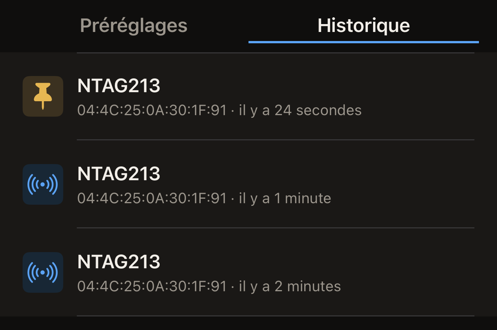

Hex NFC conserve une copie des tags qu'il lit : vous pouvez donc rouvrir un
scan sans avoir le tag à proximité. Vos scans récents se trouvent dans la
bibliothèque, sur l'iPhone, du plus récent au plus ancien. Épinglez ceux que
vous voulez garder.

## Rouvrir un scan effectué auparavant

Il vous faut un tag que vous avez déjà lu ; tant que vous n'en avez scanné
aucun, **Historique** est vide. Consultez [Scanner un tag](scan-a-tag.md).

:::::steps
::::step[Ouvrir Hex NFC]
L'app s'ouvre sur son écran d'accueil, qui porte les tuiles **Scanner**,
**Composer**, **Bibliothèque** et **Avancé**.
::::

::::step[Ouvrir la bibliothèque]
Touchez **Bibliothèque**. L'écran « Bibliothèque » s'ouvre sur **Préréglages**.
::::

::::step[Afficher vos scans]
En haut de l'écran « Bibliothèque », touchez **Historique**, à droite de
**Préréglages**. Chaque ligne commence par le nom de la puce, avec en dessous
l'UID du tag et le temps écoulé depuis sa lecture.

:::figure[Chaque ligne indique la puce, puis l'UID du tag et le temps écoulé depuis sa lecture ; sur un scan épinglé, une épingle remplace l'icône.]

:::
::::

::::step[Ouvrir le scan]
Touchez le scan voulu. La bibliothèque se ferme et le scan s'ouvre sur l'écran « Tag », avec les enregistrements et les détails de la puce issus du passage qui
l'a produit.
::::
:::::

Une carte de transport s'ouvre plutôt sur l'écran « Carte de transport », en
lecture seule, comme lors de la lecture de la carte. La lecture d'un passeport
n'est jamais enregistrée : aucun passeport n'apparaît donc dans cette liste.
Consultez [Lire un passeport](passports.md). Un appareil de santé n'est jamais
enregistré non plus.

## Épingler un scan à conserver

La liste contient 50 scans. Quand un nouveau scan arrive alors que la liste est
pleine, le plus ancien scan non épinglé disparaît en fin de liste. Un scan non
épinglé disparaît aussi 90 jours après la lecture qui l'a créé, même si la
liste est courte. Lorsqu'un nouveau scan retombe sur une ligne existante, il
compte comme une nouvelle lecture et le délai de 90 jours repart de zéro. Un
scan épinglé échappe à ces deux règles et reste jusqu'à ce que vous le
supprimiez.

Les scans sont classés du plus récent au plus ancien et l'écran ne propose
aucune recherche : épinglez donc ceux que vous voudrez retrouver.

- Pour épingler un scan, balayez-le vers la droite dans **Historique**, puis
  touchez **Épingler**.

Un scan épinglé porte une épingle à gauche de sa ligne, à la place de l'icône
habituelle. Il garde sa place dans la liste au lieu de remonter en haut. Sur un
scan déjà épinglé, la même action de balayage affiche **Détacher**, et détacher
le scan le fait de nouveau entrer dans le compte des 50.

## Supprimer un scan

- Pour supprimer un scan, balayez-le vers la gauche dans **Historique**, puis
  touchez **Supprimer**. Un balayage mené jusqu'au bout supprime le scan
  immédiatement.

:::warning
Le scan disparaît dès que vous touchez **Supprimer**. Aucune confirmation n'est
demandée et il est impossible de le récupérer, mais lire de nouveau le tag crée
un nouveau scan.
:::

## Ce que contient l'historique

Avant toute lecture, **Historique** affiche « Aucun historique de scan »,
au-dessus de la ligne « Les 50 derniers tags scannés apparaissent ici.
Épinglez-en un pour le conserver. »

- Lire de nouveau le même tag, sans que rien n'y ait changé, fait remonter le
  scan existant en haut de la liste. Aucune deuxième ligne n'apparaît. Toute
  différence dans les détails de la puce, les enregistrements ou la protection
  par mot de passe du tag crée au contraire une nouvelle ligne.
- Les scans restent sur cet iPhone. Ils ne parviennent à votre compte iCloud
  que si vous activez l'option **Synchronisation iCloud**, désactivée au
  départ. Consultez [Confidentialité et vos données](privacy.md).

## Voir aussi

- [Scanner un tag](scan-a-tag.md)
- [Modifier les enregistrements d'un tag](edit-records.md)
- [Enregistrer un tag comme préréglage](presets.md)
