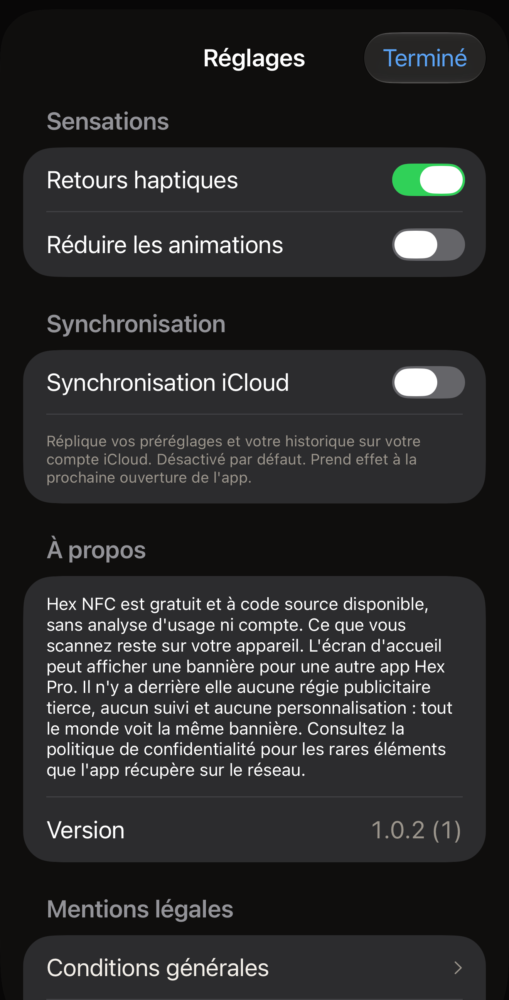

Hex NFC propose trois réglages, qui partagent un même écran avec le numéro de
version de l'app, un moyen d'envoyer un commentaire ou de noter l'app, et ses
documents juridiques. Sur l'écran d'accueil de Hex NFC,
touchez le bouton en forme d'engrenage en haut à droite ; il ne porte aucun
texte, et VoiceOver le désigne par **Réglages**. Le panneau qui s'ouvre
s'intitule **Réglages**. Les groupes ci-dessous suivent l'ordre de l'écran.

:::figure[Le panneau **Réglages** s'ouvre sur **Sensations** et **Synchronisation**, avec chaque interrupteur à sa valeur par défaut.]

:::

## Sensations

:::table[Réglages du groupe Sensations]
| Réglage | Effet | Par défaut |
| :--- | :--- | :--- |
| **Retours haptiques** | Fait vibrer l'iPhone pendant un scan, une écriture et les autres moments que l'app souligne. Le désactiver arrête aussitôt ces vibrations. | Activé |
| **Réduire les animations** | Atténue les animations de l'app. :more[L'app réduit les animations lorsque cet interrupteur ou le réglage Réduire les animations de l'iPhone lui-même est activé : désactiver celui-ci n'annule donc pas le réglage du système.] | Désactivé |
:::

Lorsque le réglage Réduire les animations de l'iPhone est activé, la mention
“« Réduire les animations » est activé sur le système : les animations sont
déjà réduites au minimum.” apparaît sous la ligne.

## Synchronisation

:::table[Réglages du groupe Synchronisation]
| Réglage | Effet | Par défaut |
| :--- | :--- | :--- |
| **Synchronisation iCloud** | Réplique vos préréglages et votre historique de scan sur votre compte iCloud. Les mots de passe des tags ne sont jamais répliqués. Ils restent dans le trousseau de l'iPhone qui les a définis. | Désactivé |
:::

Hex NFC construit sa bibliothèque une seule fois, au lancement : activer ou
désactiver **Synchronisation iCloud** ne change donc rien tant que vous n'avez
pas fermé puis rouvert l'app. Le texte sous la ligne le signale. Fermer l'app
signifie la quitter. Revenir à l'écran d'accueil de l'iPhone laisse Hex NFC en
cours d'exécution, et l'interrupteur que vous avez déplacé reste sans effet.

### Activer la synchronisation iCloud {#turn-on-icloud-sync}

::::steps
:::step[Ouvrir les réglages de Hex NFC]
Dans Hex NFC, sur l'écran d'accueil de l'app, touchez le bouton en forme
d'engrenage en haut à droite.
:::

:::step[Activer la synchronisation iCloud]
Activez **Synchronisation iCloud**. L'interrupteur bascule, et rien d'autre ne
change pour l'instant.
:::

:::step[Fermer Hex NFC et le rouvrir]
Suivez [Fermer et rouvrir l'app](#close-and-reopen-the-app). L'app reconstruit
sa bibliothèque au démarrage, cette fois avec la synchronisation en marche.
:::

:::step[Vérifier l'absence d'avertissement]
Touchez de nouveau le bouton en forme d'engrenage et regardez sous
**Synchronisation iCloud**. L'explication indique « Réplique vos préréglages et
votre historique sur votre compte iCloud. Désactivé par défaut. Prend effet à
la prochaine ouverture de l'app. » Si un deuxième paragraphe la suit, la
synchronisation n'a pas démarré ; consultez
[Si la synchronisation ne démarre pas](#when-sync-does-not-start).
:::
::::

### Fermer et rouvrir l'app {#close-and-reopen-the-app}

::::steps
:::step[Fermer Hex NFC]
Balayez vers le haut depuis le bord inférieur de l'écran et marquez une pause
jusqu'à ce que les apps ouvertes apparaissent. Sur un iPhone doté d'un bouton
principal, appuyez plutôt deux fois sur ce bouton. Balayez ensuite vers le haut
la carte de Hex NFC : elle quitte l'écran.
:::

:::step[Rouvrir Hex NFC]
Touchez l'icône de Hex NFC. L'app reconstruit sa bibliothèque au démarrage,
selon la position de **Synchronisation iCloud** au moment où vous l'avez
fermée.
:::
::::

Désactiver de nouveau **Synchronisation iCloud** demande la même fermeture
suivie d'une réouverture. Dans les deux cas, vos préréglages et votre
historique restent sur cet iPhone. Hex NFC ne supprime pas ce qu'iCloud
contient déjà. Un autre iPhone connecté au même compte conserve tout ce qu'il a
reçu. Ce qui s'arrête, c'est l'envoi de nouvelles modifications depuis
celui-ci.

### Si la synchronisation ne démarre pas {#when-sync-does-not-start}

Si l'interrupteur est activé et qu'iCloud était inaccessible au démarrage de
l'app, la synchronisation ne démarre pas. Un deuxième texte apparaît sous la
ligne : « La synchronisation ne fonctionne pas. Votre bibliothèque est en
sécurité sur cet appareil, mais iCloud était indisponible au démarrage de
l'app. Vérifiez que vous êtes connecté à iCloud, puis rouvrez l'app. » Vos
préréglages et votre historique sont toujours sur l'iPhone. Seule la
réplication s'est arrêtée.

Ce message a trois causes possibles :

- L'iPhone n'est pas connecté à iCloud.
- Le compte n'a plus d'espace de stockage iCloud.
- L'iPhone n'avait pas de réseau au démarrage de Hex NFC.

Vérifiez-les dans l'ordre.

::::steps
:::step[Vérifier votre compte iCloud]
Ouvrez l'app Réglages de l'iPhone et touchez votre nom en haut. Connectez-vous
si on vous le demande, puis touchez la ligne iCloud et regardez l'espace de
stockage restant. S'il n'en reste plus, libérez de l'espace ou changez de
forfait de stockage sur cet écran.
:::

:::step[Vérifier le réseau]
Assurez-vous que l'iPhone est connecté au Wi-Fi ou aux données cellulaires.
Charger une page dans Safari permet d'en avoir le cœur net.
:::

:::step[Fermer Hex NFC et le rouvrir]
Laissez l'option **Synchronisation iCloud** activée et suivez
[Fermer et rouvrir l'app](#close-and-reopen-the-app), puis touchez le bouton en
forme d'engrenage sur l'écran d'accueil de Hex NFC. Si un deuxième paragraphe
figure encore sous **Synchronisation iCloud**, la synchronisation n'a
toujours pas démarré.
:::
::::

## À propos

La section À propos indique ce que fait l'app et ce qu'elle ne fait pas : aucune
analyse d'usage, aucun compte, et ce que vous scannez reste sur votre appareil.
Elle évoque aussi la bannière que l'écran d'accueil de l'app peut afficher pour
une autre app Hex Pro. Il n'y a derrière cette bannière aucune régie
publicitaire tierce, aucun suivi et aucune personnalisation. Tout le monde voit
la même bannière. Pour les rares éléments que l'app récupère sur le réseau,
lisez [Confidentialité et vos données](privacy.md).

Sous ce paragraphe, **Version** affiche le numéro de version de l'app, suivi de
son numéro de build entre parenthèses.

## Commentaires et notes {#feedback-and-ratings}

**Envoyer un commentaire**, sous **Version**, ouvre un formulaire pour écrire un
message à Hex Pro.

1. Dans la zone de message, écrivez ce qui ne va pas ou ce qui pourrait être
   amélioré.
2. Pour obtenir une réponse, indiquez votre adresse e-mail sous
   **Adresse de réponse (facultatif)**. Si vous la laissez vide, le message part
   sans adresse.
3. Vérifiez la liste sous **Envoyé avec votre message**. Elle indique la version
   de l'app, la version d'iOS, le modèle de l'appareil et la langue qui
   accompagnent votre message. Rien de vos tags, de vos scans ni de votre
   historique de scan n'est envoyé.
4. Touchez **Envoyer** en haut à droite.

Le formulaire vous remercie une fois le message parti. S'il ne parvient pas à
joindre Hex Pro, il garde ce que vous avez saisi et propose
**Nous écrire par e-mail**, qui ouvre votre app de messagerie avec le message et
les mêmes informations déjà remplis.

**Noter Hex NFC** ouvre la page de l'app sur l'App Store, où vous pouvez lui
attribuer une note ou rédiger un avis.

De temps en temps, l'écran d'accueil de Hex NFC demande
**Vous aimez Hex NFC ?** dans une carte le long de son bord inférieur. Cette
carte n'apparaît qu'après quelques écritures ou changements de protection
réussis, ou après la lecture d'une carte de transport ou d'un passeport complet,
et seulement si aucun de vos scans récents n'a échoué. Elle attend que l'écran
d'accueil soit resté sans interaction pendant dix secondes, revient au plus une
fois par mois et ne masque jamais rien dont vous avez besoin : l'écran
au-dessus défile toujours et chaque bouton fonctionne.

Touchez **J'adore !** et le panneau de notation d'Apple s'affiche, si iOS
choisit de le montrer. Touchez **Bof.** et la carte propose plutôt
**Envoyer un commentaire**. L'une ou l'autre réponse est définitive, et la carte
ne repose plus la question. **Masquer** la range pour un mois, et ouvrir quoi
que ce soit depuis l'écran d'accueil pendant qu'elle est affichée a le même
effet.

## Mentions légales

**Conditions générales** et **Politique de confidentialité** ouvrent chacun le
document complet dans une carte de lecture, que vous faites défiler puis fermez
avec **Terminé**. Chaque carte porte deux lignes au-dessus du premier titre :
la date d'entrée en vigueur de cette version, et « Ars Vitae Pty Ltd, trading
as Hex Pro (Australia) ». Les deux documents sont en anglais, quelle que soit la
langue du reste de l'app.

Les conditions générales indiquent ce que coûte l'app, dans la section
intitulée « 3. The app is free », et [Questions fréquentes](faq.md) y répond
également. La politique de confidentialité est le document sur lequel repose
[Confidentialité et vos données](privacy.md).

## Voir aussi

- [Enregistrer un tag comme préréglage](presets.md)
- [Retrouver un tag scanné auparavant](scan-history.md)
- [Confidentialité et vos données](privacy.md)
