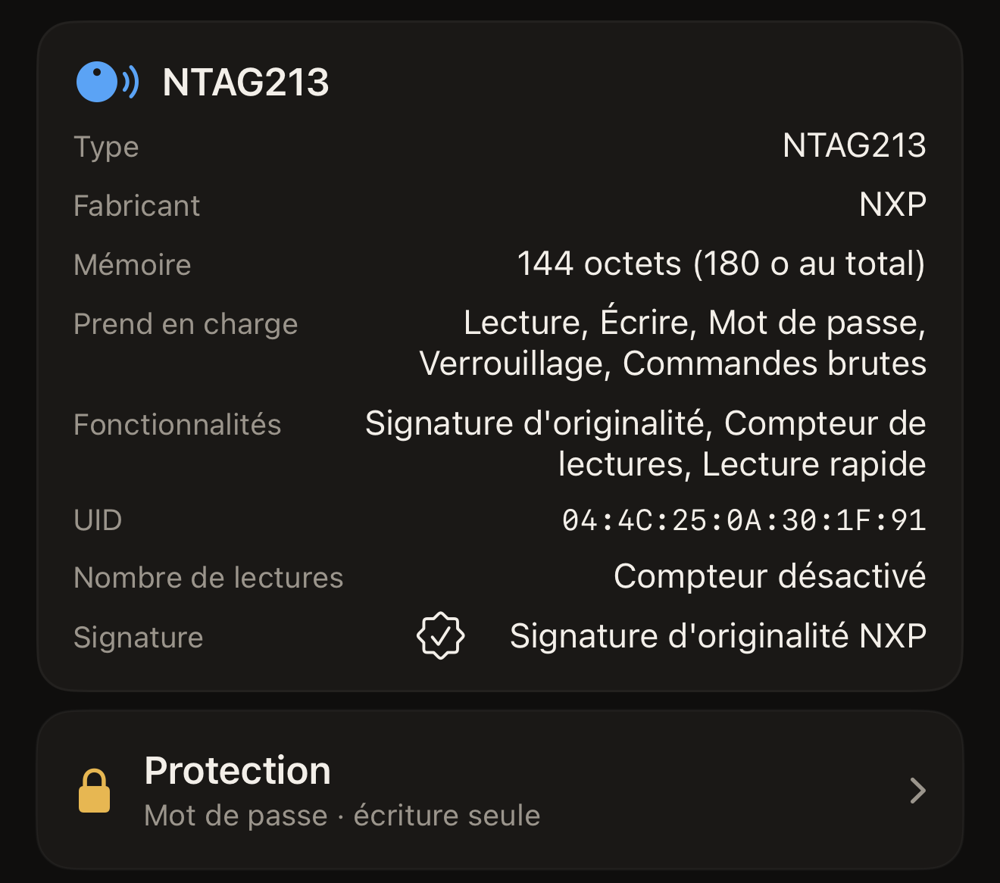

Un tag collé sur une affiche répond à tous les téléphones qui s'en approchent,
et une puce non protégée laisse n'importe lequel d'entre eux écraser ce que vous
y avez écrit. La protection est la réponse qu'apporte la puce elle-même. Le
secret se trouve dans les pages de configuration de la puce, et la puce refuse
toute modification tant que ce secret n'a pas été présenté. Hex NFC peut définir
ce secret depuis l'iPhone, le présenter lors d'un scan ultérieur, puis le
retirer. La protection appartient au tag, pas à l'app.

## Ce que refuse un tag protégé

Par défaut, la protection porte sur l'écriture. Un tag ainsi protégé reste
lisible par n'importe quel téléphone, ce qui convient à une affiche ou à une
carte de visite. Les gens y approchent leur téléphone et obtiennent le lien, et
personne d'autre ne le modifie. Deux familles de puces peuvent étendre la
protection à la lecture, ce qui change ce que permettra tout scan ultérieur.

[Scanner un tag](scan-a-tag.md). Sur une puce qui prend en charge la protection,
l'écran « Tag » s'ouvre avec deux cartes. La carte d'informations du tag indique
la puce que vous avez en main. C'est sur la carte **Protection** que se règle la
protection. Touchez **Protection** et le panneau du même nom s'ouvre, avec ses
réglages. [Protéger un tag par mot de passe](protect-a-tag.md) décrit comment la
mettre en place.

La protection en lecture est réservée à deux familles. Sur un NTAG213, NTAG215,
NTAG216 ou MIFARE Ultralight EV1, le réglage s'appelle **Exiger aussi le mot de
passe en lecture**, sous **Avancé**. L'activer étend la protection à la lecture.
Le panneau en énonce clairement la conséquence : « Les tags protégés en lecture
ne peuvent pas être relus, vérification comprise, sans le mot de passe. » Sur un
NTAG424 DNA, le réglage s'appelle **Exiger aussi la clé en lecture**. Il se
trouve à côté de la clé elle-même, et non sous **Avancé**. Un ICODE SLIX2 et un
MIFARE Ultralight C n'ont pas ce réglage : leur secret protège l'écriture, et la
lecture reste libre.

Sur l'écran « Tag », la carte **Protection** résume en une ligne ce que le scan
a trouvé. « Désactivée » signifie que le scan a établi qu'aucun secret n'est
défini. « Mot de passe · écriture seule » signifie que l'écriture est protégée
et la lecture libre, et « Mot de passe · lecture et écriture », que les deux
sont protégées. La quatrième réponse, « Inconnue · impossible de lire la
protection de ce tag », n'équivaut pas à « Désactivée » : le tag ne l'a pas
indiqué. Scannez à nouveau le tag : un passage interrompu trop tôt laisse l'app
sans réponse. Une puce dont l'app ne peut pas interroger la protection donne la
même réponse à chaque fois. Essayer d'écrire sur un tel tag reste sans risque.
Un tag protégé refuse l'écriture, et l'écran d'écriture demande le secret au
lieu de modifier quoi que ce soit. Si vous scannez un tag protégé en lecture
sans avoir le mot de passe, vous obtenez « Ce tag exige son mot de passe avant
d'afficher quoi que ce soit. »

:::figure[La carte d'informations du tag indique la puce, et la carte **Protection**, en dessous, donne le résumé, ici « Mot de passe · écriture seule ».]

:::

## Quelles puces peuvent porter un secret

La forme du secret dépend de la puce, tout comme le champ dans lequel l'app vous
le demande. Ce champ se trouve dans la demande de déverrouillage, qui apparaît quand un tag
vous refuse l'accès. Un tag protégé qui ne répond pas à un scan affiche « Le tag
est protégé » au-dessus du champ, avec **Déverrouiller et rescanner** en
dessous. Une écriture sur un tag protégé vous le demande de la même façon avant
de continuer.

:::table[La forme du secret selon la famille de puces]
| Puce | Le secret | Le champ de la demande de déverrouillage |
| --- | --- | --- |
| NTAG213, NTAG215, NTAG216, MIFARE Ultralight EV1 | Un mot de passe de 4 octets | **Mot de passe du tag (4 octets)** |
| NTAG424 DNA | Une clé AES de 16 octets | **Clé du tag (AES, 16 octets)** |
| MIFARE Ultralight C | Une clé 3DES de 16 octets, écriture seule | **Clé du tag (3DES, 16 octets)** |
| ICODE SLIX2 | Un mot de passe de 4 octets, écriture seule | **Mot de passe du tag (4 octets)** |
:::

Chacun de ces champs attend le secret en hexadécimal, à raison de deux
caractères par octet : 8 caractères pour un mot de passe de 4 octets, 32 pour
une clé de 16 octets. Les espaces ou les deux-points entre les octets sont
acceptés, de même que les majuscules comme les minuscules : `FF FF FF FF` et
`ffffffff` sont donc un même mot de passe saisi de deux façons. Le champ affiche
« OK » dès qu'il contient le bon nombre d'octets, et d'ici là il rappelle
combien il en attend.

Une puce scannée qui ne dispose d'aucun mécanisme de mot de passe n'a pas de
carte **Protection**, sauf si le scan a trouvé des bits de verrouillage gravés.
Un verdict de verrouillage fait alors réapparaître la carte pour l'afficher.
Elle indique « Verrouillé définitivement », « Partiellement verrouillé · une
partie de ce tag est en lecture seule définitivement » ou « Verrouillage écrit ·
scannez à nouveau pour confirmer ». Sur un tag verrouillé, la carte affiche son
verdict sans s'ouvrir. La carte figure aussi sur l'écran « Tag » avant tout
scan : c'est ainsi qu'un préréglage reçoit des réglages de protection. La puce
que vous tenez reste indiquée sur la carte d'informations du tag. [Tags
compatibles avec Hex NFC](tags-that-work.md) décrit le reste de ce que chacune
permet. Le tableau complet, puce par puce, se trouve dans la [matrice de prise
en charge des puces](../developer/chip-support-matrix.md).

Sur un MIFARE Ultralight C, une protection en lecture masque précisément les
pages à partir desquelles l'app identifie la puce. Un tag ainsi protégé ne
pourrait plus jamais être reconnu, et encore moins déverrouillé. L'app dit en toutes lettres que la protection se limite à l'écriture : « Hex NFC peut protéger ce tag en
écriture, mais pas en lecture. »

## Pourquoi la perte d'un mot de passe est définitive

Rien du secret d'un tag ne peut être récupéré de l'extérieur. Pour un mot de
passe de 4 octets, l'avertissement de l'app dit tout : « Si vous perdez le mot
de passe, la mémoire protégée est perdue. Aucune récupération possible. » Les
puces à clé disent la même chose plus longuement : « Si vous perdez cette clé,
vous ne pourrez plus jamais réécrire ce tag. Il n'existe pas de réinitialisation
d'usine pour un NTAG424. Conservez-la en lieu sûr. » et « Si vous perdez cette
clé, la mémoire protégée ne pourra plus jamais être réécrite. L'Ultralight C n'a
pas de réinitialisation d'usine. Conservez-la en lieu sûr. » Le mot de passe
d'un SLIX2 ne peut être réinitialisé qu'en présentant le mot de passe actuel, si
bien que le perdre mène au même résultat.

Hex NFC conserve un secret enregistré avec un préréglage à un seul endroit :
« Le secret est stocké uniquement sur cet appareil (trousseau). Il n'est jamais
synchronisé ni inclus dans un export. » Un préréglage partagé avec quelqu'un
d'autre, ou restauré sur un autre iPhone, arrive donc sans le mot de passe.
[Enregistrer un tag comme préréglage](presets.md) explique ce que cela implique si vous réutilisez un préréglage sur toute une
série de tags. Conservez votre
propre copie en lieu sûr.

## Modifier la protection demande deux passages

::include[two-tap-confirmation]

Inutile d'aller chercher cet UID. L'app l'affiche à côté du champ, sous
« Saisissez l'UID de ce tag pour confirmer. », en une suite de caractères
hexadécimaux sans séparateurs. Majuscules et minuscules sont acceptées. Définir
un secret et le retirer sont deux modifications du tag : toutes deux passent par
cette confirmation.

## Voir aussi

- [Scanner un tag](scan-a-tag.md)
- [Protéger un tag par mot de passe](protect-a-tag.md)
- [Retirer le mot de passe d'un tag](remove-password.md)
- [Limiter les essais incorrects de mot de passe](attempt-limit.md)
- [Verrouiller un tag définitivement](permanent-lock.md)
