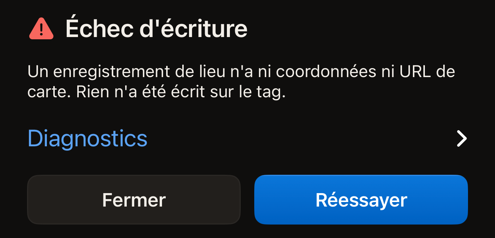
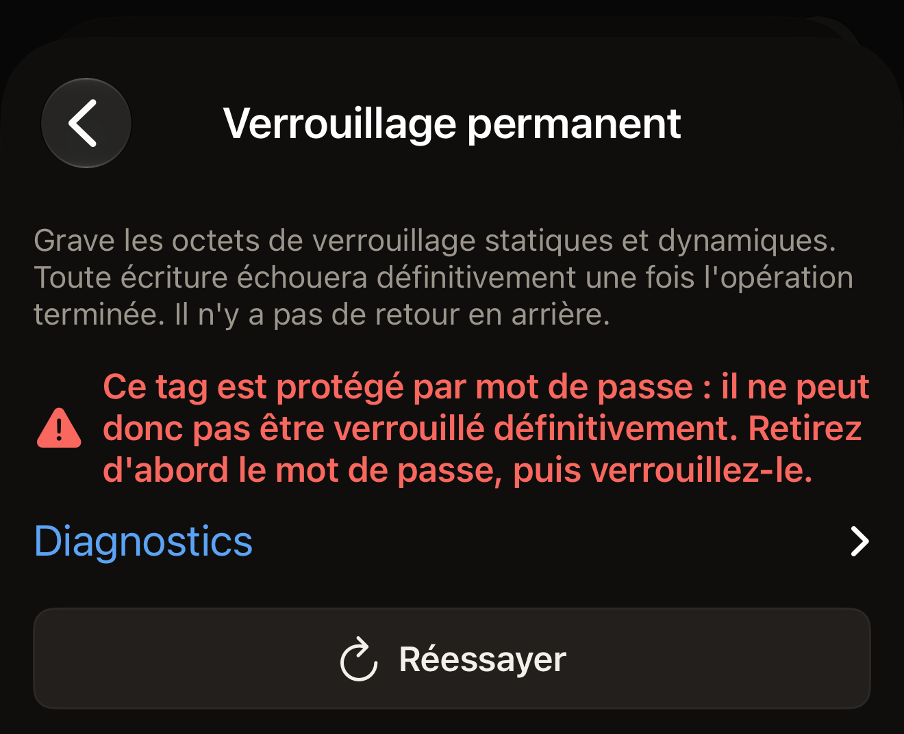

Presque toutes les lectures qui échouent viennent d'un tag qui a bougé. Posez le
haut de l'iPhone à plat sur le tag, maintenez-le immobile pendant environ une
seconde, puis touchez **Réessayer**.

Hex NFC décrit le problème par une phrase plutôt que par un code. Retrouvez
ci-dessous la phrase que vous avez vue. Juste sous chaque message d'échec se
trouve une ligne fermée intitulée **Diagnostics**, avec un chevron à droite.
Touchez cette ligne : le détail technique s'affiche en dessous.

## Trouver votre message

- [Délai expiré, tag perdu en cours de lecture ou scan annulé](#scan-stopped)
- [MIFARE Classic, pas de NFC sur cet appareil, version non autorisée,
  opération que le tag ne prend pas en charge ou appareil de santé](#tag-not-readable)
- [Enregistrements trop volumineux, ou tag qui renvoie autre chose](#write-failed)
- [Un autre tag, après la saisie de l'UID d'un tag](#different-tag)
- [Une vérification du mot de passe qui n'a pas abouti](#password-check)
- [Une erreur inattendue s'est produite](#unexpected)

## Commencer par ces vérifications

- Posez le haut de l'iPhone sur le tag, et non le milieu du dos.
- Sortez l'iPhone de sa coque si elle est en métal, et éloignez le tag de toute
  surface métallique.
- Gardez le tag et l'iPhone immobiles ensemble jusqu'à ce que l'app réponde.
- Essayez un deuxième tag. Si celui-ci se lit, c'est le premier tag qu'il faut
  examiner.

## Que signifie « Échec du scan » ? {#scan-failed}

« Échec du scan » est le titre affiché au-dessus d'une lecture que l'app n'a pas
pu terminer. La phrase en dessous en donne la raison, et les rubriques ci-dessous
sont classées selon cette raison.

::::steps
:::step[Ouvrir les diagnostics]
Touchez **Diagnostics**, la ligne juste sous le message. Le détail s'affiche en
dessous, et vous pouvez sélectionner le texte pour le copier.
:::

:::step[Lancer un nouveau scan]
Touchez **Réessayer**. L'écran de scan ouvre une nouvelle session et attend en
affichant « Tenez le tag près du haut de l'iPhone ».
:::

:::step[Maintenir le tag immobile]
Posez le haut de l'iPhone à plat sur le tag et laissez-le en place jusqu'à ce que
l'app réponde.
:::
::::

## Pourquoi le scan s'est-il arrêté en cours de route ? {#scan-stopped}

« Le délai du scan a expiré. Maintenez le tag immobile contre le haut du
téléphone et réessayez. Si le délai expire à chaque fois avec un même tag, il
s'agit peut-être d'un MIFARE Classic, que l'iPhone ne peut pas lire (une limite
d'iOS, pas un défaut du tag). »

iOS a mis fin à la session parce qu'aucun tag ne lui a répondu dans le délai
imparti. Vous voyez cette phrase quand l'iPhone avait déjà trouvé un tag sur le
même écran, par exemple lors du second passage d'un tag protégé, ou quand une
tentative précédente sur cet écran s'est terminée par une erreur. Déplacez
lentement le haut de l'iPhone au-dessus du tag, puis laissez-le en place.

Quand l'iPhone n'a trouvé aucun tag, l'écran affiche plutôt « Aucun tag trouvé »,
avec **Réessayer** en dessous. Ce n'est pas un échec : il n'y a donc pas de
diagnostics en dessous. La solution est la même : posez le haut de l'iPhone à plat
sur le tag et maintenez-le immobile.

Un tag qui commence à répondre puis s'arrête donne une autre phrase : « Tag perdu
en cours de lecture. Maintenez-le contre le haut du téléphone et réessayez. » Le
tag a quitté le champ au milieu d'une commande.

« Scan annulé. » signifie que le scan a été fermé avant d'aboutir, par vous ou par
l'app. Ce message apparaît une fois que l'iPhone a trouvé un tag sur le même
écran, ou après qu'une tentative précédente sur cet écran s'est terminée par une
erreur. Si vous fermez le panneau de scan d'iOS avant qu'un tag soit trouvé, il se
ferme, sans aucun message. Un scan ne fait que lire : rien n'a donc changé sur le tag.

## Pourquoi l'iPhone ne parvient-il pas du tout à lire ce tag ? {#tag-not-readable}

Trois messages indiquent que la lecture est impossible, quelle que soit la façon
de tenir le tag. Deux autres figurent aussi ici, et aucun n'est un échec de
lecture.

« Ce tag semble être un MIFARE Classic. L'iPhone le détecte mais ne peut pas lire
sa mémoire chiffrée : iOS n'expose pas les clés MIFARE Classic dont une app aurait
besoin. » La puce a répondu suffisamment pour que l'app reconnaisse sa famille.
Elle n'est pas allée plus loin.

:::important[Aucune app ne lit un MIFARE Classic sur iPhone]
iOS ne donne à aucune app les clés qui déverrouillent la mémoire de cette puce :
aucun réglage de Hex NFC ne peut donc changer le résultat. Utilisez plutôt un tag
présenté dans [Tags compatibles avec Hex NFC](tags-that-work.md).
:::

« Cet appareil ne prend pas en charge le NFC. » L'app n'a pu ouvrir aucune session NFC sur cet iPhone. L'iPhone n'a pas d'interrupteur NFC à réactiver. Aucun réglage
de Hex NFC n'y change rien. Tenir le tag autrement n'aidera pas.
[Questions fréquentes](faq.md) indique ce dont l'app a besoin pour fonctionner. Si
le message apparaît sur un iPhone où Hex NFC fonctionne par ailleurs, ouvrez
**Diagnostics** et copiez le texte. Envoyez-le comme l'explique
[Si vous avez besoin de plus d'aide](#if-you-need-more-help).

« Cette version n'est pas encore autorisée pour ce type de tag. » Votre exemplaire
de l'app n'est pas habilité à lire ce type de tag. Ni le tag ni la façon de le
tenir n'y changent quoi que ce soit. Vérifiez d'abord sur l'App Store s'il existe
une mise à jour de Hex NFC. Si le message revient, ouvrez **Diagnostics** et
envoyez le texte comme l'explique
[Si vous avez besoin de plus d'aide](#if-you-need-more-help).

« Ce tag ne prend pas en charge cette opération. » est le message qui ne concerne
pas la lecture. Le tag a bien été lu. Ce qu'il refuse, c'est l'opération demandée,
par la voie que vous avez prise. La carte d'informations du tag nomme la puce.
Lorsque la puce les fournit, ses lignes **Prend en charge** et
**Fonctionnalités** indiquent ce qu'elle sait faire.

**Opérations** > **Protéger par mot de passe** et la carte **Protection** de
l'écran « Tag » protègent toutes deux sept puces : NTAG213, NTAG215, NTAG216,
MIFARE Ultralight EV1, MIFARE Ultralight C, NTAG424 DNA et ICODE SLIX2.
[Protéger un tag par mot de passe](protect-a-tag.md) détaille les deux voies.
[Tags compatibles avec Hex NFC](tags-that-work.md) présente les puces que l'app
reconnaît. La [matrice de prise en charge des puces](../developer/chip-support-matrix.md)
donne tout le détail technique, puce par puce.

« Il s'agit d'un appareil de santé. Hex NFC n'écrit jamais sur les appareils de
santé et ne leur envoie aucune commande. » signifie que vous avez présenté un
appareil médical, comme un stylo à insuline. Une écriture, une opération ou une
commande de la console **Avancé** qui le vise s'arrête avant que quoi que ce soit
ne soit écrit ou que votre commande ne parte : l'appareil reste inchangé. Le
scanner avec **Scanner** ouvre son écran **Appareil de santé**, décrit dans
[Appareils de santé](tags-that-work.md#health-devices).

## Que signifie « Échec d'écriture » ? {#write-failed}

« Échec d'écriture » est le titre affiché au-dessus d'une écriture, d'une
relecture ou d'un changement de protection qui n'a pas abouti. Trois éléments se
trouvent en dessous. **Diagnostics** contient le détail, **Fermer** vous ramène à
l'éditeur, et **Réessayer** relance l'écriture en conservant le mot de passe
saisi. Pour une écriture lancée depuis l'écran « Tag » qui active ou désactive la
protection, la nouvelle tentative lit à nouveau l'UID du tag. Elle vous demande de
le ressaisir une seconde fois. Votre accord pour modifier un tag n'est pas
conservé après un échec. Un préréglage écrit depuis **Bibliothèque** n'est pas
confirmé de cette façon : c'est le tag que vous présentez qui fait office
d'instruction, et sa nouvelle tentative revient donc directement à un seul
passage.

:::figure[Une écriture qui échoue indique sa raison sous « Échec d'écriture », avec **Diagnostics** en dessous et **Fermer** à côté de **Réessayer**.]

:::

Deux de ces messages ont leur propre solution.

« Ces enregistrements sont trop volumineux pour ce tag. » Vos enregistrements
demandent plus de place que n'en offre la zone de données de la puce. Raccourcissez
ou supprimez un enregistrement, ou écrivez sur un tag doté de plus de mémoire.
[Types d'enregistrement](record-types.md) indique la place que prend chaque type
d'enregistrement.

« Le tag a renvoyé un contenu différent de celui envoyé. Réessayez l'écriture. »
L'app a relu le tag après l'écriture, et les octets ne correspondaient pas à ce
qu'elle avait envoyé. Touchez **Réessayer** en maintenant le tag immobile.

## Pourquoi le tag a-t-il été refusé après la saisie de son UID ? {#different-tag}

::include[two-tap-confirmation]

« Ce n'est pas le même tag. » signifie que le tag présenté n'est pas celui
qu'attendait l'app. La ligne **Diagnostics** indique quel passage a déclenché le
message, et quel tag était attendu.

Sur l'écran **Opérations**, ce message apparaît au second passage. Le tag présenté
n'est pas celui dont vous avez saisi l'UID. Présentez à nouveau le même tag, ou
recommencez avec le tag que vous vouliez modifier.

Un changement de protection depuis l'écran « Tag » peut le déclencher à l'un ou
l'autre passage. Au second passage, il signifie la même chose. Au premier passage,
rien n'a encore été saisi. Le tag présenté n'est alors pas celui à partir duquel
l'éditeur a été ouvert. Présentez plutôt ce tag-là.

Sur l'écran **Opérations**, une opération qui échoue affiche le message, puis
**Diagnostics** juste en dessous, puis **Réessayer** plus bas. Deux écrans
remplacent ce bouton : **Limite de tentatives** affiche **Recommencer**, et
**Retirer le mot de passe** affiche **Saisir un autre mot de passe**. Chacun
redemande le mot de passe : la tentative suivante envoie donc ce que vous saisirez
ensuite, et non le mot de passe que le tag vient de refuser.

:::figure[Sur l'écran **Verrouillage permanent**, un verrouillage refusé affiche son message, puis **Diagnostics**, puis **Réessayer**.]

:::

## Que faire si la vérification du mot de passe n'aboutit pas ? {#password-check}

« Impossible de vérifier le mot de passe : le tag a cessé de répondre.
Maintenez-le immobile contre le haut du téléphone et réessayez. » Le tag s'est tu
pendant que l'app vérifiait le mot de passe. Rien n'a été établi à son sujet, dans
un sens comme dans l'autre. L'app ne vous dit pas que le mot de passe est faux.
Maintenez le tag immobile et relancez l'opération.
[Retirer le mot de passe d'un tag](remove-password.md) traite du cas d'un mot de
passe qui n'ouvre réellement plus un tag.

## Pourquoi un message signale-t-il une erreur inattendue ? {#unexpected}

« Une erreur inattendue s'est produite. » apparaît sur l'écran de scan, l'écran
d'écriture et l'écran **Opérations**. Ce message s'affiche quand l'app ne reconnaît
pas un échec comme une erreur de tag. « Un imprévu s'est produit. Réessayez. »
provient de la couche NFC, pour la même raison.

Deux autres décrivent un tag qui répond sous une forme que l'app n'attendait pas :

- « Le tag a répondu en dehors du protocole attendu. »
- « Le tag a renvoyé des données que cette app n'a pas pu interpréter. »

Pour ces quatre messages, la marche à suivre est la même. Ouvrez **Diagnostics**,
copiez le texte, puis présentez à nouveau le tag. Si le même message revient pour
le même tag, les diagnostics copiés permettent d'identifier le défaut.

## Si vous avez besoin de plus d'aide {#if-you-need-more-help}

Envoyez les diagnostics copiés à Hex Pro depuis l'app : sur l'écran d'accueil,
touchez le bouton en forme d'engrenage, puis **Envoyer un commentaire**, et
collez-les dans le message. Ajoutez le nom de la puce si le tag a été lu assez
loin pour afficher une carte d'informations. S'il n'a jamais été lu,
précisez-le, et indiquez quels tags se lisent et lesquels ne se lisent pas. Le
formulaire ajoute de lui-même la version de l'app, la version d'iOS, le modèle
de l'appareil et la langue. Pour obtenir une réponse, indiquez votre adresse
e-mail dans **Adresse de réponse (facultatif)**.
[Commentaires et notes](settings.md#feedback-and-ratings) décrit le formulaire.

Vous pouvez aussi écrire à `support@hex.pro`, l'adresse indiquée dans la
**Politique de confidentialité** et dans les **Conditions générales**, sous
**Mentions légales** dans les **Réglages**. Par e-mail, indiquez la version de
l'app affichée dans **Version** dans les **Réglages**, ainsi que le modèle
d'iPhone et la version d'iOS, que l'app Réglages de l'iPhone affiche sous
Général, puis Informations.

Lisez ensuite [Scanner un tag](scan-a-tag.md) pour voir à quoi ressemble une
lecture normale, ou [Questions fréquentes](faq.md) pour savoir ce dont l'app a
besoin pour fonctionner.
