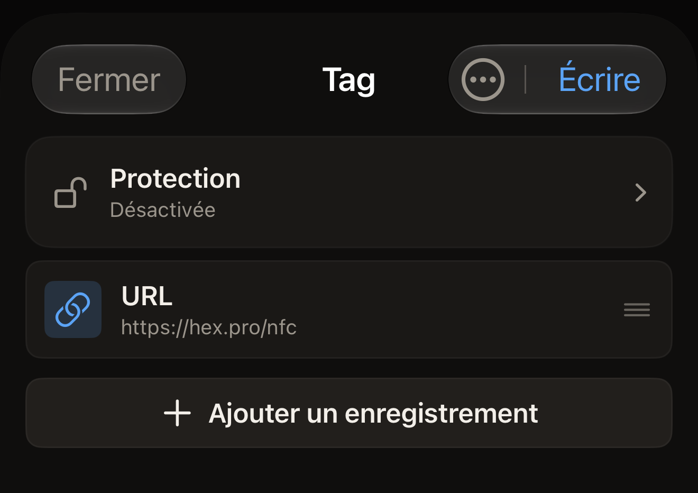
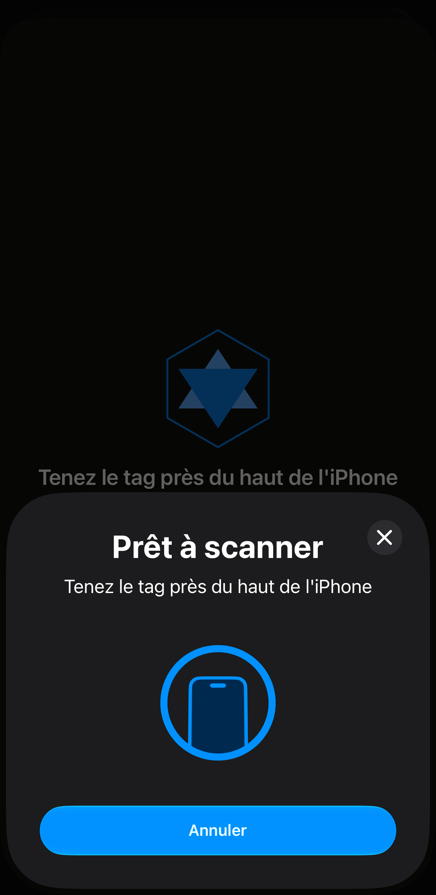

Un tag peut contenir une adresse web, et un téléphone qui lit le tag se voit
proposer cette adresse. Dans Hex NFC, l'adresse est un enregistrement URL.
Vous composez l'enregistrement sur l'iPhone, puis vous tenez une fois le tag
contre l'iPhone pour y transférer l'enregistrement.

Avant de commencer, ayez le tag à portée de main. Si vous n'êtes pas sûr
qu'un tag accepte encore l'écriture, scannez-le d'abord, comme l'explique
[Scanner un tag](scan-a-tag.md). Le scan ouvre l'écran « Tag ». Sur cet
écran, **Écrire** est disponible pour un tag qui accepte encore une
écriture. Le bouton est grisé pour un tag que l'app relit comme verrouillé
définitivement, car un tel tag refuse toute écriture. Touchez **Fermer**
pour quitter cet écran et revenir à l'écran d'accueil de Hex NFC, puis
commencez à l'étape 1.

## Écrire un lien sur un tag vide

:::::steps
::::step[Lancer une nouvelle composition]
Sur l'écran d'accueil de Hex NFC, touchez **Composer**. L'écran « Tag »
s'ouvre sans aucun enregistrement, sous le titre « Tag vide ».
::::

::::step[Ajouter un enregistrement URL]
Touchez **Ajouter un enregistrement** > **URL**. L'éditeur d'enregistrement
s'ouvre sur le nouvel enregistrement.
::::

::::step[Saisir l'adresse]
Dans **URL**, saisissez l'adresse précédée de son schéma, par exemple
`https://hex.pro`, puis touchez **Enregistrer**. L'enregistrement apparaît
dans la liste. L'app écrit l'adresse exactement comme vous l'avez saisie,
sans rien y ajouter. Une adresse qui arrive sur le tag sans son `https://`
n'est pas un lien qui fonctionne. Un téléphone qui lit ce tag n'a aucune
page à ouvrir.

:::figure[Une fois que vous avez touché **Enregistrer**, l'écran « Tag » liste le nouvel enregistrement **URL**, et **Écrire**, en haut à droite, est prêt à être touché.]

:::
::::

::::step[Envoyer l'enregistrement sur le tag]
Touchez **Écrire**, en haut de l'écran « Tag ». L'écran d'écriture s'ouvre
et affiche « Tenez le tag près du haut de l'iPhone ». iOS place son propre
panneau de scan par-dessus l'app, avec la même ligne.

:::figure[La ligne de l'écran d'écriture reste visible au-dessus du panneau de scan d'iOS, qui la reprend et propose son propre bouton Annuler.]

:::
::::

::::step[Tenir le tag contre l'iPhone]
Posez le haut de l'iPhone sur le tag et gardez-le en place. L'écran affiche
« Écriture… », puis « Vérification… ». Rien dans cette étape ne verrouille
le tag. Vous pouvez réécrire dessus aussi souvent que vous le voulez. Le
message de réussite, « Écriture terminée », indique seulement que les
enregistrements ont été écrits et relus intacts. L'écran se ferme de
lui-même et l'écran « Tag » réapparaît.
::::
:::::

L'écriture remplace tout ce que contenait le tag. Pour conserver une partie
de ce qui se trouve déjà sur un tag, scannez-le d'abord. Modifiez cette
liste au lieu d'en composer une nouvelle, comme l'explique [Modifier les
enregistrements d'un tag](edit-records.md).

:::tip[Tous les types d'enregistrement s'écrivent de la même façon]
Un lien est ce que l'on place le plus souvent sur un tag, et c'est l'un des
13 types d'enregistrement que vous pouvez ajouter. [Types
d'enregistrement](record-types.md) les liste tous, et les étapes ci-dessus
restent les mêmes quel que soit celui que vous choisissez.
:::

## Ce que l'app vérifie avant d'annoncer la réussite

L'app ne se fie jamais à la seule réponse du tag pour une écriture. Elle
envoie les enregistrements, relit le tag et compare ce qu'elle a reçu avec
ce qu'elle a envoyé. « Écriture terminée » signifie que le tag a été relu et
qu'il contient exactement ce que vous avez écrit.

Un état arrête l'écriture au lieu de la laisser aboutir. Sur un tag dont le
mot de passe protège les enregistrements, l'écran d'écriture affiche « Le
tag est protégé » et demande ce mot de passe avant d'écrire quoi que ce
soit. Saisissez le mot de passe dans **Mot de passe du tag (4 octets)** et
touchez **Déverrouiller et écrire**. Tenez ensuite à nouveau le tag contre
le haut de l'iPhone. C'est lors de ce second passage que l'app s'authentifie
et écrit. L'app saute cette demande quand elle possède déjà le mot de passe,
enregistré au moment où vous avez protégé le tag. L'écriture se fait alors
en un seul passage. Si vous ne connaissez pas le mot de passe, touchez
**Annuler** : vos enregistrements restent sur l'écran « Tag ». Consultez
[Protection des tags](tag-protection.md) pour savoir ce qu'un mot de passe
fait à un tag.

Sur un tag dépourvu d'en-tête pour accueillir les enregistrements,
l'écriture n'est pas arrêtée à l'avance. L'app envoie les enregistrements,
la relecture ne trouve rien de lisible sur le tag, et l'écriture se termine
sur « Échec d'écriture ».

Ce qui vous en préserve, c'est un scan. Sur un tag que l'app a scanné comme
non formaté, l'écran « Tag » affiche « Ce tag n'est pas formaté » au-dessus
de la liste des enregistrements. En dessous, l'écran indique « Il n'a pas de
Capability Container : les enregistrements écrits maintenant ne seront pas
lisibles. Formatez-le d'abord. » Touchez cet avertissement pour ouvrir
l'écran « Opérations » et formater le tag. Une composition lancée depuis
**Composer** ne repose sur aucun scan, si bien que l'écran « Tag » n'a aucun
moyen de vous avertir.

Les enregistrements que vous avez composés ne sont pas perdus pendant la
réparation. Touchez le bouton de menu en haut à droite de l'écran « Tag »,
puis **Opérations…**. L'écran « Opérations » s'ouvre par-dessus l'écran
« Tag ». Vos enregistrements sont toujours là quand vous le fermez.
Consultez [Effacer ou formater un tag](erase-or-format.md).

Pour arrêter une écriture avant qu'elle commence, touchez **Annuler** sur
l'écran d'écriture tant qu'il attend encore un tag. Vos enregistrements
restent sur l'écran « Tag ». Toucher Annuler sur le panneau de scan d'iOS avant
qu'un tag soit lu a le même effet. Si aucun tag n'est approché de l'iPhone,
le panneau de scan d'iOS se ferme de lui-même au bout d'une minute environ, et
l'écran d'écriture affiche « Aucun tag trouvé » avec **Fermer** et
**Réessayer**.

## Si l'écriture échoue

Une écriture qui échoue, ou une relecture qui diffère de ce qui a été
envoyé, se termine sur « Échec d'écriture », avec la raison en dessous. À
partir de là :

- Pour renvoyer les mêmes enregistrements, touchez **Réessayer**. Vous
  conservez tout ce que vous avez déjà saisi.
- Pour revenir à l'écran « Tag » sans écrire, touchez **Fermer**.

Un tag qui refuse sans cesse n'est peut-être pas du bon type pour ce que
vous écrivez. [Tags compatibles avec Hex NFC](tags-that-work.md) indique
quelles puces l'app reconnaît, et la [matrice de prise en charge des
puces](../developer/chip-support-matrix.md) donne le détail puce par puce.

## Voir aussi

- [Modifier les enregistrements d'un tag](edit-records.md)
- [Enregistrer un tag comme préréglage](presets.md)
- [Si un tag ne peut être ni scanné ni écrit](troubleshooting.md)
