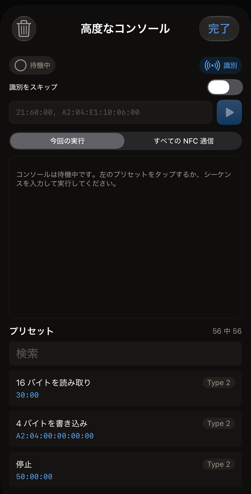
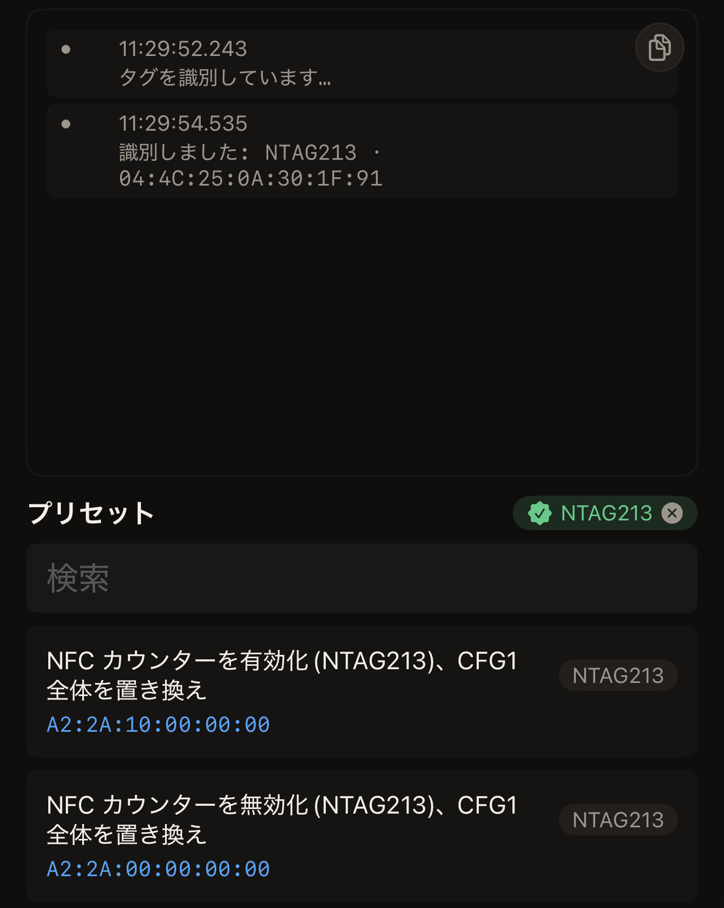
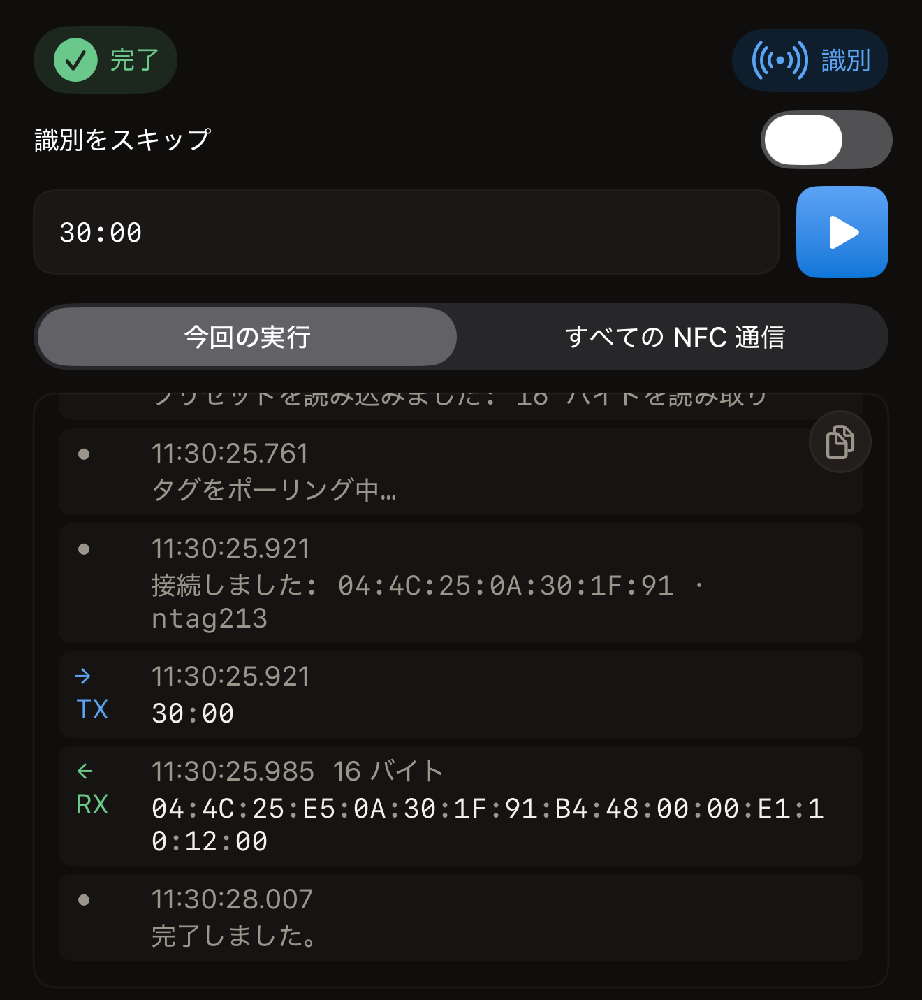

Hex NFC の高度なコンソールは、iPhone からタグへバイトを直接送ります。送信したコマンドと受信した応答を、それぞれの時刻とともに表示します。要約ではなくフレームそのものを見たいときに使います。

始める前に、タグを手元に用意し、そのチップのデータシートを開いておきます。データシートは、チップメーカー自身がそのチップについてまとめた資料です。メーカーの Web サイトにチップ名で掲載されていて、そのチップ名は後述の識別の手順で確認できます。このガイドにはデータシートの内容を転載したページはありません。また、コンソールは、データシートを読んだかどうかに関係なく、入力された内容をそのまま送信します。

コンソールは 1 つの画面に収まっていて、このページで取り上げるコントロールはすべてその画面にあります。一番上にはステータス表示とその横の**識別**、そして**識別をスキップ**のスイッチがあります。その下に**コマンド**フィールドとその横の**実行**ボタン、**今回の実行**と**すべての NFC 通信**の切り替えが続きます。さらにその下に出力エリアがあり、画面の一番下に**プリセット**があります。プリセットの行の上には**検索**があります。

## チップを識別する

:::::steps
::::step[Hex NFC を開く]
Hex NFC を開きます。Hex NFC のホーム画面が表示されます。
::::

::::step[コンソールを開く]
Hex NFC のホーム画面で、4 つのタイルの最後にある**詳細**をタップします。このタイルの 2 行目には「生コマンドコンソール」と書かれています。コンソールが開き、空の出力エリアに「コンソールは待機中です。左のプリセットをタップするか、シーケンスを入力して実行してください。」と表示されます。プリセットの一覧は画面の下部にあり、左側ではありません。

:::figure[コンソールを開いた直後は、ステータス表示が「待機中」で、出力エリアは空、画面の下部に**プリセット**があります。]

:::
::::

::::step[識別のスキャンを開始する]
ステータス表示の右にあるカプセル型のボタン、**識別**をタップします。出力エリアに「タグを識別しています…」が加わり、iOS のスキャンシートが「タグをかざして識別します。」という表示とともに現れます。
::::

::::step[タグを iPhone にかざす]
iPhone の上端をタグに平らに当て、動かさずに保ちます。出力エリアにチップ名とタグの UID が表示され、**プリセット**の横にチップ名が表示されます。表示される行は「識別しました: NTAG213 · 04:4C:25:0A:30:1F:91」です。

:::figure[識別のスキャン後は、出力エリアにチップ名と UID が表示されます。**プリセット**の横にはチップ名が表示され、一覧の先頭にはそのチップ用のプリセットが並びます。]

:::
::::
:::::

チップを識別すると、プリセット一覧の並び順が変わります。そのチップ用に書かれたプリセットが一覧の先頭に来て、その下に、次のようなそのチップにも当てはまるプリセットが続きます。

- チップの種別全体に向けて書かれたプリセット
- 同じチップファミリーに属する別のチップ用のプリセット（NTAG216 に対する NTAG215 用のプリセットなど）

どちらもグレイ表示にはなりません。ただし、同じファミリーの別のチップ用のバイトが、手元のチップでは違うページを指すことがあるので、先に**コマンド**でバイトを確認してください。プリセットがグレイ表示になるのは、別のチップファミリー用か、まったく別の種類のタグ用の場合だけです。グレイ表示のプリセットも、タップすれば**コマンド**に読み込まれます。識別したチップを解除するには、**プリセット**の横にあるチップ名をタップします。一覧は通常の順序に戻ります。

アプリがチップを特定できない場合、コンソールには「タグに接続しましたが、チップは不明です · 04:BA:4A:92:1B:21:90」と表示されます。続いて、タグが自身について報告した内容が表示されます。1 行目は「報告値: NXP · NTAG · 128-256 bytes · v1.0」のような内容で、チップメーカー、製品ファミリー、チップが申告するメモリ容量、製品バージョンを示します。2 行目は 1 行目の元になった生のバイトで、「GET_VERSION: 00:04:04:02:01:00:0F:03」のように表示されます。行をタップするとコピーできます。「コピーしました」という表示が 1 秒ほど現れ、バイトがクリップボードに入るので、不具合の報告に使えます。

## プリセットの中身

**プリセット**にあるプリセットは、アプリに最初から含まれている、保存済みのコマンドシーケンスです。各行に表示されるのは、プリセットの名前、対象のチップファミリーを示すバッジ、バイトそのものの 3 つだけです。タグを読み取るプリセットもあれば、タグに書き込むプリセットもあり、チップが 1 回しか書き込みを受け付けないページに書き込むものも含まれます。

行の裏に説明はないため、プリセットが何をするかを知る手がかりはバイトだけです。何かを実行する前に、**コマンド**でバイトを読み、手元のチップのデータシートと照らし合わせてください。多くのシールやカードに使われている Type 2 のチップでは、`30` または `3A` で始まるコマンドは読み取り、`A2` で始まるコマンドは書き込みです。タグを変更せずにコンソールの動作を確かめるには、**16 バイトを読み取り**という名前の行から始めてください。この行のバイトは `30:00` です。

## コマンドを実行する

:::::steps
::::step[プリセットを読み込む]
**プリセット**の下の一覧でプリセットをタップします。そのバイトが**コマンド**に入り、コンソールには読み込んだプリセットの名前が記録されます。この時点では何も送信されていません。
::::

::::step[送信内容を確認する]
**コマンド**のシーケンスを読み、必要なら編集します。16 進数の 2 桁が 1 バイトで、1 つのコマンド内のバイトはコロンで区切り、コマンドとコマンドの間はカンマで区切ります。フィールドが空のときは、サンプルとして「21:60:00, A2:04:E1:10:06:00」が表示されます。これはプレースホルダーで、フィールドに入力されているわけではありません。フィールドが空の間は何も送信されず、プリセットを読み込むかシーケンスを入力するまで**実行**はグレイ表示のままです。例として読むと、これは 3 バイトと 6 バイトの 2 つのコマンドで、2 つ目のコマンドはあるページに 4 バイトを書き込みます。
::::

::::step[送信する]
**実行**ボタンをタップします。ステータス表示が「ポーリング中…」になり、出力エリアに「タグをポーリング中…」が加わって、iOS のスキャンシートが「タグをかざしてコマンドを送信します。」という表示とともに現れます。
::::

::::step[タグを iPhone にかざす]
iPhone の上端をタグに平らに当て、動かさずに保ちます。出力エリアに、タグの UID とチップを示す接続の行が「接続しました: 04:4C:25:0A:30:1F:91 · ntag213」のように加わります。続いて、コマンドを送信している間、ステータス表示は「実行中…」になります。

タグにバイトが届く前に止めるには、iOS のシートで「キャンセル」をタップします。実行が終わり、ステータス表示は「待機中」に戻って、出力エリアに「タグが見つかる前にキャンセルしました。何も送信していません。」と表示されます。タグを近づけないまま放置すると、シートは自動的に閉じ、ステータス表示は「タグが見つかりません」になります。**実行**または**識別**でコンソールが一度タグを読み取った後は、それ以降の実行でのキャンセルやタイムアウトは、代わりにエラー行として記録されます。
::::

::::step[応答を読む]
コマンドごとに送信行と受信行が 1 行ずつ加わり、受信行には返ってきたバイト数が示されます。最後の応答の後、ステータス表示は「完了」になり、出力エリアの最後に「完了しました。」と表示されます。

:::figure[**16 バイトを読み取り**を実行した後は、出力エリアに送信行が 1 行と 16 バイトの受信行が 1 行あり、ステータス表示は「完了」です。]

:::
::::
:::::

:::warning[コンソールは送信前に何も確認しない]
書き込みコマンドは、送信された瞬間にタグを変更します。チップには、タグの寿命を通じて 1 回しか書き込めないページもあります。そこに誤ったバイトを書き込むと、後のコマンドで元に戻すことはできません。
:::

多数のプリセットから 1 つを探すには、**プリセット**の見出しの下にある**検索**に、名前またはバイトの一部を入力します。プリセット一覧を使わずに、**コマンド**に自分でシーケンスを入力することもできます。タグがコマンドを拒否すると、その実行とタップは終わりますが、出力エリアにすでにある行はすべてそのまま残ります。

## 今回の実行だけでなく、すべてのフレームを見る

出力エリアの上にある**すべての NFC 通信**をタップします。コンソールに、アプリがタグとやり取りするすべてのフレームが表示されます。この画面からのフレームに加えて、スキャン、書き込み、タグの操作のフレームも表示されます。新しいフレームは発生するたびに追加されます。コンソール自身のログに戻るには、**今回の実行**をタップします。

## プローブを拒否するチップと通信する

接続した後にタグが何も応答しない場合は、ステータス表示と**コマンド**の間にあるスイッチ、**識別をスキップ**をオンにします。するとアプリは、チップに種類を問い合わせずにコマンドを送信します。実行結果では、チップ名の代わりに、タグは不明と報告されます。このスイッチは自分でオフにするまでオンのままで、実行が終わっても自動的には戻りません。スイッチがオンの間は、その下に「コマンドをチップへ直接送ります。GET_VERSION を拒否するチップに必要です。プローブがチップを停止させ、以降のコマンドはすべて失敗します。」という理由が表示されます。

スイッチがオンでも、1 つだけ確認が行われます。タグがインスリンペンなどの NFC ヘルスケア機器である可能性がある場合、アプリはそれを判断できる分だけを読み取り、ヘルスケア機器にはあなたのコマンドを一切送りません。

## コンソールがエラーを報告した場合

エラー行が出ると、実行もタップも終わります。iOS のスキャンシートも閉じるので、さらに何か送信するには、もう一度**実行**をタップしてタグをかざします。

- 「コマンドを解析できませんでした。」は、**コマンド**のテキストがアプリで読み取れるシーケンスになっておらず、何も送信されていないことを示します。3 つの規則を確認してください。どのバイトも 16 進数 2 桁であること、1 つのコマンド内のバイトの間にコロンがあること、コマンドとコマンドの間にカンマがあることです。
- 「タグを識別できませんでした。」は、識別のスキャンが結果を得られないまま終わったことを示します。**識別**をタップして、もう一度タグをかざします。
- 「これはヘルスケア機器です。Hex NFC はヘルスケア機器への書き込みやコマンド送信を一切行いません。」は、タグがインスリンペンなどの医療機器であることを示します。あなたのコマンドは 1 つも送られていません。
- 「予期しないエラーが発生しました。」は、アプリがそれ以上うまく説明できない理由で実行が止まったことを示します。詳細は行の残りの部分に表示されます。
- エラー行に表示されるそれ以外のメッセージは、タグの動作をアプリ自身が説明したものです。文言は、スキャンや書き込みで表示されるものと同じです。

それらのメッセージが実際に何を意味することが多いかは、[タグをスキャンまたは書き込みできない場合](troubleshooting.md)を参照してください。

## 関連項目

- [タグのメモリのコピーを保存する](memory-dump.md)
- [Hex NFC で使えるタグ](tags-that-work.md)
- [チップ対応表](../developer/chip-support-matrix.md)
