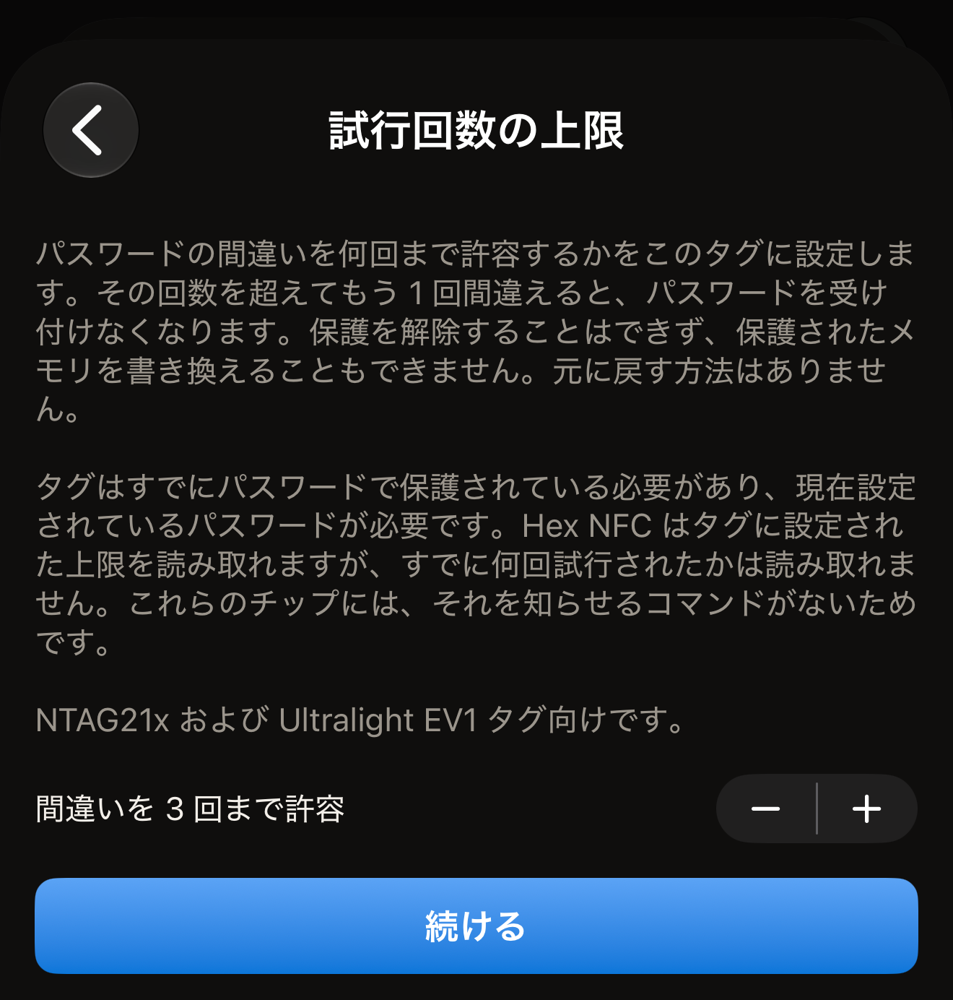
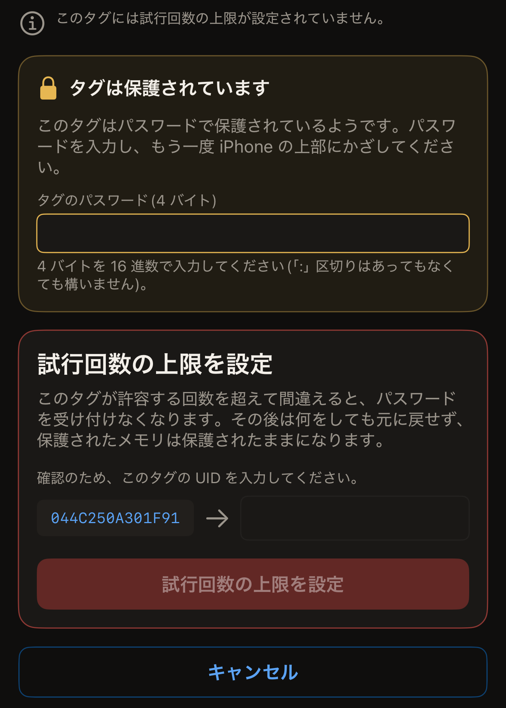

試行回数の上限は、パスワードで保護されたタグに、パスワードの間違いを何回まで許すかを指定するものです。Hex NFC は iPhone からこの回数をタグに書き込みます。3 に設定すると、タグは 3 回までの間違いを受け付け、その次に間違えるとパスワードを二度と受け付けなくなります。それ以降は保護を解除することも、保護されたメモリを書き換えることもできません。元に戻す方法はありません。

始める前に、次の点を確認してください。

- タグがすでにパスワードで保護されている必要があります。
- タグに現在設定されているパスワードが必要です。
- チップが NTAG21x または MIFARE Ultralight EV1 である必要があります。この設定はこれらのチップにあります。

チップの機能については、[Hex NFC で使えるタグ](tags-that-work.md)または[チップ対応表](../developer/chip-support-matrix.md)を参照してください。

上限は**保護**カードには含まれていません。1 枚のタグごとに設定するもので、取り消せないため、「操作」画面の**危険な操作**の中にあります。

::include[two-tap-confirmation]

タグを開くためのスキャンは、この 2 回のタップには含まれません。この操作では、スキャンに 1 回、操作そのものに 2 回の、合計 3 回タグをかざします。

:::warning[間違ったパスワードは 1 回の試行に数えられることがある]
タグにすでに上限が設定されている場合、ここで入力したパスワードがタグに拒否されると、それは上限に数えられます。Hex NFC はタグに設定された上限を表示しますが、これらのチップには、すでに何回試行されたかを知らせるコマンドがありません。試行を 1 回消費せずにパスワードを試す方法もありません。アプリがタグのパスワードを表示することはありません。パスワードを渡すチップもありません。入力するのは、タグを保護したときに控えたパスワードです。
:::

## 試行回数の上限を設定する

:::::steps
::::step[タグをスキャンする]
Hex NFC のホーム画面で**スキャン**をタップし、タグを iPhone の上部に近づけます。タグの内容が「タグ」画面に表示されます。一番上のカードの見出しはチップの名前です。そのすぐ下、レコードの上に**保護**カードがあります。

パスワードで書き込みだけが保護されているタグは、ほかのタグと同じようにスキャンできます。その**保護**カードには「パスワード・書き込みのみ」と表示されます。

パスワードで読み取りも保護されているタグでは、スキャンが途中で止まります。スキャン画面に「タグは保護されています」と表示され、パスワードを求められます。パスワードを入力し、**ロックを解除して再スキャン**をタップします。そのあと「タグ」画面が開き、**保護**カードには「パスワード・読み取りと書き込み」と表示されます。このロック解除ではパスワードをタグに送信するので、入力を間違えると、このページで扱っている試行を 1 回消費します。ロック解除の詳しい手順は、[タグをスキャンする](scan-a-tag.md#unlock-a-protected-tag)で説明しています。
::::

::::step[試行回数の上限の画面を開く]
「タグ」画面で、右上の**書き込む**の隣にあるメニューボタンをタップし、**操作…**をタップします。「操作」画面で、**危険な操作**カードにある**試行回数の上限**をタップします。
::::

::::step[許容する間違いの回数を選ぶ]
行には**間違いを 3 回まで許容**と表示され、隣のプラス・マイナスボタンを押すと数字が変わります。1 から 7 までの好きな数を選べます。最初は 3 です。プラス・マイナスボタンには上限なしの設定がないため、この画面ではタグの上限を変更できても、上限をなくすことはできません。タグのパスワードを削除すると上限も一緒に消えますが、それにはタグがまだ受け付けるパスワードが必要です。

:::figure[**試行回数の上限**画面は上限 3 の状態で開き、行の隣にプラス・マイナスボタン、その下に**続ける**があります。]

:::
::::

::::step[「続ける」をタップする]
**続ける**をタップします。プラス・マイナスボタンでは変更できなくなり、画面は 1 回目のタップを求めます。
::::

::::step[操作の 1 回目のタップでタグをかざす]
**試行回数の上限を設定**をタップし、タグを iPhone の上部に近づけます。このタップで、タグの UID と、タグにすでに設定されている上限を読み取ります。

タグをかざす前に iOS のスキャンシートを閉じると、プラス・マイナスボタンと**続ける**の画面に戻り、別の上限を選べます。iPhone にタグを近づけないままシートが自動的に閉じた場合は、画面に「タグが見つかりません」と表示され、**もう一度試す**と**最初からやり直す**が表示されます。
::::

::::step[パスワードとタグの UID を入力する]
「タグは保護されています」という見出しのカードで、タグに現在設定されているパスワードを求められます。**タグのパスワード(4 バイト)**に 16 進数で入力します。`:` の区切りはあってもなくても構いません。次に、画面に表示された UID を、その隣のフィールドに入力します。

:::figure[パスワードは「タグは保護されています」カードに、UID はその下のカードの**試行回数の上限を設定**の上に入力します。]

:::
::::

::::step[2 回目のタップで同じタグをかざす]
**試行回数の上限を設定**をタップし、もう一度タグを iPhone の上部に近づけます。アプリは新しい上限を書き込み、読み戻します。画面には「このタグは、パスワードの間違いを 3 回まで許容する設定になりました。」と表示されます。

その下には「その回数を超えてもう 1 回間違えると、パスワードを二度と受け付けなくなります。」と表示されます。
::::
:::::

## 2 回のタップの間にアプリが表示すること

1 回目のタップではタグ自身の設定を読み取るので、UID を入力する前に、タグに何が設定されているかが画面に表示されます。表示されるのは次の 3 つのいずれかです。

- 「このタグには試行回数の上限が設定されていません。」何回間違えても、パスワードを受け付けなくなることはありません。
- 「このタグはすでにパスワードの間違いを 3 回まで許容する設定になっています。」この数はタグに設定されている値で、新しい上限で置き換えられます。
- 「このタグは読み取りが保護されているため、パスワードを提示するまで現在の上限を読み取れません。」表示できる情報はありません。設定ページはパスワードで保護されています。操作はここから続けられます。UID を入力すれば、2 回目のタップでパスワードを送信し、新しい上限を書き込みます。

タグがすでに何回試行を消費したかは表示されません。これらのチップには、それを知らせるコマンドがないためです。

## タグにパスワードがない場合

試行回数の上限はパスワードを守るためのものなので、パスワードのないタグでは、アプリはこの操作を受け付けません。その場合は「このタグにはパスワードが設定されていないため、試行回数の上限が守るものがありません。」と表示されます。

この拒否は何かが書き込まれる前に行われるので、タグは元のままです。[パスワードでタグを保護する](protect-a-tag.md)の説明に従って先にパスワードを設定してから、ここに戻ってください。

## 上限を読み戻せない場合

書き込みの途中でタグが離れると、見出しに「試行回数の上限を書き込みました。」と表示されます。

説明には「タグは書き込みを受理しましたが、今回のタップではバイトを読み戻せませんでした。操作をやり直してください。最初のタップでタグに設定されている上限を確認できます。」とあります。チップは書き込みを受け付けましたが、何が書き込まれたかを今回のタップでは確かめられなかったということです。

この時点で実行は終わっているため、画面にやり直しの選択肢は表示されません。「操作」画面に戻り、もう一度**試行回数の上限**を開きます。最後まで実行すると、新しい実行の 1 回目のタップで、タグに設定されている上限が表示されます。

## 後でパスワードが使えなくなった場合

上限が設定されたタグでパスワードが拒否されると、「タグがそのパスワードを拒否しました。このタグには試行回数の上限が設定されているため、パスワードが正しくても、すでに受け付けなくなっている可能性があります。」と表示されます。

確認が最後まで終わらなかった場合は、「そのパスワードではタグを開けませんでした。このタグには試行回数の上限が設定されており、間違えた試行はすべて上限に数えられます。パスワードを確認してから、もう一度お試しください。」と表示されます。

どちらのメッセージでも、次にすべきことは同じです。タグをもう一度かざす前に、正しいパスワードを確かめてください。どちらのメッセージも、「タグは保護されています」カードの案内の代わりに表示されることがあります。カードのフィールドは空の状態で始まるので、自分で入力しない限り、拒否されたパスワードが再び送信されることはありません。一方、実行が失敗で終わった場合は、画面に**最初からやり直す**が残ります。これをタップすると入力画面に戻り、もう一度パスワードを求められます。タグが許容する回数を超えて間違えると、もう何をしてもタグは開かず、保護されたメモリは恒久的に保護されたままになります。

## 関連項目

- [タグのパスワードを削除する](remove-password.md)
- [タグの保護](tag-protection.md)
- [タグをスキャンまたは書き込みできない場合](troubleshooting.md)
