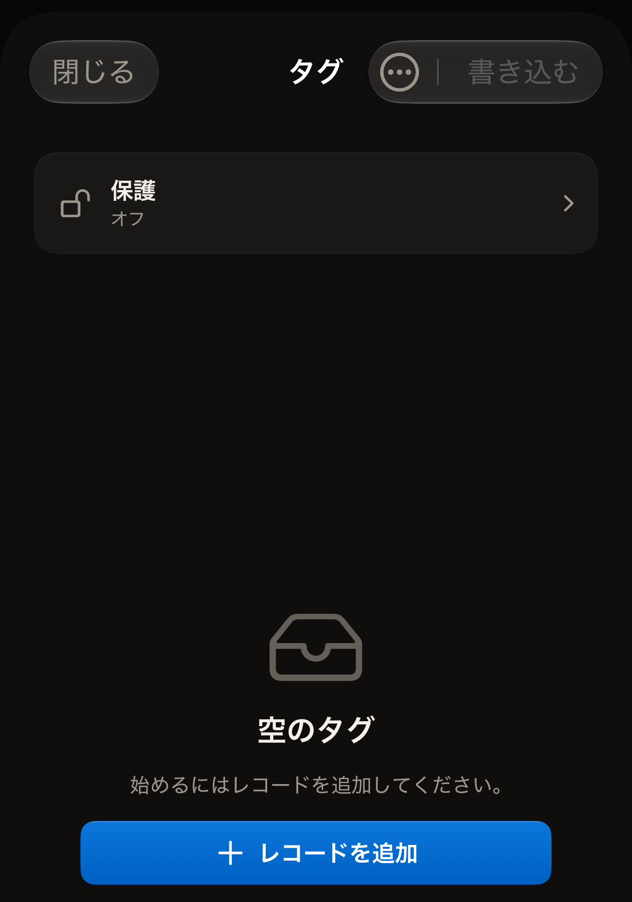
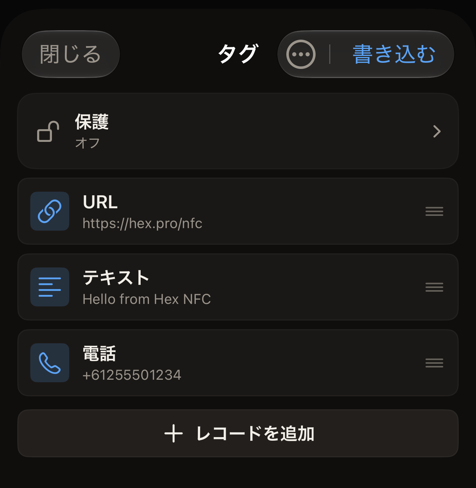

タグにはレコードの一覧が入っていて、Hex NFC はその一覧を「タグ」画面に表示します。レコードを追加、変更、上へ移動、削除し、一覧が思いどおりになったら iPhone からタグに書き込みます。

## レコードの一覧を開く

次のどちらかを行います。

- 手元にあるタグを編集するには、そのタグをスキャンします。タグのレコードが「タグ」画面に表示されます。[タグをスキャンする](scan-a-tag.md)を参照してください。
- 手元にタグがない状態でレコードを組み立てるには、Hex NFC のホーム画面で**作成**をタップします。

まだ何も入っていないタグや、**作成**から始めたばかりの状態では、「空のタグ」と表示され、その下に「始めるにはレコードを追加してください。」と表示されます。

:::figure[**作成**から始めてレコードがまだない状態では「空のタグ」と表示され、そのメッセージの下に**レコードを追加**があります。]

:::

## レコードを追加する

::::steps
:::step[レコードの選択画面を開く]
「タグ」画面で**レコードを追加**をタップします。このボタンはレコード一覧の末尾にあり、タグに何も入っていないときは「空のタグ」の下にあります。「レコードを追加」画面が開き、追加できる種類ごとにタイルが 1 つずつ並びます。
:::

:::step[種類を選ぶ]
**テキスト**、**URL**、**連絡先**、**Wi-Fi** など、使いたいタイルをタップします。アプリがその種類のレコードを追加し、入力できるように開きます。
:::

:::step[レコードに入力する]
レコードに必要な内容を入力し、**保存**をタップします。「タグ」画面の一覧の末尾にレコードが表示されます。
:::
::::

選べる種類は 13 あります。それぞれに何が入り、タグを読み取った端末がそれをどう扱うかは、[レコードの種類](record-types.md)で説明しています。

## QR コードからレコードを追加する

::::steps
:::step[QR コードリーダーを開く]
「レコードを追加」画面で **QR をスキャン**をタップします。「QR コードをスキャン」画面が開きます。
:::

:::step[カメラを許可する]
初めて使うときは、画面に「QR コードを読み取るためにカメラを許可」と「フレームはデバイス上で処理されます。アップロードはされません。」と表示されます。**カメラを許可**をタップし、iOS に尋ねられたらアクセスを許可します。以前にカメラへのアクセスを拒否していた場合は、代わりに「カメラへのアクセスが必要です」と表示されます。**設定を開く**をタップし、Hex NFC のカメラへのアクセスをもう一度オンにします。
:::

:::step[カメラをコードに向ける]
コードが枠の中に収まるようにします。アプリは最初に見つけたコードを読み取ってレコードに変換し、確認できるように開きます。
:::
::::

選ばれる種類は、コードの内容に合わせて、Wi-Fi ネットワーク、連絡先、メール、テキストメッセージ、電話番号、場所のいずれかになります。Web アドレスは URL レコードになります。それ以外はすべてテキストレコードになります。

## レコードを変更、移動、削除する

「タグ」画面で次の操作を行います。

- レコードを変更するには、その行をタップしてフィールドを編集し、**保存**をタップします。
- レコードを移動するには、その行を上下にドラッグします。一覧の順番が、タグにレコードが書き込まれる順番になります。
- レコードを削除するには、その行を左にスワイプして**削除**をタップします。行を端までスワイプすると、**削除**をタップしなくても削除されます。

:::figure[レコードは書き込まれる順に並び、一覧の末尾に**レコードを追加**があります。]

:::

ここで削除したレコードは一覧から消えるだけで、タグからは消えません。タグは次に書き込むまで元の内容を保持するので、誤って一覧を空にしても失うものはありません。タグの中身を実際に消すには、[タグを消去またはフォーマットする](erase-or-format.md)を参照してください。

## 編集を終える

書き込むまで、この画面での変更はタグに反映されません。一覧が整ったら、次のいずれかを行います。

- レコードをタグに書き込むには、**書き込む**をタップします。[タグにリンクを書き込む](write-a-link.md)を参照してください。
- このレコードのセットをあとで使えるように残しておくには、「タグ」画面の上部にあるメニューを開き、**プリセットとして保存…**をタップします。[タグをプリセットとして保存する](presets.md)を参照してください。
- 編集をやめるには、**閉じる**をタップします。タグは元のままで、書き込みも保存もしていない編集内容は破棄されます。

## 関連項目

- [レコードの種類](record-types.md)
- [タグにリンクを書き込む](write-a-link.md)
- [タグをプリセットとして保存する](presets.md)
