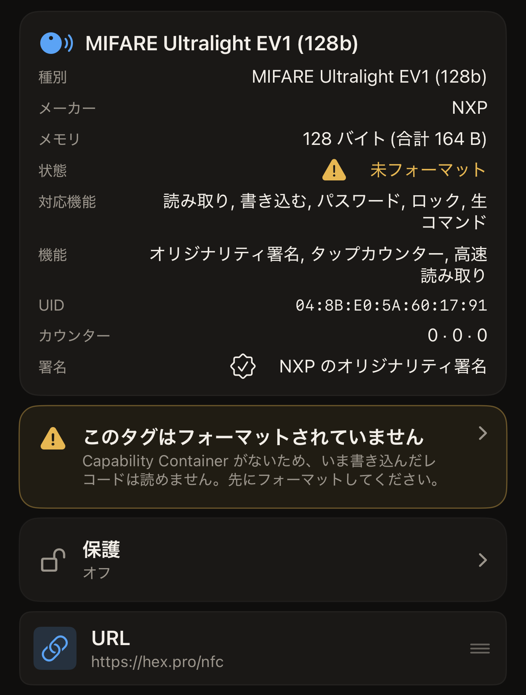
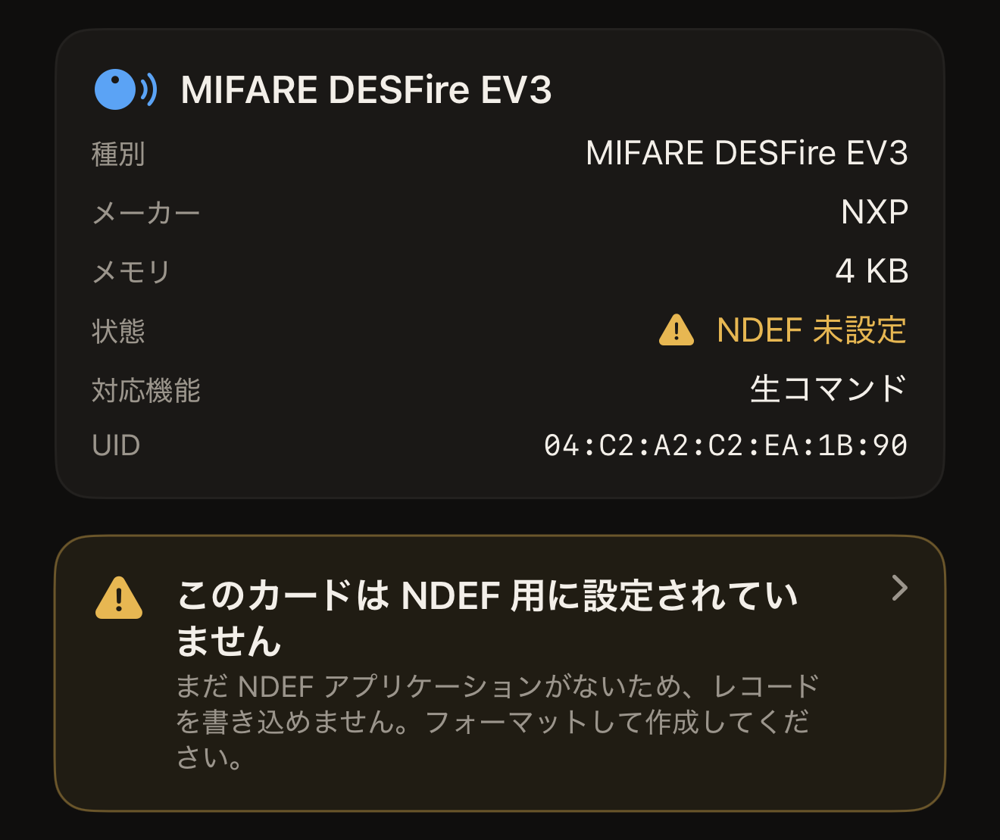
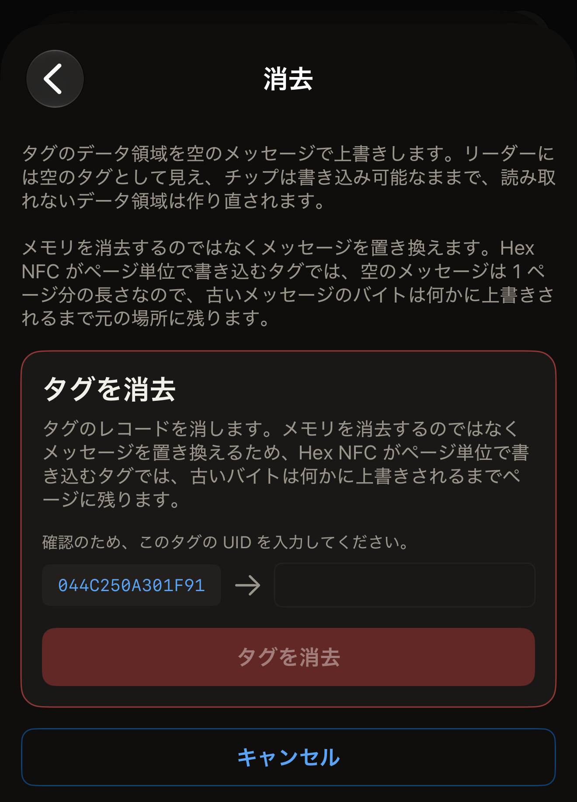
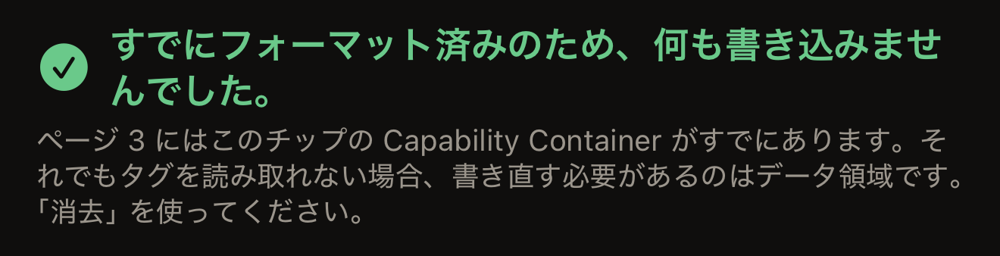
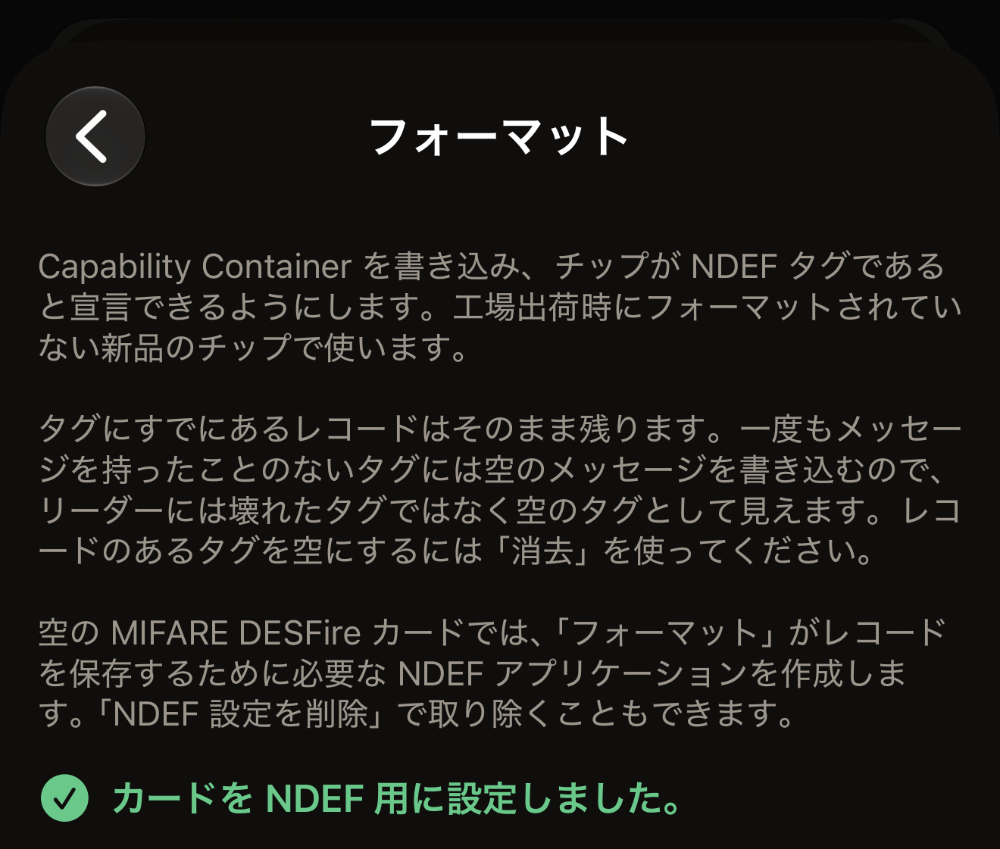
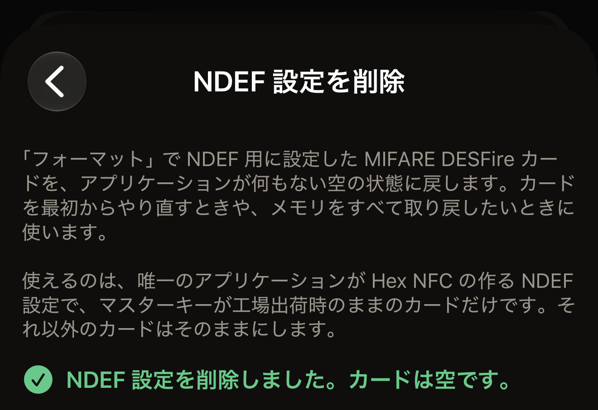

Hex NFC には、読み取れないタグを直す方法が 2 つあり、それぞれ正反対の働きをします。消去はタグのデータ領域を空のメッセージで上書きするので、リーダーには空のタグとして見え、チップは書き込み可能なままです。フォーマットは Capability Container を書き込みます。これは、リーダーがタグのほかの部分を読む前に探す短いヘッダーです。

始める前に、タグをスキャンします。Hex NFC のホーム画面で**スキャン**をタップし、タグを iPhone の上部に近づけます。アプリがタグを読み取ると**タグ**画面が開きます。フォーマットされていないタグ、データを読み取れないタグ、NDEF 用に設定されていない MIFARE DESFire のカードでも、この画面は開きます。どの場合もスキャンに続いて自動的に開くので、何かをタップする必要はありません。スキャン画面に警告が表示されても、それは行き止まりではなく診断です。**タグ**画面で、右上の**書き込む**の隣にあるメニューボタンをタップし、**操作…**をタップします。どちらの修復も**操作**画面の下部にある**危険な操作**にあります。その隣にある **NDEF 設定を削除**は、MIFARE DESFire のカードに行ったフォーマットを元に戻します。ここではどの操作も、タグを変更する前にそのタグを確認します。

::include[two-tap-confirmation]

## タグに必要な修復

アプリは、問題が見つかったその画面で問題の名前を表示します。表示される名前ごとに、必要な修復が決まっています。

- スキャン画面に「このタグはまだフォーマットされていません」、または**タグ**画面に「未フォーマット」と表示されたら、タグをフォーマットします。タグに Capability Container がないため、書き込んだ内容は何も読み取れません。
- スキャン画面に「このタグのデータを読み取れません」、または**タグ**画面に「データ読取不可」と表示されたら、タグを消去します。Capability Container はすでにあるため、フォーマットで直せるものはありません。
- スキャン画面に「このカードはまだ NDEF 用に設定されていません」、または**タグ**画面に「NDEF 未設定」と表示されたら、カードをフォーマットします。そのカードは空の MIFARE DESFire か、以前のフォーマットで設定が最後まで終わらなかったカードなので、まだレコードを書き込めません。交通系カードや入館証にこの表示が出ることはありません。

まだ書き込みを受け付けるタグでは、**タグ**画面にタップできる警告も表示されます。警告には「このタグはフォーマットされていません」、「このタグのデータを読み取れません」、「このカードは NDEF 用に設定されていません」のいずれかが表示され、タップすると**操作**が開きます。完全にロック済みのタグでは、状態は表示されますが警告は表示されません。どちらの修復も書き込みだからです。

:::figure[Capability Container がないタグでは、**状態**の横に「未フォーマット」と表示され、カードの下に「このタグはフォーマットされていません」の警告が表示されます。]

:::

:::figure[空の MIFARE DESFire のカードでは、**状態**の横に「NDEF 未設定」と表示され、カードの下に「このカードは NDEF 用に設定されていません」の警告が表示されます。]

:::

## タグを消去する

消去するとタグのレコードが消え、チップは書き込み可能なまま残ります。読み取れなくなったデータ領域も作り直されます。

:::::steps
::::step[消去画面を開く]
**操作**画面で**消去**をタップします。開いた画面には消去で何が書き込まれるかが説明されていて、タグに何かが書き込まれる前に警告が表示されます。
::::

::::step[消去を開始する]
**タグを消去**をタップします。iPhone がタグをかざすよう求めます。
::::

::::step[タグを iPhone にかざす]
iPhone の上端をタグに当てます。画面に「2 回中 1 回目。タグを当てて識別します。」と表示され、続いてタグの UID が表示されます。
::::

::::step[UID を入力する]
画面に「確認のため、このタグの UID を入力してください。」と表示され、UID の横に空のフィールドが表示されます。同じ文字を、間にコロンを入れずにフィールドに入力し（大文字でも小文字でもかまいません）、**タグを消去**をタップします。タグのパスワードがデータ領域を保護している場合は、フィールドの上に「タグは保護されています」という見出しのカードが表示され、タグに現在設定されているパスワードまたは鍵を求められます。これを入力するまで、**タグを消去**をタップしても何も起きません。

:::figure[1 回目のタップの後、空のフィールドの左にタグの UID が表示され、入力するまで**タグを消去**はグレイ表示のままです。]

:::
::::

::::step[もう一度タグをかざす]
もう一度タグを iPhone の上部に近づけます。アプリがタグから空のメッセージを読み戻すと、画面に「タグを消去しました。」と表示されます。
::::
:::::

消去の結果は 2 通りです。空のメッセージを読み戻せた場合は「タグを消去しました。」と表示されます。それ以外の場合は問題の内容を示すエラーが表示され、その下に不具合の報告に使える詳細が表示されます。次に試すことは[タグをスキャンまたは書き込みできない場合](troubleshooting.md)で説明しています。

:::note
消去はタグのメモリを消し去るのではなく、タグのメッセージを置き換えます。多くのシールやカードに使われているチップである NTAG や MIFARE Ultralight のタグでは、空のメッセージの長さは 1 ページです。古いメッセージのバイトは、何かで上書きされるまで元の場所に残ります。人に譲るタグには、自分で用意したメッセージを上書きしてください。
:::

## タグをフォーマットする {#format-a-tag}

フォーマットは、フォーマット済みで出荷されていない新しいチップに使います。フォーマットは Capability Container を書き込み、タグにすでにあるレコードはそのまま残します。ICODE SLIX2 などの ISO 15693 のタグでは、一度もメッセージを保存したことのないタグに空のメッセージも書き込むので、リーダーには壊れたタグではなく空のタグとして見えます。レコードが入っているタグを空にしたいときは、フォーマットではなく消去を使ってください。空の MIFARE DESFire のカードでは、フォーマットによってカードが NDEF 用に設定されます。これについては、このセクションの最後で説明します。

::::steps
:::step[フォーマット画面を開く]
**操作**画面で**フォーマット**をタップします。
:::

:::step[フォーマットを開始する]
**タグをフォーマット**をタップします。iPhone がタグをかざすよう求めます。
:::

:::step[タグを iPhone にかざす]
iPhone の上端をタグに当てます。画面に「2 回中 1 回目。タグを当てて識別します。」と表示され、続いてタグの UID が表示されます。
:::

:::step[UID を入力する]
画面に「確認のため、このタグの UID を入力してください。」と表示され、UID の横に空のフィールドが表示されます。同じ文字を、間にコロンを入れずにフィールドに入力し（大文字でも小文字でもかまいません）、**タグをフォーマット**をタップします。
:::

:::step[もう一度タグをかざす]
もう一度タグを iPhone の上部に近づけます。アプリがヘッダーを読み戻すと、画面に「タグをフォーマットしました。」と表示されます。MIFARE DESFire のカードでは、代わりに「カードを NDEF 用に設定しました。」と表示されます。
:::
::::

NTAG または MIFARE Ultralight のタグでは、フォーマットの結果は次の 3 つのいずれかです。

- 「タグをフォーマットしました。」は、ヘッダーが書き込まれ、読み戻して確認され、正しい位置にあることを示します。タグはメッセージを書き込める状態です。
- 「すでにフォーマット済みのため、何も書き込みませんでした。」は、タグに正しいヘッダーがすでにあったため、タグには何も書き込まれなかったことを示します。それでも読み取れないタグの問題はデータ領域にあるので、アプリは**消去**を案内します。
- 「このタグにはすでに別の Capability Container があります。」は、タグのヘッダーが、アプリが識別したチップと一致しないことを示します。何も書き込まれていません。

:::figure[ヘッダーがすでにある場合、フォーマットは「すでにフォーマット済みのため、何も書き込みませんでした。」と報告し、代わりに消去を案内します。]

:::

ISO 15693 のタグでは、Capability Container のブロックが書き換え可能なままで、アプリが毎回そのブロックを書き込むため、結果は常に「タグをフォーマットしました。」になります。

:::warning
NTAG と MIFARE Ultralight のタグでは、Capability Container に書き込めるのはタグの寿命を通じて 1 回だけで、後から修正することはできません。そのため、アプリはまずそのページを読み取り、空の場合にだけ書き込みます。識別できなかったチップには、ヘッダーを推測で書き込まず、フォーマットを拒否します。アプリが読み取ったチップ名は**タグ**画面の上部に表示されます。[Hex NFC で使えるタグ](tags-that-work.md)では、アプリがそれぞれのチップで何をできるかを説明しています。
:::

### MIFARE DESFire のカードをフォーマットする

空の MIFARE DESFire EV1、EV2、EV3 のカードには、アプリケーションが 1 つもありません。フォーマットすると、レコードを保存するのに必要な NDEF アプリケーションがカードに作られます。手順は上と同じで、2 回のタップと UID の入力も変わりません。アプリはカードの空きメモリに合わせて NDEF ファイルの大きさを決め、4K のカードでは最大 4 KB になります。設定が済んだカードは、iOS がほかの NDEF タグと同じように読み書きします。

MIFARE DESFire のカードでは、2 回目のタップの結果は次の 2 つのいずれかです。

- 「カードを NDEF 用に設定しました。」は、NDEF アプリケーションがカードにあり、読み戻して確認できたことを示します。カードはレコードを書き込める状態です。
- 「すでに NDEF 用に設定済みのため、何も書き込みませんでした。」は、Hex NFC が以前にこのカードを設定していたため、カードには何も書き込まれなかったことを示します。

:::figure[空の MIFARE DESFire のカードをフォーマットで設定すると、「カードを NDEF 用に設定しました。」と表示されます。]

:::

次のいずれかが表示された場合、アプリはそのカードを NDEF 用に設定するのを拒否しており、カードには何も書き込んでいません。

- 「このカードにはすでに他のアプリケーションがあるため、ここでは NDEF 用に設定できません。何も書き込んでいません。」交通系カードや入館証では、この表示になります。
- 「このカードに何かを追加するにはマスターキーが必要なため、ここでは NDEF 用に設定できません。何も書き込んでいません。」
- 「このカードは別のアプリで NDEF 用に設定されているため、Hex NFC はそのままにします。何も書き込んでいません。」

2 回目のタップで、まだ何も書き込まないうちにカードが iPhone から離れた場合は、画面に「読み取り中にタグを見失いました。端末の上部に当てたまま、もう一度お試しください。」と表示され、何も書き込まれていません。設定の書き込みが始まった後に離れた場合は、『カードは途中まで設定されています。もう一度「フォーマット」をタップして完了してください。』または『カードが途中まで設定されている可能性があります。スキャンして確認するか、もう一度「フォーマット」をタップしてください。』と表示されます。もう一度フォーマットすると、前回止まったところから再開します。

空きメモリが足りないカードでは、1 回目の試行で『このカードには NDEF ファイルに必要な空きメモリがありません。途中まで作成したものは「NDEF 設定を削除」で消してください。』と表示されます。同じカードで 2 回目以降に試すと、「このカードには NDEF ファイルに必要な空きメモリがありません。何も書き込んでいません。」と表示されます。どちらの場合も、次のセクションで説明する **NDEF 設定を削除**でカードを空にできます。

## カードの NDEF 設定を削除する {#remove-ndef-setup}

**NDEF 設定を削除**は、フォーマットで設定した MIFARE DESFire のカードを空の状態に戻します。カードの NDEF アプリケーションとその中のレコードをすべて削除し、カードのメモリをすべて空きに戻します。対象になるのは、カードにあるアプリケーションが Hex NFC の作る NDEF 設定 1 つだけで、マスターキーが工場出荷時のままのカードです。フォーマットが途中で終わった設定も対象になります。それ以外のカードには何もしません。

::::steps
:::step[削除画面を開く]
**操作**画面の**危険な操作**で、**NDEF 設定を削除**をタップします。
:::

:::step[削除を開始する]
**NDEF 設定を削除**をタップします。iPhone がカードをかざすよう求めます。
:::

:::step[カードを iPhone にかざす]
iPhone の上端をカードに当てます。画面に「2 回中 1 回目。タグを当てて識別します。」と表示され、続いてカードの UID が表示されます。
:::

:::step[UID を入力する]
画面に「確認のため、このタグの UID を入力してください。」と表示され、UID の横に空のフィールドが表示されます。同じ文字を、間にコロンを入れずにフィールドに入力し（大文字でも小文字でもかまいません）、**NDEF 設定を削除**をタップします。
:::

:::step[もう一度カードをかざす]
もう一度カードを iPhone の上部に近づけ、結果が表示されるまでそのまま保ちます。アプリがカードを読み戻し、カードにアプリケーションが 1 つもないことを確かめると、画面に「NDEF 設定を削除しました。カードは空です。」と表示されます。
:::
::::

:::figure[NDEF 設定がなくなったカードでは、「NDEF 設定を削除しました。カードは空です。」と表示されます。]

:::

すでに空のカードでは、「このカードはすでに空のため、何も変更しませんでした。」と表示されます。次のいずれかが表示された場合、アプリはそのカードの設定の削除を拒否しており、何も変更していません。

- 「このカードには他のアプリケーションがあります。設定を削除するとそれらも消えるため、何も変更していません。」
- 「このカードの NDEF 設定は別のアプリで作られたものなので、Hex NFC は削除しません。何も変更していません。」
- 「このカードのマスターキーは工場出荷時のキーではないため、アプリは設定を削除できません。何も変更していません。」

2 回目のタップで、まだ何も変更しないうちにカードが iPhone から離れた場合は、画面に「読み取り中にタグを見失いました。端末の上部に当てたまま、もう一度お試しください。」と表示され、カードは何も変わっていません。削除が始まった後に離れた場合は、「カードはすでに空になっている可能性があります。スキャンして確認してください。」と表示されます。スキャンしてもカードが NDEF 用に設定されたままなら、もう一度 **NDEF 設定を削除**を実行します。削除のたびにアプリはまずカードを読み取るので、すでに空のカードでは「このカードはすでに空のため、何も変更しませんでした。」と表示されます。

設定がなくなったカードをスキャンすると、**タグ**画面の**状態**の横に再び「NDEF 未設定」と表示されます。フォーマットすれば、カードを改めて NDEF 用に設定できます。

## レコード一覧からタグを空にする

**操作**を経由せずに、**タグ**画面からタグを空にすることもできます。空にする書き込みは保護の変更を伴わないため、タグをかざすのは 1 回だけで、UID の入力も求められません。パスワードによる保護の設定や削除も同時に行う書き込みでは、タグを 2 回かざし、UID の入力を求められます。これは、**危険な操作**にあるどの操作でも求められるのと同じ、2 回のタップによる確認です。

::::steps
:::step[すべてのレコードを削除する]
**タグ**画面で、レコードを左にスワイプして**削除**をタップします。画面に「レコードが残っていません」と表示されるまで繰り返します。この時点では、削除はまだタグに反映されていません。
:::

:::step[空の状態を書き込む]
画面に「すべてのレコードを削除しました。書き込んでタグを空にするか、レコードを追加し直してください。」と表示されます。その下、**レコードを追加**の上にある**書き込んでタグを空にする**をタップします。iPhone がタグをかざすよう求めます。
:::

:::step[タグを iPhone にかざす]
iPhone の上端をタグに当て、書き込みが終わるまでそのまま保ちます。
:::
::::

## 関連項目

- [タグをスキャンする](scan-a-tag.md)
- [タグのレコードを編集する](edit-records.md)
- [タグにリンクを書き込む](write-a-link.md)
- [タグをスキャンまたは書き込みできない場合](troubleshooting.md)
- [Hex NFC で使えるタグ](tags-that-work.md)
