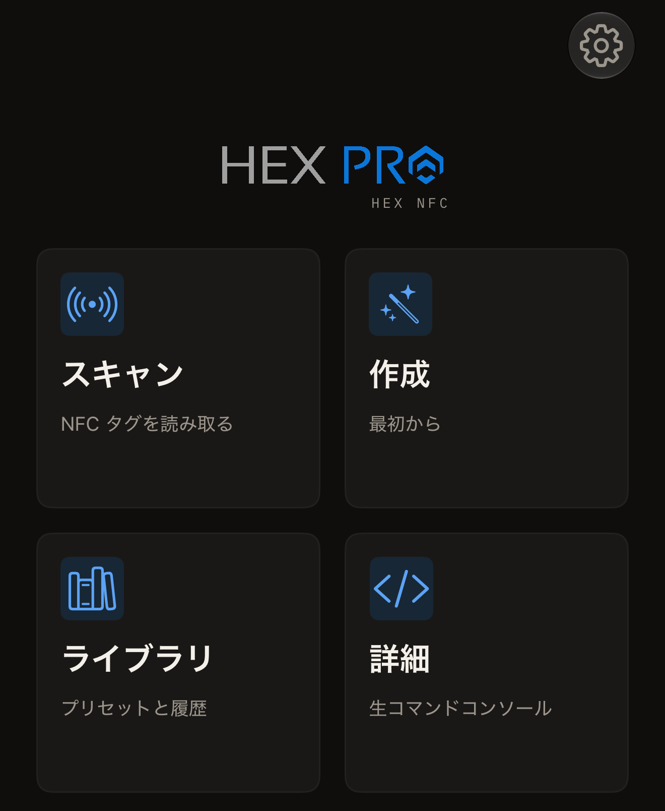

Hex NFC は身の回りの NFC タグを読み取り、タグに入っているレコードをすべて表示します。空のタグにレコードを書き込んだり、パスワードを設定できるチップにパスワードを設定したりすることもできます。日本の交通系カードや、電子パスポートのチップも読み取れます。アカウントを作る必要はなく、アプリには解析機能も含まれていません。

## 必要なもの

- [App Store](https://apps.apple.com/app/id6801457461) から iPhone にインストールした Hex NFC。
- iOS 17 以降を搭載した iPhone。
- NFC タグ。市販の空のシール、カード、キーホルダーの多くには、このアプリで読み取れるチップが入っています。対応するチップは [Hex NFC で使えるタグ](tags-that-work.md)に、それぞれのチップでできることは[チップ対応表](../developer/chip-support-matrix.md)に載っています。

## できること

Hex NFC を開くと、4 つのタイルが並ぶ Hex NFC のホーム画面が表示されます。

- タグを読み取って中身を確認するには、**スキャン**をタップします。詳しくは[タグをスキャンする](scan-a-tag.md)を参照してください。[交通系カード](transit-cards.md)も同じように読み取れ、[パスポート](passports.md)は 2 回かざして読み取ります。
- レコードを一から組み立てて書き込むには、**作成**をタップします。詳しくは[タグにリンクを書き込む](write-a-link.md)を参照してください。
- 以前スキャンしたタグを見るには、**ライブラリ**をタップします。詳しくは[以前スキャンしたタグを探す](scan-history.md)を参照してください。保存したレコードのセットもここにあります。こちらは[タグをプリセットとして保存する](presets.md)で説明しています。
- コマンドセットがわかっているチップに生コマンドを送信するには、**詳細**をタップして生コマンドのコンソールを開きます。詳しくは[タグに生コマンドを送信する](advanced-console.md)を参照してください。

:::figure[Hex NFC のホーム画面には、**スキャン**、**作成**、**ライブラリ**、**詳細**の 4 つのタイルが並びます。]

:::

## タグの内容を変える

タグを開いたら、[タグのレコードを編集する](edit-records.md)の手順でレコードを組み立て直せます。選べる種類は[レコードの種類](record-types.md)にまとめてあります。[パスワードでタグを保護する](protect-a-tag.md)では、チップが照合する秘密を設定します。[タグのパスワードを削除する](remove-password.md)では、その秘密を再び取り除きます。[パスワードの間違いの回数を制限する](attempt-limit.md)では、チップが何回までの間違いを許容するかを扱います。タグそのものに働きかけるツールは 3 つあります。[タグを消去またはフォーマットする](erase-or-format.md)、[タグを完全にロックする](permanent-lock.md)、[タグのメモリのコピーを保存する](memory-dump.md)です。

## 使い始める

[最初のタグを読み取る](quick-start.md)では、Hex NFC のホーム画面から最初のスキャンまでを 5 分ほどで進めます。[タグの保護](tag-protection.md)では、パスワードが何を保護するのか、なくしたパスワードはなぜ取り戻せないのかを説明します。タグが応答しないときは、[タグをスキャンまたは書き込みできない場合](troubleshooting.md)を参照してください。[設定](settings.md)ではアプリのすべてのスイッチを一覧にし、[プライバシーとデータ](privacy.md)では iPhone の中にとどまるものを説明し、[よくある質問](faq.md)では料金についての疑問に答えています。
