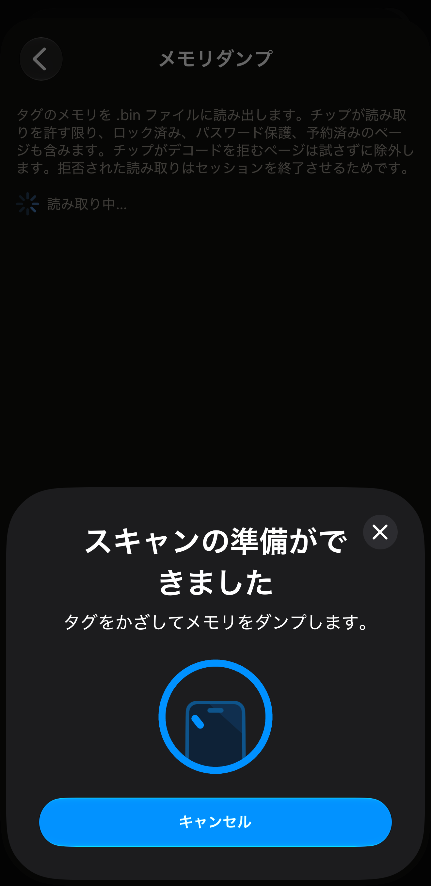
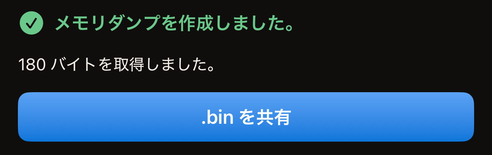
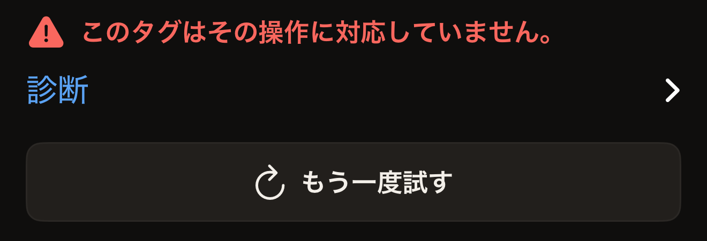

メモリダンプは、タグのページを `.bin` ファイルにコピーし、そのファイルを iOS の共有シートに渡します。行うのは読み取りだけで、実行後もタグは変わりません。ダンプではタグを 1 回かざします。パスワードで読み取りが保護されているタグでは 2 回です。タグの UID を入力し直すよう求められることはありません。

必要なものは、NFC を搭載した iPhone、App Store からインストールした Hex NFC、そして手元のタグです。このアプリでタグを読み取ったことがない場合は、[最初のタグを読み取る](quick-start.md)から始めてください。メモリダンプは「操作」画面にあります。この画面は、「タグ」画面の右上にあるメニューボタンから開きます。以下の手順では、そこへ進むためにタグをスキャンします。スキャンそのものについては[タグをスキャンする](scan-a-tag.md)で説明しています。

メモリダンプは、Hex NFC がページ単位でアクセスするチップで使えます。対象のチップは NTAG 210µ、NTAG213、NTAG213 TT、NTAG215、NTAG216、MIFARE Ultralight EV1、MIFARE Ultralight C、EM V10、EM V11、EM V16 です。それ以外のタグでは、画面に「このタグはその操作に対応していません。」と表示されます。

[Hex NFC で使えるタグ](tags-that-work.md)では、手元のタグのチップを見分ける方法を説明しています。

## タグのメモリをダンプする

:::warning[画面を離れる前にファイルを送る]
アプリはダンプのコピーを残しません。ファイルを送らずに共有シートを閉じたり、「メモリダンプ」画面を離れたりすると、ファイルは失われます。その場合は、タグをもう一度読み取る必要があります。
:::

:::::steps
::::step[スキャン画面を開く]
Hex NFC のホーム画面で**スキャン**をタップします。スキャン画面が開き、タグを探し始めます。
::::

::::step[タグを iPhone にかざす]
iPhone の上端をタグに平らに当て、1 秒ほど動かさずに保ちます。「タグ」画面が開き、タグの内容が表示されます。
::::

::::step[「操作」を開く]
「タグ」画面で、右上のメニューボタン（**書き込む**の左にあるボタン）をタップします。メニューには**プリセットとして保存…**と**操作…**の 2 つの行があります。**操作…**をタップします。
::::

::::step[ダンプを開始する]
**メモリダンプ**をタップします。画面が開くとすぐにスキャンが始まり、途中で確認は求められません。
::::

::::step[もう一度タグを iPhone にかざす]
もう一度 iPhone の上端をタグに当てます。待っている間、ステータス行には「iPhone の上部にタグを当ててください。」と表示されます。タグが応答すると「読み取り中…」に変わります。最後に「メモリダンプを作成しました。」と表示され、その下に取得したバイト数が表示されます。

:::figure[タグの読み取り中も、iOS のシートには「タグをかざしてメモリをダンプします。」と表示されたままで、その奥のステータス行には「読み取り中…」と表示されます。]

:::

パスワードで読み取りも保護されているタグでは、ダンプは何も読み取らないうちに止まります。「タグは保護されています」という見出しのカードが表示され、タグのパスワードまたは鍵を求められます。それを入力して**ロック解除して読み出す**をタップし、もう一度タグを iPhone にかざします。
::::

::::step[ファイルを共有する]
**.bin を共有**をタップし、ファイルの送信先を選びます。このボタンは、読み取りが最後まで終わった後にだけ表示されます。

:::figure[読み取りが終わると「メモリダンプを作成しました。」と表示され、その下にバイト数、さらにその下に **.bin を共有**が表示されます。]

:::
::::
:::::

## ファイルの中身

ファイルの中身は、チップのメモリを最初のページから 1 ページ 4 バイトずつコピーしたもので、ヘッダーも追加のデータもありません。ロック済みのページ、パスワードで保護されたページ、予約済みのページも、チップが読み取りを許す限りすべて含まれます。チップがデコードを拒むページは、読み取りを試みずに除外します。1 回でも読み取りが拒否されるとセッションが終わり、ダンプの残りを取得できなくなるためです。MIFARE Ultralight C では、最後の 4 ページの手前でコピーが止まります。この 4 ページにはチップの鍵が入っていて、どの読み取りにも応答しません。

完全なダンプのサイズはチップごとに決まっているので、「メモリダンプを作成しました。」の下のバイト数を見れば、すべて取得できたかどうかがわかります。チップ名は「タグ」画面のタグ情報カードの上部に表示され、下の表の 1 列目と同じ表記が使われます。MIFARE Ultralight EV1 の場合は、2 つのサイズのどちらであるかもそこに表示されます。

:::table[完全なダンプのバイト数]
| チップ | 完全なダンプ |
| :--- | ---: |
| NTAG 210µ、EM V10、EM V11、EM V16 | 64 バイト |
| NTAG213、NTAG213 TT | 180 バイト |
| NTAG215 | 540 バイト |
| NTAG216 | 924 バイト |
| MIFARE Ultralight EV1 (48b) | 80 バイト |
| MIFARE Ultralight EV1 (128b) | 164 バイト |
| MIFARE Ultralight C | 176 バイト |
:::

Hex NFC は、読み取った日時を含む名前でファイルを一時領域に書き込みます。ファイルを残すには共有するしかありません。アプリにはダンプの一覧がなく、「タグ」画面からファイルに戻る手段もありません。画面を離れる前に、どこかへ送ってください。

## ダンプが終わらない場合

ダンプに失敗してもタグは元のままなので、もう一度読み取っても失うものはありません。

- 同じタグをもう一度読み取るには、**もう一度試す**をタップします。画面で新しいスキャンが始まります。
- タグの応答内容を確認するには、エラーメッセージの下にある**診断**を開きます。中のテキストは選択でき、不具合の報告にコピーできます。

タグを読み取る前に iOS のシートで「キャンセル」をタップすると、「操作」画面に戻ります。iPhone にタグを近づけないままでいると、シートは自動的に閉じ、画面に「タグが見つかりません」と表示されて、その下に**もう一度試す**が表示されます。

「このタグはその操作に対応していません。」は、チップがこのページの冒頭に挙げたものではないことを示します。NTAG424 DNA、ICODE SLIX、ICODE SLIX2、MIFARE DESFire の各チップ、FeliCa は、いずれもこの応答になります。各チップでできることは[チップ対応表](../developer/chip-support-matrix.md)に一覧があります。

:::figure[ダンプで読み取れないチップでは、画面に「このタグはその操作に対応していません。」と表示され、その下に**診断**と**もう一度試す**が表示されます。]

:::

読み取りの途中でタグが外れてしまう場合は、[タグをスキャンまたは書き込みできない場合](troubleshooting.md)を参照してください。このページで扱っていないメッセージについても、そちらを参照してください。

## 関連項目

- [タグをスキャンする](scan-a-tag.md)
- [Hex NFC で使えるタグ](tags-that-work.md)
- [タグに生コマンドを送信する](advanced-console.md)
