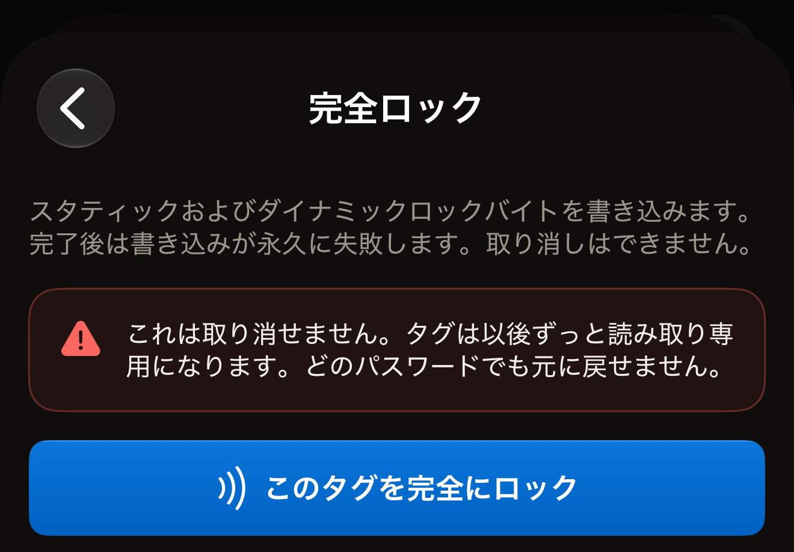
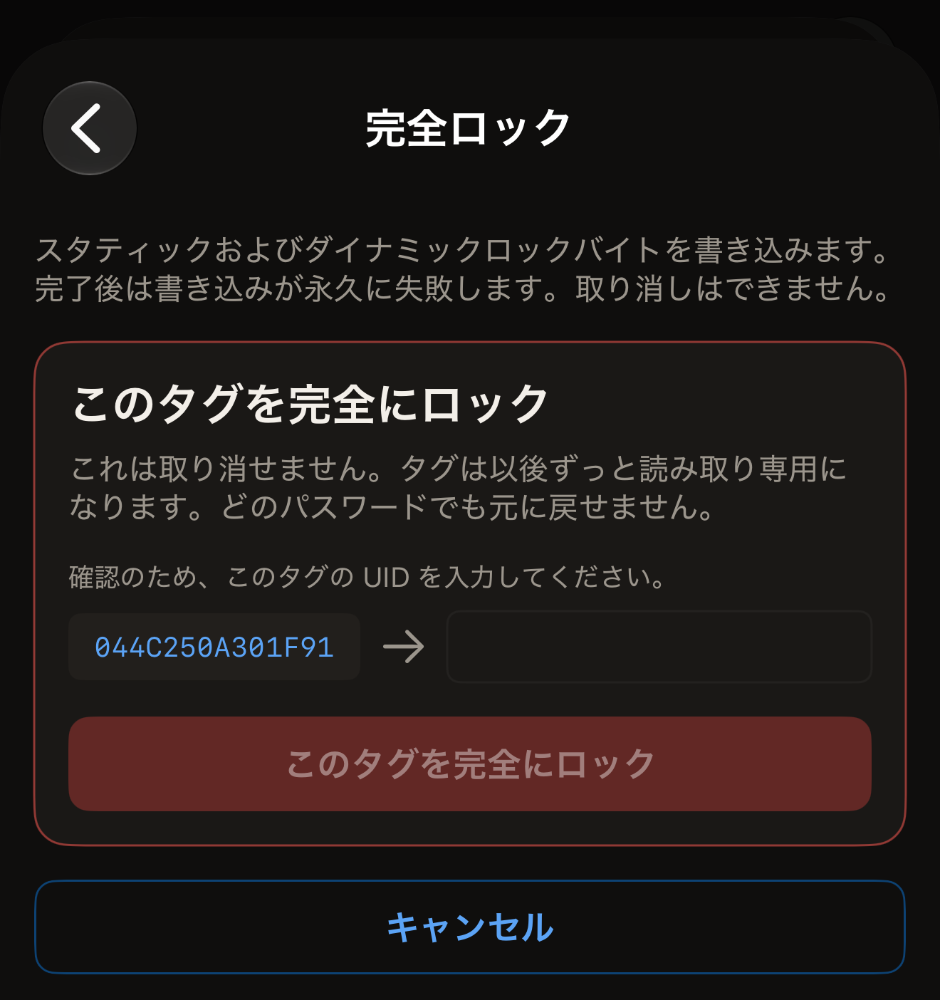
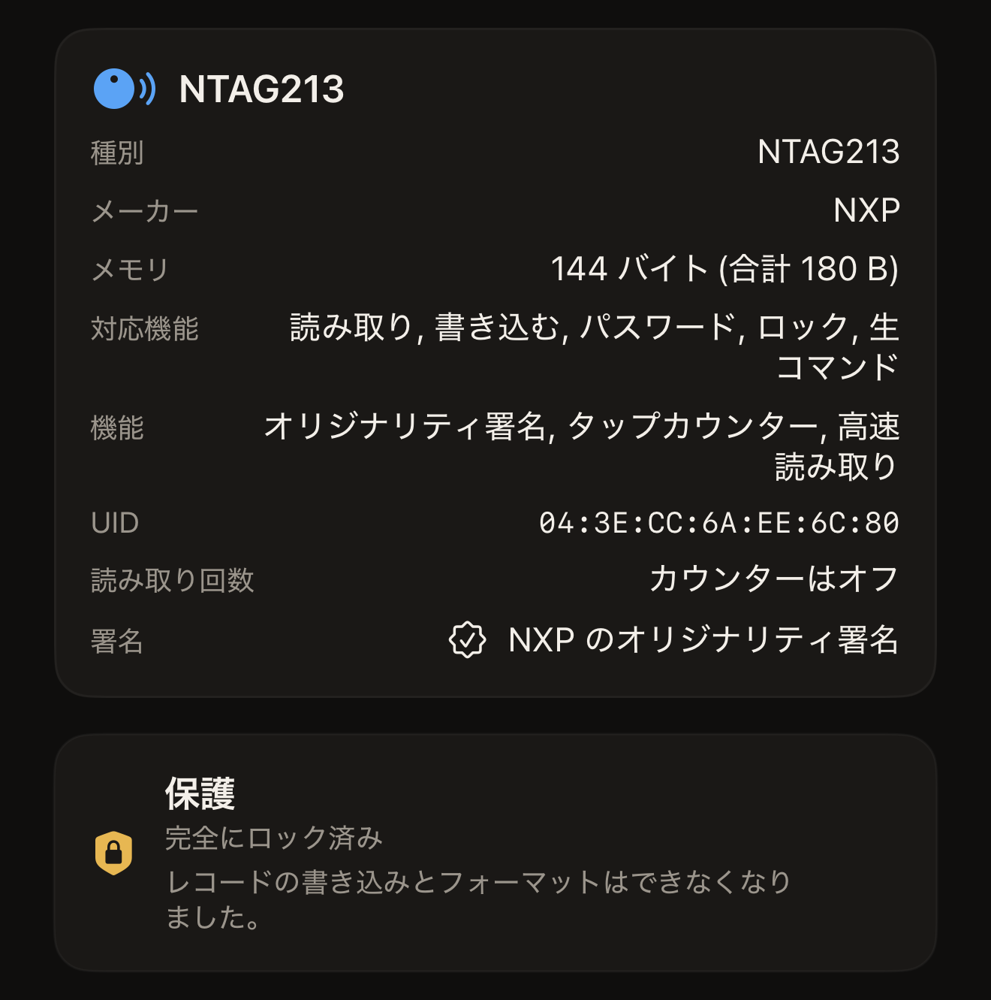

Hex NFC では、チップのロックビットを設定することで、iPhone からタグを完全にロックできます。タグは保持しているレコードをそのまま残し、以後はレコードの書き込みもフォーマットも一切できなくなります。読み取りには影響しないので、どの端末でも引き続きタグを読み取れます。

タグをロックできるかどうかは 2 つの点で決まり、スキャンするとその両方を確認できます。**タグ**画面の一番上のカードは、チップの名前が見出しになっています。このカードには**対応機能**の行があります。この行に「ロック」が表示されるのは、このアプリでロックできるチップだけです。その下の**保護**カードには、現在タグを保護しているものが表示されます。「オフ」は何も保護していないという意味で、ロックを進められます。パスワードを使わないチップには**保護**カードそのものがなく、ロックを妨げるものもありません。

「パスワード・書き込みのみ」のように、パスワードや鍵の名前が入った概要は、保護が有効になっていることを示します。この状態のタグはロックされません。アプリがそれをどう伝えるかは、チップによって異なります。

NTAG と MIFARE Ultralight EV1 では、Hex NFC は何かを書き込む前に確認し、「このタグはパスワードで保護されているため、完全にロックできません。先にパスワードを削除してから、ロックしてください。」と表示します。MIFARE Ultralight C と ICODE SLIX2 では、アプリはロックを開始します。この 2 つのチップの概要には、3DES 鍵またはパスワードが表示されます。タグ自身の保護が最初の書き込みを拒否し、その拒否は「何もロックされていません。」として返ってきます。どちらの場合もロックビットは書き込まれないので、このタップでタグが損なわれることはありません。先にパスワードまたは鍵を削除してください。手順は[タグのパスワードを削除する](remove-password.md)を参照してください。

ロックを妨げるのはパスワードそのものではなく、保護が有効になっていることです。タグに保存されていても、もう何も保護していないパスワードは、改めてスキャンしたときの**保護**カードでは「オフ」と表示されます。この状態のタグはロックできます。

:::warning[ロックしたタグはロックを解除できない]
パスワードでも、ほかのアプリでも、後のタップでも、完全ロックを元に戻すことはできません。タグをロックするのは、その内容が確定してからにしてください。
:::

## タグを完全にロックする

::include[two-tap-confirmation]

:::::steps
::::step[ロックしたいタグをスキャンする]
Hex NFC のホーム画面で**スキャン**をタップし、タグを iPhone の上部に近づけます。**タグ**画面が開き、タグの内容が表示されます。[タグをスキャンする](scan-a-tag.md)を参照してください。
::::

::::step[タグをロックできるか確認する]
「タグ」画面で、タグ情報カードの**対応機能**の行に「ロック」があること、**保護**カードに「オフ」と表示されていることを確認します。パスワードを使わないチップでは**保護**カードは表示されませんが、それでも問題ありません。
::::

::::step[「操作」画面を開く]
「タグ」画面で、右上の**書き込む**の隣にあるメニューボタンをタップし、**操作…**をタップします。
::::

::::step[「完全ロック」を選ぶ]
**危険な操作**までスクロールし、**完全ロック**をタップします。開いた画面には、ロックによって失われるものと、取り消せないことが説明されています。このタイルは、ロックビットを持たないチップも含め、すべてのタグで表示されます。アプリは 1 回目のタップでチップを確認します。ロックできないチップでは、そのタップの後、UID を入力する前に「このタグはその操作に対応していません。」と表示されます。何も書き込まれません。

:::figure[**完全ロック**画面は警告を表示した状態で開き、**このタグを完全にロック**をタップするまでタグには何も書き込まれません。]

:::
::::

::::step[1 回目のタップでタグをかざす]
警告を読んでから、**このタグを完全にロック**をタップします。画面に「2 回中 1 回目。タグを当てて識別します。」と表示されるので、シートが閉じるまでタグを iPhone の上部に近づけたままにします。
::::

::::step[タグの UID を入力する]
「確認のため、このタグの UID を入力してください。」の下に、空のフィールドと並んでタグの UID が表示されます。UID はコロンやスペースのない大文字で表示され、すべてを入力します。タグ情報カードで `04:BA:4A:92:1B:21:90` と表示される UID は、ここでは `04BA4A921B2190` と表示されます。大文字でも小文字でも一致と見なされ、入力の前後のスペースは無視されます。入力した内容が一致するまで、ボタンはグレイ表示のままです。

:::figure[2 回のタップの間は、空のフィールドの左にタグの UID が表示され、UID を入力するまで**このタグを完全にロック**はグレイ表示のままです。]

:::
::::

::::step[2 回目のタップでタグをかざす]
もう一度**このタグを完全にロック**をタップし、タグを iPhone の上部に近づけます。待機中は画面に「2 回中 2 回目。同じタグをもう一度かざしてください。」と表示され、タグを離すと結果が表示されます。
::::
:::::

## ロックが完了したときの表示

「タグを完全にロックしました。」が、目指す結果です。アプリはロックビットを設定した後、もう 1 回書き込みを受け付けるようタグに求め、タグはそれを拒否しました。その拒否がロックの証拠です。

「ロックを書き込みました。」は、ロックビットは設定されたものの、今回のタップではそれを確認できなかったという意味です。チップによっては、ロックビットが有効になるのは次にタグが起動したときです。アプリは「このチップのロックビットは次回のタップから有効になるため、このセッションでは確認できません。もう一度タグをスキャンして、書き込みを拒否することを確かめてください。」と補足します。タグをもう一度スキャンし、**保護**カードで判定結果を確認してください。

**タグ**画面の**保護**には、ロックされていることをアプリが読み戻して確認したタグでは「完全にロック済み」と表示され、その下に「レコードの書き込みとフォーマットはできなくなりました。」と表示されます。確認のスキャンをするまでは、代わりに「ロックを書き込み済み・もう一度スキャンして確認してください」と表示されます。ロックされていることを読み戻して確認したタグでは、**書き込む**は使えません。

:::figure[確認のスキャンの後、**保護**カードには「完全にロック済み」と表示され、その下に「レコードの書き込みとフォーマットはできなくなりました。」と表示されます。]

:::

タグに保存されたパスワードはロック後も残り、その場合カードには「完全にロック済み・パスワードは設定されたまま」と表示されます。その下の行には、そのパスワードをまだ削除できるかどうかが表示されます。そもそもどのチップをロックできるかは、[Hex NFC で使えるタグ](tags-that-work.md)で説明しています。

## ロックが完了しなかった場合

ロックはいくつかの段階に分けて行われます。途中で止まった場合、アプリは単に失敗とは呼ばず、タグがどういう状態になったかを示します。

- 「何もロックされていません。」チップはすべての段階を拒否し、そのことを報告しました。ロックビットは何も書き込まれておらず、タグは元のままなので、もう一度実行しても失うものはありません。タグをもう一度スキャンして、ロックに必要な 2 つの点を確認してください。1 つは、**保護**カードに「オフ」と表示されていること、またはパスワードを使わないチップで**保護**カードがまったく表示されないことです。もう 1 つは、タグ情報カードの**対応機能**の行に「ロック」があることです。MIFARE Ultralight C と ICODE SLIX2 では、保護が有効なときにこのメッセージが表示されます。鍵またはパスワードを削除してから、もう一度ロックを実行してください。
- 「このタグは一部がロックされ、これは取り消せません。メモリの一部は恒久的に読み取り専用になり、残りは拒否されたためまだ書き込めます。」チップの一部はもう元に戻せません。もう一度実行しても、残りが完了することはありません。「タグ」画面に戻ると、**保護**カードには「一部ロック済み・このタグの一部は恒久的に読み取り専用です」と表示されます。パスワードがまだ設定されているタグでは、代わりに「一部ロック済み・パスワードは設定されたまま」と表示されます。NTAG21x と MIFARE Ultralight では、アプリがロックバイトを読み戻すので、改めてスキャンしても同じ表示になります。ICODE SLIX2 のブロックごとのロックはスキャン時には読み直さないため、改めてスキャンしても一部ロックについては何も表示されません。このチップでは、実行の最後に表示される結果が唯一の記録です。
- 「取り消せないロックの途中でタグが応答しなくなったため、メモリのいずれかが読み取り専用になったかどうかをこのアプリでは判断できません。このタグはロックされている可能性があるものとして扱ってください。」書き込みの途中でタグが離れました。タグを使う前に、もう一度スキャンして**保護**カードを確認してください。
- 「このタグの一部は恒久的に読み取り専用になり、これは取り消せません。残りを確認する前にタグが応答しなくなったため、残りもロックされている可能性があります。」1 つの段階は確認済みで、もう 1 つは不明です。タグをもう一度スキャンし、ロックされているものとして扱ってください。

## 関連項目

- [タグの保護](tag-protection.md)
- [タグを消去またはフォーマットする](erase-or-format.md)
- [タグをスキャンまたは書き込みできない場合](troubleshooting.md)
