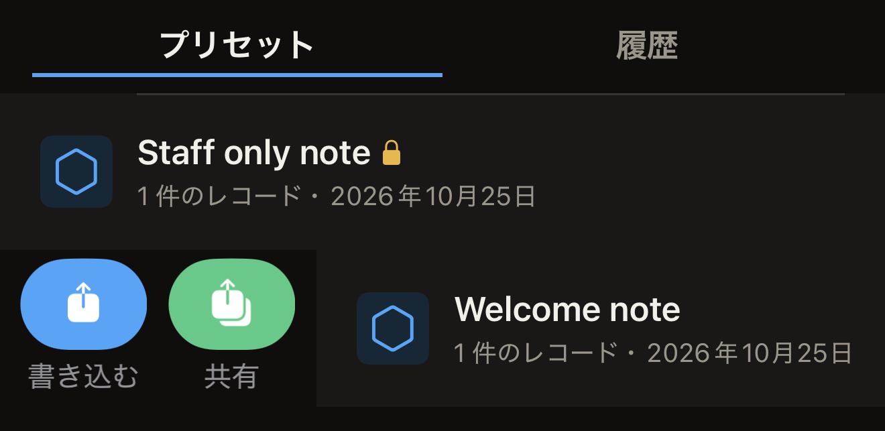
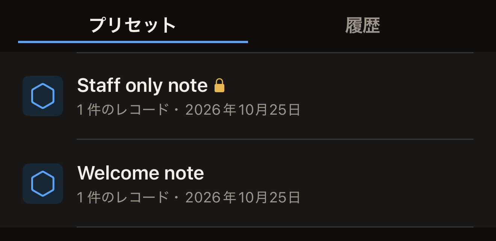

プリセットは、名前を付けて iPhone に保存したレコードのセットです。編集中のタグから保存しておけば、同じレコードを作り直すことなく、何枚のタグにでも書き込めます。

始める前に、保存する内容として、レコードのセットを「タグ」画面に用意しておきます。Hex NFC のホーム画面で**スキャン**をタップし、コピーしたいタグをかざします。手元にタグがない状態から始めるには、**作成**をタップします。どちらの場合も「タグ」画面が開きます。[タグをスキャンする](scan-a-tag.md)と[タグのレコードを編集する](edit-records.md)を参照してください。

## 編集中のレコードを保存する

::::steps
:::step[保存シートを開く]
「タグ」画面で右上のメニューボタンをタップし、**プリセットとして保存…**をタップします。タグにレコードか保護設定が 1 つ以上設定されるまで、このメニューの行はグレイ表示です。
:::

:::step[プリセットに名前を付ける]
**名前**に、あとで見分けのつく名前を入力します。たとえば、タグを設置する場所の名前などです。名前を入力するまで、**保存**はグレイ表示のままです。
:::

:::step[メモを追加する]
任意で、**メモ**にプリセットの用途を入力します。このフィールドには 4 行まで入力できます。
:::

:::step[アイコンを選ぶ]
**アイコン**で、3 つのセグメントのいずれかをタップします。セグメントは図形ではなく言葉で、**外枠**、**上向きキャレット**、**下向きキャレット**と表示されています。タップしたものによって、**ライブラリ**でプリセットの横に表示される六角形のバッジが決まります。
:::

:::step[プリセットの中身を確認する]
**レコード**には、保存されるレコードの数が表示されます。保護だけを持ち、ほかに何も持たないプリセットの場合は、代わりに「レコードはありません。このプリセットは保護のみを適用します。」と表示されます。

リストに、座標も地図の URL もない**場所**が含まれている場合、**レコード**には『場所のレコードに座標も地図の URL もないため、このプリセットはタグに書き込めません。「タグ」画面でそのレコードを入力するか削除してから、保存してください。』とも表示されます。その間、**保存**はグレイ表示のままです。**キャンセル**をタップし、レコードを入力するか削除してから、保存シートをもう一度開きます。[レコードの種類](record-types.md)を参照してください。
:::

:::step[保存する]
**保存**をタップします。シートが閉じ、**ライブラリ**の**プリセット**タブの一番上にプリセットが表示されます。
:::
::::

プリセットに保護が含まれるのは、保存する前にタグにパスワードまたは鍵を設定した場合だけです。この設定は「タグ」画面で行います。保護できるタグでは、この画面に**保護**が表示されます。**保護**をタップして、**このタグをパスワードで保護**をオンにします。シートに表示されるフィールド（**パスワード(4 バイト)**など）に秘密を入力し、**完了**をタップします。[パスワードでタグを保護する](protect-a-tag.md)を参照してください。

設定が済むと、保存シートに**保護**セクションが加わり、「パスワードによる保護(書き込みのみ)」のように、プリセットが持つ保護の内容が表示されます。秘密そのものはプリセットには含まれません。アプリは同じセクションで、そのことを「シークレットはこのデバイス(キーチェーン)にのみ保存されます。同期されることも、書き出しに含まれることもありません。」と示しています。プリセットでタグの保護を有効にできるのは、その秘密がこの iPhone にある間だけです。秘密を入力せずに保存したプリセットでは、保護は何も有効になりません。

iPhone が保存を拒否した場合は、フォームの下部に赤い文字で 1 行表示されます。「保存できませんでした:」に続けて、iPhone が返した理由が表示されます。シートは開いたままで、レコードも「タグ」画面に残っているので、入力した内容は失われません。もう一度**保存**をタップします。同じ理由が再び表示される場合は、**キャンセル**をタップします。レコードは「タグ」画面に残っています。プリセットとして保存する代わりに、そのままタグに書き込むこともできます。

## プリセットをタグに書き込む {#write-a-preset-to-a-tag}

プリセット名の横にあるロックアイコンは、そのプリセットに保護設定が含まれていることを示します。行からわかるのはそこまでです。書き込みでタグの保護が有効になるかどうかは、プリセットとともに保存されている秘密によって決まるため、行には示されません。秘密も表示されません。この iPhone で自分のパスワードまたは鍵を入力してから保存したプリセットは、その秘密を持っていて、タグの保護を有効にします。すでに保護されていたタグから保存し、そのパスワードを一度も入力していないプリセットは、秘密を持っていません。レコードは書き込みますが、何も保護しません。目の前のプリセットがどちらかわからない場合は、保護を有効にする方として扱ってください。

:::::steps
::::step[ライブラリを開く]
Hex NFC のホーム画面で**ライブラリ**をタップします。「ライブラリ」画面が**プリセット**タブで開き、最後に変更したプリセットが一番上に表示されます。
::::

::::step[書き込みを開始する]
プリセットを左端から少しだけスワイプし、**書き込む**をタップします。**ライブラリ**が閉じ、書き込み画面が開きます。

:::figure[プリセットを左端から少しスワイプすると、**書き込む**と**共有**が表示されます。]

:::
::::

::::step[タグを iPhone にかざす]
画面に「iPhone の上部にタグを近づけてください」と表示されている間に、タグを iPhone の上部に近づけます。レコードがタグに書き込まれると、「書き込み完了」と表示されます。
::::
:::::

:::warning[保護を適用するプリセットでは、タグの確認を求められない]
保護設定を含み、この iPhone に秘密がまだ残っているプリセットは、かざしたタグがどれであってもその秘密を設定します。タグを読み取る 1 回目のタップなしで保護が有効になるのは、アプリの中でここだけです。確認のために UID を入力することもありません。保護するつもりのタグだけをかざしてください。それらのタグを使っている間は、プリセットを残しておいてください。このプリセットで保護したタグには、このプリセットをもう一度書き込むことで再びアクセスできます。プリセットを削除すると、その秘密のコピーも削除されます。
:::

## プリセットを管理する

プリセットを保存するまで、**プリセット**タブには「保存されたプリセットはありません」と表示されます。保存すると、各行にプリセットの名前とアイコンが表示されます。その下の行には、レコードの数と、プリセットを最後に変更した日付が表示されます。

名前の横のロックアイコンは保護設定を含むプリセットを示し、VoiceOver では「保護を適用」と読み上げられます。このロックアイコンが何を示し、何を示さないかは、前述の[プリセットをタグに書き込む](#write-a-preset-to-a-tag)で説明しています。

:::figure[プリセット名の後ろにあるロックアイコンは、保護設定を含むプリセットであることを示します。]

:::

プリセットを左端からスワイプすると**書き込む**と**共有**が、右端からスワイプすると**削除**と**複製**が表示されます。少しだけスワイプしてから、目的のボタンをタップします。右端から反対側までスワイプしきると、それだけでプリセットが削除されます。

保存したプリセットは変更できません。ロックアイコンのないプリセットの内容を変えるには、「タグ」画面でレコードを作り直します。それを新しいプリセットとして保存してから、古いプリセットを削除します。

ロックアイコンの付いたプリセットは、そのままにしておいてください。先にパスワードまたは鍵を設定し直さない限り、「タグ」画面で作り直してもレコードだけになり、秘密は含まれません。古いプリセットを削除すると、そのプリセットで保護したタグを開く秘密の唯一のコピーが失われます。コピーをもう 1 つ作るには**複製**を使います。保存されている秘密も一緒にコピーされます。

**プリセット**タブでは、次の操作ができます。

- プリセットのコピーをアプリの外に残しておくには、プリセットを左端からスワイプして**共有**をタップします。アプリはプリセットの名前を付けた `.hexnfc` ファイルを作成し、共有シートに渡します。このファイルにはレコードと保護設定が含まれますが、パスワードや鍵は含まれません。Hex NFC には `.hexnfc` ファイルを開く手段がありません。相手に送るのは保管用のレコードのコピーであり、相手が自分のアプリに追加できるプリセットではありません。
- プリセットのコピーをもう 1 つ作るには、プリセットを右端からスワイプして**複製**をタップします。コピーには、同じレコード、同じ保護設定、同じ保存済みの秘密が含まれます。
- プリセットを削除するには、プリセットを右端からスワイプして**削除**をタップします。確認は求められず、プリセットに保存されている秘密も一緒に削除されます。

## 関連項目

- [タグのレコードを編集する](edit-records.md)
- [タグにリンクを書き込む](write-a-link.md)
- [タグの保護](tag-protection.md)
- [以前スキャンしたタグを探す](scan-history.md)
