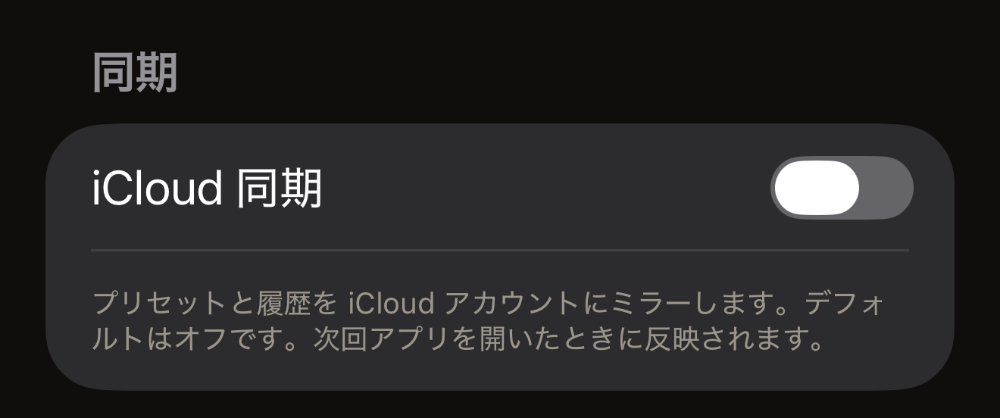

タグを iPhone にかざすと、タグの内容が画面に表示されます。この読み取りは iPhone 上で行われ、結果も iPhone に残ります。Hex NFC にはアカウントも解析もありません。Hex Pro 自身のサーバーに送るリクエストは 4 種類です。そのうち 3 種類には利用者に関する情報は何も含まれず、4 種類目のフィードバックのメッセージには、送ることを選んだ内容だけが含まれます。ポリシーの全文はアプリ内にあります。Hex NFC のホーム画面で右上の歯車ボタンをタップし、**法的情報**の下の**プライバシーポリシー**をタップします。

## iPhone に残るもの

スキャン履歴と保存したプリセットはこの iPhone 上のローカルデータベースに保存され、設定もローカルに保存されます。ときどき **Hex NFC はいかがですか？**とたずねるカードの裏にあるものも、すべてローカルに保存されます。すでにたずねたかどうか、どう答えたか、次にいつたずねてよいかを決める最近の書き込みと読み取りの回数です。このカードについては[設定](settings.md#feedback-and-ratings)で説明しています。項目を削除すると、そのデータベースから削除されます。アプリを削除すると、アプリのローカルデータも一緒に削除されます。

タグのパスワードは、これらとは別に、パスワードを設定した iPhone の iOS キーチェーンに保存されます。パスワードが同期されることも、書き出したファイルに含まれることも、どこかに送信されることもありません。アプリが保存する項目は 2 種類です。1 つは、書き込みによって保護を適用したタグ用の項目で、そのタグの UID に結び付けて保存されます。この書き込みは、「タグ」画面の**保護**カード、または保護を適用するプリセットから行われます。もう 1 つは、保護を適用するプリセット用の項目で、そのプリセットに結び付けて保存されます。どちらにも利用者に関する情報は含まれません。**操作…** > **パスワードで保護**で入力したパスワードはどちらにも保存されないため、自分で控えておいてください。iOS はアプリが削除されたあともキーチェーンの項目を残すため、アプリを削除しても、保存されたパスワードは消えません。パスポートの読み取り結果は、どこにも保存されません。チップが返した内容はそのセッションの間だけ画面に表示され、セッションが終わると消えます。詳しくは[パスポートを読み取る](passports.md)で説明しています。

保存されたパスワードが消えるのは、次の 2 つの場合です。1 つは、プリセットを削除した場合です。プリセットとともに保存されていたパスワードが削除されます。これは、そのプリセットを書き込んだタグがまだ保護されているかどうかに関係なく起こります。その結果、アプリがもう持っていないパスワードでタグが保護されたまま残ることがあります。もう 1 つは、タグの**保護**カードで保護をオフにしてからタグに書き込んだ場合で、その手順は[タグのパスワードを削除する](remove-password.md)で説明しています。この場合でも、アプリがパスワードを削除するのは、タグを読み戻したときだけです。読み戻しでは、次の 2 点を両方とも確認できなければなりません。

- 保護が解除されていること。
- タグのパスワードが、チップの工場出荷時の値に戻っていること。

1 点目は確認できても 2 点目を確認できなかった削除では、保存されたパスワードは残ります。保護が解除されていても、設定したパスワードをまだ保持しているタグは、そのパスワードがなければ再び保護できません。**操作**から行った削除では、キーチェーンからは何も消えません。そのタグ用にすでに保存されている項目は、そのまま残ります。

Hex NFC には、パスワードを保存しているタグの一覧はありません。もう一度かざせないタグについては、保存されたパスワードをアプリ内から削除できません。そのキーチェーン項目は、後のパスワード削除で消えるか、iPhone を消去しない限り、この iPhone に残ります。

**iCloud 同期**は最初はオフで、スイッチの変更は次にアプリを開いたときに反映されます。オンにすると、プリセットとスキャン履歴が、Apple が運用し Apple ID で保護されるプライベートな iCloud データベースにミラーされます。Hex Pro はその内容を読み取れません。どちらの場合も、タグのパスワードは含まれません。このスイッチは[設定](settings.md)にあります。

:::figure[**iCloud 同期**はオンにするまでオフのままで、その下の行には、変更が次にアプリを開いたときに反映されることが示されています。]

:::

同期をオフにしても、ミラーが止まるのは、[アプリを閉じて開き直す](settings.md#close-and-reopen-the-app)で説明しているように Hex NFC を閉じて開き直したときです。iPhone のホーム画面に戻るだけでは、アプリは動作し続け、ミラーも続きます。

ミラーを止めても、iCloud にすでに保存されているデータは削除されません。アプリを削除しても同じです。そのコピーを削除するには、iPhone の「設定」アプリを開きます。一番上の自分の名前をタップし、iCloud の行をタップします。表示されるストレージの項目を順に確認すると、各アプリが保存しているデータを削除できます。

:::note[タグは個人用の保存場所ではない]
タグに書き込んだ内容は iPhone の外にあるハードウェアに保存され、保護されていないタグは、リーダーを持っていれば誰でも読み取れます。保護しない限り、タグの内容は公開されているものとして扱ってください。保護については[タグの保護](tag-protection.md)で説明しています。
:::

## アプリが Hex Pro に接続する 4 つの場面 {#when-the-app-reaches-hex-pro}

どれもバックグラウンドでは実行されません。最初の 3 つには、利用者を特定できる情報は何も含まれません。

- Hex NFC のホーム画面は、プロジェクトの開発費に関する公開の数値を 1 つ、api.apps.hex.pro から取得します。このリクエストに個人データは含まれません。
- 交通系カードの不明な停留所で**送信**をタップすると、駅名の提案が送信されます。名前のフィールドを開いている間にキーボードの送信キーをタップしても送信されます。送信されるのは、路線コード、駅コード、地域コード、カードのシステムコード、入力した名前です。カードのシリアル番号、残高、利用履歴は含まれないので、名前のフィールドには個人的な情報を入力しないでください。
- **Hex Pro の他のアプリ**カードは、Hex Pro の別のアプリのバナーを api.p.hex.pro から取得します。リクエストで送信されるのは、このアプリのバンドル ID、プラットフォーム、スロット名です。応答には画像または動画が指定されており、アプリはそれを別のアドレスからダウンロードして iPhone に保存します。バナーは全員に同じものが表示されます。その裏に広告ネットワーク、トラッキング用の識別子、パーソナライズはありません。
- **フィードバックを送信**のフォームで**送信**をタップすると、フィードバックのメッセージが送信されます。含まれるのは、メッセージ、入力した場合はメールアドレス、そしてフォームの**メッセージと一緒に送信される情報**に表示される 4 つの情報（アプリのバージョン、iOS のバージョン、デバイスの機種、言語）です。メッセージは api.hex.pro に送られ、そこから Hex Pro のフィードバック用の受信箱に届きます。保存期間は最長 24 か月で、マーケティングに使われることはありません。タグ、スキャン、スキャン履歴の内容は何も含まれません。

ネットワークを使うもう 1 つの機能が iCloud 同期で、上の段落の例外です。オンにすると、プリセットとスキャン履歴がバックグラウンドで iPhone と Apple の間でやり取りされます。そのデータが Hex Pro に届くことはありません。

インターネットのリクエストでは、応答するサーバーに IP アドレスが伝わります。Hex Pro は短期間だけ運用ログを保持しますが、IP アドレスを使って個人を特定したり、プロファイルを作成したりすることはありません。フィードバックのメッセージは、IP アドレスを元に戻せない形に変換した値と一緒に保存されます。この値は、1 つの接続から送られるメッセージが多くなりすぎないようにするためだけに使われ、7 日以内に消去されます。

## 各アクセス許可の用途

Hex NFC が求めるアクセス許可は 2 つです。NFC はアプリの動作に欠かせないもので、iOS にはこれをオフにするスイッチがありません。カメラは任意で、初めて QR コードかパスポートの写真ページをスキャンするときに iOS が許可を求めます。どちらで取り込んだ内容も iPhone に残ります。

アプリ内のプライバシーポリシーには、連絡先、位置情報、Bluetooth の 3 つのアクセス許可についても記載されています。アプリにはこの 3 つを求める機能がないため、iOS がこれらの許可を求めることはありません。

:::table[Hex NFC が求めるアクセス許可]
| アクセス許可 | 用途 |
| :--- | :--- |
| NFC | タグを読み取ったり書き込んだりします。スキャン画面または書き込み画面が開いている間だけ使われます。 |
| カメラ | 自分で選んだ QR コードをスキャンして、レコードにします。また、スキャンすることを選んだときは、パスポートの写真ページを読み取ります。撮影した映像が保存されたり、アップロードされたりすることはありません。 |
:::

## Hex Pro が決して行わないこと

Hex NFC には、解析やテレメトリの SDK も、第三者の広告も含まれておらず、iPhone のフィンガープリントを取る仕組みもありません。Hex Pro は個人情報を販売、貸与、共有しません。アカウントがないため、Hex Pro のサーバーに利用者のプロファイルが保存されることもありません。書き出したファイルには選んだレコードとプリセットが含まれ、タグのパスワードが含まれることはありません。

## 関連項目

- [設定](settings.md)
- [交通系カードを読み取る](transit-cards.md)
- [パスポートを読み取る](passports.md)
- [タグの保護](tag-protection.md)
