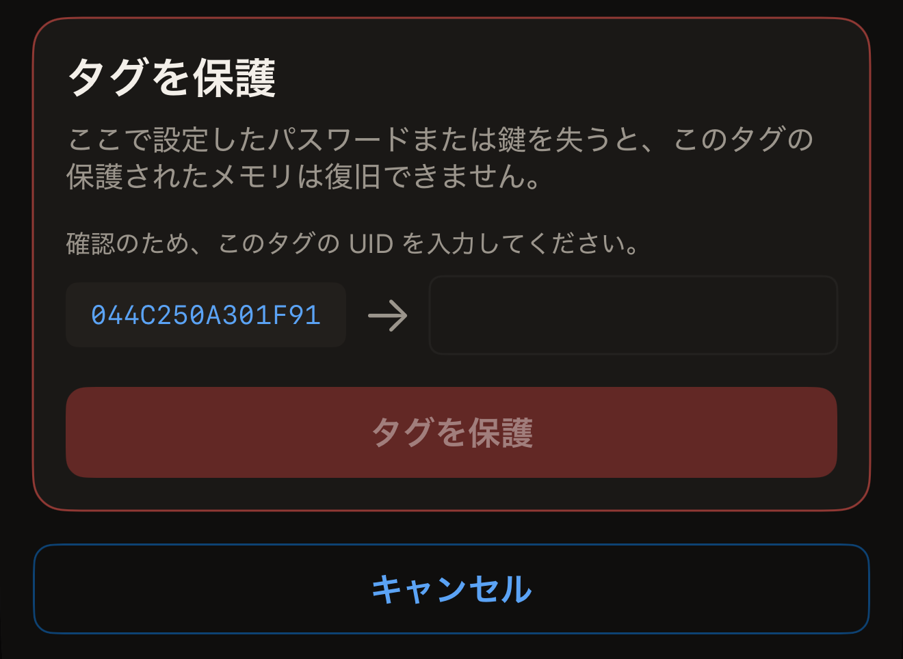
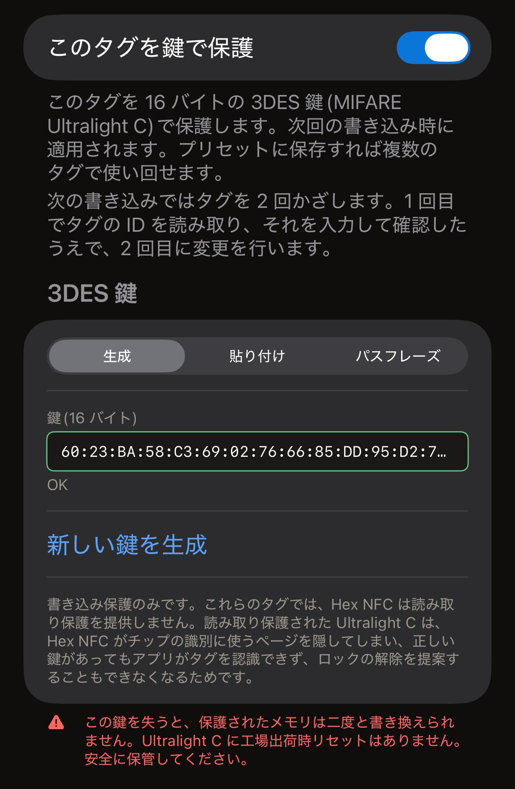
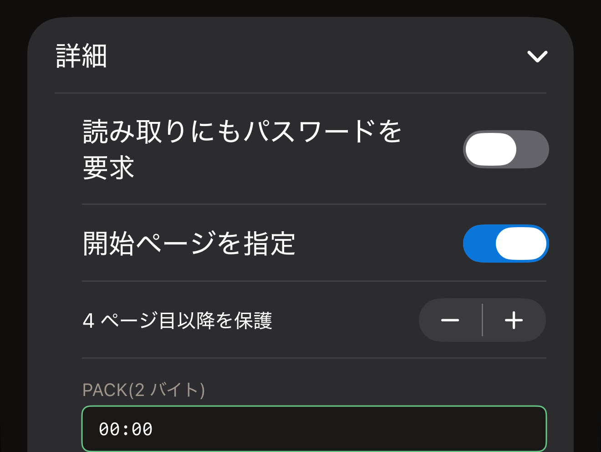

タグに設定したパスワードは、書き込みを保護します。読み取りも保護しない限り、レコードは誰でも読み取れます。パスワードが送信されるまで、書き込みは拒否されます。Hex NFC で iPhone からパスワードを設定する方法は 2 つあり、どちらも対象のチップは同じです。**操作…**にある**パスワードで保護**は、タグの保護だけを行います。「タグ」画面の**保護**カードは、次の書き込みの一部として秘密をタグに設定します。ほかに何も変えずにタグを保護するなら「操作」から、どのみちタグに書き込むところなら「保護」カードから行ってください。

始める前に、保護したいタグをスキャンして、「タグ」画面に表示しておきます。[タグをスキャンする](scan-a-tag.md)を参照してください。この画面の一番上にあるカードの 1 行目に、チップの名前が表示されます。その名前から、タグに設定できる秘密の種類がわかります。

アプリが保護できるチップは、NTAG213、NTAG215、NTAG216、MIFARE Ultralight EV1、MIFARE Ultralight C、NTAG424 DNA、ICODE SLIX2 の 7 つです。手元のタグがそもそも保護できるかどうかは、[チップ対応表](../developer/chip-support-matrix.md)で確認してください。それ以外のチップでは、**パスワードで保護**は「このタグはその操作に対応していません。」で終わります。また、タグがロックを報告しない限り、それらのチップでは「タグ」画面に**保護**カードも表示されません。

::include[two-tap-confirmation]

## 「操作」からタグを保護する

この方法では、1 回目のタップの前には何も入力しません。1 回目のタップでタグがどのチップかを読み取り、画面はそのチップに合った種類の秘密を求めます。NTAG213、NTAG215、NTAG216、MIFARE Ultralight EV1、ICODE SLIX2 では 4 バイトのパスワード、NTAG424 DNA と MIFARE Ultralight C では 16 バイトの鍵です。各チップの機能については、[チップ対応表](../developer/chip-support-matrix.md)を参照してください。

:::::steps
::::step[「パスワードで保護」を開く]
「タグ」画面で、右上の**書き込む**の隣にあるメニューボタンをタップし、**操作…** > **パスワードで保護**の順に進みます。
::::

::::step[タグをかざして識別させる]
**タグを保護**をタップします。スキャンシートが開き、画面に「2 回中 1 回目。タグを当てて識別します。」と表示されます。シートが閉じるまで、タグを iPhone の上部に近づけたままにします。
::::

::::step[新しいパスワードまたは鍵を入力する]
画面には「タグを識別しました:」に続いて読み取ったチップの名前が表示され、そのチップに必要なフィールドが並びます。秘密を 16 進数で入力します。バイトの間のコロンはあってもなくても構いません。

- NTAG213、NTAG215、NTAG216、MIFARE Ultralight EV1 では、**パスワード(4 バイト)**にパスワードを入力します。保護されていないと判定されたタグでは、このフィールドには最初から工場出荷時の値の `FF FF FF FF` が入っています。これを自分のパスワードに置き換えてください。PACK は、タグがパスワードを受け付けたときに返す 2 バイトです。リーダーはこれを確認して、想定どおりのタグと通信していることを確かめます。**PACK(2 バイト)**には最初から 2 バイトのゼロが入っています。使っているシステムで特定の値が求められない限り、そのままにしておくのが適切です。
- NTAG424 DNA では、**鍵(16 バイト)**に鍵を入力します。
- ICODE SLIX2 では、**パスワード(4 バイト)**に書き込み用のパスワードを入力します。読み取りは制限されません。
- MIFARE Ultralight C では、**鍵(16 バイト)**に鍵を入力します。保護されていないと判定されたタグでは、このフィールドには最初からランダムに生成された鍵が入っています。このチップに設定できるのは書き込み保護だけです。

NTAG21x、MIFARE Ultralight EV1、NTAG424 DNA では、フィールドの下にあるスイッチで読み取りも保護できます。スイッチの表示は**読み取りにもパスワードを要求**で、NTAG424 DNA では**読み取りにも鍵を要求**です。オフのままなら、どのリーダーでも引き続きタグを読み取れます。オンにすると、秘密なしではタグから何も読み取れなくなるため、以後 Hex NFC でスキャンするときは最初に秘密を求められます。それでもこの操作自体は「パスワードを設定しました。」で終わります。アプリは自分で読み戻すために、書き込んだばかりの秘密を送信するからです。
::::

::::step[タグの UID を入力する]
フィールドの下にある**タグを保護**という見出しのカードに、「確認のため、このタグの UID を入力してください。」と表示されます。空のフィールドの隣には、そのタップでアプリが読み取った UID が表示されます。タグにすでにパスワードまたは鍵が設定されている場合は、その上に「タグは保護されています」という見出しのカードが表示され、タグに現在設定されている秘密を求められます。その UID を 1 文字ずつそのとおりにフィールドに入力し、**タグを保護**をタップします。

:::figure[**タグを保護**カードの左側に写し取る UID があり、それを入力するフィールドは右側にあります。]

:::
::::

::::step[同じタグをもう一度かざす]
画面に「2 回中 2 回目。同じタグをもう一度かざしてください。」と表示されます。タグをもう一度 iPhone に近づけます。アプリがタグの設定を読み戻し、保護が有効になっていることを確認すると、「パスワードを設定しました。」と表示されます。
::::
:::::

:::warning[パスワードを控えておく]
アプリにはタグからパスワードを読み戻す機能がないため、自分で控えたものが唯一の控えになります。画面の警告は、その理由を「ここで設定したパスワードまたは鍵を失うと、このタグの保護されたメモリは復旧できません。」と伝えています。
:::

実行が失敗すると、画面に**もう一度試す**が表示されます。これをタップすると画面が最初の状態に戻り、1 回目のタップからやり直せます。UID のカードが表示されている間は、**キャンセル**で画面を最初の状態に戻せます。タグは元のままで、開いたままのスキャンシートは「キャンセルしました。」と表示して閉じます。

すでに保護されているタグでは、この方法で 2 つの秘密を入力します。フィールドには新しい秘密を、「タグは保護されています」カードにはタグに現在設定されている秘密を入力します。現在の秘密でタグを開き、新しい秘密に置き換えます。

## 「保護」カードから鍵を設定する {#protection-card}

NTAG424 DNA と MIFARE Ultralight C には、パスワードの代わりに 16 バイトの鍵を設定します。ICODE SLIX2 には独自の書き込み用パスワードを設定します。この 3 つはいずれも「タグ」画面の**保護**カードから設定でき、秘密は次の書き込みの一部としてタグに設定されます。Type-2 のパスワードもこのカードで設定できます。

:::::steps
::::step[「保護」カードを開く]
「タグ」画面で、チップの名前が表示されたカードの下にある**保護**カードをタップします。
::::

::::step[保護をオンにする]
カードの一番上にあるスイッチをオンにします。スイッチの表示は、NTAG424 DNA と MIFARE Ultralight C では**このタグを鍵で保護**、パスワードを使うチップでは**このタグをパスワードで保護**です。
::::

::::step[鍵またはパスワードを入力する]
カードに表示される、そのチップ用のフィールドに入力します。

- NTAG424 DNA では、**鍵(16 バイト)**に 16 バイトを入力するか、**ランダムな鍵を生成**をタップします。読み取りも保護するには、**読み取りにも鍵を要求**をオンにします。
- MIFARE Ultralight C では、**3DES 鍵**の下にある選択肢で鍵の作り方を選びます。まだ鍵が設定されていないタグでは、カードは**生成**が選ばれた状態で開き、**鍵(16 バイト)**にはランダムな 16 バイトがすでに入っています。**新しい鍵を生成**で、これを別の値に置き換えられます。**貼り付け**では、自分で用意した 16 バイトを**鍵(16 バイト)**に入力します。**パスフレーズ**を使うと、毎回同じ鍵が作られます。
- ICODE SLIX2、NTAG213、NTAG215、NTAG216、MIFARE Ultralight EV1 では、**パスワード(4 バイト)**に 4 バイトを入力します。

NTAG213、NTAG215、NTAG216、MIFARE Ultralight EV1 では、フィールドの下にある**詳細**に、読み取り保護、ページの範囲、PACK の設定があります。これらを使う場合は、次の手順に進む前に開いてください。[Type-2 のパスワードで保護するページを選ぶ](#pages-a-type-2-password-covers)を参照してください。

フィールドに鍵またはパスワードがすべて入力されると、一番上のスイッチの下にある注記に、次の書き込みで必要になることが表示されます。注記には「次の書き込みではタグを 2 回かざします。1 回目でタグの ID を読み取り、それを入力して確認したうえで、2 回目に変更を行います。」とあります。

:::figure[保護されていない MIFARE Ultralight C では、**3DES 鍵**の下の選択肢が最初から**生成**になっているので、**鍵(16 バイト)**にはすでにランダムな鍵が入っています。]

:::
::::

::::step[設定を保存する]
右上の**完了**をタップします。この時点では、まだタグには何も書き込まれていません。
::::

::::step[書き込みを始める]
「タグ」画面の右上にある**書き込む**をタップします。UID を読み取るタップのために、タグを iPhone の上部に近づけます。
::::

::::step[タグを確認してもう一度かざす]
**タグを保護**という見出しのカードに、そのタップでアプリが読み取った UID が空のフィールドの隣に表示されます。その UID をフィールドに入力して**タグを保護**をタップし、同じタグをもう一度かざします。そのあと**保護**カードに、タグを保護している内容の概要が表示されます。
::::
:::::

このカードの警告は、チップに合わせた内容になっています。NTAG424 DNA の鍵では「この鍵を失うと、このタグは二度と書き換えられません。NTAG424 に工場出荷時リセットはありません。安全に保管してください。」、MIFARE Ultralight C の鍵では「この鍵を失うと、保護されたメモリは二度と書き換えられません。Ultralight C に工場出荷時リセットはありません。安全に保管してください。」、パスワードでは「このパスワードを失うと、このタグの保護されたメモリは復旧できません。」と表示されます。

すでにパスワードが設定されているタグは、カードに入力されているパスワードで開きます。タグの現在のパスワードをカードに入力しておけば、1 回目のタップでタグが開き、ほかに入力するものはありません。

カードにタグを開けるパスワードが入っていない場合は、1 回目のタップで保護されていることがわかります。書き込みはいったん止まり、「タグは保護されています」という見出しの下でそのパスワードを求めます。フィールドの上の注記には、このあとの流れが「保護を変更するには、タグを 2 回かざします。1 回目でタグの ID を読み取って確認し、2 回目で変更を行います。」と表示されます。

タグの ID はすでに読み取ってあるので、ここでパスワードを入力してもタップは増えません。ボタンの表示は**ロック解除して続ける**で、次に UID のカードが表示されます。

## Type-2 のパスワードで保護するページを選ぶ {#pages-a-type-2-password-covers}

「保護」カードで**完了**をタップする前に、**詳細**を開きます。NTAG213、NTAG215、NTAG216、MIFARE Ultralight EV1 では、ここにさらに 3 つの設定があります。

- 書き込みに加えて読み取りも保護するには、**読み取りにもパスワードを要求**をオンにします。カードには「読み取り保護されたタグは、検証を含めてパスワードなしでは読み戻せません。」という注記があります。
- タグ全体ではなく一部だけを保護するには、**開始ページを指定**をオンにし、**4 ページ目以降を保護**を保護したい最初のページに合わせます。ページとは、タグのメモリを 4 バイトずつに区切った単位です。設定できる範囲は 3 から 254 までです。これは対象となるすべてのチップを合わせた範囲で、手元のタグの範囲ではありません。アプリが範囲をタグに合わせて調整することはありません。チップのメモリの末尾より後ろを開始ページにすると、パスワードは書き込まれますが、何も保護されません。それでも書き込みは完了画面で終わり、その画面にはタグが保護されていないことを示すものは何もありません。タグが何も保護していないことは、改めてスキャンして初めてわかります。開始ページはチップのメモリの範囲内で選んでください。各チップのメモリ量は[チップ対応表](../developer/chip-support-matrix.md)に記載しています。オフのままにした場合は、「データ領域全体(チップの最初のデータページ以降)を保護します。」となります。
- パスワードと一緒に保存する 2 バイトを指定するには、**PACK(2 バイト)**に入力します。

:::figure[**開始ページを指定**をオンにすると、**詳細**には、**PACK(2 バイト)**の上に開始ページとそのプラス・マイナスボタンが表示されます。]

:::

チップがパスワードの間違いを何回まで許容するかは、別の場所で設定します。[パスワードの間違いの回数を制限する](attempt-limit.md)を参照してください。

## 結果を確認できない場合

保護の実行は最後にタグの設定を読み戻すので、タグの応答だけで成功と判断されることはありません。半分しか確認できなかった場合は、どちらの半分かをメッセージが伝えます。

画面に次のいずれかが表示された場合、タグは保護されています。

- 「パスワードを設定しました。」
- 「保護は有効になっていますが、パスワードが適用されたかどうかをこのアプリでは確認できませんでした。入力したパスワードは控えておいてください。それが現在タグにあるパスワードである可能性が非常に高いです。」

次のいずれかが表示された場合、タグは保護されていません。

- 「タグは保護されていないままで、入力したパスワードも保存されていません。もう一度タグを端末にかざしてやり直してください。」
- 「パスワードをタグに保存しました。保護はまだ無効のままです。」
- 「パスワードはタグに保存されましたが、保護は有効になりませんでした。もう一度タグを端末にかざして完了してください。」
- 「タグは保護されていないままで、現在どのパスワードを保持しているかをこのアプリでは確認できませんでした。入力したパスワードと以前のパスワードの両方を控えたうえで、もう一度タグを端末にかざしてください。」

次のいずれかが表示された場合は、どちらとも確定していません。

- 「保護が有効になったかどうかを確認できませんでした。もう一度タグを端末にかざして確認してください。」
- 「保護が有効になったかどうかも、タグが現在どのパスワードを保持しているかも確認できませんでした。入力したパスワードと以前のパスワードの両方を控えたうえで、もう一度タグを端末にかざしてください。」

メッセージがもう一度かざすよう求めている場合は、タグをもう一度かざし、どちらかのパスワードでタグが開くまで両方のパスワードを控えておいてください。2 つのメッセージは何も求めませんが、それぞれ次に行うことがあります。

- 「パスワードをタグに保存しました。保護はまだ無効のままです。」と表示された場合、タグには入力したパスワードが保存されていますが、何も保護していません。これを正すためにパスワードを送信する必要はありません。同じパスワードで手順をもう一度実行してください。保存されたパスワードをタグから削除したい場合は、[タグのパスワードを削除する](remove-password.md)を参照してください。
- 「保護は有効になっていますが、パスワードが適用されたかどうかをこのアプリでは確認できませんでした。入力したパスワードは控えておいてください。それが現在タグにあるパスワードである可能性が非常に高いです。」と表示された場合、タグは保護されています。そのパスワードを控えておいてください。次にそのタグに書き込むときには、パスワードを求められます。

## 関連項目

- [タグの保護](tag-protection.md)
- [タグのパスワードを削除する](remove-password.md)
- [パスワードの間違いの回数を制限する](attempt-limit.md)
- [チップ対応表](../developer/chip-support-matrix.md)
