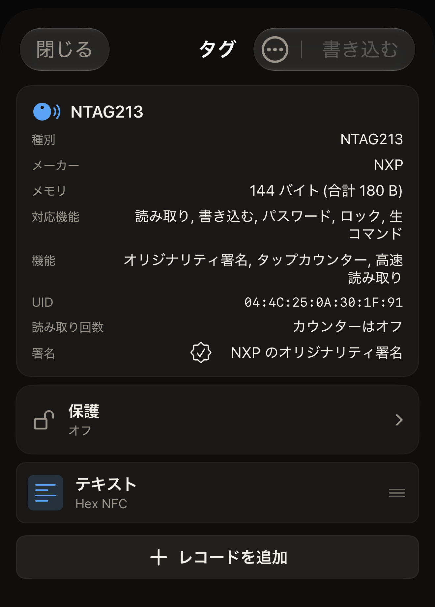

5 分ほどで、Hex NFC を使って NFC タグを 1 枚読み取り、その中身を画面とアプリの履歴で確かめます。用意するのは iPhone とタグ 1 枚です。

## 始める前に

- iOS 17 以降を搭載した iPhone に、[App Store](https://apps.apple.com/app/id6801457461) から Hex NFC をインストールします。初めて起動するときに設定することは何もなく、起動すると Hex NFC のホーム画面が表示されます。料金や対応する iPhone については[よくある質問](faq.md)を参照してください。
- タグを 1 枚手元に用意します。シール、カード、キーホルダーのどれでもかまいません。
- 空のタグでもかまいません。アプリはそのタグを読み取り、何も入っていないことを表示します。
- タグを読み取っても、タグの中身は何も変わりません。このページの手順でタグに書き込むことはありません。

## 最初のタグを読み取る

:::::steps
::::step[スキャン画面を開く]
Hex NFC を開くと、Hex NFC のホーム画面が表示されます。アプリ名の下には、**スキャン**、**作成**、**ライブラリ**、**詳細**の 4 つのタイルが並んでいます。左上のタイルの**スキャン**をタップします。スキャン画面が開き、「iPhone の上部にタグを近づけてください」と表示されてタグを待ちます。
::::

::::step[タグを iPhone に近づける]
iPhone の上端をタグに平らに当て、動かさずに保ちます。読み取りのあいだ、画面の下部には iOS 独自のパネルが表示されます。アプリの表示はその上に残ります。スキャン画面には「読み取り中…」、続いて「タグを検出」と表示されます。「タグを検出」が表示されたら、アプリはタグの読み取りを終えているので、iPhone を離してかまいません。タグを読み取れなかったときは「スキャンに失敗しました」と表示され、その下に理由が示されます。**もう一度試す**をタップし、タグを iPhone の上部に当てて動かさずに保ちます。タグが応答しない場合は、[タグをスキャンまたは書き込みできない場合](troubleshooting.md)を参照してください。
::::

::::step[アプリが見つけた内容を確かめる]
「タグを検出」の下に、チップの名前と、読み取ったものの数が表示されます。レコードとは、リンクやテキストなど、タグに入っている 1 つ 1 つの内容のことです。レコードが 1 つ入っているタグでは「1 件のレコードが見つかりました」と表示されます。レコードが 1 つもないタグでは「このタグに NDEF レコードはありません」と表示されます。この画面は 1 秒ほど表示されます。チップの名前とタグの UID は次の画面にも表示されるので、ここで覚えておく必要はありません。ほかの表示については[タグをスキャンする](scan-a-tag.md)を参照してください。
::::

::::step[レコードを開く]
続いて「タグ」画面が自動的に開きます。上部のカードにはチップの名前が表示され、**UID** の行があります。カードの下では、レコードが 1 つずつ行になっていて、種類と内容の一部が表示されます。行をタップするとレコード全体が表示され、**キャンセル**をタップすると元の画面に戻ります。**キャンセル**はレコードを閉じるだけで、タグにもアプリにも何も書き込みません。空のタグでは、行の代わりに「空のタグ」と表示されます。これは失敗ではなく、読み取りが最後まで完了したということです。

:::figure[NTAG213 をスキャンすると、「タグ」画面上部のカードに **UID** の行が表示され、タグに入っている 1 つのレコードがその下に**テキスト**の行として表示されます。]

:::
::::

::::step[タグを閉じる]
**閉じる**をタップします。「タグ」画面は何も書き込まずに閉じ、Hex NFC のホーム画面に戻ります。
::::
:::::

## 学んだこと

これで、手に取ったタグを読み取り、何が入っているかを確かめられるようになりました。いまのスキャンはアプリに保存されています。Hex NFC のホーム画面で**ライブラリ**をタップし、続いて**履歴**をタップします。**履歴**は、「ライブラリ」画面の上部に並ぶ 2 つのタブのうち 2 つ目です。さきほどのスキャンが一覧のいちばん上にあります。スキャンをピン留めすると、[以前スキャンしたタグを探す](scan-history.md)で説明している上限を超えても残しておけます。保存されたスキャンを開くと、タグをもう一度かざさなくても同じ「タグ」画面が表示されます。

## 次のステップ

- スキャン結果それぞれの意味や、先にパスワードを求めるタグについては、[タグをスキャンする](scan-a-tag.md)を読んでください。
- 保存されたスキャンを開き直したり、ピン留めしたり、削除したりするには、[以前スキャンしたタグを探す](scan-history.md)を読んでください。
- 空のタグに Web アドレスを書き込むには、[タグにリンクを書き込む](write-a-link.md)を読んでください。
- アプリが認識するチップを確かめるには、[Hex NFC で使えるタグ](tags-that-work.md)を読んでください。
- タグが応答しないときは、[タグをスキャンまたは書き込みできない場合](troubleshooting.md)を読んでください。
