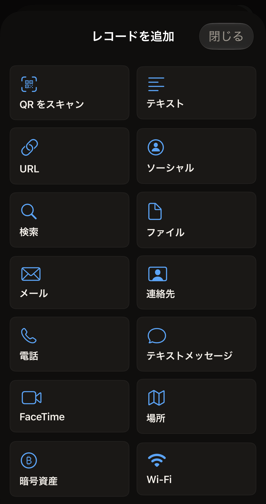
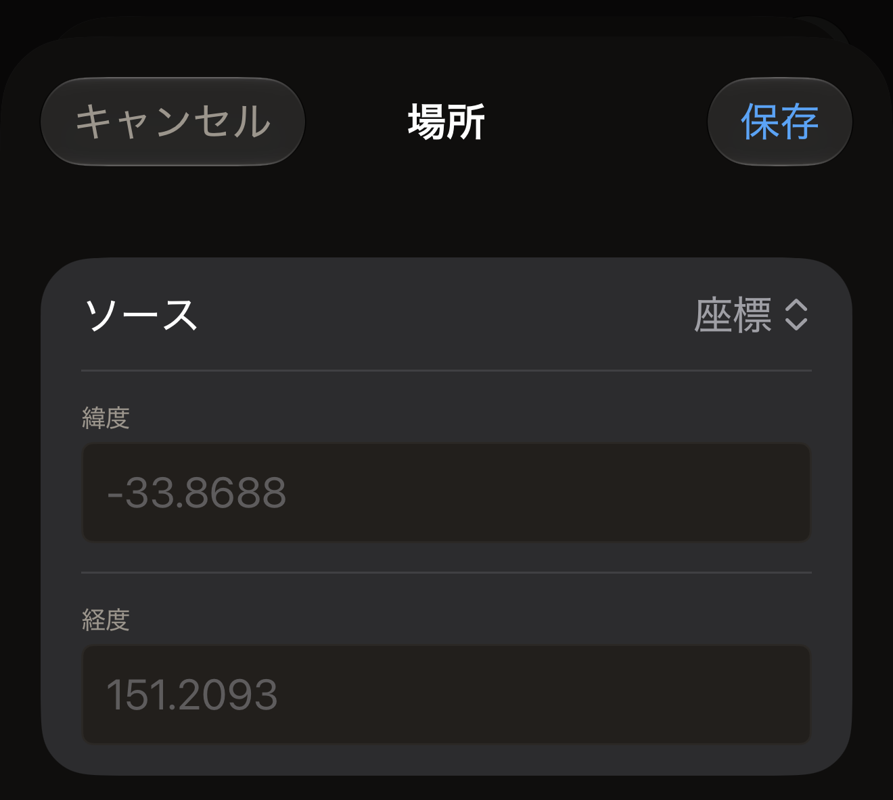

タグにはレコードの一覧が入っていて、レコードにはそれぞれ種類があります。iPhone でタグをスキャンするか、Hex NFC のホーム画面で**作成**をタップしてレコードのない状態から始めます。続いて、「タグ」画面で**レコードを追加**をタップします。アプリには 13 の種類があり、その手順は[タグのレコードを編集する](edit-records.md)で説明しています。選んだ種類によって、レコードの編集画面に表示されるフィールドが決まり、あとでほかの端末がタグを読み取ったときに受け取る内容も決まります。スキャンしたタグには、アプリで開けても追加はできない種類が 5 つ入っていることもあります。これについては[開けても追加できない種類](#types-you-can-open-but-not-add)で説明しています。

:::figure[**レコードを追加**には 13 種類のレコードが並び、先頭には QR コードをレコードに変換する **QR をスキャン**があります。]

:::

## 種類によって変わること

種類とは、1 つの情報を入れるための型です。電話番号は**電話**レコードに、ネットワークは **Wi-Fi** レコードに入れます。アプリは入力された内容を、その型について NFC の規格が定めるバイト列に変換します。電話番号を**テキスト**レコードに入れたりせず、いちばん近い種類を選んでください。読み取る端末は、作成者の意図ではなく型に従って動作します。

読み取った端末で何が起きるかは、その端末しだいです。リンクはどこでもリンクとして扱われますが、ネットワークはそうではありません。**Wi-Fi** のフォームには「iPhone は NFC から自動接続しませんが、Android のリーダーは接続します。Hex NFC は仕様通りにレコードを書き込みます。」とあります。

レコードは容量を使うので、小さなチップでは容量が足りなくなります。チップごとの容量は [Hex NFC で使えるタグ](tags-that-work.md)に載っています。

## テキストとリンク

:::table[テキスト、リンク、検索のためのレコードの種類]
| 種類 | 入力する項目 | タグに書き込まれる内容 |
| --- | --- | --- |
| **テキスト** | **テキスト**、**言語コード**、**エンコーディング** | 入力した文章。入力した言語コードが付き、選んだエンコーディングで書き込まれます。 |
| **URL** | **URL** | 入力したとおりのアドレス。一般的な Web のプレフィックスは 1 バイトで保存されるので、レコードの容量が少なくて済みます。 |
| **ソーシャル** | **プラットフォーム**、**ハンドル名** | 選んだプラットフォームと入力したハンドル名から組み立てたプロフィールのリンク。 |
| **検索** | **検索エンジン**、**検索語** | 選んだ検索エンジンの検索用アドレス。入力した語句が含まれます。 |
| **ファイル** | **パス** | ファイルのアドレス。フォームには「file:// URL として保存されます。指定できるディレクトリは iOS によって制限されています。」と書かれています。 |
:::

新しい**テキスト**レコードの言語コードは最初は en になっていて、フィールドの説明に「ISO 639-1(例:en、fr、ja)」と使う形式が示されています。**エンコーディング**には **UTF-8** と **UTF-16** の 2 つがあり、新しいレコードでは **UTF-8** が選ばれています。

ほとんどのプラットフォームでは、**ハンドル名**はプロフィールのアドレスの末尾にくる名前で、先頭の @ を付けずに入力します。次の 6 つのプラットフォームは、アドレスがハンドル名から組み立てられないため、別のものを入力します。

- プラットフォームが **Whatsapp** のときは、wa.me のリンクに含まれる電話番号、つまりプラス記号を付けない国際電話番号を省略せずに入力します。
- プラットフォームが **Skype** のときは、Skype 名を入力します。
- プラットフォームが **Steam** のときは、プロフィールのアドレスにあるカスタム URL を入力します。
- プラットフォームが **Slack** のときは、アドレスの先頭にくるワークスペース名を入力します。
- プラットフォームが **Facebook** か **Wechat** のときは、それぞれのリンクに含まれているものを入力します。名前の場合も番号の場合もあります。

アプリは、入力された内容をそのプラットフォームのプロフィールのアドレスに入れるだけで、それ以外は何も変更しません。

**検索エンジン**には **Google**、**Google Images**、**Bing**、**Yandex**、**DuckDuckGo**、**YouTube**、**Wikipedia** があります。**プラットフォーム**には **Facebook**、**Bluesky**、**X**、**Github**、**Instagram**、**Line**、**Linkedin**、**Medium**、**Pinterest**、**Skype**、**Slack**、**Snapchat**、**Soundcloud**、**Steam**、**Telegram**、**Threads**、**Tiktok**、**Twitch**、**Vk**、**Wechat**、**Whatsapp**、**Youtube** があります。いずれも、画面上ではここに書いたとおりに表記されます。

## 人とメッセージ

:::table[人に連絡するためのレコードの種類]
| 種類 | 入力する項目 | タグに書き込まれる内容 |
| --- | --- | --- |
| **メール** | **宛先**、**Cc**、**Bcc**、**件名**、**本文** | 宛先、件名、本文を含むメール用のアドレス。 |
| **連絡先** | **ID** の下にある**氏名**と**組織**、続いて**連絡先**の下にある**電話番号**、**メール**、**ウェブサイト** | 連絡先カード。読み取った端末のアドレス帳に追加できます。 |
| **電話** | **電話番号** | 電話用のアドレス。読み取った端末は、その番号に発信するよう提案します。 |
| **テキストメッセージ** | **宛先**、**メッセージ** | 番号と送信するテキストを含むメッセージ用のアドレス。 |
| **FaceTime** | **対象**、**モード** | 選んだとおりのビデオまたは音声の FaceTime 用アドレス。 |
:::

このうち 6 つのフィールドには、複数の値を入力できます。**宛先**、**Cc**、**Bcc**、**電話番号**、**メール**、**ウェブサイト**はいずれもカンマで区切られるため、**宛先**と**電話番号**には「カンマ区切り」というヒントが表示されます。**組織**を空のままにすると、カードには含まれません。

## 場所、お金、ネットワーク

:::table[場所、支払い、ネットワークのためのレコードの種類]
| 種類 | 入力する項目 | タグに書き込まれる内容 |
| --- | --- | --- |
| **場所** | **ソース**、続いて**緯度**と**経度**、または**地図の URL** | 地図のアドレス。座標の組か、貼り付けた地図のリンクです。 |
| **暗号資産** | **ネットワーク**、**アドレス**、**金額**、**メッセージ** | 選んだネットワーク上の支払い用アドレス。**金額**と**メッセージ**は、空のままにすると含まれません。 |
| **Wi-Fi** | **ネットワーク名(SSID)**、**パスワード**、**認証**、**暗号化**、**非公開ネットワーク** | ネットワーク名、パスワード、選んだセキュリティ設定を含むネットワークのレコード。 |
:::

**場所**のフォームのそれ以外の項目は、**ソース**で決まります。**ソース**には**座標**、**Apple マップの URL**、**Google マップの URL** があります。**座標**を選ぶと**緯度**と**経度**が表示されます。それぞれ `-33.8688`、`151.2093` のように 10 進数で入力します。小数点にカンマも使えるので、`48,8566` は `48.8566` として読み取られます。ほかの 2 つのソースでは、代わりに**地図の URL** が表示されます。アドレスは自分で用意します。地図アプリか、その場所を見つけたブラウザーからリンクをコピーし、フィールドに貼り付けます。タグには、貼り付けたとおりのリンクが書き込まれます。2 つのうちどちらを選んだかは、タグには一切書き込まれません。リンクの入手元に合うほうを選んでください。アプリが iPhone の現在地を読み取ることはありません。場所はすべて、入力または貼り付けたものか、QR コードやスキャンしたタグから取り込まれたものです。

:::figure[**ソース**を**座標**にすると、フォームに**緯度**と**経度**が表示されます。入力するまで、どちらにもグレイの例が表示されています。]

:::

**場所**レコードには、緯度と経度の両方か、地図の URL が必要です。どちらかが入力されるまで、フォームには「緯度と経度、または地図の URL を入力してください。入力するまで、このレコードはタグに書き込めません。」と表示され、「タグ」画面のそのレコードの行には「場所なし」と表示されます。追加したあと**キャンセル**で閉じた**場所**レコードは、その状態のまま一覧に残ります。一覧にそうしたレコードがあるままタグに書き込もうとすると、iOS のスキャンシートが開く前に止まり、「場所のレコードに座標または地図の URL がありません。タグには何も書き込まれていません。」と表示されます。レコードに入力するか削除してから、もう一度書き込んでください。**プリセットとして保存…**も同じように止まります。一覧にそうしたレコードがあるあいだは**保存**がグレイ表示のままで、保存シートにその理由が表示されます。プリセットは保存したあとは変更できないため、以前のバージョンのアプリで空の**場所**レコードを含めて保存したプリセットは、書き込むたびに拒否されます。「タグ」画面でそのレコードを組み立て直し、新しいプリセットとして保存してから、古いプリセットを削除してください。

**ネットワーク**には **Bitcoin**、**Ethereum**、**Monero**、**Litecoin**、**Dogecoin**、**Solana** があります。**金額**は、ヒントも入力チェックもない普通のテキストフィールドです。アプリは入力された内容を、そのまま支払いのリンクにコピーします。金額は、使っているウォレットと同じ書き方で入力してください。誰かが送金する前に、そのウォレットで金額を読み込んで確かめてください。

**Wi-Fi** のフォームでは、**認証**は最初は **WPA2 Personal**、**暗号化**は最初は **AES** になっています。これは、ほとんどの家庭用ルーターで使われている組み合わせです。**認証**にはほかに **WPA3 Personal**、**WPA Personal**、**WEP**、**オープン**があります。**暗号化**にはほかに **TKIP**、**TKIP + AES**、**WEP**、**なし**があります。ルーターの設定画面に表示されている組み合わせに合わせてください。

:::warning[Wi-Fi レコードにはパスワードが読める形で入る]
タグを読み取った端末はすべて、ネットワークのパスワードも一緒に読み取ります。**Wi-Fi** レコードは、誰に読まれてもかまわないタグにだけ入れてください。
:::

## 開けても追加できない種類 {#types-you-can-open-but-not-add}

スキャンしたタグ、プリセット、履歴の項目には、**レコードを追加**にはない 5 つの種類が入っていることがあります。**アプリリンク**、**Bluetooth**、**データ**、**ショートカット**、**生データ**です。どれにも専用のフォームはありません。タップするとテキストエディターが開き、レコードが JSON で表示されます。その上には『このレコード種別は JSON で編集します。テキストが有効なレコードになっていない間は、「保存」で最後に有効だった内容が保存されます。』という説明があります。

:::table[5 つの種類がタグに書き込む内容]
| 種類 | タグに書き込まれる内容 |
| --- | --- |
| **アプリリンク** | リンクとして書き込まれる App Store のアドレス。 |
| **Bluetooth** | デバイスのアドレスとデバイス名を含むペアリング用のレコード。 |
| **データ** | メディアタイプのラベルが付いた、レコードのバイト列。 |
| **ショートカット** | ショートカットを名前で実行するアドレス。レコードが指定する入力も渡します。 |
| **生データ** | レコードのバイト列そのもの。変更されずにそのまま書き戻されます。 |
:::

エディターを開くと、レコードはすでに書き出された状態になっています。値の入っているキーが画面に表示されていて、その値をその場で変更します。まだ値のないキーは含まれていません。下の表にある省略可能なキーは、ここに記載したとおりのつづりで入力するまで含まれません。`id` と `type` は、アプリが書いたままにしておいてください。それ以外のキーは次のとおりです。

:::table[JSON でのみ編集する種類のキー]
| 種類 | 入力するキー |
| --- | --- |
| **アプリリンク** | `appStoreURL`、必要なら続けて `universalLink` と `displayName` |
| **Bluetooth** | `deviceMAC`、必要なら続けて `deviceName` |
| **データ** | `mimeType` と、base64 で `payload` |
| **ショートカット** | `shortcutName`、ショートカットが入力を受け取るなら続けて `input` |
| **生データ** | 下の一覧にある数値で `tnf`、続けて base64 で `typeBytes`、`idBytes`、`payload` |
:::

プレーンテキストで Hello という語を持つ**データ**レコードは、次のようになります。

```text title="JSON エディターでのデータレコード"
{
  "id" : "9E2B1C64-6A2F-4D0E-9A52-0B7F1C3D8E44",
  "mimeType" : "text/plain",
  "payload" : "SGVsbG8=",
  "type" : "data"
}
```

この `payload` の裏に変換機能はありません。値は、別の場所で作成した base64 でなければなりません。テキストをそのまま貼り付けても、エンコードはされません。有効な base64 でない `payload` があると、レコード全体が読み込まれなくなります。その場合については、次の注記で説明します。

**生データ**は、アプリが分類できないレコードを読み取ったときに使われる種類です。ふつうは、変更せずにそのまま書き戻します。変更する場合は、まず `tnf` から始めます。これは、`typeBytes` にどのような名前が入っているかを示すために NDEF の規格で使われる数値です。値は次のいずれかです。

- 0 は空のレコードです。
- 1 は NFC Forum 自身の一覧にある名前です。
- 2 はメディアタイプです。
- 3 は絶対アドレスです。
- 4 はベンダーが定義した名前です。
- 5 は不明です。
- 6 は分割されたレコードの続きです。

`typeBytes`、`idBytes`、`payload` はいずれも base64 で、`idBytes` はふつう空です。

```text title="ベンダー定義の種類を持つ生データレコード"
{
  "id" : "3F7A9D21-4C88-4B0A-BE13-52C0A7E6D915",
  "idBytes" : "",
  "payload" : "SGVsbG8=",
  "tnf" : 4,
  "typeBytes" : "ZXhhbXBsZS5jb206bm90ZQ=="
}
```

:::note[エディターが読み取れないテキストは無視される]
エディターは、テキストがレコードとして読み取れた時点でその内容を反映します。それまでは、レコードは元の値を保ったままで、メッセージも表示されません。エディターの中にも反映を知らせる表示はないため、**保存**をタップしたあとで確認してください。「タグ」画面のレコードの行には、レコード自体から取った 2 行目があります。

- 種類が**データ**なら、メディアタイプです。
- 種類が**ショートカット**なら、ショートカット名です。
- 種類が**アプリリンク**なら、App Store のアドレスです。
- 種類が **Bluetooth** なら、デバイス名またはアドレスです。
- 種類が**生データ**なら、ペイロードの先頭のバイト列です。

2 行目が以前のままなら、入力したテキストはレコードになっていません。
:::

## レコードの保存、破棄、削除

**保存**は変更を残し、**キャンセル**は変更を破棄します。**レコードを削除**は、確認せずにレコードを一覧から取り除き、エディターを閉じます。その時点で**キャンセル**はもう使えないので、この方法で削除したレコードは追加し直す必要があります。3 つとも、アプリが持っているコピーに対して働き、タグには作用しません。タグが変わるのは書き込んだときだけです。これについては[タグのレコードを編集する](edit-records.md)で説明しています。

レコードはすべて、入力した内容から作られます。レコードの編集画面が、連絡先や現在地、周りの Bluetooth デバイスを読み取ることはありません。アプリが保存するものについては、[プライバシーとデータ](privacy.md)を参照してください。

## スキャンしたタグが開くときの種類

アプリは、読み取った内容を、知っている種類のうちいちばん近いものに分類します。電話、メッセージ、メール、FaceTime、地図、支払い、ショートカット、ファイルのアドレスはそれぞれの種類として開き、それ以外のリンクは **URL** レコードとして開きます。連絡先カード、ネットワークのレコード、ペアリング用のレコードは、それぞれ元の種類に戻ります。それ以外のメディアタイプは**データ**レコードになり、残りはすべて**生データ**レコードになります。**生データ**レコードは、1 バイトも変えずに書き戻されます。

## 関連項目

- [タグのレコードを編集する](edit-records.md)
- [タグにリンクを書き込む](write-a-link.md)
- [タグをプリセットとして保存する](presets.md)
- [チップ対応表](../developer/chip-support-matrix.md)
