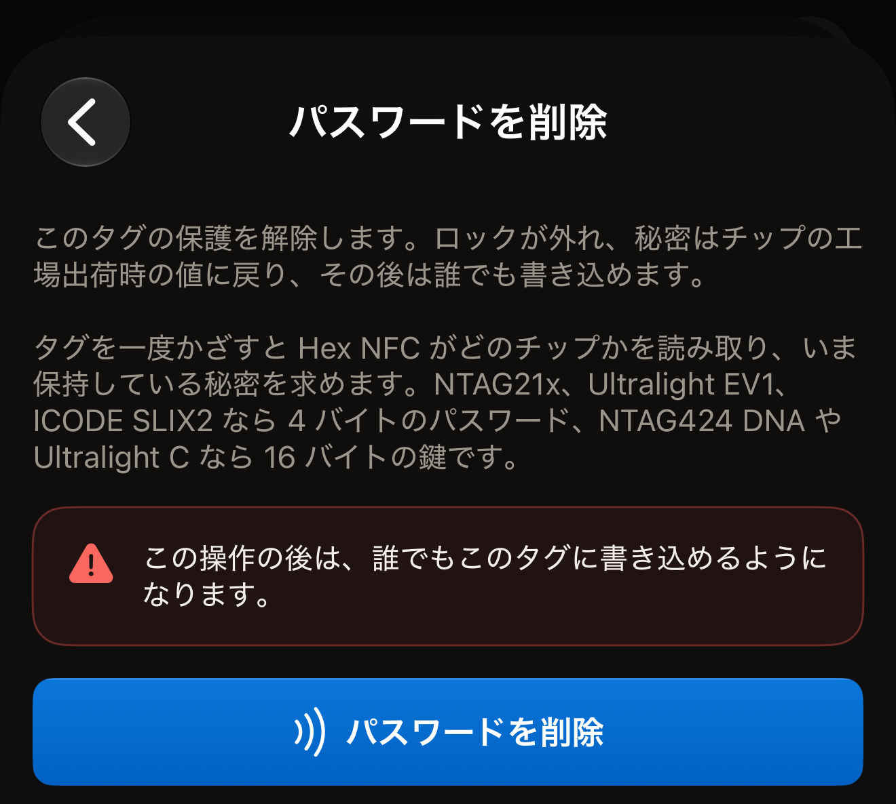
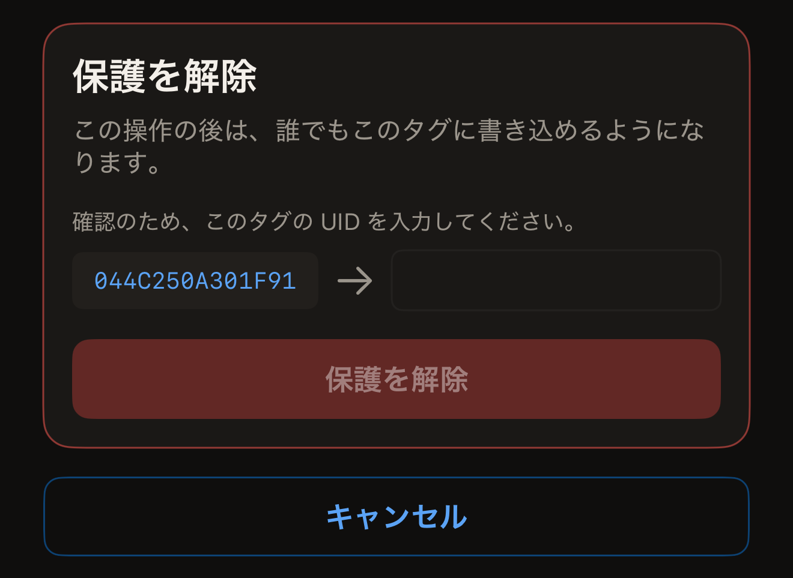
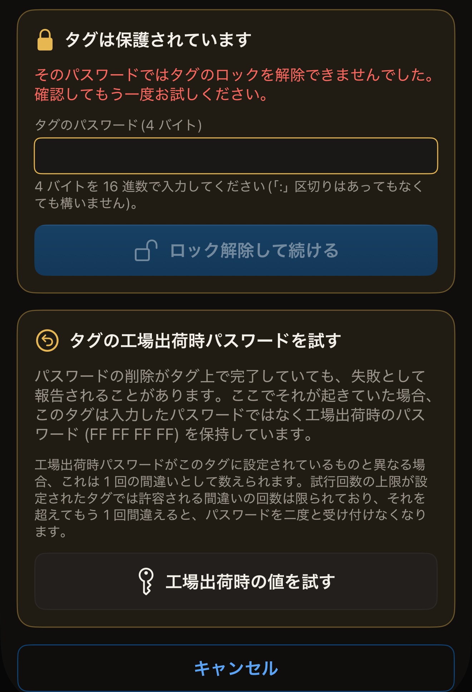

タグに設定したパスワードは、タグに現在設定されているパスワードを送信できる限り、削除できます。削除すると誰でもタグを読み書きできるようになり、パスワードまたは鍵はチップの工場出荷時の値に戻ります。

始める前に、iPhone で Hex NFC を開いてタグをスキャンし、「タグ」画面に表示しておきます（[タグをスキャンする](scan-a-tag.md)を参照）。タグに設定されているパスワードを手元に用意してください。この画面の一番上にあるカードの 1 行目には、タグの UID の上にチップの名前が表示されます。その名前によって、削除のときに求められる秘密の種類が決まります。以下のどちらの方法にも名前が出てこないチップには、Hex NFC で削除できるパスワードはありません。アプリがそうしたチップにパスワードを設定することはないからです。

## 「操作」でパスワードを削除する

この方法は、アプリが保護できるすべてのチップに使えます。1 回目のタップの前には何も入力しません。1 回目のタップでタグがどのチップかを読み取り、画面はタグに現在設定されている秘密を求めます。NTAG21x チップ（NTAG213、NTAG213 TT、NTAG215、NTAG216）、MIFARE Ultralight EV1、ICODE SLIX2 では 4 バイトのパスワード、NTAG424 DNA と MIFARE Ultralight C では 16 バイトの鍵です。NTAG 210µ には削除するパスワードがありません。各チップの機能は[チップ対応表](../developer/chip-support-matrix.md)に記載しています。

:::::steps
::::step[「操作」を開く]
**タグ**画面で右上のメニューを開き、**操作…**をタップします。
::::

::::step[「パスワードを削除」を開く]
**パスワードを削除**をタップします。
::::

::::step[削除を始める]
**パスワードを削除**をタップします。その上にある警告には、削除によって失われるものが「この操作の後は、誰でもこのタグに書き込めるようになります。」と書かれています。

:::figure[タップする**パスワードを削除**ボタンは、画面の一番下、警告の下にあるものです。]

:::
::::

::::step[タグを iPhone の上部に近づける]
アプリがタグの UID を読み取り、入力できるようにタップを終了します。
::::

::::step[タグに設定されている秘密を入力する]
「タグは保護されています」という見出しのカードで、タグに現在設定されている秘密を求められます。パスワードは**タグのパスワード(4 バイト)**に 8 文字の 16 進数で入力します。NTAG424 DNA ではフィールドは**タグの鍵(AES、16 バイト)**、MIFARE Ultralight C では**タグの鍵(3DES、16 バイト)**です。区切りは無視されるので、`FF FF FF FF` と `FFFFFFFF` は同じ値になります。
::::

::::step[タグを確認する]
画面の「確認のため、このタグの UID を入力してください。」の下、フィールドの隣に、タグの UID が表示されます。その文字を区切りなしでフィールドに入力します。大文字と小文字は区別されません。**パスワードを削除**をタップし、タグをもう一度 iPhone に近づけます。
::::
:::::

::include[two-tap-confirmation]

2 回目のタップが終わると、画面に「パスワードを削除しました。」と表示されます。タグは保護されていない状態になり、どの端末からでもレコードを書き換えられます。タグが何かを表示する前にもパスワードを求めていた場合は、その保護も一緒に解除されます。

## 「タグ」画面から保護を解除する

アプリが保護できるチップであれば、書き込みの一部として保護を解除することもできます。それには、タグに設定されている鍵またはパスワードが必要です。この書き込みでは、**タグ**画面に表示されているレコードがタグに書き戻されます。スキャンした直後なら、その一覧はタグにすでにあるレコードと同じなので、自分で一覧を編集しない限り、タグの内容はそのまま残ります。

:::::steps
::::step[「保護」を開く]
**タグ**画面で**保護**をタップします。
::::

::::step[保護をオフにする]
NTAG424 DNA または MIFARE Ultralight C のタグでは**このタグを鍵で保護**を、パスワードを使うチップ（NTAG21x、MIFARE Ultralight EV1、ICODE SLIX2）では**このタグをパスワードで保護**をオフにします。その下の注記には、次の書き込みで読み取りと書き込みの両方の保護が解除され、秘密が工場出荷時の値に戻ることが書かれています。
::::

::::step[変更を確定する]
**完了**をタップします。
::::

::::step[タグに書き込む]
**タグ**画面で**書き込む**をタップし、タグを iPhone の上部に近づけます。アプリがタグの UID を読み取り、その UID を入力するよう求めます。
::::

::::step[タグを確認する]
フィールドの隣に表示された UID を、区切りなしで入力します。大文字と小文字のどちらでも構いません。入力したら**保護を解除**をタップします。変更を行うために、タグをもう一度 iPhone に近づけます。

:::figure[**保護を解除**カードには、アプリが読み取った UID と、それを入力する空のフィールドを指す矢印が表示されます。]

:::
::::
:::::

この書き込みでは、アプリがそのタグ用にすでに保持している鍵またはパスワードを送信します。それは**保護**カードで入力したもの、またはタグを保護したときに使ったものです。アプリが何も保持していないタグでは、書き込みは「タグは保護されています」で止まり、秘密を求めます。どのフィールドで求められるかは、チップによって異なります。

- NTAG424 DNA では、**タグの鍵(AES、16 バイト)**に入力します。
- MIFARE Ultralight C では、**タグの鍵(3DES、16 バイト)**に入力します。
- NTAG21x、MIFARE Ultralight EV1、ICODE SLIX2 では、**タグのパスワード(4 バイト)**に入力します。

次に**ロック解除して続ける**をタップします。アプリはすでにタグの UID を読み取っているので、タップが増えることはありません。続いて確認のカードが表示されます。UID を入力して**保護を解除**をタップし、タグをもう一度かざします。

## タグがパスワードを拒否した場合

NTAG21x と MIFARE Ultralight EV1 では、1 回のタップで送信できるパスワードは 1 つです。パスワードを拒否したタグは、そのタップの間はもう応答しません。アプリが同じタップで 2 つ目のパスワードを試すことはありません。

タグがパスワードを拒否すると、「タグは保護されています」カードが再び表示され、「そのパスワードではタグのロックを解除できませんでした。確認してもう一度お試しください。」と表示されます。フィールドは空の状態で始まるので、自分で入力しない限り、拒否されたパスワードが再び送信されることはありません。パスワードを入力して**ロック解除して続ける**をタップし、タグをもう一度かざします。**キャンセル**をタップすると、画面は最初の状態に戻ります。

削除がほかの理由で失敗した場合は、画面に**別のパスワードを入力**が表示されます。これをタップすると画面が最初の状態に戻り、次の実行では空のフィールドでもう一度パスワードを求められます。

入力したパスワードをタグが拒否し、そのパスワードが `FF FF FF FF` でなかった場合、アプリは試せることを 1 つ提案します。**パスワードを削除**画面の失敗の表示の下に、「タグの工場出荷時パスワードを試す」という見出しのカードが表示されます。削除はタグ上で完了していても、失敗と報告されることがあります。その場合、タグは入力したパスワードではなく `FF FF FF FF` を保持しています。これは、すべての NTAG21x と MIFARE Ultralight EV1 が工場から出荷されるときの値です。**工場出荷時の値を試す**をタップすると、次のタップでこの値を送信します。タップするまで、画面には送信するパスワードが表示されます。表示は「次にかざしたときは、入力したパスワードではなく工場出荷時のパスワード (FF FF FF FF) を送信します。」です。

:::figure[パスワードが拒否されると、「タグは保護されています」カードの下に工場出荷時のパスワードのカードが表示され、その一番下に**工場出荷時の値を試す**があります。]

:::

:::warning
工場出荷時の値がタグに設定されているものと違う場合、そのタップは 1 回の間違いとして数えられます。試行回数の上限が設定されたタグでは許される間違いの回数が限られており、それを 1 回でも超えると、タグはパスワードを二度と受け付けなくなります。[パスワードの間違いの回数を制限する](attempt-limit.md)を参照してください。
:::

工場出荷時の値でタグが開いた場合は、実行が終わったときにアプリがそのことを伝えます。メッセージは「このタグを開いたのは工場出荷時のパスワードでした。つまり以前の削除は実際には完了していたことになります。このタグ用に控えていたパスワードは、タグが保持しているものではありません。」です。

## 削除が完了しない場合

タップが 2 回あるということは、途中でタグが離れてしまう機会も 2 回あるということです。アプリは結果を報告する前にタグの保護状態を読み戻すので、メッセージにはタグの現在の状態が示されます。

- 「パスワードを削除しました。」は、どこに表示されても成功を意味します。ほかの部分で失敗を報告している画面に表示された場合も同じです。保護がなくなったことを読み戻して確認しています。
- 「このタグはまだ保護されています。失われたものはありません。もう一度端末にかざして、パスワードの削除を完了してください。」は、保護が有効のままであることを読み戻して確認したという意味です。同じパスワードで削除をもう一度実行してください。
- 「パスワードが削除されたかどうかを確認できませんでした。もう一度タグを端末にかざして確認してください。」は、アプリが保護状態を読み取る前にタグが範囲外に出たという意味です。削除をもう一度実行して、タグの状態を確かめてください。

手元のどのパスワードでもタグが開かない場合、保護されたメモリはそのままになります。失ったパスワードを復旧できない理由は、[タグの保護](tag-protection.md)で説明しています。

## 関連項目

- [タグの保護](tag-protection.md)
- [パスワードでタグを保護する](protect-a-tag.md)
- [パスワードの間違いの回数を制限する](attempt-limit.md)
- [タグをスキャンまたは書き込みできない場合](troubleshooting.md)
