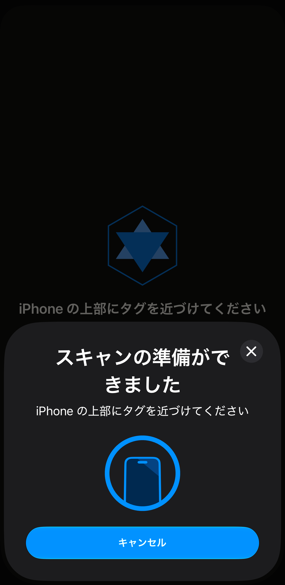
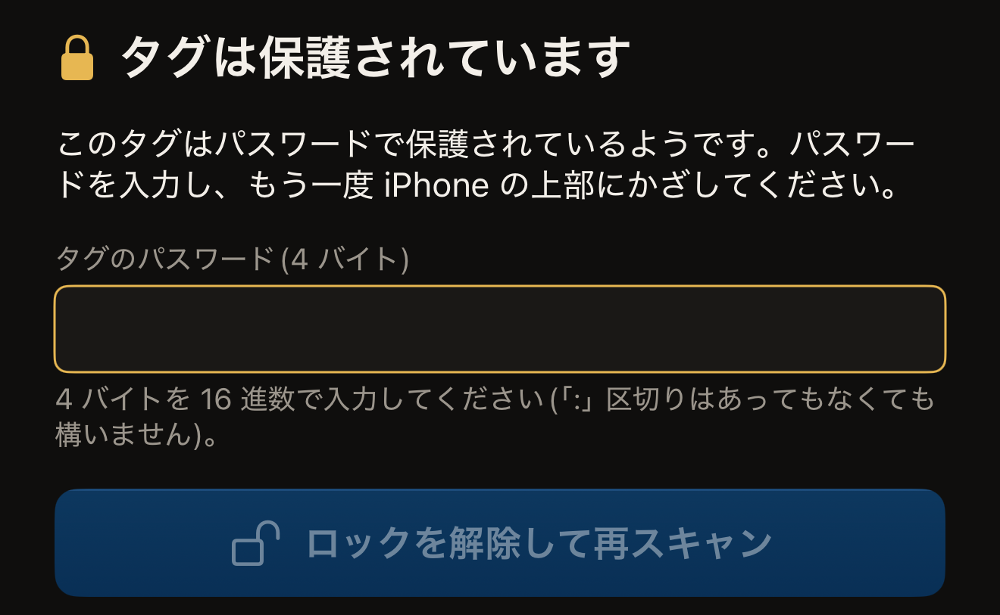
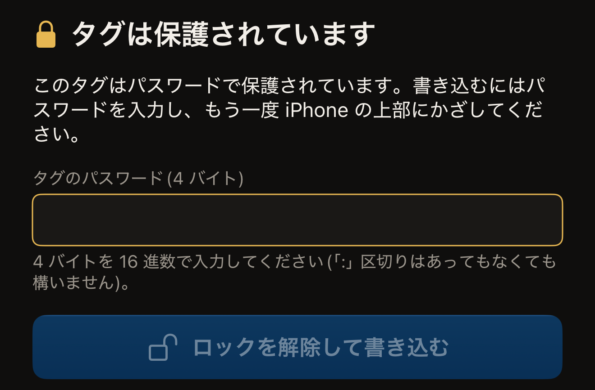

Hex NFC では、タグを 1 回かざすと読み取りが終わります。**スキャン**をタップしてタグを iPhone の上部に近づけると、見つかったチップとタグの中身が表示されます。スキャンは読み取るだけなので、タグの中身は何も変わりません。

タグは、読み取る前にパスワードを求めるように設定することもできます。そのように保護されたタグは、パスワードが送信されるまで読み取りを拒否します。パスワードを送信するには、1 回ではなく 2 回かざす必要があります。これについては、このページの後半で説明します。保護されているタグのほとんどは書き込み保護だけです。そうしたタグは、ほかのタグと同じように 1 回かざせばスキャンできます。タグをスキャンしたことがない場合は、[最初のタグを読み取る](quick-start.md)で同じ操作を最初から説明しています。

## タグをスキャンする

:::::steps
::::step[スキャン画面を開く]
Hex NFC を開き、Hex NFC のホーム画面で**スキャン**をタップします。スキャン画面が開き、「iPhone の上部にタグを近づけてください」と表示されます。

:::figure[アプリがタグを待つあいだ、アプリ自身の案内文は iOS のスキャンシートの上に表示されます。シートの「キャンセル」をタップするとスキャンが止まります。]

:::
::::

::::step[タグを iPhone の上部に近づける]
iPhone の上端をタグに当て、動かさずに保ちます。タグを読み取っているあいだ、画面には「読み取り中…」と表示されます。
::::

::::step[アプリが見つけた内容を確かめる]
チェックマークとともに「タグを検出」と表示され、その下にチップの名前が表示されます。さらにその下に、アプリが読み取った内容が表示されます。「1 件のレコードが見つかりました」の行は、タグに入っているレコードの数を示します。「このタグに NDEF レコードはありません」は、タグがフォーマット済みで、中身が空であることを意味します。最後にタグの UID が表示されます。
::::
:::::

結果は 1 秒ほど表示され、そのあとレコードが並んだ**タグ**画面が開きます。ここでレコードを変更したり、もう一度書き込んだりできます。結果に表示された内容は、ここでも何も失われていません。チップの名前はタグ情報カードの見出しに、レコードはその下の一覧になっています。UID はそのカードの行の 1 つで、いつでもタップしてコピーできます。スキャンはそれぞれ履歴にも保存されます。[以前スキャンしたタグを探す](scan-history.md)と[タグのレコードを編集する](edit-records.md)を参照してください。

タグを読み取る前にやめるには、iOS のスキャンシートでキャンセルをタップします。スキャン画面が閉じ、Hex NFC のホーム画面に戻ります。iPhone にタグを近づけないままでいると、1 分ほどで iOS のシートが自動的に閉じ、スキャン画面に「タグが見つかりません」と表示されます。その下には**キャンセル**と**もう一度試す**があります。

タグによっては、スキャン画面から別の画面に進みます。日本の交通系カードでは、交通系カード用の読み取り専用の結果画面が開きます。詳しくは[交通系カードを読み取る](transit-cards.md)を参照してください。電子パスポートでは、先に写真ページの情報を求められます。詳しくは[パスポートを読み取る](passports.md)を参照してください。インスリンペンなどの NFC ヘルスケア機器では、読み取り専用の**ヘルスケア機器**の画面が開き、保存はされません。詳しくは[ヘルスケア機器](tags-that-work.md#health-devices)を参照してください。保護されたタグではパスワードを求められます。これは次の作業で説明します。

結果に「このタグはまだフォーマットされていません」と表示された場合は、タグをフォーマットするまで、書き込んだ内容は何も読み取れません。フォーマットの方法は[タグを消去またはフォーマットする](erase-or-format.md)で説明しています。

## 保護されたタグのロックを解除する {#unlock-a-protected-tag}

読み取りにパスワードが必要なタグでは、スキャンが途中で止まります。スキャン画面には「タグは保護されています」と表示され、その下に「このタグはパスワードで保護されているようです。パスワードを入力し、もう一度 iPhone の上部にかざしてください。」という文が表示されます。その下には、パスワードのフィールド、**ロックを解除して再スキャン**、そして**キャンセル**と**もう一度試す**が並んだ行があります。パスワードはアカウントではなくタグに属するもので、知っているのは設定した人だけです。この状態になるのは**読み取りにもパスワードを要求**を設定した場合で、[パスワードでタグを保護する](protect-a-tag.md)で説明しています。

:::::steps
::::step[タグのパスワードを入力する]
**タグのパスワード(4 バイト)**に、0 から 9 と A から F の 16 進数の文字でパスワードを入力します。4 バイトのパスワードは 8 文字です。バイトの間のコロンはあってもなくてもよく、長さには数えられないので、`A1B2C3D4` と入力しても `A1:B2:C3:D4` と入力してもかまいません。入力が正しい長さになると、フィールドの下の説明に「OK」と表示されます。

:::figure[保護されたタグでは、スキャンが**タグのパスワード(4 バイト)**の入力で止まります。入力が正しい長さになるまで、**ロックを解除して再スキャン**はグレイ表示のままです。]

:::

NTAG424 DNA では、フィールドの名前が代わりに**タグの鍵(AES、16 バイト)**になります。MIFARE Ultralight C では**タグの鍵(3DES、16 バイト)**になります。この 2 つのチップは、パスワードではなく鍵で開きます。どちらの鍵も 16 バイト、つまり 32 文字です。
::::

::::step[2 回目のタップを始める]
**ロックを解除して再スキャン**をタップします。入力した内容がチップに合った長さになるまで、このボタンはグレイ表示のままです。
::::

::::step[もう一度タグを iPhone の上部に近づける]
アプリがパスワードを送信してからタグを読み取り、ほかのタグと同じように「タグを検出」と表示します。
::::
:::::

タグがパスワードを拒否すると、「タグは保護されています」の画面に戻り、案内文が「そのパスワードではタグのロックを解除できませんでした。確認してもう一度お試しください。」に変わります。NTAG424 DNA または MIFARE Ultralight C では、代わりに「その鍵ではタグのロックを解除できませんでした。確認してもう一度お試しください。」と表示されます。入力を直し、**ロックを解除して再スキャン**をタップして、もう一度かざします。パスワードが拒否されると、そのタップが終わるまでチップは応答しなくなります。試すたびにタグをかざし直すのは、意図した設計です。パスワードなしの通常の読み取りに戻るには、**もう一度試す**をタップします。**キャンセル**の動作は異なり、タグを読み取らずにスキャン画面を閉じ、入力した内容は破棄されます。どちらを選んでもタグは変わりません。

:::warning[拒否されたパスワードが 1 回の間違いとして数えられることがある]
タグは、間違ったパスワードを決まった回数までしか許容せず、それを超えるとパスワードを二度と受け付けなくなるように設定できます。そうした上限を報告するタグでは、アプリは上の案内の代わりに、その拒否に応じた文言を表示します。もう一度試すよりも、パスワードを確認し直すほうが大切です。[パスワードの間違いの回数を制限する](attempt-limit.md)を参照してください。
:::

## 書き込む前に保護されたタグのロックを解除する

書き込みは**タグ**画面から始めます。保護されたタグは、上で説明したロック解除を経て**タグ**画面に進みます。先にそのスキャンを終えると、ほかのタグと同じように**タグ**画面が開きます。その読み取りを省く方法が 2 つあります。**ライブラリ**の**履歴**タブには以前スキャンしたタグが並び、行をタップするとそのタグが**タグ**画面でもう一度開きます。**プリセット**タブでプリセットを左から右へスワイプすると**書き込む**が表示されます。これをタップすると、そのプリセットのレコードを書き込む書き込み画面がすぐに開きます。

**タグ**画面のツールバーで**書き込む**をタップすると、書き込み画面が開きます。書き込みの流れ全体は[タグにリンクを書き込む](write-a-link.md)で説明しています。ここでは、保護されたタグで加わる手順を説明します。

書き込み画面では、少し前にロックを解除したタグでも、もう一度パスワードを求められます。1 回のタップはそれぞれ別のセッションで、アプリはセッションをまたいでパスワードを持ち越しません。2 回目の入力は想定どおりの動作で、ロック解除に失敗したしるしではありません。最初から数えると、保護されたタグには 3 回のタップが必要です。拒否される最初のスキャン、**タグ**画面を開くロック解除のスキャン、そして書き込みです。画面には「タグは保護されています」と表示され、続いて「このタグはパスワードで保護されています。書き込むにはパスワードを入力し、もう一度 iPhone の上部にかざしてください。」とパスワードを求められます。

:::::steps
::::step[書き込み画面でパスワードを入力する]
**タグのパスワード(4 バイト)**に、スキャンのときと同じ 8 文字の 16 進数でタグのパスワードを入力します。鍵を使う 2 つのチップでは、フィールドの名前がパスワードではなく鍵になり、鍵は 32 文字です。

:::figure[書き込み画面では、書き込むためのパスワードを求める案内が表示され、ボタンは**ロックを解除して再スキャン**ではなく**ロックを解除して書き込む**になります。]

:::
::::

::::step[書き込みの 2 回目のタップを始める]
**ロックを解除して書き込む**をタップします。書き込みでタグの保護も変更する場合は、ボタンが代わりに**ロック解除して続ける**になります。その場合、アプリは書き込む前にタグの UID を表示し、「確認のため、このタグの UID を入力してください。」の下にその UID を入力するよう求めます。[パスワードでタグを保護する](protect-a-tag.md)を参照してください。
::::

::::step[タグをかざして書き込む]
もう一度タグを iPhone の上部に近づけます。アプリがパスワードを送信し、続けて書き込みます。
::::
:::::

ここでパスワードが拒否された場合も、「そのパスワードではタグのロックを解除できませんでした。確認してもう一度お試しください。」と表示されます。対処も同じで、入力した内容を確認してから、もう一度タグをかざします。

スキャンが「スキャンに失敗しました」で終わることもあります。空だと思っていたタグがパスワードを求めることもあります。どちらの場合も、[タグをスキャンまたは書き込みできない場合](troubleshooting.md)の手順を順に試してください。
