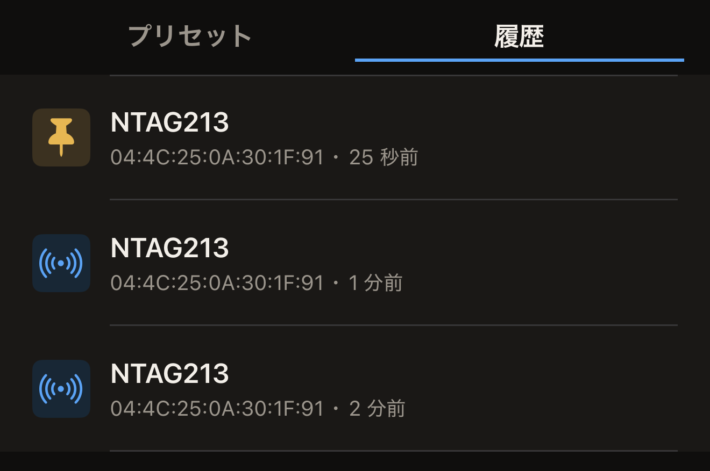

Hex NFC は読み取ったタグのコピーを保存するので、タグが手元になくてもスキャンをもう一度開けます。最近のスキャンは iPhone のライブラリに新しい順に並んでいます。残しておきたいものはピン留めします。

## 以前のスキャンを開く

すでに読み取ったタグが必要です。タグをスキャンするまで、**履歴**は空のままです。[タグをスキャンする](scan-a-tag.md)を参照してください。

:::::steps
::::step[Hex NFC を開く]
アプリを開くと、**スキャン**、**作成**、**ライブラリ**、**詳細**のタイルが並ぶ Hex NFC のホーム画面が表示されます。
::::

::::step[ライブラリを開く]
**ライブラリ**をタップします。「ライブラリ」画面が**プリセット**タブで開きます。
::::

::::step[スキャンの一覧を表示する]
「ライブラリ」画面の上部で、**プリセット**の右にある**履歴**をタップします。各行の先頭にはチップの名前があり、その下にタグの UID と、読み取ってからの経過時間が表示されます。

:::figure[各行にはチップの名前、タグの UID、読み取ってからの経過時間が表示され、ピン留めしたスキャンではアイコンの代わりにピンが表示されます。]

:::
::::

::::step[スキャンを開く]
開きたいスキャンをタップします。ライブラリが閉じ、そのスキャンが「タグ」画面で開きます。画面には、そのスキャンを記録したタップで読み取ったレコードとチップの詳細が表示されます。
::::
:::::

交通系カードの場合は、代わりに「交通系カード」画面が読み取り専用で開きます。カードを読み取ったときと同じ表示です。パスポートの読み取り結果は保存されないため、この一覧にパスポートは表示されません。[パスポートを読み取る](passports.md)を参照してください。ヘルスケア機器も保存されることはありません。

## 残したいスキャンをピン留めする

一覧には 50 件のスキャンが保存されます。一覧がいっぱいのときに新しいスキャンが加わると、ピン留めされていないスキャンのうち最も古いものが末尾から消えます。ピン留めされていないスキャンは、一覧の件数にかかわらず、そのスキャンを記録した読み取りから 90 日たつと消えます。再スキャンが既存の行にまとめられた場合は、新しい読み取りとして扱われ、90 日が最初から数え直されます。ピン留めしたスキャンはどちらのルールの対象にもならず、削除するまで残ります。

スキャンは新しい順に並び、画面にはスキャンを検索する機能がありません。あとで探したくなりそうなスキャンはピン留めしておきます。

- スキャンをピン留めするには、**履歴**でそのスキャンを右にスワイプし、**ピン留め**をタップします。

ピン留めしたスキャンでは、行の左端に通常のアイコンの代わりにピンが表示されます。一覧の一番上に移動することはなく、元の位置に残ります。すでにピン留めされているスキャンでは、同じスワイプ操作で表示されるボタンが**ピン留めを解除**になります。ピン留めを解除すると、そのスキャンは再び 50 件の数に含まれます。

## スキャンを削除する

- スキャンを削除するには、**履歴**でそのスキャンを左にスワイプし、**削除**をタップします。反対側までスワイプしきると、すぐにスキャンが削除されます。

:::warning
**削除**をタップした時点で、スキャンは削除されます。確認は求められず、元に戻す方法もありません。ただし、タグをもう一度読み取れば新しいスキャンが作成されます。
:::

## 履歴に残る内容

まだ何も読み取っていないうちは、**履歴**に「スキャン履歴はありません」と表示され、その下に「直近 50 件のスキャンしたタグがここに表示されます。ピン留めすると残せます。」という行が表示されます。

- 同じタグをもう一度読み取ったとき、タグに何も変化がなければ、既存のスキャンが一覧の一番上に戻ります。2 つ目の行は表示されません。チップの詳細、レコード、タグのパスワード保護のいずれかが異なる場合は、代わりに新しい行が追加されます。
- スキャンはこの iPhone に保存されます。iCloud アカウントに送られるのは、**iCloud 同期**をオンにした場合だけです。この設定は最初はオフになっています。[プライバシーとデータ](privacy.md)を参照してください。

## 関連項目

- [タグをスキャンする](scan-a-tag.md)
- [タグのレコードを編集する](edit-records.md)
- [タグをプリセットとして保存する](presets.md)
