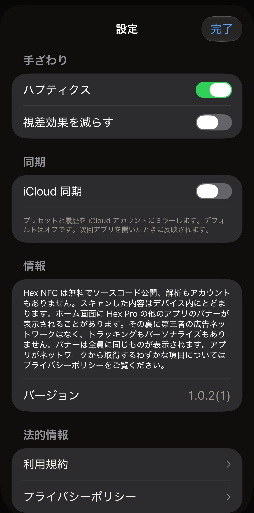

Hex NFC の設定は 3 つあり、アプリのバージョン番号、フィードバックの送信やアプリの評価を行う項目、法的文書と同じ画面にまとめられています。Hex NFC のホーム画面で、右上の歯車ボタンをタップします。このボタンには文字がなく、VoiceOver では**設定**と読み上げられます。開いたシートのタイトルは**設定**です。以下のグループは、画面に表示される順に並んでいます。

:::figure[**設定**シートは**手ざわり**と**同期**から始まり、どのスイッチもデフォルトの状態です。]

:::

## 手ざわり

:::table[手ざわりの設定]
| 設定項目 | 機能 | デフォルト |
| :--- | :--- | :--- |
| **ハプティクス** | スキャン、書き込み、そのほかアプリが合図する場面で iPhone を振動させます。オフにすると、その振動はすぐに止まります。 | オン |
| **視差効果を減らす** | アプリのアニメーションを控えめにします。:more[このスイッチか iPhone 自体の「視差効果を減らす」設定のどちらかがオンのとき、アプリは動きを抑えます。そのため、このスイッチをオフにしてもシステムの設定は取り消されません。] | オフ |
:::

iPhone 自体の「視差効果を減らす」がオンのときは、行の下に『システムの「視差効果を減らす」がオンです。アニメーションはすでに最小限になっています。』と表示されます。

## 同期

:::table[同期の設定]
| 設定項目 | 機能 | デフォルト |
| :--- | :--- | :--- |
| **iCloud 同期** | プリセットとスキャン履歴を iCloud アカウントにミラーします。タグのパスワードはミラーされません。パスワードは、それを設定した iPhone のキーチェーンに保存されたままです。 | オフ |
:::

Hex NFC は起動時に一度だけライブラリを構築するため、**iCloud 同期**をオンやオフにしても、アプリを閉じて開き直すまで何も変わりません。行の下の説明にもそのことが書かれています。アプリを閉じるとは、アプリを終了することです。iPhone のホーム画面に戻るだけでは Hex NFC は動作し続け、切り替えたスイッチは効果がないままです。

### iCloud 同期をオンにする {#turn-on-icloud-sync}

::::steps
:::step[「設定」を開く]
Hex NFC のホーム画面で、右上の歯車ボタンをタップします。
:::

:::step[iCloud 同期をオンにする]
**iCloud 同期**をオンにします。スイッチは切り替わりますが、この時点ではほかに何も変わりません。
:::

:::step[Hex NFC を閉じて開き直す]
[アプリを閉じて開き直す](#close-and-reopen-the-app)の手順に従います。アプリは起動時にライブラリを構築し直し、今度は同期が動作した状態になります。
:::

:::step[警告が出ていないか確認する]
もう一度歯車ボタンをタップし、**iCloud 同期**の下を見ます。そこには「プリセットと履歴を iCloud アカウントにミラーします。デフォルトはオフです。次回アプリを開いたときに反映されます。」という説明が表示されています。その後に 2 つ目の段落が続いている場合は、同期が始まっていません。[同期が始まらない場合](#when-sync-does-not-start)を参照してください。
:::
::::

### アプリを閉じて開き直す {#close-and-reopen-the-app}

::::steps
:::step[Hex NFC を閉じる]
画面の下端から上にスワイプし、開いているアプリが表示されるまで指を止めます。ホームボタンのある iPhone では、代わりにホームボタンをダブルクリックします。次に Hex NFC のカードを上にスワイプすると、カードが画面から消えます。
:::

:::step[Hex NFC をもう一度開く]
Hex NFC のアイコンをタップします。アプリは起動時にライブラリを構築し直します。このとき、アプリを閉じたときの **iCloud 同期**の設定が使われます。
:::
::::

**iCloud 同期**を再びオフにする場合も、同じようにアプリを閉じて開き直す必要があります。どちらの場合も、プリセットと履歴はこの iPhone に残ります。Hex NFC は、iCloud にすでに保存されているデータを削除しません。同じアカウントでサインインしている別の iPhone には、受け取ったデータがすべて残ります。止まるのは、この iPhone からの新しい変更の送信です。

### 同期が始まらない場合 {#when-sync-does-not-start}

スイッチがオンでも、アプリの起動時に iCloud に接続できなかった場合、同期は始まりません。行の下に 2 行目として「同期は実行されていません。ライブラリはこのデバイスに安全に保存されていますが、App の起動時に iCloud を利用できませんでした。iCloud にサインインしているか確認してから、App を開き直してください。」と表示されます。プリセットと履歴は iPhone に残っています。止まったのはミラーだけです。

この行が表示される原因は、次の 3 つです。

- iPhone が iCloud にサインインしていません。
- アカウントの iCloud ストレージに空きがありません。
- Hex NFC の起動時に、iPhone がネットワークに接続していませんでした。

上から順に確認します。

::::steps
:::step[iCloud アカウントを確認する]
iPhone の「設定」アプリを開き、一番上にある自分の名前をタップします。サインインを求められたらサインインし、iCloud の行をタップして、ストレージの残りを確認します。空きがない場合は、その画面で容量を空けるか、ストレージプランを変更します。
:::

:::step[ネットワークを確認する]
iPhone が Wi-Fi またはモバイルデータ通信に接続していることを確認します。Safari でページを読み込めるかどうかで判断できます。
:::

:::step[Hex NFC を閉じて開き直す]
**iCloud 同期**はオンのままにして、[アプリを閉じて開き直す](#close-and-reopen-the-app)の手順に従い、Hex NFC のホーム画面で歯車ボタンをタップします。**iCloud 同期**の下に 2 つ目の段落がまだ表示されている場合は、同期はまだ始まっていません。
:::
::::

## 情報

「情報」セクションには、アプリがすることとしないことが書かれています。解析もアカウントもなく、スキャンした内容はデバイスにとどまります。また、Hex NFC のホーム画面に Hex Pro の別のアプリのバナーが表示されることがある点にも触れています。このバナーの裏に第三者の広告ネットワークはなく、トラッキングもパーソナライズもありません。バナーは全員に同じものが表示されます。アプリがネットワークから取得するわずかな項目については、[プライバシーとデータ](privacy.md)をお読みください。

その段落の下の**バージョン**には、アプリのバージョン番号と、それに続いて括弧内にビルド番号が表示されます。

## フィードバックと評価 {#feedback-and-ratings}

**バージョン**の下にある**フィードバックを送信**をタップすると、Hex Pro にメッセージを送るフォームが開きます。

1. うまくいかないことや、改善してほしいことをメッセージ欄に入力します。
2. 返信がほしい場合は、**返信先（任意）**にメールアドレスを入力します。空欄のままにすると、返信先なしでメッセージが送られます。
3. **メッセージと一緒に送信される情報**の一覧を確認します。メッセージと一緒に送られるアプリのバージョン、iOS のバージョン、デバイスの機種、言語が表示されます。タグ、スキャン、スキャン履歴の内容は何も送信されません。
4. 右上の**送信**をタップします。

メッセージが送信されると、フォームにお礼が表示されます。Hex Pro に接続できなかった場合は、入力した内容を残したまま**メールで送る**が表示されます。これをタップすると、メッセージと同じ情報が入力された状態でメールアプリが開きます。

**Hex NFC を評価**をタップすると App Store のアプリのページが開き、評価を付けたりレビューを書いたりできます。

Hex NFC のホーム画面では、ときどき下端に沿ってカードが表示されます。カードには **Hex NFC はいかがですか？**と表示されます。このカードが表示されるのは、書き込みや保護の変更が何度か成功したあと、または交通系カードやパスポート全体を読み取ったあとで、しかも最近のスキャンに失敗がない場合だけです。ホーム画面が 10 秒間操作されないままになるまで待ってから表示され、表示されるのは多くても月に 1 回です。必要なものを覆い隠すこともありません。カードの上にある画面はスクロールでき、どのボタンも使えます。

**気に入っています！**をタップすると、iOS が表示すると判断した場合に Apple の評価シートが表示されます。**いまいち**をタップすると、カードは代わりに**フィードバックを送信**を勧めます。どちらの答えも最終的なもので、カードがもう一度たずねることはありません。**非表示**をタップすると、カードは 1 か月間隠れます。カードが表示されている間にホーム画面から何かを開いた場合も同じです。

## 法的情報

**利用規約**と**プライバシーポリシー**をタップすると、それぞれの文書全体が閲覧用のカードで開きます。スクロールして読み、**完了**で閉じます。どちらのカードにも、最初の見出しの上に 2 行があります。その版が発効した日付と、「Ars Vitae Pty Ltd, trading as Hex Pro (Australia)」です。アプリのほかの部分がどの言語で表示されていても、どちらの文書も英語です。

アプリの料金については、利用規約の「3. The app is free」という見出しのセクションに書かれており、[よくある質問](faq.md)でも答えています。プライバシーポリシーは、[プライバシーとデータ](privacy.md)のもとになっている文書です。

## 関連項目

- [タグをプリセットとして保存する](presets.md)
- [以前スキャンしたタグを探す](scan-history.md)
- [プライバシーとデータ](privacy.md)
