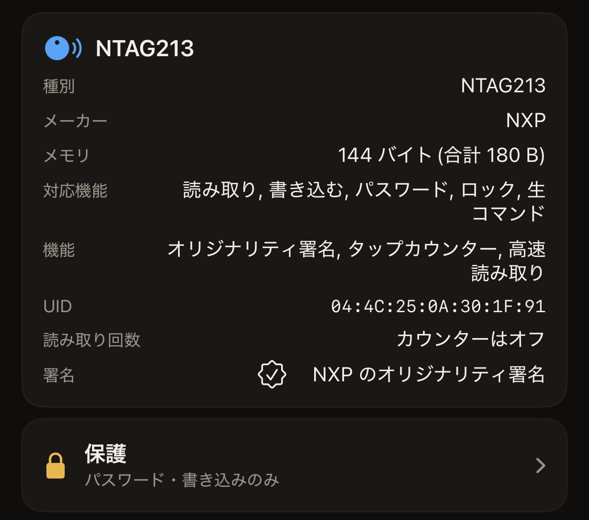

ポスターに貼ったタグは、近づいたすべての端末に応答します。保護されていないチップなら、どの端末からでも書き込んだ内容を上書きできてしまいます。それに対するチップ自身の備えが保護です。秘密はチップの設定ページに置かれ、チップは秘密が送信されるまで変更を拒否します。Hex NFC では、iPhone からこの秘密を設定することも、後のスキャンで送信することも、再び削除することもできます。この保護はアプリではなく、タグ自体にかかっています。

## 保護されたタグが拒否すること

保護の対象は、標準では書き込みです。このように保護されたタグは、どの端末からでも引き続き読み取れます。ポスターや名刺にはこれが適しています。タグをかざした人はリンクを受け取れますが、ほかの人が内容を変えることはできません。2 つのチップファミリーでは保護を読み取りにも広げることができ、その場合は以後のスキャンでできることが変わります。

[タグをスキャンする](scan-a-tag.md)と、保護に対応したチップでは、「タグ」画面に 2 つのカードが表示されます。タグ情報カードには、手元にあるチップの名前が表示されます。**保護**カードには保護の設定があります。**保護**をタップすると、同じ名前のシートが開き、設定が表示されます。設定の手順は[パスワードでタグを保護する](protect-a-tag.md)で説明しています。

読み取り保護を使えるのは 2 つのファミリーです。NTAG213、NTAG215、NTAG216、MIFARE Ultralight EV1 では、**詳細**の中にある**読み取りにもパスワードを要求**がその設定です。これをオンにすると、保護が読み取りにも広がります。その結果について、シートには「読み取り保護されたタグは、検証を含めてパスワードなしでは読み戻せません。」とはっきり書かれています。NTAG424 DNA では、設定は**読み取りにも鍵を要求**です。こちらは**詳細**の中ではなく、鍵そのものの隣にあります。ICODE SLIX2 と MIFARE Ultralight C にはこの設定がありません。これらのチップの秘密は書き込みを保護するもので、読み取りは制限されません。

「タグ」画面の**保護**カードには、スキャンでわかったことが 1 行の概要で表示されます。「オフ」は、秘密が設定されていないことをスキャンで確認できたという意味です。「パスワード・書き込みのみ」は書き込みが保護され読み取りは制限されていないこと、「パスワード・読み取りと書き込み」は両方が保護されていることを示します。4 つ目の答えは「不明・このタグの保護状態を読み取れませんでした」で、これは「オフ」とは違い、タグが答えなかったことを意味します。タグをもう一度スキャンしてください。タップが途中で終わると、アプリは答えを得られません。アプリが保護状態を問い合わせられないチップでは、毎回同じ表示になります。そのようなタグでも、書き込みを試して問題ありません。保護されたタグは書き込みを拒否し、書き込み画面は何も変更せずに秘密を求めます。パスワードを持たずに読み取り保護されたタグをスキャンすると、「このタグは、パスワードを提示するまで何も表示しません。」と表示されます。

:::figure[タグ情報カードにはチップの名前が、その下の**保護**カードには概要が表示されます。この例では「パスワード・書き込みのみ」です。]

:::

## 秘密を設定できるチップ

秘密の形式はチップによって決まり、アプリが秘密を求めるフィールドもチップによって変わります。このフィールドはロック解除の入力欄にあり、この入力欄はタグに拒否されたときに表示されます。保護されていてスキャンに応答しないタグでは、フィールドの上に「タグは保護されています」、下に**ロックを解除して再スキャン**が表示されます。保護されたタグに書き込むときも、書き込みを始める前に同じように秘密を求められます。

:::table[チップファミリーごとの秘密の形式]
| チップ | 秘密 | ロック解除の入力欄のフィールド |
| --- | --- | --- |
| NTAG213、NTAG215、NTAG216、MIFARE Ultralight EV1 | 4 バイトのパスワード | **タグのパスワード(4 バイト)** |
| NTAG424 DNA | 16 バイトの AES 鍵 | **タグの鍵(AES、16 バイト)** |
| MIFARE Ultralight C | 16 バイトの 3DES 鍵（書き込みのみ） | **タグの鍵(3DES、16 バイト)** |
| ICODE SLIX2 | 4 バイトのパスワード（書き込みのみ） | **タグのパスワード(4 バイト)** |
:::

どのフィールドも、秘密を 16 進数で、1 バイトにつき 2 文字で入力します。4 バイトのパスワードなら 8 文字、16 バイトの鍵なら 32 文字です。バイトの間のスペースやコロンも使え、大文字と小文字のどちらでも構わないので、`FF FF FF FF` と `ffffffff` は同じパスワードを 2 通りに入力したものになります。正しいバイト数が入力されるとフィールドに「OK」と表示され、それまでは必要なバイト数が繰り返し表示されます。

パスワードのしくみをまったく持たないチップをスキャンした場合、**保護**カードは表示されません。ただし、スキャンでロックビットが書き込まれていることがわかった場合は別です。ロックの判定結果を示すために、カードが再び表示されます。表示は「完全にロック済み」、「一部ロック済み・このタグの一部は恒久的に読み取り専用です」、「ロックを書き込み済み・もう一度スキャンして確認してください」のいずれかです。ロックされたタグでは、カードは状態を表示するだけで、開きません。また、まだタグをスキャンしていない状態でも「タグ」画面にはこのカードがあり、プリセットはここで保護の設定を取り込みます。手元のチップが何かは、引き続きタグ情報カードで確認できます。[Hex NFC で使えるタグ](tags-that-work.md)では、それぞれのチップでできるほかのことを説明しています。チップごとの詳しい情報は[チップ対応表](../developer/chip-support-matrix.md)にあります。

MIFARE Ultralight C に読み取り保護をかけると、アプリがチップの識別に使うページそのものが隠れてしまいます。そのように保護したタグは、ロックの解除はおろか、二度と認識することさえできなくなります。書き込みのみという制限について、アプリは「Hex NFC はこのタグを書き込みから保護できますが、読み取りからは保護できません。」とはっきり伝えます。

## パスワードを失うと元に戻せない理由

タグの秘密は、外から取り戻す方法がまったくありません。4 バイトのパスワードについては、「パスワードを失うと、保護されたメモリは失われます。復旧手段はありません。」というアプリ自身の警告がすべてです。鍵を使うチップの警告は同じことをもう少し詳しく述べていて、「この鍵を失うと、このタグは二度と書き換えられません。NTAG424 に工場出荷時リセットはありません。安全に保管してください。」と「この鍵を失うと、保護されたメモリは二度と書き換えられません。Ultralight C に工場出荷時リセットはありません。安全に保管してください。」と表示されます。SLIX2 のパスワードは現在のパスワードを送信しないとリセットできないため、失った場合の結果は同じです。

Hex NFC は、プリセットと一緒に保存した秘密を 1 か所にしか保管しません。画面には「シークレットはこのデバイス(キーチェーン)にのみ保存されます。同期されることも、書き出しに含まれることもありません。」と表示されます。そのため、ほかの人と共有したプリセットや、別の iPhone で復元したプリセットには、パスワードが含まれません。[タグをプリセットとして保存する](presets.md)では、何枚ものタグで 1 つのプリセットを使い回す場合にこれが何を意味するかを説明しています。パスワードの控えは、信頼できる場所に自分で保管してください。

## 保護の変更には 2 回のタップが必要

::include[two-tap-confirmation]

その UID を自分で探す必要はありません。アプリは「確認のため、このタグの UID を入力してください。」の下、フィールドの隣に、区切りのない 16 進数の文字列として UID を表示します。大文字と小文字のどちらでも入力できます。秘密の設定も削除もタグへの変更なので、どちらもこの確認を経ます。

## 関連項目

- [タグをスキャンする](scan-a-tag.md)
- [パスワードでタグを保護する](protect-a-tag.md)
- [タグのパスワードを削除する](remove-password.md)
- [パスワードの間違いの回数を制限する](attempt-limit.md)
- [タグを完全にロックする](permanent-lock.md)
