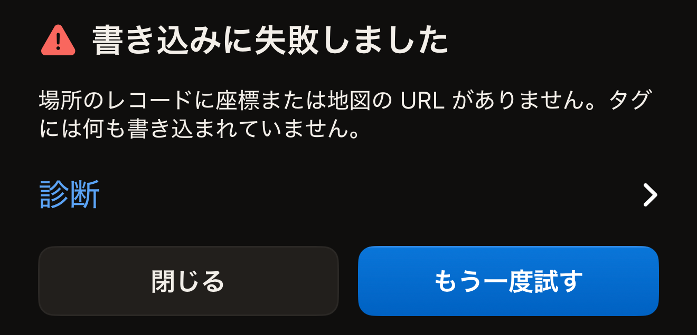
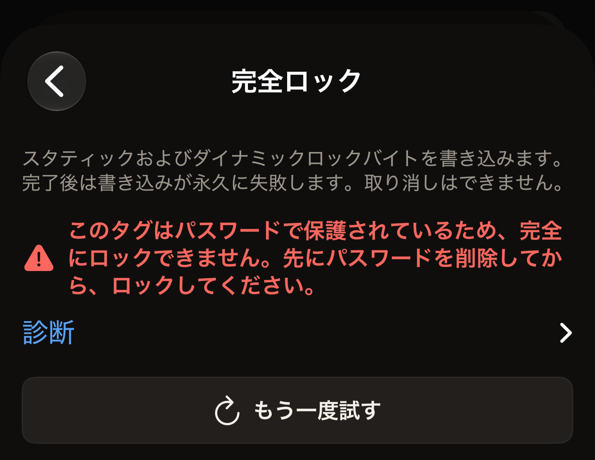

読み取りに失敗する原因のほとんどは、タグが動いたことです。iPhone の上端をタグに平らに当て、1 秒ほど動かさずに保ってから、**もう一度試す**をタップします。

Hex NFC は、問題をコードではなく文章で示します。表示された文章を以下から探してください。どの失敗メッセージにも、そのすぐ下に**診断**という閉じた行があり、右端にシェブロンが付いています。この行をタップすると、その下に技術的な詳細が開きます。

## メッセージを探す

- [タイムアウトした、読み取り中にタグを見失った、キャンセルされた](#scan-stopped)
- [MIFARE Classic、このデバイスに NFC がない、ビルドが未対応、タグが対応していない操作、ヘルスケア機器](#tag-not-readable)
- [レコードが大きすぎる、タグに書き込まれた内容が送信したものと異なる](#write-failed)
- [UID を入力した後に別のタグと判定された](#different-tag)
- [パスワードの確認が終わらない](#password-check)
- [予期しないエラーが発生した](#unexpected)

## まず試すこと

- 背面の中央ではなく、iPhone の上端をタグに当てます。
- 金属製のケースから iPhone を取り出し、タグを金属面から離します。
- アプリが応答するまで、タグと iPhone を一緒に動かさずに保ちます。
- 別のタグを試します。別のタグが読み取れる場合は、最初のタグに原因があります。

## 「スキャンに失敗しました」の意味は？ {#scan-failed}

「スキャンに失敗しました」は、アプリが読み取りを完了できなかったときに表示される見出しです。その下の文章が理由を示していて、このページの以下の見出しはその理由ごとに分かれています。

::::steps
:::step[診断を開く]
メッセージのすぐ下にある行、**診断**をタップします。その下に詳細が開きます。テキストは選択できるので、コピーして使えます。
:::

:::step[新しいスキャンを始める]
**もう一度試す**をタップします。スキャン画面で新しいセッションが始まり、「iPhone の上部にタグを近づけてください」と表示されて待機します。
:::

:::step[タグを動かさずに保つ]
iPhone の上端をタグに平らに当て、アプリが応答するまでそのまま保ちます。
:::
::::

## スキャンが途中で止まったのはなぜ？ {#scan-stopped}

「スキャンがタイムアウトしました。タグを端末の上部に固定したまま、もう一度お試しください。特定のタグだけ毎回タイムアウトする場合、iPhone が読めない MIFARE Classic かもしれません(iOS の制限であり、タグの不具合ではありません)。」

制限時間内にタグが応答しなかったため、iOS がセッションを終了しました。この文章が表示されるのは、同じ画面で iPhone がすでにタグを見つけていた場合（保護されたタグを 2 回目にかざしたときなど）や、その画面での前回の試行がエラーで終わった場合です。iPhone の上端をタグの上でゆっくり動かし、そのまま保ちます。

iPhone がタグをまったく見つけられなかった場合は、代わりに「タグが見つかりません」と表示され、その下に**もう一度試す**があります。これは失敗ではないため、その下に診断はありません。対処方法は同じで、iPhone の上端をタグに平らに当て、動かさずに保ちます。

タグが応答し始めてから止まった場合は、「読み取り中にタグを見失いました。端末の上部に当てたまま、もう一度お試しください。」という別の文章が表示されます。これは、コマンドの途中でタグが通信範囲から外れたことを示します。

「スキャンをキャンセルしました。」は、スキャンが終わる前に、自分またはアプリによって閉じられたことを示します。このメッセージが表示されるのは、同じ画面で iPhone がすでにタグを見つけていた場合か、その画面での前回の試行がエラーで終わった後です。タグが見つかる前に iOS のシートを閉じた場合は、シートが閉じるだけでメッセージは表示されません。スキャンは読み取りだけを行うので、タグの内容は何も変わっていません。

## iPhone でこのタグをまったく読み取れないのはなぜ？ {#tag-not-readable}

次の 3 つのメッセージは、タグをどのようにかざしても読み取りができないことを示します。ほかに 2 つのメッセージもここで扱いますが、どちらも読み取りの失敗ではありません。

「MIFARE Classic のタグのようです。iPhone は検出できますが、暗号化されたメモリは読めません。iOS はアプリが必要とする MIFARE Classic の鍵を公開していません。」チップは、アプリがチップファミリーを認識できるところまでは応答しましたが、それ以上は進みませんでした。

:::important[iPhone では、どのアプリも MIFARE Classic を読み取れない]
iOS は、このチップのメモリを開く鍵をどのアプリにも渡さないため、Hex NFC のどの設定を変えても結果は変わりません。代わりに、[Hex NFC で使えるタグ](tags-that-work.md)に載っているタグを使ってください。
:::

「このデバイスは NFC に対応していません。」アプリがこの iPhone で NFC セッションをまったく開けませんでした。iPhone には、オンに戻せる NFC のスイッチはありません。Hex NFC のどの設定でもこれは変わらず、タグのかざし方を変えても解決しません。アプリの動作に必要なものは[よくある質問](faq.md)で説明しています。ほかの点では Hex NFC が動作する iPhone でこのメッセージが表示される場合は、**診断**を開いてテキストをコピーし、[さらにサポートが必要な場合](#if-you-need-more-help)の説明に従って送ってください。

「このビルドはまだそのタグ種別に対応していません。」お使いのアプリは、その種類のタグを読み取るように登録されていません。タグやかざし方を変えても、この状況は変わりません。まず App Store で Hex NFC のアップデートを確認してください。それでもメッセージが表示される場合は、**診断**を開き、[さらにサポートが必要な場合](#if-you-need-more-help)の説明に従ってテキストを送ってください。

「このタグはその操作に対応していません。」は、読み取りに関するメッセージではありません。タグは読み取れています。タグが受け付けないのは、選んだ方法で依頼した操作です。チップ名はタグ情報カードに表示されます。チップが報告する場合は、**対応機能**と**機能**の行に、そのチップでできることが表示されます。

**操作** > **パスワードで保護**と「タグ」画面の**保護**カードは、どちらも NTAG213、NTAG215、NTAG216、MIFARE Ultralight EV1、MIFARE Ultralight C、NTAG424 DNA、ICODE SLIX2 の 7 種類のチップを保護できます。2 つの方法の手順は[パスワードでタグを保護する](protect-a-tag.md)で説明しています。アプリが認識するチップについては [Hex NFC で使えるタグ](tags-that-work.md)を、チップごとの詳しい技術情報については[チップ対応表](../developer/chip-support-matrix.md)を参照してください。

「これはヘルスケア機器です。Hex NFC はヘルスケア機器への書き込みやコマンド送信を一切行いません。」は、かざしたものがインスリンペンなどの医療機器であることを示します。それに向けた書き込み、操作、**詳細**のコンソールのコマンドは、何かを書き込んだりコマンドを送ったりする前に止まるので、機器は変わりません。**スキャン**でスキャンすると**ヘルスケア機器**の画面が開きます。詳しくは[ヘルスケア機器](tags-that-work.md#health-devices)を参照してください。

## 「書き込みに失敗しました」の意味は？ {#write-failed}

「書き込みに失敗しました」は、書き込み、読み戻し、または保護の変更が完了しなかったときに表示される見出しです。その下には 3 つのコントロールがあります。**診断**には詳細があり、**閉じる**でエディターに戻ります。**もう一度試す**は、入力したパスワードを保持したまま書き込みをやり直します。「タグ」画面から始めた、保護を有効または無効にする書き込みでは、やり直すとタグの UID がもう一度読み取られ、UID をもう一度入力するよう求められます。タグを変更することへの同意は、失敗をまたいで引き継がれないためです。**ライブラリ**から書き込んだプリセットでは、このような確認はありません。かざしたタグがそのまま書き込み先の指定になるので、やり直しでもタグをかざすのは 1 回だけです。

:::figure[書き込みに失敗すると、「書き込みに失敗しました」の下に理由が表示され、その下に**診断**、さらに**閉じる**と**もう一度試す**が並びます。]

:::

次の 2 つのメッセージには、それぞれに合った対処方法があります。

「これらのレコードはこのタグには大きすぎます。」レコードに必要な容量が、チップのデータ領域より大きくなっています。レコードを短くするか削除するか、メモリの大きいタグに書き込んでください。各種類のレコードに必要な容量は[レコードの種類](record-types.md)で説明しています。

「タグの内容が送信したものと異なります。もう一度書き込んでください。」アプリが書き込み後にタグを読み戻したところ、送信したバイトと一致しませんでした。タグを動かさずに保ったまま、**もう一度試す**をタップします。

## UID を入力したのにタグが拒否されたのはなぜ？ {#different-tag}

::include[two-tap-confirmation]

「別のタグです。」は、かざしたタグがアプリの想定していたタグではないことを示します。**診断**の行には、何回目のタップでこのメッセージが出たかと、想定していたタグが示されます。

**操作**画面では、このメッセージは 2 回目のタップで表示されます。かざしたタグが、UID を入力したタグではありません。同じタグをもう一度かざすか、変更するつもりだったタグで最初からやり直してください。

「タグ」画面からの保護の変更では、どちらのタップでもこのメッセージが出ることがあります。2 回目のタップで出た場合の意味は同じです。1 回目のタップの時点では、まだ何も入力していません。この場合は、かざしたタグが、エディターを開いたときのタグではありません。代わりにそのタグをかざしてください。

**操作**画面で操作に失敗すると、メッセージが表示され、そのすぐ下に**診断**、さらにその下に**もう一度試す**が表示されます。2 つの画面では、このボタンが別のボタンに置き換わります。**試行回数の上限**では**最初からやり直す**、**パスワードを削除**では**別のパスワードを入力**が表示されます。どちらもパスワードをもう一度求めるので、次の試行では、タグが拒否したばかりのパスワードではなく、次に入力したパスワードが送信されます。

:::figure[**完全ロック**画面でロックが拒否されると、メッセージ、**診断**、**もう一度試す**の順に表示されます。]

:::

## パスワードの確認が終わらない場合は？ {#password-check}

「パスワードを確認できませんでした。タグが応答しなくなっています。端末の上部に当てたまま動かさずに、もう一度お試しください。」アプリがパスワードを確認している間に、タグが応答しなくなりました。パスワードが正しいかどうかは、どちらとも判断されていません。アプリはパスワードが間違っているとは伝えていません。タグを動かさずに保ち、もう一度操作を実行してください。本当にタグを開けなくなったパスワードについては、[タグのパスワードを削除する](remove-password.md)で説明しています。

## 予期しないエラーが発生したと表示されるのはなぜ？ {#unexpected}

「予期しないエラーが発生しました。」は、スキャン画面、書き込み画面、**操作**画面に表示されます。アプリがタグのエラーとして認識できない失敗のときに表示されます。「予期しない問題が発生しました。もう一度お試しください。」は、同じ理由で NFC の処理層から表示されます。

さらに次の 2 つは、アプリが想定していない形でタグが応答したことを示します。

- 「タグが想定外のプロトコルで応答しました。」
- 「タグが、このアプリでは解析できないデータを返しました。」

4 つとも、次にすることは同じです。**診断**を開いてテキストをコピーし、もう一度タグをかざします。同じタグで同じメッセージが再び表示される場合は、コピーした診断内容から問題を特定できます。

## さらにサポートが必要な場合 {#if-you-need-more-help}

コピーした診断内容は、アプリから Hex Pro に送ってください。ホーム画面の歯車ボタンをタップし、**フィードバックを送信**をタップして、メッセージに貼り付けます。タグ情報カードが表示されるところまで読み取れた場合は、そのチップ名も書き添えてください。まったく読み取れなかった場合はそのことと、どのタグが読み取れてどのタグが読み取れないかを書いてください。アプリのバージョン、iOS のバージョン、デバイスの機種、言語はフォームが自動で添えます。返信が必要な場合は、**返信先（任意）**にメールアドレスを入力してください。フォームについては[フィードバックと評価](settings.md#feedback-and-ratings)で説明しています。

`support@hex.pro` へのメールでも連絡できます。このアドレスは、**設定**の**法的情報**にある**プライバシーポリシー**と**利用規約**に記載されています。メールの場合は、**設定**の**バージョン**に表示されるアプリのバージョンと、iPhone の機種と iOS のバージョンを書き添えてください。機種とバージョンは、iPhone の「設定」アプリで一般、情報の順に開くと確認できます。

次に、正常な読み取りがどのようなものかは[タグをスキャンする](scan-a-tag.md)を、アプリの動作に必要なものは[よくある質問](faq.md)を参照してください。
