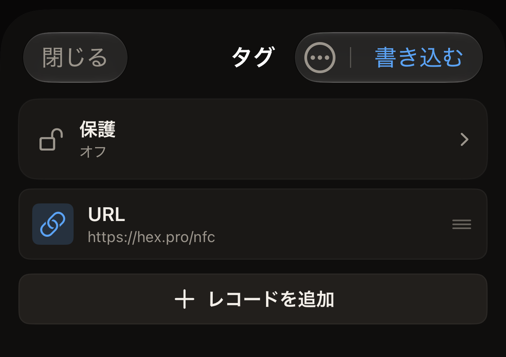
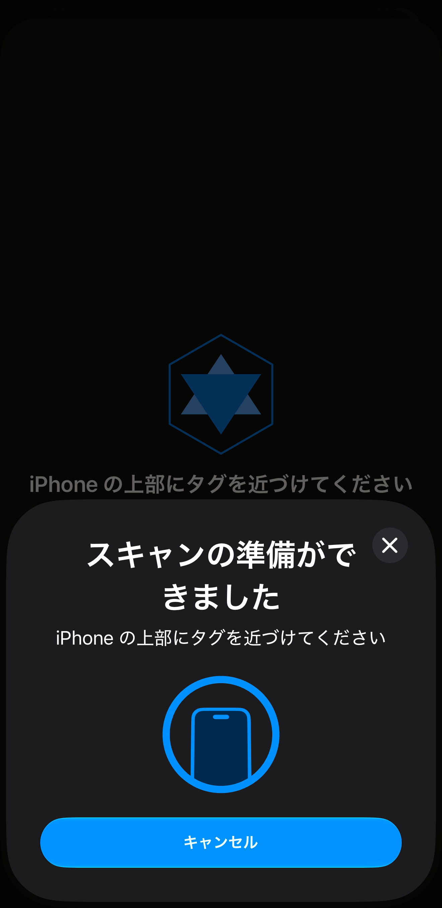

タグには Web アドレスを入れておくことができ、そのタグを読み取った端末にはそのアドレスが提示されます。Hex NFC では、このアドレスは URL レコードになります。iPhone でレコードを作成し、タグを iPhone に 1 回かざしてレコードを送ります。

始める前に、タグを手元に用意します。タグにまだ書き込めるかどうかわからない場合は、[タグをスキャンする](scan-a-tag.md)の説明に従って先にスキャンします。スキャンすると「タグ」画面が開きます。まだ書き込めるタグでは、そこで**書き込む**が使えます。アプリが読み戻した結果、完全にロック済みとわかったタグでは、**書き込む**がグレイ表示になります。そのタグはどんな書き込みも拒否します。**閉じる**をタップしてその画面を離れ、Hex NFC のホーム画面に戻ってから、手順 1 から始めます。

## 空のタグにリンクを書き込む

:::::steps
::::step[新しく作成を始める]
Hex NFC のホーム画面で**作成**をタップします。「タグ」画面がレコードのない状態で開き、「空のタグ」という見出しが表示されます。
::::

::::step[URL レコードを追加する]
**レコードを追加** > **URL** をタップします。新しいレコードの編集画面が開きます。
::::

::::step[アドレスを入力する]
**URL** に、`https://hex.pro` のように先頭にスキームを付けてアドレスを入力し、**保存**をタップします。レコードが一覧に表示されます。アプリは入力したとおりにアドレスを書き込み、何も付け足しません。`https://` のないままタグに書き込まれたアドレスは、有効なリンクになりません。そのタグを読み取った端末には、開くページがありません。

:::figure[**保存**をタップすると、「タグ」画面に新しい **URL** レコードが表示され、右上の**書き込む**をタップできる状態になります。]

:::
::::

::::step[レコードをタグに送る]
「タグ」画面の上部にある**書き込む**をタップします。書き込み画面が開き、「iPhone の上部にタグを近づけてください」と表示されます。iOS はアプリの上に独自のスキャンシートを表示し、そこにも同じ一文が表示されます。

:::figure[書き込み画面の案内文は、iOS のスキャンシートの上に表示されたままです。シートにも同じ案内文と、シート独自の「キャンセル」があります。]

:::
::::

::::step[タグを iPhone に近づける]
iPhone の上端をタグに当て、そのまま保ちます。画面には「書き込み中…」、続いて「検証中…」と表示されます。この手順でタグがロックされることはありません。何度でも上書きできます。成功したときに表示される「書き込み完了」は、レコードがタグに書き込まれ、読み戻した内容に欠けがなかったことだけを示します。画面は自動的に閉じ、「タグ」画面に戻ります。
::::
:::::

書き込むと、タグに入っていた内容はすべて置き換わります。タグにすでに入っている内容の一部を残したい場合は、先にそのタグをスキャンします。そのうえで、[タグのレコードを編集する](edit-records.md)の説明に従い、新しく作成するのではなく、その一覧を編集します。

:::tip[どの種類のレコードも書き込み方は同じ]
リンクはタグに入れるものとして最も一般的で、追加できる 13 種類のレコードの 1 つです。すべての種類は[レコードの種類](record-types.md)に載っています。どれを選んでも、上の手順は同じです。
:::

## 成功と表示する前にアプリが確認すること

アプリは、書き込めたというタグの応答をそのまま信用しません。レコードを送ったあとでタグをもう一度読み取り、返ってきた内容を送った内容と比べます。「書き込み完了」は、読み戻したタグに、書き込んだ内容がそのまま入っていたことを意味します。

ある状態では、書き込みが完了せずに止まります。パスワードでレコードが保護されているタグでは、書き込み画面に「タグは保護されています」と表示され、何かを書き込む前にそのパスワードを求められます。**タグのパスワード(4 バイト)**にパスワードを入力し、**ロックを解除して書き込む**をタップします。続いて、もう一度タグを iPhone の上部に近づけます。この 2 回目のタップで認証と書き込みが行われます。タグを保護したときのパスワードをアプリがすでに持っている場合は、この入力は省かれます。書き込みは 1 回のタップで完了します。パスワードがわからない場合は**キャンセル**をタップします。レコードは「タグ」画面に残ります。パスワードがタグにどう作用するかは、[タグの保護](tag-protection.md)を参照してください。

レコードを収めるヘッダーがないタグでは、書き込みの前に止められることはありません。アプリはレコードを送りますが、読み戻してもタグから読み取れる内容が見つからず、書き込みは「書き込みに失敗しました」で終わります。

これを避けるには、先にスキャンします。アプリが未フォーマットとしてスキャンしたタグでは、「タグ」画面のレコード一覧の上に「このタグはフォーマットされていません」と表示されます。その下には「Capability Container がないため、いま書き込んだレコードは読めません。先にフォーマットしてください。」と表示されます。この通知をタップすると「操作」画面が開くので、そこでタグをフォーマットします。**作成**から始めたタグにはその前のスキャンがないため、「タグ」画面には警告に使える情報がありません。

この修復で、作成したレコードが失われることはありません。「タグ」画面の右上にあるメニューボタンをタップし、続いて**操作…**をタップします。「操作」画面が「タグ」画面の上に開きます。閉じたあとも、レコードはそのまま残っています。[タグを消去またはフォーマットする](erase-or-format.md)を参照してください。

書き込みが始まる前にやめるには、書き込み画面がタグを待っているあいだに**キャンセル**をタップします。レコードは「タグ」画面に残ります。タグを読み取る前に iOS のシートで「キャンセル」をタップしても同じです。iPhone にタグを近づけないままでいると、1 分ほどで iOS のシートが自動的に閉じ、書き込み画面に「タグが見つかりません」と表示されます。その下には**閉じる**と**もう一度試す**があります。

## 書き込みに失敗した場合

書き込みに失敗した場合や、読み戻した内容が送った内容と異なる場合は、「書き込みに失敗しました」と表示され、その下に理由が示されます。そこから次のどちらかを行います。

- 同じレコードをもう一度送るには、**もう一度試す**をタップします。入力済みの内容はそのまま残ります。
- 書き込まずに「タグ」画面に戻るには、**閉じる**をタップします。

何度も拒否されるタグは、書き込もうとしている内容に合わない種類のタグかもしれません。アプリが認識するチップは [Hex NFC で使えるタグ](tags-that-work.md)で、チップごとの詳細は[チップ対応表](../developer/chip-support-matrix.md)で確認できます。

## 関連項目

- [タグのレコードを編集する](edit-records.md)
- [タグをプリセットとして保存する](presets.md)
- [タグをスキャンまたは書き込みできない場合](troubleshooting.md)
