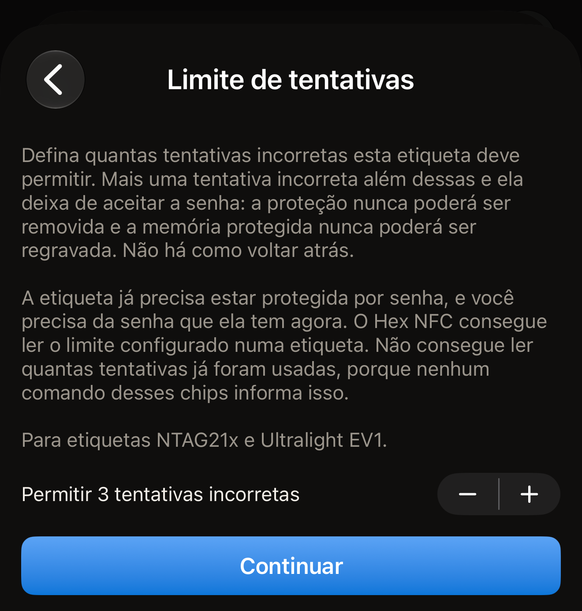
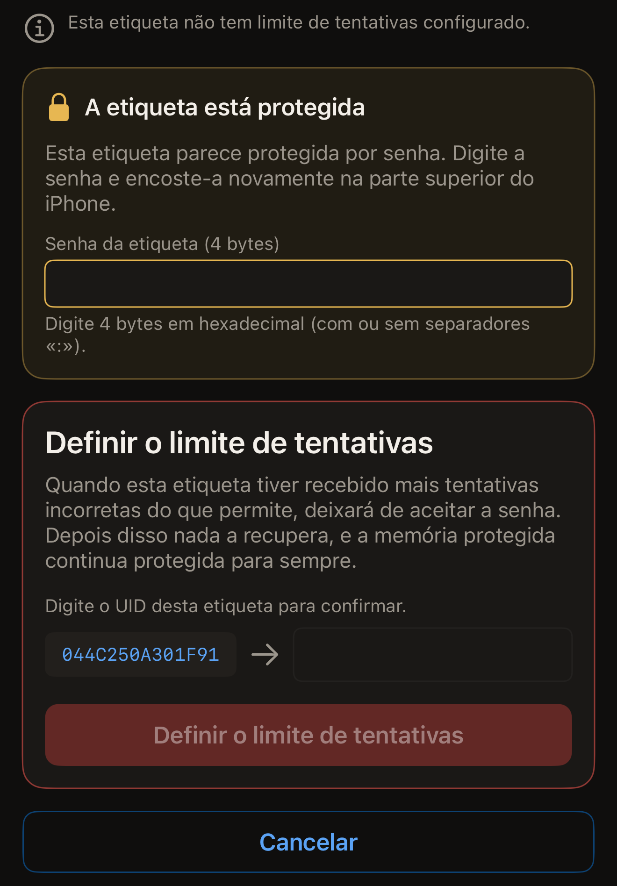

Um limite de tentativas diz a uma etiqueta protegida por senha quantas senhas
incorretas ela deve tolerar, e o Hex NFC grava esse número na etiqueta pelo
iPhone. Defina 3 e a etiqueta aceita três tentativas incorretas; a tentativa
seguinte faz com que ela deixe de aceitar a senha para sempre. A partir daí, a
proteção nunca mais pode ser removida, e a memória protegida nunca mais pode ser
regravada. Não há como voltar atrás.

Antes de começar:

- A etiqueta já precisa estar protegida por senha.
- Você precisa da senha que ela tem agora.
- O chip precisa ser um NTAG21x ou MIFARE Ultralight EV1, porque é nesses chips
  que essa configuração existe.

Para saber o que um chip oferece, consulte
[Etiquetas que funcionam com o Hex NFC](tags-that-work.md) ou a
[matriz de compatibilidade de chips](../developer/chip-support-matrix.md).

O limite não faz parte do cartão **Proteção**. Ele fica na tela Operações, em
**Ações perigosas**, porque é aplicado a uma etiqueta por vez e não pode ser
desfeito.

::include[two-tap-confirmation]

A leitura que abre a etiqueta não é uma dessas duas aproximações. Aqui você
aproxima a etiqueta três vezes no total: uma para lê-la e depois as duas
aproximações da operação.

:::warning[Uma senha incorreta pode gastar uma tentativa]
Se a etiqueta já tiver um limite, a senha que você digitar aqui conta para esse
limite quando a etiqueta a recusar. O Hex NFC informa o limite configurado em
uma etiqueta, mas nenhum comando desses chips diz quantas tentativas já foram
usadas. E não há como testar uma senha sem gastar uma dessas tentativas. O app
nunca mostra a senha de uma etiqueta para você. Nenhum chip a revela. A senha a
digitar é a que você guardou quando protegeu a etiqueta.
:::

## Definir o limite de tentativas

:::::steps
::::step[Ler a etiqueta]
Na tela inicial do Hex NFC, toque em **Escanear** e encoste a etiqueta na parte
superior do iPhone. O conteúdo da etiqueta abre na tela Etiqueta. O cartão no
alto tem o nome do chip como título. O cartão **Proteção** fica logo abaixo
dele, acima dos registros.

Uma etiqueta cuja senha protege somente a gravação é lida como qualquer outra.
O cartão **Proteção** dela mostra “Senha · somente gravação”.

Já uma etiqueta cuja senha também protege a leitura interrompe a leitura. A
tela de leitura mostra “A etiqueta está protegida” e pede a senha. Digite-a e
toque em **Desbloquear e ler de novo**. Depois disso, a tela Etiqueta se abre, e
o cartão **Proteção** mostra “Senha · leitura e gravação”. Esse desbloqueio
apresenta a senha à etiqueta, então uma senha digitada errada gasta uma das
tentativas de que esta página trata.
[Ler uma etiqueta](scan-a-tag.md#unlock-a-protected-tag) explica o desbloqueio
em detalhes.
::::

::::step[Abrir a tela Limite de tentativas]
Na tela Etiqueta, toque no botão de menu no canto superior direito, ao lado de
**Gravar**, e toque em **Operações…**. Na tela Operações, toque em **Limite de
tentativas** no cartão **Ações perigosas**.
::::

::::step[Escolher quantas tentativas incorretas permitir]
A linha mostra **Permitir 3 tentativas incorretas**, e o número muda quando você
toca nos botões de mais e menos ao lado dela. Escolha qualquer número de 1 a 7.
O valor inicial é 3. Os botões de mais e menos não oferecem a opção de não ter
limite, então esta tela pode alterar o limite de uma etiqueta, mas nunca
removê-lo. Remover a senha da etiqueta apaga o limite junto, e para isso é
preciso uma senha que a etiqueta ainda aceite.

:::figure[A tela **Limite de tentativas** abre com um limite de 3, com os botões de mais e menos ao lado da linha e **Continuar** abaixo dela.]

:::
::::

::::step[Tocar em Continuar]
Toque em **Continuar**. Os botões de mais e menos deixam de aceitar alterações,
e a tela pede a primeira aproximação.
::::

::::step[Encostar a etiqueta para a primeira aproximação da operação]
Toque em **Definir o limite de tentativas** e encoste a etiqueta na parte
superior do iPhone. Esta aproximação lê o UID da etiqueta e o limite que ela já
tem configurado.

Fechar o painel do iOS antes de aproximar uma etiqueta leva você de
volta aos botões de mais e menos e a **Continuar**, para você escolher outro
limite. Se o painel se fechar sozinho sem nenhuma etiqueta encostada no iPhone,
a tela mostra “Nenhuma etiqueta encontrada” com **Tentar de novo** e **Começar
de novo**.
::::

::::step[Digitar a senha e o UID da etiqueta]
Um cartão com o título “A etiqueta está protegida” pede a senha que a etiqueta
tem agora. Digite-a em **Senha da etiqueta (4 bytes)**, em hexadecimal, com ou
sem separadores `:`. Depois, digite o UID mostrado na tela no campo ao lado
dele.

:::figure[A senha vai no cartão “A etiqueta está protegida”, e o UID vai no cartão abaixo dele, acima de **Definir o limite de tentativas**.]

:::
::::

::::step[Encostar a mesma etiqueta para a segunda aproximação]
Toque em **Definir o limite de tentativas** e encoste a etiqueta na parte
superior do iPhone de novo. O app grava o novo limite e o relê. A tela informa
“Esta etiqueta agora está configurada para permitir 3 tentativas incorretas.”

Logo abaixo, ela acrescenta “Mais uma tentativa incorreta depois disso e ela
deixa de aceitar a senha para sempre.”
::::
:::::

## O que o app informa entre as aproximações

A primeira aproximação lê as configurações da própria etiqueta, então a tela diz
o que a etiqueta tem antes de você digitar o UID. Ela informa uma de três
coisas:

- “Esta etiqueta não tem limite de tentativas configurado.” Nenhum número de
  tentativas incorretas pode fazer com que ela deixe de aceitar a senha.
- “Esta etiqueta já está configurada para permitir 3 tentativas incorretas.” O
  número é o que a etiqueta tem, e o novo limite o substitui.
- “Esta etiqueta está protegida contra leitura, então o limite atual não pode
  ser lido até que a senha seja apresentada.” Não há nada a informar. As páginas
  de configuração estão protegidas pela senha. A operação continua a partir
  daqui: digite o UID, e a segunda aproximação apresenta a senha e grava o novo
  limite.

O app nunca informa quantas tentativas uma etiqueta já gastou, porque nenhum
comando desses chips revela isso.

## Se a etiqueta não tiver senha

Um limite de tentativas protege uma senha, então o app recusa a operação em uma
etiqueta que não tem senha. A recusa diz “Esta etiqueta não tem senha definida,
então não há nada que um limite de tentativas possa proteger.”

A recusa acontece antes de qualquer gravação. A etiqueta fica exatamente como
estava. Defina uma senha primeiro, como explica
[Proteger uma etiqueta com senha](protect-a-tag.md), e depois volte aqui.

## Se o app não conseguir reler o limite

Uma etiqueta que se afasta no meio da gravação recebe o título “Limite de
tentativas gravado.”

A explicação diz “A etiqueta confirmou a gravação, mas esta aproximação não
conseguiu reler o byte. Inicie a operação novamente: a primeira aproximação
informa o limite que a etiqueta tem.” O chip aceitou a gravação. Esta
aproximação é que não conseguiu comprovar o que ficou gravado.

Nesse ponto a operação já terminou, então a tela não oferece uma nova tentativa.
Volte à tela Operações e abra **Limite de tentativas** de novo. Vá até o fim: a
primeira aproximação da nova operação informa o limite que a etiqueta tem.

## Se uma senha parar de funcionar depois

Em uma etiqueta com limite configurado, uma senha recusada pela etiqueta é
informada como “A etiqueta recusou essa senha. Esta etiqueta tem limite de
tentativas configurado, então ela pode estar bloqueada mesmo que a senha esteja
correta.”

Uma verificação que não chegou ao fim mostra “Essa senha não abriu a etiqueta.
Esta etiqueta tem limite de tentativas configurado, e cada tentativa incorreta
conta para esse limite. Confira a senha antes de tentar de novo.”

Para o seu próximo passo, as duas significam a mesma coisa: descubra a senha
correta antes de aproximar a etiqueta de novo. Qualquer uma das mensagens pode
aparecer no lugar do pedido no cartão “A etiqueta está protegida”. O campo dele
começa vazio, então a senha recusada não é enviada uma segunda vez, a menos que
você a digite. Já uma operação que termina em falha deixa **Começar de novo** na
tela, que devolve o formulário e pede a senha de novo. Depois que uma etiqueta
recebe mais tentativas incorretas do que permite, nada a abre, e a memória
protegida dela continua protegida para sempre.

## Ver também

- [Remover a senha de uma etiqueta](remove-password.md)
- [Proteção de etiquetas](tag-protection.md)
- [Se não for possível ler ou gravar uma etiqueta](troubleshooting.md)
