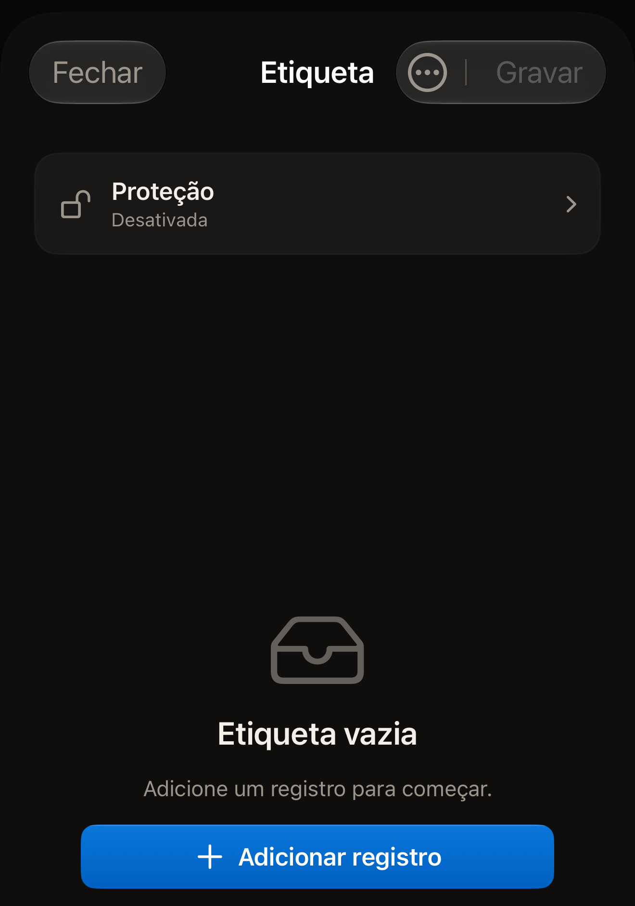
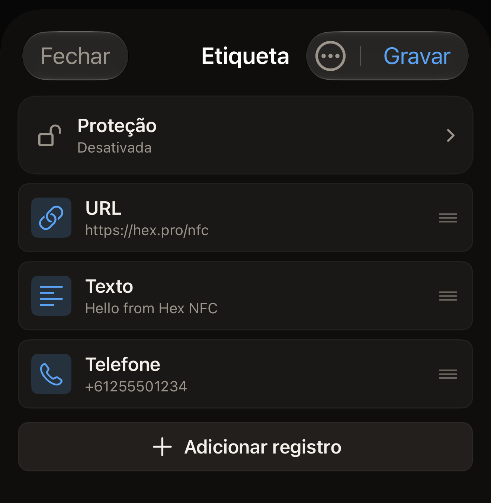

Uma etiqueta contém uma lista de registros, e o Hex NFC mostra essa lista na
tela Etiqueta. Adicione um registro, altere um, mova um para cima na lista ou
exclua um, e depois grave na etiqueta com o iPhone quando a lista estiver do
jeito que você quer.

## Abrir a lista de registros

Faça uma das opções a seguir:

- Para trabalhar em uma etiqueta que você tem em mãos, leia-a. Os registros
  dela aparecem na tela Etiqueta. Consulte [Ler uma etiqueta](scan-a-tag.md).
- Para montar um conjunto de registros sem nenhuma etiqueta à sua frente,
  toque em **Criar** na tela inicial do Hex NFC.

Uma etiqueta ou uma montagem que ainda não contém nada mostra “Etiqueta
vazia”, com “Adicione um registro para começar.” logo abaixo.

:::figure[Uma montagem sem registros mostra “Etiqueta vazia”, e **Adicionar registro** fica abaixo da mensagem.]

:::

## Adicionar um registro

::::steps
:::step[Abrir o seletor de registros]
Na tela Etiqueta, toque em **Adicionar registro**. O botão fica no fim da
lista de registros, ou abaixo de “Etiqueta vazia” quando a etiqueta não
contém nada. A tela Adicionar registro se abre com um bloco para cada tipo
que você pode adicionar.
:::

:::step[Escolher um tipo]
Toque no bloco que você quer, como **Texto**, **URL**, **Contato** ou
**Wi-Fi**. O app adiciona um registro desse tipo e o abre para você
preencher.
:::

:::step[Preencher o registro]
Digite os dados de que o registro precisa e toque em **Salvar**. O registro
aparece no fim da lista na tela Etiqueta.
:::
::::

Há 13 tipos para escolher. [Tipos de registro](record-types.md) explica o que
cada um contém e o que um telefone faz com ele quando lê a etiqueta.

## Adicionar um registro a partir de um código QR

::::steps
:::step[Abrir o leitor de QR]
Na tela Adicionar registro, toque em **Escanear QR**. A tela Escanear código
QR se abre.
:::

:::step[Permitir o acesso à câmera]
Na primeira vez, a tela mostra “Permitir câmera para escanear um QR” e “O
quadro é processado no dispositivo. Nada é enviado.” Toque em **Permitir
câmera** e permita o acesso quando o iOS pedir. Se você recusou a câmera
antes, a tela mostra “Acesso à câmera necessário”. Toque em **Abrir Ajustes**
e ative de novo a câmera para o Hex NFC.
:::

:::step[Apontar a câmera para o código]
Enquadre o código. O app lê o primeiro código que encontra, transforma-o em
um registro e o abre para você conferir.
:::
::::

O tipo escolhido corresponde ao que o código contém: uma rede Wi-Fi, um
contato, um e-mail, uma mensagem de texto, um número de telefone ou um local.
Um endereço da web vira um registro URL. Qualquer outra coisa vira um
registro de texto.

## Alterar, mover ou excluir um registro

Faça qualquer uma das opções a seguir na tela Etiqueta:

- Para alterar um registro, toque na linha dele, edite os campos e toque em
  **Salvar**.
- Para mover um registro, arraste a linha dele para cima ou para baixo. A
  ordem da lista é a ordem em que os registros são gravados na etiqueta.
- Para excluir um registro, deslize a linha dele para a esquerda e toque em
  **Excluir**. Deslizar a linha até o fim exclui o registro sem esse segundo
  toque.

:::figure[Os registros aparecem na ordem em que são gravados, com **Adicionar registro** no fim da lista.]

:::

Um registro que você exclui aqui sai da lista, não da etiqueta. A etiqueta
mantém o que tinha até a próxima gravação, então uma lista que você esvaziou
por engano não custa nada. Para limpar uma etiqueta de verdade, consulte
[Apagar ou formatar uma etiqueta](erase-or-format.md).

## Concluir a edição

Nada nesta tela chega à etiqueta até que você grave. Quando a lista estiver
certa, faça uma das opções a seguir:

- Para colocar os registros na etiqueta, toque em **Gravar**. Consulte
  [Gravar um link em uma etiqueta](write-a-link.md).
- Para guardar o conjunto para outro dia, abra o menu no topo da tela
  Etiqueta e toque em **Salvar como preajuste…**. Consulte
  [Salvar uma etiqueta como preajuste](presets.md).
- Para sair, toque em **Fechar**. A sua etiqueta fica como estava, e as
  edições que você não gravou nem salvou são descartadas.

## Ver também

- [Tipos de registro](record-types.md)
- [Gravar um link em uma etiqueta](write-a-link.md)
- [Salvar uma etiqueta como preajuste](presets.md)
