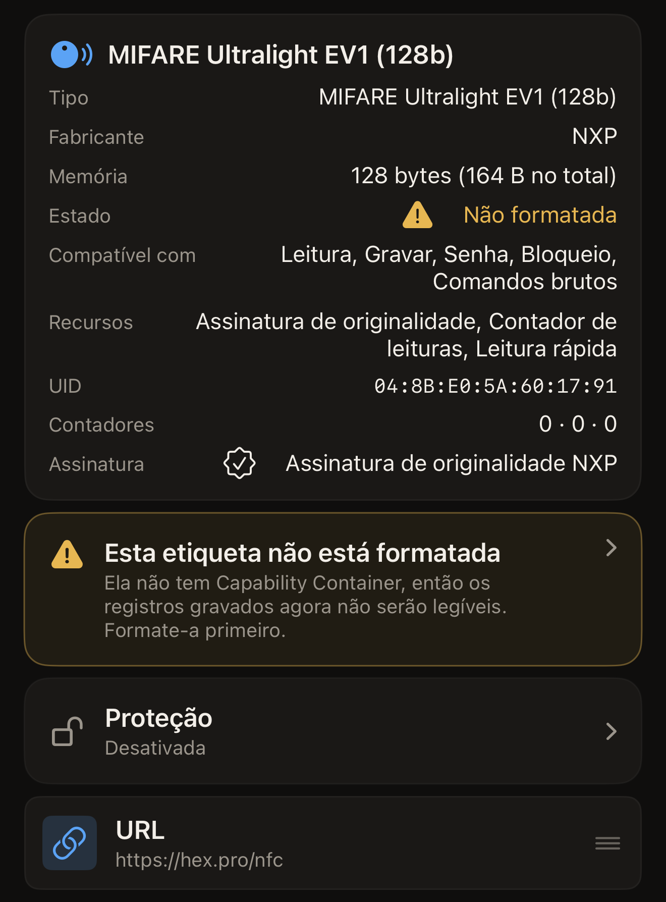
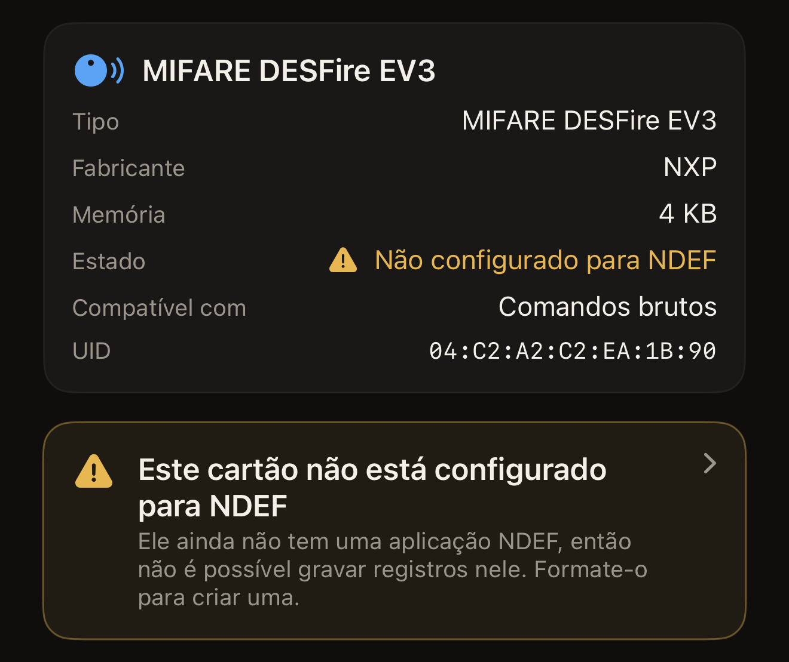
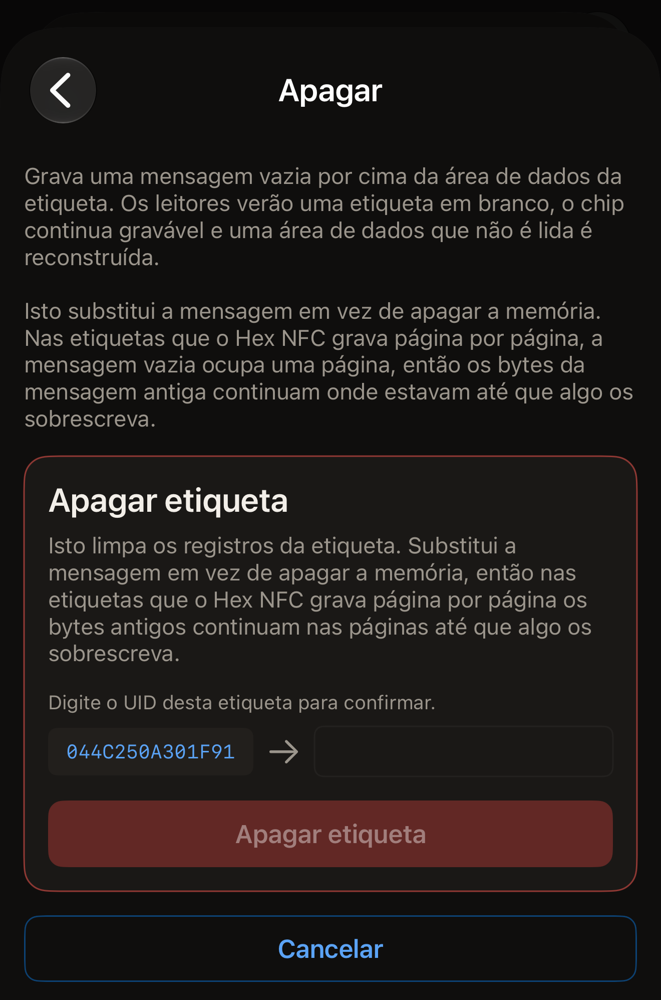
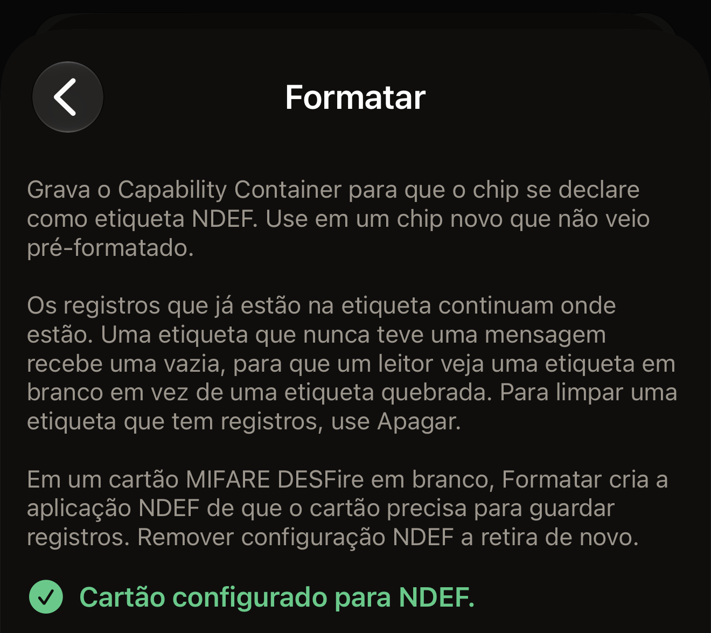
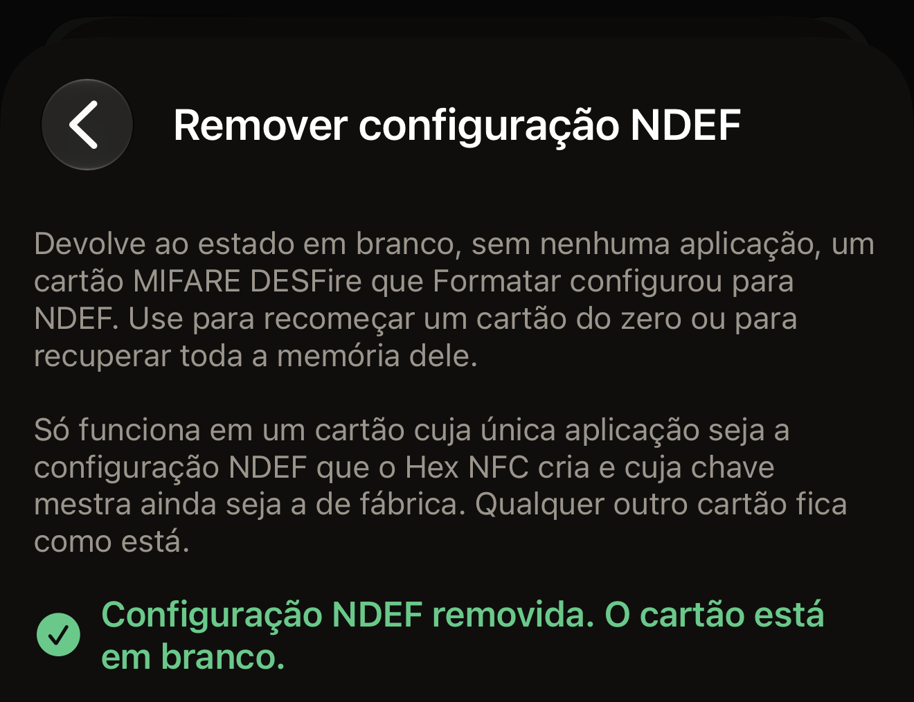

O Hex NFC tem dois reparos para uma etiqueta que não é lida, e eles fazem
trabalhos opostos. Apagar grava uma mensagem vazia por cima da área de dados
da etiqueta, de modo que os leitores veem uma etiqueta em branco e o chip
continua gravável. Formatar grava o Capability Container, o cabeçalho curto
que um leitor procura antes de ler qualquer outra coisa na etiqueta.

Antes de começar, leia a etiqueta: na tela inicial do Hex NFC, toque em
**Escanear** e encoste a etiqueta na parte superior do iPhone. A tela
**Etiqueta** se abre assim que o app termina de lê-la. Ela também se abre para
uma etiqueta não formatada, para uma etiqueta cujos dados não podem ser lidos
e para um cartão MIFARE DESFire que não está configurado para NDEF. Em todos
esses casos, ela aparece sozinha logo depois da leitura, sem que você precise
tocar em nada. Um aviso na tela de leitura é um diagnóstico, não um beco sem
saída. Na tela **Etiqueta**, toque no botão de menu no canto superior direito,
ao lado de **Gravar**, e depois toque em **Operações…**. Os dois reparos ficam
em **Ações perigosas**, no fim da tela **Operações**. **Remover configuração
NDEF** fica ao lado deles e desfaz a formatação de um cartão MIFARE DESFire.
Toda operação ali confirma a etiqueta antes de alterá-la:

::include[two-tap-confirmation]

## De qual reparo a etiqueta precisa

O app dá nome ao problema na tela em que você o encontra, e cada nome indica
o reparo de que a etiqueta precisa.

- Formate a etiqueta quando a tela de leitura mostrar “Esta etiqueta ainda não
  está formatada” ou a tela **Etiqueta** mostrar “Não formatada”. A etiqueta
  não tem Capability Container, então nada que você gravar nela pode ser lido.
- Apague a etiqueta quando a tela de leitura mostrar “Os dados desta etiqueta
  não podem ser lidos” ou a tela **Etiqueta** mostrar “Dados ilegíveis”. O
  Capability Container já está no lugar, então uma formatação não tem nada a
  reparar ali.
- Formate o cartão quando a tela de leitura mostrar “Este cartão ainda não
  está configurado para NDEF” ou a tela **Etiqueta** mostrar “Não configurado
  para NDEF”. O cartão é um MIFARE DESFire em branco, ou um cartão que uma
  formatação anterior deixou com a configuração incompleta, então ainda não é
  possível gravar registros nele. Um cartão de transporte ou de acesso nunca
  mostra essas mensagens.

Em uma etiqueta que ainda aceita gravações, a tela **Etiqueta** também mostra
um aviso em que você pode tocar. Ele diz “Esta etiqueta não está formatada”,
“Os dados desta etiqueta não podem ser lidos” ou “Este cartão não está
configurado para NDEF”. Tocar nele abre
**Operações**. Uma etiqueta bloqueada permanentemente mostra o estado, mas
nenhum aviso, porque os dois reparos são gravações.

:::figure[Uma etiqueta sem Capability Container mostra “Não formatada” ao lado de **Estado**, com o aviso “Esta etiqueta não está formatada” abaixo do cartão.]

:::

:::figure[Um cartão MIFARE DESFire em branco mostra “Não configurado para NDEF” ao lado de **Estado**, com o aviso “Este cartão não está configurado para NDEF” mais abaixo.]

:::

## Apagar uma etiqueta

Apagar limpa os registros da etiqueta e deixa o chip gravável. Também
reconstrói uma área de dados que deixou de ser lida.

:::::steps
::::step[Abrir a tela Apagar]
Na tela **Operações**, toque em **Apagar**. A tela que se abre explica o que o
apagamento grava e avisa você antes que qualquer coisa chegue à etiqueta.
::::

::::step[Iniciar o apagamento]
Toque em **Apagar etiqueta**. O iPhone pede a etiqueta.
::::

::::step[Encostar a etiqueta no iPhone]
Encoste a parte superior do iPhone na etiqueta. A tela mostra “Etapa 1 de 2.
Mantenha a etiqueta para identificá-la.” e, em seguida, o UID da etiqueta.
::::

::::step[Digitar o UID de novo]
A tela mostra “Digite o UID desta etiqueta para confirmar.” e coloca o UID ao
lado de um campo vazio. Digite esses mesmos caracteres no campo, sem
dois-pontos entre eles, em maiúsculas ou minúsculas, e toque em **Apagar
etiqueta**. Se a senha da etiqueta cobre a área de dados, um cartão com o
título “A etiqueta está protegida” aparece acima do campo e pede a senha ou a
chave que a etiqueta tem agora. **Apagar etiqueta** não faz nada até que isso
seja preenchido.

:::figure[Depois da primeira aproximação, o UID da etiqueta fica à esquerda de um campo vazio, e o botão **Apagar etiqueta** continua esmaecido até você digitá-lo.]

:::
::::

::::step[Aproximar a etiqueta pela segunda vez]
Encoste a etiqueta na parte superior do iPhone de novo. A tela mostra
“Etiqueta apagada.” assim que o app relê a mensagem vazia na etiqueta.
::::
:::::

O apagamento termina de uma de duas formas. Ele informa “Etiqueta apagada.”
assim que a mensagem vazia é relida. Caso contrário, informa um erro que dá
nome ao problema, com os detalhes logo abaixo para um relatório de bug.
[Se não for possível ler ou gravar uma etiqueta](troubleshooting.md) explica o
que tentar em seguida.

:::note
Apagar substitui a mensagem da etiqueta em vez de limpar a memória. Nas
etiquetas NTAG e MIFARE Ultralight, os chips da maioria dos adesivos e
cartões, a mensagem vazia ocupa uma página. Os bytes da mensagem antiga
continuam onde estavam até que algo grave por cima deles. Grave uma mensagem
sua em uma etiqueta que você vai passar adiante.
:::

## Formatar uma etiqueta {#format-a-tag}

Use a formatação em um chip novo que não veio pré-formatado. A formatação
grava o Capability Container e mantém no lugar os registros que já estão na
etiqueta. Nas etiquetas ISO 15693, como a ICODE SLIX2, uma etiqueta que nunca
teve uma mensagem também recebe uma mensagem vazia, para que um leitor veja
uma etiqueta em branco, e não uma etiqueta com defeito. Para limpar uma
etiqueta que já tem registros, apague-a em vez de formatá-la. Em um cartão
MIFARE DESFire em branco, a formatação configura o cartão para NDEF, como
explica a última parte desta seção.

::::steps
:::step[Abrir a tela Formatar]
Na tela **Operações**, toque em **Formatar**.
:::

:::step[Iniciar a formatação]
Toque em **Formatar etiqueta**. O iPhone pede a etiqueta.
:::

:::step[Encostar a etiqueta no iPhone]
Encoste a parte superior do iPhone na etiqueta. A tela mostra “Etapa 1 de 2.
Mantenha a etiqueta para identificá-la.” e, em seguida, o UID da etiqueta.
:::

:::step[Digitar o UID de novo]
A tela mostra “Digite o UID desta etiqueta para confirmar.” e coloca o UID ao
lado de um campo vazio. Digite esses mesmos caracteres no campo, sem
dois-pontos entre eles, em maiúsculas ou minúsculas, e toque em **Formatar
etiqueta**.
:::

:::step[Aproximar a etiqueta pela segunda vez]
Encoste a etiqueta na parte superior do iPhone de novo. A tela mostra
“Etiqueta formatada.” assim que o app relê o cabeçalho. Em um cartão MIFARE
DESFire, a tela mostra “Cartão configurado para NDEF.” em vez disso.
:::
::::

Em uma etiqueta NTAG ou MIFARE Ultralight, a formatação termina com um de três
resultados:

- “Etiqueta formatada.” significa que o cabeçalho foi gravado, relido e está
  no lugar, e que a etiqueta está pronta para receber uma mensagem.
- “Já estava formatada: nada foi gravado.” significa que a etiqueta já tinha o
  cabeçalho certo, então nada chegou a ela. O app indica **Apagar**, porque,
  se a etiqueta continua sem ser lida, o problema está na área de dados.
- “Esta etiqueta já tem um Capability Container diferente.” significa que o
  cabeçalho na etiqueta não corresponde ao chip que o app identificou. Nada
  foi gravado.

:::figure[Quando a formatação encontra o cabeçalho já no lugar, ela informa “Já estava formatada: nada foi gravado.” e, em vez disso, orienta você a apagar a etiqueta.]

:::

Uma etiqueta ISO 15693 informa “Etiqueta formatada.” todas as vezes, porque o
bloco do Capability Container continua regravável e o app o grava a cada
execução.

:::warning
Nas etiquetas NTAG e MIFARE Ultralight, o Capability Container só pode ser
gravado uma vez em toda a vida útil da etiqueta e nunca pode ser corrigido.
Por isso, o app lê essa página primeiro e só grava enquanto ela estiver em
branco. Ele recusa um chip que não conseguiu identificar em vez de tentar
adivinhar um cabeçalho. O nome do chip que o app leu aparece no topo da tela
**Etiqueta**, e [Etiquetas que funcionam com o Hex NFC](tags-that-work.md)
explica o que o app consegue fazer com cada chip.
:::

### Formatar um cartão MIFARE DESFire

Um cartão MIFARE DESFire EV1, EV2 ou EV3 em branco não tem nenhuma aplicação,
e a formatação cria nele a aplicação NDEF de que ele precisa para guardar
registros. O procedimento é o mesmo descrito acima, com as mesmas duas
aproximações e o UID digitado. O app ajusta o tamanho do arquivo NDEF à
memória livre do cartão, até 4 KB em um cartão 4K. Depois que o
cartão está configurado, o iOS lê o cartão e grava nele como faz com qualquer
outra etiqueta NDEF.

Em um cartão MIFARE DESFire, a segunda aproximação termina com um de dois
resultados:

- “Cartão configurado para NDEF.” significa que a aplicação NDEF está no
  cartão e foi relida, e que o cartão está pronto para receber registros.
- “Já estava configurado para NDEF: nada foi gravado.” significa que o Hex NFC
  já tinha configurado este cartão antes, então nada chegou a ele.

:::figure[Um cartão MIFARE DESFire em branco que a formatação configurou informa “Cartão configurado para NDEF.”]

:::

O app recusa estes cartões e não grava nada neles:

- “Este cartão já tem outras aplicações, então não pode ser configurado para
  NDEF aqui. Nada foi gravado.” É o que acontece com um cartão de transporte
  ou de acesso.
- “Este cartão exige a chave mestra antes de qualquer coisa ser adicionada a
  ele, então não pode ser configurado para NDEF aqui. Nada foi gravado.”
- “Este cartão foi configurado para NDEF por outro app, então o Hex NFC o
  deixa como está. Nada foi gravado.”

Se o cartão se afastar do iPhone durante a segunda aproximação antes que a
configuração tenha gravado qualquer coisa, a tela mostra “A etiqueta se perdeu
no meio da leitura. Mantenha-a encostada na parte superior do telefone e tente
de novo.” e nada foi gravado. Depois que a configuração começa a gravar, a
tela mostra “O cartão está configurado pela metade. Toque em Formatar de novo
para concluir.” ou “O cartão pode estar configurado pela metade. Escaneie-o
para conferir ou toque em Formatar de novo.” Uma nova formatação continua de
onde a anterior parou.

Com um cartão que fica sem memória livre, a tela mostra “Não há memória livre
suficiente neste cartão para um arquivo NDEF. Use Remover configuração NDEF
para limpar o que foi iniciado.” na primeira tentativa. Uma nova tentativa no
mesmo cartão mostra “Não há memória livre suficiente neste cartão para um
arquivo NDEF. Nada foi gravado.” Nos dois casos, **Remover configuração NDEF**
limpa o cartão, como explica a próxima seção.

## Remover a configuração NDEF de um cartão {#remove-ndef-setup}

**Remover configuração NDEF** deixa em branco de novo um cartão MIFARE
DESFire que uma formatação configurou. A operação apaga a aplicação NDEF do
cartão e todos os registros que ela contém, e devolve ao cartão toda a sua
memória. Ela só funciona em um cartão cuja única aplicação é a configuração
NDEF que o Hex NFC cria, inclusive uma configuração que uma formatação deixou
pela metade, e cuja chave mestra ainda é a chave de fábrica. Qualquer outro
cartão fica como está.

::::steps
:::step[Abrir a tela de remoção]
Na tela **Operações**, em **Ações perigosas**, toque em **Remover
configuração NDEF**.
:::

:::step[Iniciar a remoção]
Toque em **Remover configuração NDEF**. O iPhone pede o cartão.
:::

:::step[Encostar o cartão no iPhone]
Encoste a parte superior do iPhone no cartão. A tela mostra “Etapa 1 de 2.
Mantenha a etiqueta para identificá-la.” e, em seguida, o UID do cartão.
:::

:::step[Digitar o UID de novo]
A tela mostra “Digite o UID desta etiqueta para confirmar.” e coloca o UID ao
lado de um campo vazio. Digite esses mesmos caracteres no campo, sem
dois-pontos entre eles, em maiúsculas ou minúsculas, e toque em **Remover
configuração NDEF**.
:::

:::step[Aproximar o cartão pela segunda vez]
Encoste o cartão na parte superior do iPhone de novo e mantenha-o ali até o
resultado aparecer. A tela mostra “Configuração NDEF removida. O cartão está
em branco.” assim que o app relê o cartão e não encontra nenhuma aplicação
nele.
:::
::::

:::figure[Um cartão cuja configuração NDEF foi removida informa “Configuração NDEF removida. O cartão está em branco.”]

:::

Um cartão que já está em branco informa “Este cartão já está em branco: nada
foi alterado.” O app recusa estes cartões e não altera nada neles:

- “Este cartão tem outras aplicações. Remover a configuração também as
  apagaria, então nada foi alterado.”
- “A configuração NDEF deste cartão foi feita por outro app, então o Hex NFC
  não vai removê-la. Nada foi alterado.”
- “A chave mestra deste cartão não é a de fábrica, então o app não consegue
  remover a configuração. Nada foi alterado.”

Se o cartão se afastar do iPhone durante a segunda aproximação antes que a
remoção tenha alterado qualquer coisa, a tela mostra “A etiqueta se perdeu no
meio da leitura. Mantenha-a encostada na parte superior do telefone e tente de
novo.” e nada mudou no cartão. Se ele se afastar depois que a remoção começou,
a tela mostra “O cartão talvez já esteja em branco. Escaneie-o para
conferir.” Se a leitura ainda mostrar o cartão configurado para NDEF, use
**Remover configuração NDEF** de novo: cada remoção lê o cartão primeiro, e um
cartão que já está em branco informa “Este cartão já está em branco: nada foi
alterado.”

Depois que a configuração é removida, uma leitura volta a mostrar “Não
configurado para NDEF” ao lado de **Estado** na tela **Etiqueta**, e uma nova
formatação configura o cartão do zero.

## Limpar uma etiqueta pela lista de registros

Também é possível limpar uma etiqueta pela tela **Etiqueta**, sem passar por
**Operações**. Uma gravação de limpeza não altera a proteção, então usa uma
única aproximação e não pede que você digite o UID. Uma gravação que também
ativa ou remove uma senha usa duas aproximações e pede o UID. É a mesma
confirmação em duas aproximações que toda operação em **Ações perigosas**
pede.

::::steps
:::step[Excluir todos os registros]
Na tela **Etiqueta**, deslize um registro para a esquerda e toque em
**Excluir**, até que a tela mostre “Nenhum registro restante”. As remoções
ainda não estão na etiqueta.
:::

:::step[Gravar o resultado vazio]
Agora a tela mostra “Você removeu todos os registros. Grave para limpar a
etiqueta, ou adicione um de volta.” Abaixo dessa linha, acima de **Adicionar
registro**, toque em **Gravar para limpar a etiqueta**. O iPhone pede a
etiqueta.
:::

:::step[Encostar a etiqueta no iPhone]
Encoste a parte superior do iPhone na etiqueta e mantenha-o ali até a gravação
terminar.
:::
::::

## Ver também

- [Ler uma etiqueta](scan-a-tag.md)
- [Editar os registros de uma etiqueta](edit-records.md)
- [Gravar um link em uma etiqueta](write-a-link.md)
- [Se não for possível ler ou gravar uma etiqueta](troubleshooting.md)
- [Etiquetas que funcionam com o Hex NFC](tags-that-work.md)
