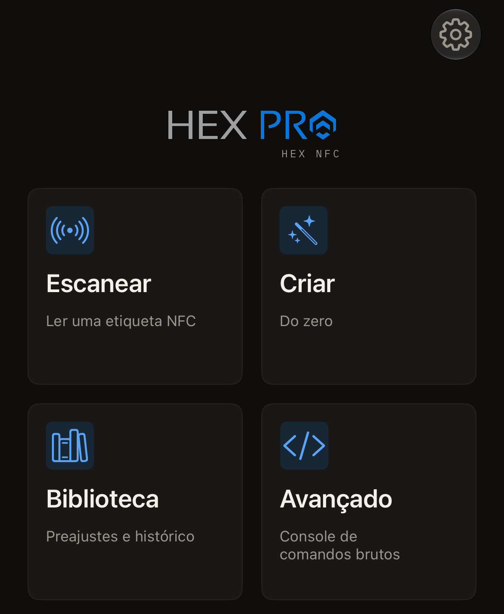

O Hex NFC lê as etiquetas NFC ao seu redor e mostra cada registro que uma
etiqueta contém. Ele grava registros em uma etiqueta em branco e define uma
senha nos chips que comportam uma. O app também lê um cartão de transporte
japonês ou o chip de um passaporte eletrônico. Não é preciso criar uma conta,
e o app não inclui nenhum analytics.

## Do que você precisa

- O Hex NFC instalado no iPhone pela [App Store](https://apps.apple.com/app/id6801457461).
- Um iPhone com iOS 17 ou posterior.
- Uma etiqueta NFC. A maioria dos adesivos, cartões e chaveiros NFC em branco
  tem um chip que o app lê. [Etiquetas que funcionam com o Hex
  NFC](tags-that-work.md) indica quais são, e a [matriz de compatibilidade de
  chips](../developer/chip-support-matrix.md) diz o que cada um pode fazer.

## O que você pode fazer

O app abre na tela inicial do Hex NFC, que tem quatro blocos.

- Toque em **Escanear** para ler uma etiqueta e ver o que ela contém:
  [Ler uma etiqueta](scan-a-tag.md). Um [cartão de
  transporte](transit-cards.md) é lido da mesma forma, e um
  [passaporte](passports.md) exige duas aproximações.
- Toque em **Criar** para montar registros do zero e depois gravá-los:
  [Gravar um link em uma etiqueta](write-a-link.md).
- Toque em **Biblioteca** para ver as etiquetas que você leu antes:
  [Encontrar uma etiqueta que você leu antes](scan-history.md). Os conjuntos
  de registros que você guardou também estão lá:
  [Salvar uma etiqueta como preajuste](presets.md).
- Toque em **Avançado** para enviar um comando bruto a um chip cujo conjunto
  de comandos você conhece:
  [Enviar um comando bruto a uma etiqueta](advanced-console.md).

:::figure[A tela inicial do Hex NFC abre com quatro blocos: **Escanear**, **Criar**, **Biblioteca** e **Avançado**.]

:::

## Alterar o que uma etiqueta contém

Com uma etiqueta aberta, você pode refazer os registros dela em
[Editar os registros de uma etiqueta](edit-records.md), escolhendo entre os
tipos descritos em [Tipos de registro](record-types.md). Em [Proteger uma
etiqueta com senha](protect-a-tag.md), você define o segredo que o chip
verifica, e em [Remover a senha de uma etiqueta](remove-password.md), você o
retira de novo. [Limitar as tentativas incorretas de senha](attempt-limit.md)
explica quantas recusas o chip aceita. Três ferramentas atuam na própria
etiqueta: [Apagar ou formatar uma etiqueta](erase-or-format.md),
[Bloquear uma etiqueta permanentemente](permanent-lock.md) e
[Salvar uma cópia da memória de uma etiqueta](memory-dump.md).

## Começar a usar

[Ler sua primeira etiqueta](quick-start.md) leva você da tela inicial do Hex NFC
até a sua primeira leitura em cerca de 5 minutos.
[Proteção de etiquetas](tag-protection.md) explica o que uma senha protege e
por que uma senha perdida não pode ser recuperada. Quando uma etiqueta não
responder, consulte
[Se não for possível ler ou gravar uma etiqueta](troubleshooting.md).
[Ajustes](settings.md) lista todos os botões de ativação do app,
[Privacidade e seus dados](privacy.md) diz o que fica no iPhone, e
[Perguntas frequentes](faq.md) responde quanto o app custa.
