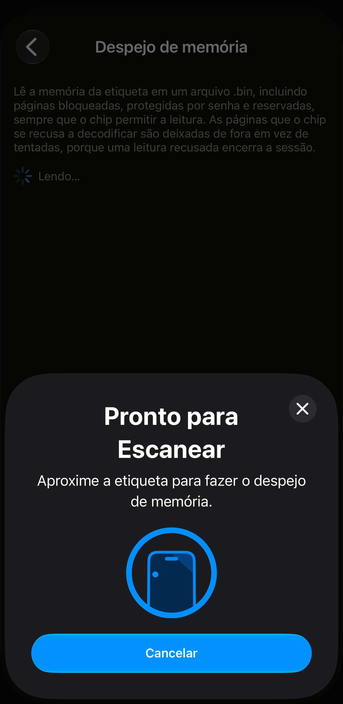
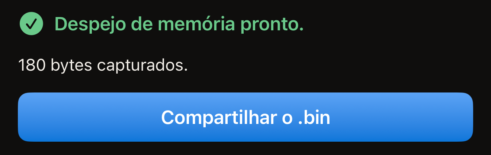
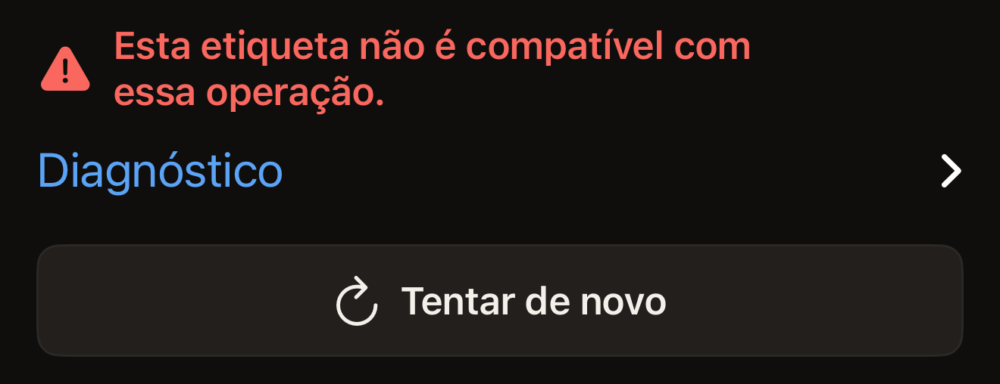

O despejo de memória copia as páginas de uma etiqueta para um arquivo `.bin` e
entrega esse arquivo ao menu Compartilhar do iOS. Ele só lê. A etiqueta
continua igual depois. O despejo usa uma aproximação da etiqueta, ou duas em
uma etiqueta cuja senha protege a leitura, e nunca pede que você digite o UID
da etiqueta de novo.

Você precisa de um iPhone com NFC, do Hex NFC instalado pela App Store e da
etiqueta em mãos. Se você ainda não leu nenhuma etiqueta com o app, comece por
[Ler sua primeira etiqueta](quick-start.md). O despejo de memória fica na tela
Operações. Essa tela se abre pelo botão de menu no canto superior direito da
tela Etiqueta. Os passos abaixo leem uma etiqueta para chegar lá.
[Ler uma etiqueta](scan-a-tag.md) trata da leitura em si.

Ele funciona nos chips que o Hex NFC acessa página por página. Esses chips são
NTAG 210µ, NTAG213, NTAG213 TT, NTAG215, NTAG216, MIFARE Ultralight EV1,
MIFARE Ultralight C, EM V10, EM V11 e EM V16. Em qualquer outra etiqueta, a
tela mostra “Esta etiqueta não é compatível com essa operação.”

[Etiquetas que funcionam com o Hex NFC](tags-that-work.md) explica como saber
qual chip você tem em mãos.

## Fazer o despejo de memória de uma etiqueta

:::warning[Envie o arquivo antes de sair da tela]
O app não guarda nenhuma cópia do despejo. Se você fechar o menu Compartilhar
ou sair da tela Despejo de memória sem enviar o arquivo, ele se perde. Você
terá de ler a etiqueta de novo.
:::

:::::steps
::::step[Abrir a tela de leitura]
Na tela inicial do Hex NFC, toque em **Escanear**. A tela de leitura se abre
e começa a procurar uma etiqueta.
::::

::::step[Encostar a etiqueta no iPhone]
Encoste a parte superior do iPhone na etiqueta, bem rente, e mantenha-o parado
por cerca de um segundo. A tela Etiqueta se abre com o conteúdo da etiqueta.
::::

::::step[Abrir Operações]
Na tela Etiqueta, toque no botão de menu no canto superior direito, o que fica
à esquerda de **Gravar**. O menu tem duas linhas, **Salvar como preajuste…** e
**Operações…**. Toque em **Operações…**.
::::

::::step[Iniciar o despejo]
Toque em **Despejo de memória**. A tela se abre e começa a leitura na hora,
sem nenhuma confirmação antes.
::::

::::step[Encostar a etiqueta no iPhone de novo]
Encoste a parte superior do iPhone na etiqueta mais uma vez. A linha de status
mostra “Mantenha a etiqueta na parte superior do iPhone.” enquanto espera. Ela
muda para “Lendo…” assim que a etiqueta responde. No fim, mostra “Despejo de
memória pronto.” com o número de bytes capturados logo abaixo.

:::figure[Enquanto a etiqueta está sendo lida, o painel do iOS ainda mostra “Aproxime a etiqueta para fazer o despejo de memória.” e a linha de status por trás dele mostra “Lendo…”.]

:::

Em uma etiqueta cuja senha também protege a leitura, o despejo para antes de
ler qualquer coisa. Um cartão com o título “A etiqueta está protegida” pede a
senha ou a chave da etiqueta. Digite-a, toque em **Desbloquear e extrair** e
encoste a etiqueta no iPhone de novo.
::::

::::step[Compartilhar o arquivo]
Toque em **Compartilhar o .bin** e escolha para onde enviar o arquivo. Esse
botão só aparece depois de uma leitura concluída.

:::figure[Uma leitura concluída mostra “Despejo de memória pronto.” com a contagem de bytes logo abaixo e, mais abaixo, **Compartilhar o .bin**.]

:::
::::
:::::

## O que o arquivo contém

O arquivo é a memória do chip copiada página por página a partir da primeira,
com 4 bytes por página, sem cabeçalho e sem nada acrescentado. As páginas
bloqueadas, protegidas por senha e reservadas estão todas nele, sempre que o
chip permite que sejam lidas. As páginas que o chip se recusa a decodificar
ficam de fora em vez de serem solicitadas. Uma única leitura recusada encerra
a sessão e faria você perder o resto do despejo. Em um MIFARE Ultralight C, a
cópia para antes das quatro últimas páginas, que guardam a chave do chip e não
respondem a nenhuma leitura.

Um despejo completo tem um tamanho fixo para cada chip, então a contagem
abaixo de “Despejo de memória pronto.” mostra se você obteve tudo. A tela
Etiqueta mostra o nome do chip no topo do cartão de informações da etiqueta.
Ela usa as mesmas palavras da primeira coluna abaixo. Um MIFARE Ultralight
EV1 informa ali qual dos dois tamanhos ele tem.

:::table[Bytes em um despejo completo]
| Chip | Despejo completo |
| :--- | ---: |
| NTAG 210µ, EM V10, EM V11, EM V16 | 64 bytes |
| NTAG213, NTAG213 TT | 180 bytes |
| NTAG215 | 540 bytes |
| NTAG216 | 924 bytes |
| MIFARE Ultralight EV1 (48b) | 80 bytes |
| MIFARE Ultralight EV1 (128b) | 164 bytes |
| MIFARE Ultralight C | 176 bytes |
:::

O Hex NFC salva o arquivo em um armazenamento temporário, com um nome que traz
a data e a hora da leitura. É compartilhá-lo que o preserva. O app não tem uma
lista de despejos. Nada na tela Etiqueta remete ao arquivo. Envie-o para algum
lugar antes de sair da tela.

## Se o despejo não terminar

Um despejo que falha deixa a etiqueta exatamente como estava, então não custa
nada lê-la de novo.

- Para ler a mesma etiqueta de novo, toque em **Tentar de novo**. A tela
  inicia uma nova leitura.
- Para ver o que a etiqueta respondeu, abra **Diagnóstico** abaixo da mensagem
  de falha. O texto ali dentro pode ser selecionado e copiado para um
  relatório de bug.

Tocar em Cancelar no painel do iOS antes que alguma etiqueta seja lida leva
você de volta à tela Operações. Sem nenhuma etiqueta encostada no iPhone, o
painel se fecha sozinho e a tela mostra “Nenhuma etiqueta encontrada” com
**Tentar de novo** logo abaixo.

“Esta etiqueta não é compatível com essa operação.” significa que o chip não é
um dos listados no início desta página. NTAG424 DNA, ICODE SLIX, ICODE SLIX2,
os chips MIFARE DESFire e FeliCa respondem todos assim. A
[matriz de compatibilidade de chips](../developer/chip-support-matrix.md)
lista o que cada chip consegue fazer.

:::figure[Em um chip que o despejo não consegue ler, a tela mostra “Esta etiqueta não é compatível com essa operação.” com **Diagnóstico** e **Tentar de novo** logo abaixo.]

:::

Para uma etiqueta que se perde no meio de uma leitura, consulte
[Se não for possível ler ou gravar uma etiqueta](troubleshooting.md). Vá até
lá também para uma mensagem que esta página não cobre.

## Ver também

- [Ler uma etiqueta](scan-a-tag.md)
- [Etiquetas que funcionam com o Hex NFC](tags-that-work.md)
- [Enviar um comando bruto a uma etiqueta](advanced-console.md)
