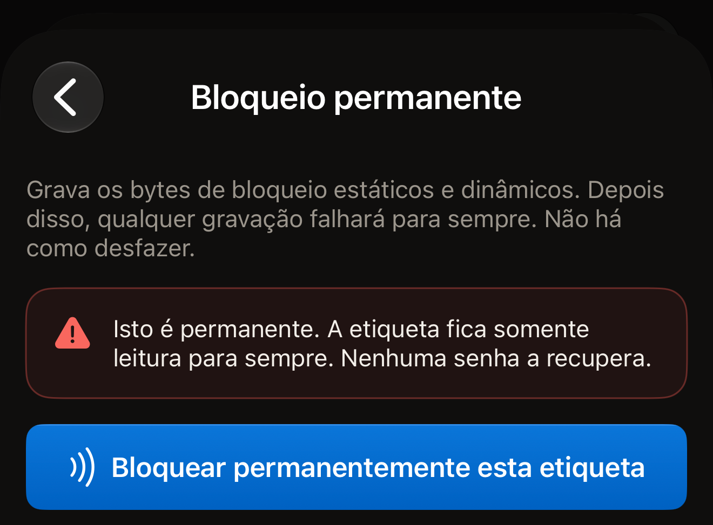
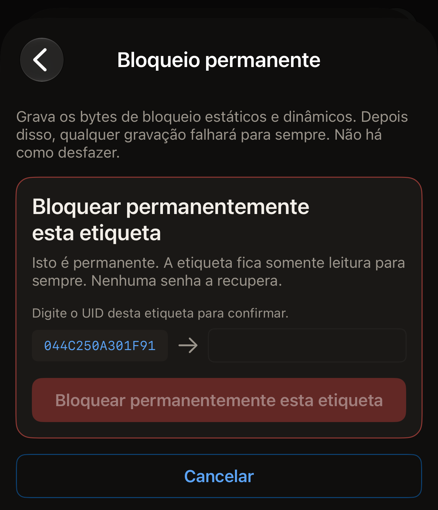
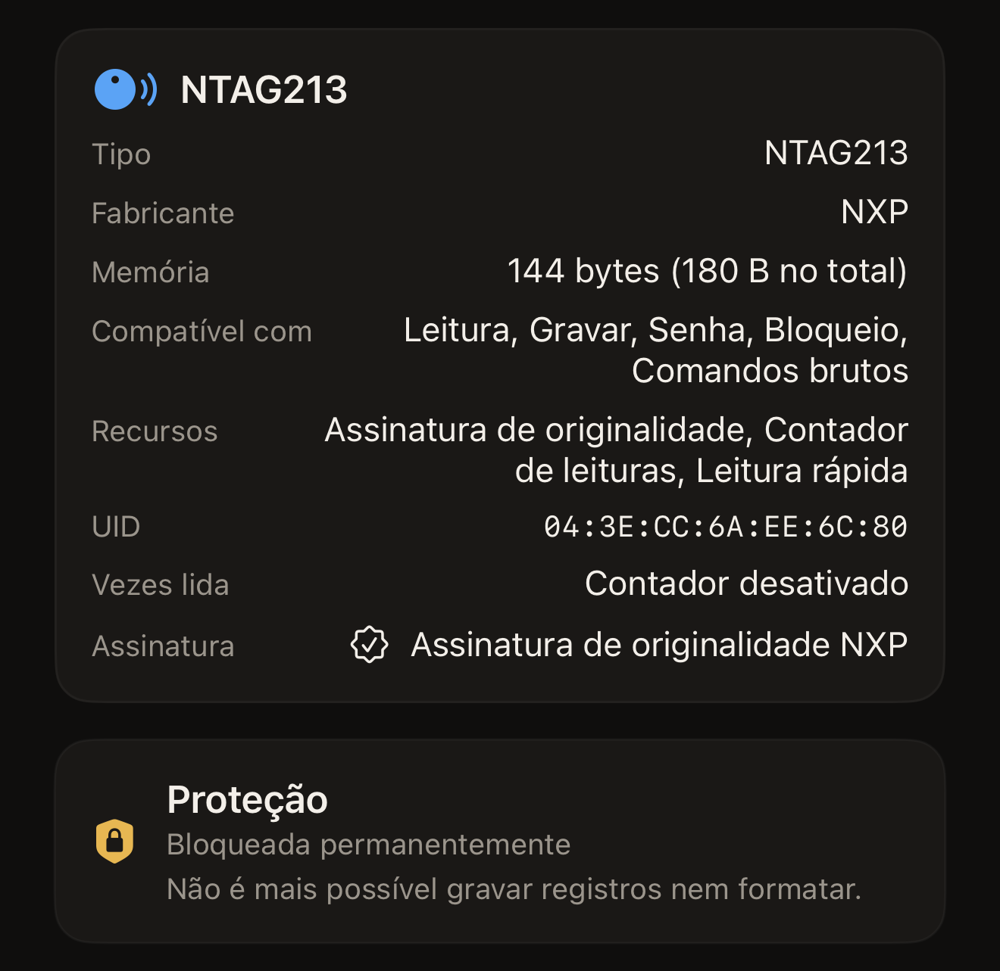

O Hex NFC pode bloquear uma etiqueta permanentemente pelo iPhone, gravando os
bits de bloqueio no próprio chip. A etiqueta mantém os registros que tem, e
nenhum registro ou formatação pode ser gravado nela de novo. A leitura não é
afetada, então qualquer telefone continua podendo ler a etiqueta.

Duas coisas determinam se uma etiqueta pode ser bloqueada, e uma leitura mostra
as duas. Na tela **Etiqueta**, o cartão no alto tem o nome do chip como título.
Ele tem uma linha **Compatível com**. “Bloqueio” só aparece nessa linha em um
chip que este app consegue bloquear. Abaixo dele, o cartão **Proteção** diz o
que protege a etiqueta agora. “Desativada” significa que nada a protege, e o
bloqueio pode prosseguir. Um chip que não usa senha não tem cartão
**Proteção**, e nada nele pode impedir um bloqueio.

Um resumo que mencione uma senha ou uma chave, como “Senha · somente gravação”,
significa que a proteção está ativada. Uma etiqueta nesse estado não é
bloqueada. A forma como o app avisa isso depende do chip.

Em um NTAG ou MIFARE Ultralight EV1, o Hex NFC verifica antes de gravar
qualquer coisa. A resposta é “Esta etiqueta está protegida por senha, então não
pode ser bloqueada permanentemente. Remova a senha primeiro e depois bloqueie.”
Em um MIFARE Ultralight C ou ICODE SLIX2, o app inicia o bloqueio. O resumo
nesses dois chips menciona uma chave 3DES ou uma senha. A própria proteção da
etiqueta recusa a primeira gravação. Essa recusa volta como “Nada foi
bloqueado.” Nos dois casos, nenhum bit de bloqueio é gravado, então a aproximação
não custa nada à etiqueta. Remova a senha ou a chave primeiro: consulte
[Remover a senha de uma etiqueta](remove-password.md).

O que impede o bloqueio é a proteção ativada, não a senha em si. Uma senha
guardada na etiqueta que já não protege nada aparece como “Desativada” no
cartão **Proteção** depois de uma nova leitura. Uma etiqueta nesse estado pode
ser bloqueada.

:::warning[Uma etiqueta bloqueada não pode ser desbloqueada]
Nenhuma senha, nenhum outro app e nenhuma aproximação posterior desfaz um
bloqueio permanente. Só bloqueie uma etiqueta quando o conteúdo dela for
definitivo.
:::

## Bloquear uma etiqueta permanentemente

::include[two-tap-confirmation]

:::::steps
::::step[Ler a etiqueta que você quer bloquear]
Na tela inicial do Hex NFC, toque em **Escanear** e encoste a etiqueta na parte
superior do iPhone. A tela **Etiqueta** se abre e mostra o conteúdo da
etiqueta. Consulte [Ler uma etiqueta](scan-a-tag.md).
::::

::::step[Verificar se a etiqueta pode ser bloqueada]
Na tela Etiqueta, procure “Bloqueio” na linha **Compatível com** do cartão de
informações da etiqueta e confira se o cartão **Proteção** mostra “Desativada”.
Um chip que não usa senha não mostra o cartão **Proteção**, e isso também está
certo.
::::

::::step[Abrir a tela Operações]
Na tela Etiqueta, toque no botão de menu no canto superior direito, ao lado de
**Gravar**, e toque em **Operações…**.
::::

::::step[Escolher Bloqueio permanente]
Role até **Ações perigosas** e toque em **Bloqueio permanente**. A tela que se
abre diz o que o bloqueio custa e que ele não pode ser desfeito. O bloco
aparece para todas as etiquetas, inclusive chips que não têm bits de bloqueio.
O app verifica o chip na primeira aproximação. Em um chip que não pode ser
bloqueado, ele responde “Esta etiqueta não é compatível com essa operação.”
depois dessa aproximação, antes de você digitar o UID. Nada é gravado.

:::figure[A tela **Bloqueio permanente** abre com o aviso, e nada chega à etiqueta até você tocar em **Bloquear permanentemente esta etiqueta**.]

:::
::::

::::step[Encostar a etiqueta para a primeira aproximação]
Leia o aviso e toque em **Bloquear permanentemente esta etiqueta**. A tela
mostra “Etapa 1 de 2. Mantenha a etiqueta para identificá-la.”, então encoste a
etiqueta na parte superior do iPhone até o painel fechar.
::::

::::step[Digitar o UID da etiqueta]
O UID da etiqueta aparece ao lado de um campo vazio, abaixo de “Digite o UID
desta etiqueta para confirmar.” Ele é mostrado em maiúsculas, sem dois-pontos
nem espaços, e é preciso digitá-lo inteiro. Um UID que o cartão de informações
da etiqueta mostra como `04:BA:4A:92:1B:21:90` aparece aqui como
`04BA4A921B2190`. Maiúsculas e minúsculas são aceitas, e um espaço antes ou
depois do que você digitar é ignorado. O botão fica esmaecido até que o texto
digitado corresponda ao UID.

:::figure[Entre as duas aproximações, o UID da etiqueta fica à esquerda de um campo vazio, e **Bloquear permanentemente esta etiqueta** fica esmaecido até você digitá-lo.]

:::
::::

::::step[Encostar a etiqueta para a segunda aproximação]
Toque em **Bloquear permanentemente esta etiqueta** de novo e encoste a
etiqueta na parte superior do iPhone. A tela mostra “Etapa 2 de 2. Encoste a
mesma etiqueta novamente.” enquanto espera e informa o resultado quando a
etiqueta é afastada.
::::
:::::

## O que o app diz quando o bloqueio é aplicado

“Etiqueta bloqueada permanentemente.” é o resultado que você quer. Depois de
gravar os bits, o app pediu à etiqueta que aceitasse mais uma gravação, a
etiqueta recusou, e essa recusa é a prova.

“Bloqueio gravado.” significa que os bits foram gravados, mas esta aproximação
não conseguiu comprovar isso. Alguns chips só aplicam os bits de bloqueio na
próxima vez que a etiqueta é ativada. O app acrescenta “Neste chip os bits de
bloqueio só entram em vigor na próxima leitura, então não dá para verificar
nesta sessão. Leia a etiqueta de novo para confirmar que ela agora recusa
gravações.” Leia a etiqueta mais uma vez e confira o resultado no cartão
**Proteção**.

Na tela **Etiqueta**, **Proteção** mostra “Bloqueada permanentemente” para uma
etiqueta que o app releu como bloqueada. Logo abaixo aparece “Não é mais
possível gravar registros nem formatar.” Até essa leitura de confirmação, o
cartão mostra “Bloqueio gravado · escaneie novamente para confirmar”.
**Gravar** fica indisponível em uma etiqueta relida como bloqueada.

:::figure[Depois de uma leitura de confirmação, o cartão **Proteção** mostra “Bloqueada permanentemente”, com “Não é mais possível gravar registros nem formatar.” logo abaixo.]

:::

Uma senha guardada na etiqueta continua lá depois do bloqueio, e o cartão então
mostra “Bloqueada permanentemente · a senha continua definida”. A linha abaixo
diz se essa senha ainda pode ser removida. Quais chips podem ser bloqueados é o
assunto de [Etiquetas que funcionam com o Hex NFC](tags-that-work.md).

## Se o bloqueio não terminar

Um bloqueio é feito em fases. Uma operação que para no meio deixa a etiqueta em
um estado que o app identifica pelo nome, em vez de chamá-lo de falha.

- “Nada foi bloqueado.” O chip recusou todas as fases e informou isso. Nada foi
  gravado, e a etiqueta está exatamente como estava, então uma segunda tentativa
  não custa nada a ela. Leia a etiqueta de novo e confira as duas condições de
  que um bloqueio precisa. O cartão **Proteção** mostra “Desativada”, ou um chip
  que não usa senha não mostra nenhum cartão **Proteção**. “Bloqueio” aparece
  na linha **Compatível com** do cartão de informações da etiqueta. Em um
  MIFARE Ultralight C ou ICODE SLIX2, essa mensagem é o sinal de que a etiqueta
  está protegida. Remova a chave ou a senha e faça o bloqueio de novo.
- “Esta etiqueta agora está parcialmente bloqueada, e isso não pode ser
  desfeito. Parte da memória é somente leitura para sempre; o restante foi
  recusado e continua gravável.” Parte do chip já foi gasta. Nenhuma segunda
  tentativa completa o restante. De volta à tela Etiqueta, o cartão
  **Proteção** mostra “Parcialmente bloqueada · parte desta etiqueta é somente
  leitura para sempre”. Uma etiqueta que ainda tem senha mostra
  “Parcialmente bloqueada · a senha continua definida”. Em um NTAG21x ou MIFARE
  Ultralight, uma nova leitura mostra o mesmo, porque o app relê esses bytes de
  bloqueio. Ele não relê os bloqueios por bloco de um ICODE SLIX2 durante a
  leitura, então uma nova leitura desse chip não diz nada sobre o bloqueio
  parcial. Nesse chip, o resultado no fim da operação é a única indicação que
  você tem.
- “A etiqueta parou de responder durante um bloqueio que não pode ser desfeito,
  então este app não consegue dizer se alguma parte da memória agora é somente
  leitura. Trate esta etiqueta como possivelmente bloqueada.” A etiqueta foi
  afastada no meio da gravação. Leia-a de novo e confira o cartão **Proteção**
  antes de usar a etiqueta para qualquer coisa.
- “Parte desta etiqueta agora é somente leitura para sempre, e isso não pode
  ser desfeito. A etiqueta parou de responder antes que o restante pudesse ser
  confirmado, então o restante também pode estar bloqueado.” Uma fase está
  confirmada. A outra é desconhecida. Leia a etiqueta de novo e trate-a como
  bloqueada.

## Ver também

- [Proteção de etiquetas](tag-protection.md)
- [Apagar ou formatar uma etiqueta](erase-or-format.md)
- [Se não for possível ler ou gravar uma etiqueta](troubleshooting.md)
