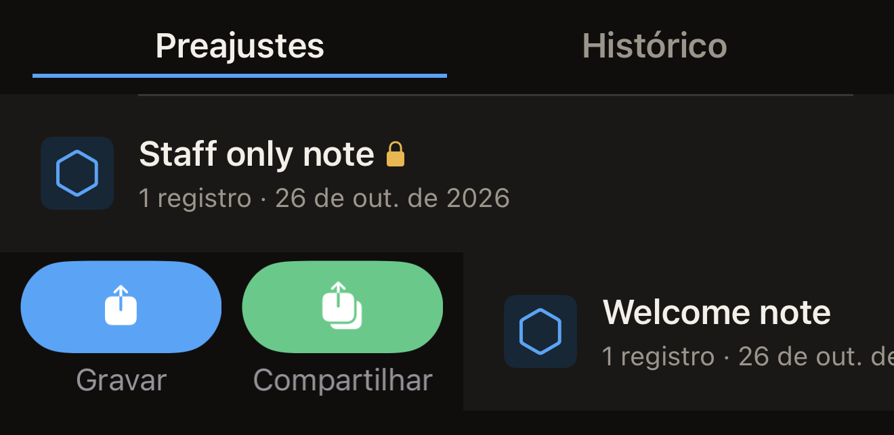
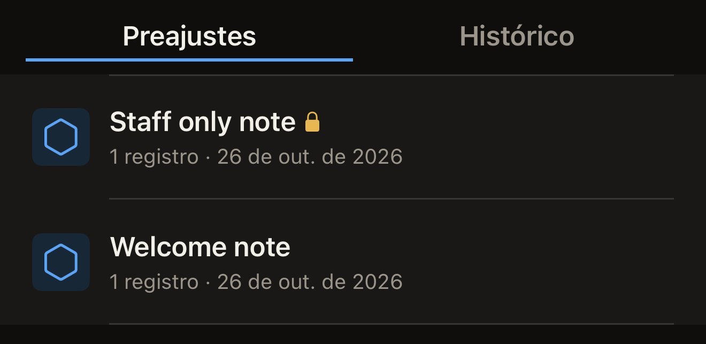

Um preajuste é um conjunto de registros com nome, guardado no iPhone. Salve
um a partir da etiqueta que você está editando e depois grave esses mesmos
registros em quantas etiquetas quiser, sem precisar montá-los de novo.

Antes de começar, coloque um conjunto de registros na tela Etiqueta, para que
haja algo a salvar. Na tela inicial do Hex NFC, toque em **Escanear** e
aproxime a etiqueta que você quer copiar. Para começar sem nenhuma etiqueta à
mão, toque em **Criar**. Qualquer um dos dois abre a tela Etiqueta. Consulte
[Ler uma etiqueta](scan-a-tag.md) e
[Editar os registros de uma etiqueta](edit-records.md).

## Salvar os registros que você está editando

::::steps
:::step[Abrir o painel de salvamento]
Na tela Etiqueta, toque no botão de menu no canto superior direito e depois em
**Salvar como preajuste…**. Essa opção do menu fica esmaecida até que a
etiqueta tenha pelo menos um registro ou uma configuração de proteção.
:::

:::step[Dar um nome ao preajuste]
Em **Nome**, digite um nome que você vá reconhecer depois, como o lugar para
onde as etiquetas vão. **Salvar** fica esmaecido até que o nome seja
preenchido.
:::

:::step[Adicionar uma nota]
Opcional: em **Notas**, descreva para que serve o preajuste. O campo aceita
até quatro linhas.
:::

:::step[Escolher um ícone]
Em **Ícone**, toque em um dos três segmentos, que são identificados por
palavras, e não por formas desenhadas: **Moldura externa**,
**Cursor para cima** ou **Cursor para baixo**. O segmento que você tocar
define o emblema hexagonal mostrado ao lado do preajuste na tela
**Biblioteca**.
:::

:::step[Conferir o que o preajuste vai guardar]
**Registros** conta os registros que serão guardados. Um preajuste que leva
proteção e nada mais mostra, em vez disso, “Sem registros. Este preajuste
apenas aplica proteção.”

Se a lista tiver um registro **Local** sem coordenadas e sem URL do mapa,
**Registros** também mostra “Um registro de local não tem coordenadas nem URL
do mapa, então este preajuste nunca poderia ser gravado em uma etiqueta.
Preencha ou exclua esse registro na tela Etiqueta e depois salve.” Enquanto
essa mensagem estiver lá, **Salvar** fica esmaecido. Toque em **Cancelar**,
preencha ou exclua o registro e abra o painel de salvamento de novo. Consulte
[Tipos de registro](record-types.md).
:::

:::step[Salvar o preajuste]
Toque em **Salvar**. O painel se fecha e o preajuste aparece no topo da aba
**Preajustes** da tela **Biblioteca**.
:::
::::

Um preajuste só leva proteção quando você define uma senha ou uma chave na
etiqueta antes de salvá-lo. Isso é feito na tela Etiqueta, que mostra
**Proteção** para as etiquetas que podem ser protegidas. Toque em **Proteção**
e ative **Proteger esta etiqueta com senha**. Digite o segredo no campo que o
painel mostra, como **Senha (4 bytes)**, e toque em **Concluído**. Consulte
[Proteger uma etiqueta com senha](protect-a-tag.md).

Feito isso, o painel de salvamento ganha uma seção **Proteção** que indica o
que o preajuste guarda, como “Proteção com senha (somente gravação)”. O
segredo não vai para dentro do preajuste. O app avisa isso na mesma seção: “O
segredo fica guardado apenas neste dispositivo (Chaveiro). Ele nunca
sincroniza nem viaja em uma exportação.” Um preajuste só ativa a proteção de
uma etiqueta enquanto esse segredo estiver neste iPhone. Um preajuste salvo
sem que você tenha digitado um segredo não ativa proteção nenhuma.

Se o iPhone recusar o salvamento, aparece uma linha em vermelho na parte de
baixo do formulário. Ela diz “Não foi possível salvar:” seguido do motivo que
o iPhone informou. O painel continua aberto e os registros continuam na tela
Etiqueta, então nada do que você digitou se perde. Toque em **Salvar** de
novo. Se o mesmo motivo voltar, toque em **Cancelar**. Os registros continuam
na tela Etiqueta. Você pode gravá-los direto em uma etiqueta em vez de
guardá-los como preajuste.

## Gravar um preajuste em uma etiqueta {#write-a-preset-to-a-tag}

Um cadeado ao lado do nome de um preajuste indica que ele leva configurações
de proteção. A linha não informa nada além disso. Ela não diz se a gravação
vai ativar a proteção da etiqueta, porque isso depende do segredo guardado
junto ao preajuste. O segredo não é exibido. Um preajuste que você salvou
neste iPhone depois de digitar uma senha ou uma chave sua guarda esse segredo
e ativa a proteção da etiqueta. Um preajuste salvo a partir de uma etiqueta
que já estava protegida, sem que você tenha digitado a senha dela, não guarda
segredo nenhum. Ele grava os registros e não protege nada. Se você não
souber dizer qual dos dois tem à sua frente, trate-o como um que ativa a
proteção.

:::::steps
::::step[Abrir a Biblioteca]
Na tela inicial do Hex NFC, toque em **Biblioteca**. A tela Biblioteca abre em
**Preajustes**, com o preajuste alterado mais recentemente no topo.
::::

::::step[Iniciar a gravação]
Deslize o preajuste um pouco a partir da borda esquerda e toque em
**Gravar**. A tela **Biblioteca** se fecha e a tela de gravação se abre.

:::figure[Um deslize curto a partir da borda esquerda de um preajuste mostra **Gravar** e **Compartilhar**.]

:::
::::

::::step[Encostar a etiqueta no iPhone]
Encoste a etiqueta na parte superior do iPhone enquanto a tela mostra
“Encoste a etiqueta na parte superior do iPhone”. A tela mostra “Gravação
concluída” assim que os registros estiverem na etiqueta.
::::
:::::

:::warning[Um preajuste que aplica proteção não pede que você confirme a etiqueta]
Um preajuste que leva configurações de proteção e ainda guarda o segredo
neste iPhone define esse segredo em qualquer etiqueta que você aproximar.
Este é o único lugar do app em que a proteção é ativada sem uma primeira
aproximação para ler a etiqueta. Não há UID para digitar como confirmação.
Aproxime apenas a etiqueta que você pretendia proteger. Guarde o preajuste
enquanto essas etiquetas estiverem em uso. Gravá-lo de novo é a forma de
voltar a ter acesso a uma etiqueta que ele protegeu. Excluí-lo exclui essa
cópia do segredo.
:::

## Gerenciar os preajustes

Até você salvar um, a aba **Preajustes** mostra “Nenhum preajuste salvo”.
Depois disso, cada linha traz o nome e o ícone do preajuste. Abaixo do nome,
um texto conta os registros e informa a data em que o preajuste foi alterado
pela última vez.

Um cadeado ao lado do nome marca um preajuste que leva configurações de
proteção, e o VoiceOver o lê como “Aplica proteção”. O que esse cadeado
garante e o que ele não garante está explicado acima, em
[Gravar um preajuste em uma etiqueta](#write-a-preset-to-a-tag).

:::figure[Um cadeado depois do nome de um preajuste marca um que leva configurações de proteção.]

:::

Deslizar um preajuste a partir da borda esquerda mostra **Gravar** e
**Compartilhar**. Deslizá-lo a partir da borda direita mostra **Excluir** e
**Duplicar**. Deslize um pouco e toque no botão que você quer. Um deslize
levado até o fim a partir da borda direita exclui o preajuste na hora.

Um preajuste salvo não pode ser alterado. Para mudar o que um preajuste sem
cadeado guarda, monte os registros de novo na tela Etiqueta. Salve-os como um
novo preajuste e depois exclua o antigo.

Não mexa em um preajuste com cadeado. Recriá-lo a partir da tela Etiqueta
resulta em registros sem segredo, a não ser que você configure a senha ou a
chave de novo antes. Excluir o preajuste antigo leva embora a única cópia do
segredo que abre as etiquetas que ele protegeu. Para ter uma segunda cópia de
um preajuste assim, use **Duplicar**, que leva junto o segredo guardado.

Na aba **Preajustes**, você pode fazer o seguinte:

- Para guardar uma cópia de um preajuste fora do app, deslize-o a partir da
  borda esquerda e toque em **Compartilhar**. O app cria um arquivo `.hexnfc`
  com o nome do preajuste e o entrega ao menu Compartilhar. Os registros e as
  configurações de proteção vão nesse arquivo; a senha ou a chave, nunca. O
  Hex NFC não tem como abrir um arquivo `.hexnfc`. O que você envia a alguém é
  uma cópia dos registros para guardar, não um preajuste que a pessoa possa
  adicionar ao próprio app.
- Para fazer uma segunda cópia de um preajuste, deslize-o a partir da borda
  direita e toque em **Duplicar**. A cópia tem os mesmos registros, as mesmas
  configurações de proteção e o mesmo segredo guardado.
- Para remover um preajuste, deslize-o a partir da borda direita e toque em
  **Excluir**. Nada pede confirmação, e o segredo guardado do preajuste vai
  junto com ele.

## Ver também

- [Editar os registros de uma etiqueta](edit-records.md)
- [Gravar um link em uma etiqueta](write-a-link.md)
- [Proteção de etiquetas](tag-protection.md)
- [Encontrar uma etiqueta que você leu antes](scan-history.md)
