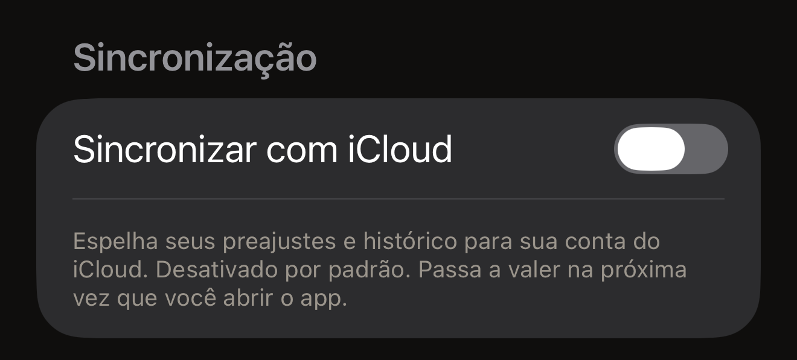

Você encosta uma etiqueta no iPhone e o que ela guarda aparece na tela. Essa
leitura acontece no iPhone, e o resultado fica nele. O Hex NFC não tem contas
nem analytics. Ele faz quatro tipos de solicitação aos servidores da própria
Hex Pro. Três não levam nada sobre você, e o quarto, uma mensagem de feedback,
leva só o que você decide enviar. O texto completo da política está
no app. Na tela inicial do Hex NFC, toque no botão de engrenagem no canto
superior direito. Depois, em **Informações legais**, toque em
**Política de Privacidade**.

## O que fica no iPhone

O seu histórico de leitura e os seus preajustes salvos ficam em um banco de
dados local neste iPhone, e os seus ajustes também são guardados localmente.
O mesmo vale para tudo o que está por trás do cartão que de vez em quando
pergunta **Curtindo o Hex NFC?**: se ele já perguntou, o que você respondeu e a
contagem de gravações e leituras recentes que decide quando ele pode perguntar
de novo. [Ajustes](settings.md#feedback-and-ratings) descreve esse cartão.
Excluir um item o remove desse banco de dados. Remover o app remove junto os
dados locais dele.

As senhas das etiquetas ficam separadas de tudo isso, no Chaveiro do iOS,
apenas no iPhone que as definiu. Uma senha nunca é sincronizada, nunca entra
em um arquivo que você exporta e nunca é enviada a lugar nenhum. O app
arquiva dois tipos de item. Um é para uma etiqueta cuja proteção foi aplicada
por uma gravação, arquivado sob o UID dessa etiqueta. Essa gravação é feita a
partir do cartão **Proteção** da tela Etiqueta ou de um preajuste que aplica
proteção. O outro item é para um preajuste que aplica proteção, arquivado sob
o preajuste. Nenhum dos dois guarda nada sobre você. Uma senha que você
digita em **Operações…** > **Proteger com senha** não é arquivada em nenhum
deles, então guarde a sua própria cópia dela. Remover o app não leva junto as
senhas arquivadas, porque o iOS mantém os itens do Chaveiro depois que um app
é removido. A leitura de um passaporte não é guardada em lugar nenhum. O que
o chip devolve fica na tela durante aquela sessão e desaparece quando a
sessão termina. [Ler um passaporte](passports.md) descreve isso em detalhes.

Duas coisas removem uma senha guardada. Excluir um preajuste descarta a senha
salva com ele. Isso acontece quer a etiqueta em que ele foi gravado continue
protegida, quer não. Uma etiqueta pode então ficar protegida por uma senha
que o app já não guarda. A outra é desativar a proteção no cartão
**Proteção** da etiqueta e depois gravar a etiqueta, como explica
[Remover a senha de uma etiqueta](remove-password.md). Mesmo nesse caso, o
app só descarta a senha depois de reler a etiqueta. Essa releitura precisa
constatar as duas coisas a seguir:

- A proteção não existe mais.
- A senha da etiqueta voltou a ser a senha padrão de fábrica do chip.

Uma remoção que comprova a primeira, mas não a segunda, mantém a senha
guardada. Uma etiqueta que está aberta, mas ainda tem a sua senha, não pode
ser protegida de novo sem ela. Uma remoção feita a partir de **Operações**
não remove nada do Chaveiro. Qualquer item já arquivado para essa etiqueta
continua onde está.

Nada no Hex NFC lista as etiquetas para as quais ele guarda uma senha. Se
você não puder aproximar uma etiqueta de novo, não há como remover de dentro
do app a senha guardada dela. Esse item do Chaveiro fica neste iPhone, a
menos que uma remoção posterior o elimine ou que você apague o iPhone.

**Sincronizar com iCloud** começa desativado, e a mudança no botão só vale
na próxima vez que você abrir o app. Com ele ativado, os seus preajustes e o seu
histórico de leitura são espelhados no seu banco de dados privado do iCloud,
que a Apple opera e o seu ID Apple protege. A Hex Pro não consegue lê-lo. As
senhas das etiquetas ficam fora dele de qualquer forma. O botão fica em
[Ajustes](settings.md).

:::figure[**Sincronizar com iCloud** fica desativado até você ativá-lo, e a linha abaixo dele diz que a mudança só vale na próxima vez que você abrir o app.]

:::

Desativar a sincronização só interrompe o espelhamento depois que você fecha o
Hex NFC e o abre de novo, como descreve
[Fechar e reabrir o app](settings.md#close-and-reopen-the-app). Voltar para a
Tela de Início do iPhone deixa o app aberto, e o espelhamento continua junto
com ele.

Interromper o espelhamento não é o mesmo que remover o que o iCloud já tem, e
remover o app também não apaga isso. Para tirar essa cópia de lá, abra o app
Ajustes do iPhone. Toque no seu nome, no topo, e depois na linha iCloud.
Percorra o armazenamento listado ali, onde os dados que cada app guarda podem
ser excluídos.

:::note[Uma etiqueta não é um armazenamento privado]
Tudo o que você grava em uma etiqueta fica em um hardware fora do iPhone, e
qualquer pessoa com um leitor pode ler uma etiqueta sem proteção. Trate o que
uma etiqueta guarda como público, a menos que você a proteja, como explica
[Proteção de etiquetas](tag-protection.md).
:::

## As quatro vezes em que o app se conecta à Hex Pro {#when-the-app-reaches-hex-pro}

Nenhuma delas acontece em segundo plano. As três primeiras não levam nada que
identifique você.

- A tela inicial do Hex NFC busca em api.apps.hex.pro um número público sobre os custos
  de desenvolvimento do projeto. A solicitação não contém dados pessoais.
- Uma sugestão de nome de estação é enviada quando você toca em **Enviar** em
  uma parada desconhecida de um cartão de transporte. Tocar na tecla de envio
  do teclado com o campo do nome aberto também a envia. Ela leva os códigos de
  linha, estação e área, o código do sistema do cartão e o nome que você
  digitou. O número de série, o saldo e o histórico de viagens do cartão não
  fazem parte dela, então não coloque dados pessoais no campo do nome.
- O cartão **Mais apps da Hex Pro** busca em api.p.hex.pro um banner de outro
  app da Hex Pro. A solicitação envia o identificador do pacote deste app, a
  plataforma e o nome de um espaço de exibição. A resposta indica uma imagem
  ou um vídeo, que o app baixa de um segundo endereço e guarda no iPhone. Todo
  mundo vê o mesmo banner. Não há rede de anúncios, identificador de
  rastreamento nem personalização por trás dele.
- Uma mensagem de feedback sai quando você toca em **Enviar** no formulário
  **Enviar feedback**. Ela leva a sua mensagem, o endereço de e-mail que você
  digitou, se tiver informado um, e os quatro dados que o formulário lista em
  **Enviado com sua mensagem**: a versão do app, a versão do iOS, o modelo do
  dispositivo e o idioma. Ela vai para api.hex.pro e de lá para a caixa de
  entrada de feedback da Hex Pro, fica guardada por até 24 meses e nunca é usada
  para marketing. Nada das suas etiquetas, das suas leituras ou do seu histórico
  de leitura faz parte dela.

A sincronização com o iCloud é a outra coisa que usa a rede, e a exceção ao
parágrafo acima. Com ela ativada, os seus preajustes e o seu histórico de
leitura circulam entre o iPhone e a Apple em segundo plano. Nada disso chega
à Hex Pro.

Qualquer solicitação pela internet mostra o seu endereço IP ao servidor que a
responde. A Hex Pro mantém logs operacionais de curta duração e não usa
endereços IP para identificar ninguém nem para traçar perfis. Uma mensagem de
feedback é guardada com uma forma embaralhada do seu endereço IP, usada só para
impedir que uma mesma conexão envie mensagens demais, e essa forma é apagada em
até sete dias.

## Para que serve cada permissão

O Hex NFC pede duas permissões a você. O NFC é aquela sem a qual ele não
funciona, e o iOS não oferece um botão de ativação para ela. A câmera é
opcional, e o iOS pede acesso a ela na primeira vez que você lê um código QR ou a página
com a foto de um passaporte.
O que qualquer uma das duas capta fica no iPhone.

A Política de Privacidade no app descreve mais três, para contatos,
localização e Bluetooth. Nada no app pede essas três, então o iOS nunca
pergunta nada sobre elas.

:::table[As permissões que o Hex NFC pede]
| Permissão | Para que é usada |
| :--- | :--- |
| NFC | Ler e gravar etiquetas, apenas enquanto uma tela de leitura ou de gravação está aberta. |
| Câmera | Ler um código QR que você escolhe transformar em registro e ler a página com a foto de um passaporte quando você decide escaneá-la. As imagens da câmera nunca são salvas nem enviadas. |
:::

## O que a Hex Pro nunca faz

O Hex NFC não inclui SDKs de analytics ou de telemetria nem publicidade de
terceiros, e nada nele faz fingerprinting do iPhone. A Hex Pro não
vende, não aluga e não compartilha informações pessoais. Não há contas, então
nenhum servidor da Hex Pro guarda um perfil seu. Um arquivo que você exporta
contém os registros e os preajustes que você escolheu, e nunca uma senha de
etiqueta.

## Ver também

- [Ajustes](settings.md)
- [Ler um cartão de transporte](transit-cards.md)
- [Ler um passaporte](passports.md)
- [Proteção de etiquetas](tag-protection.md)
