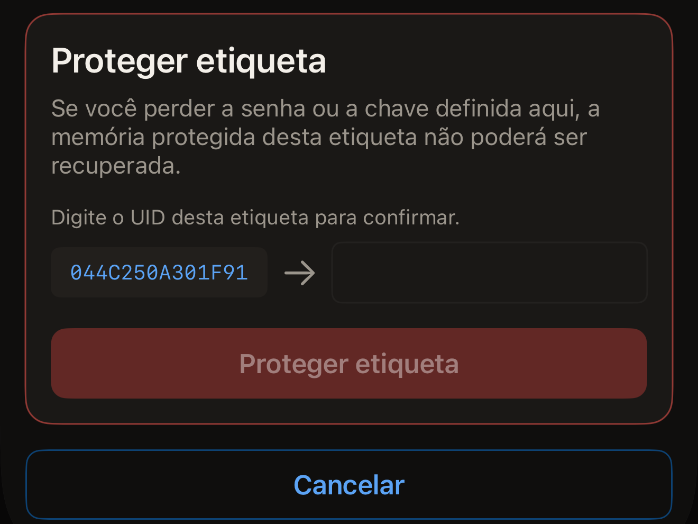
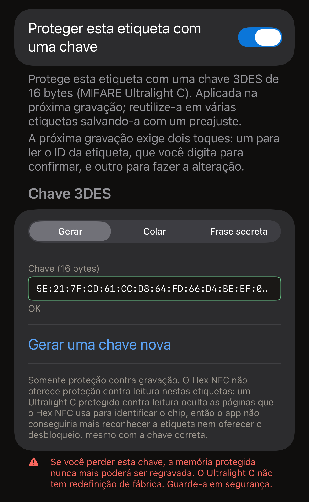
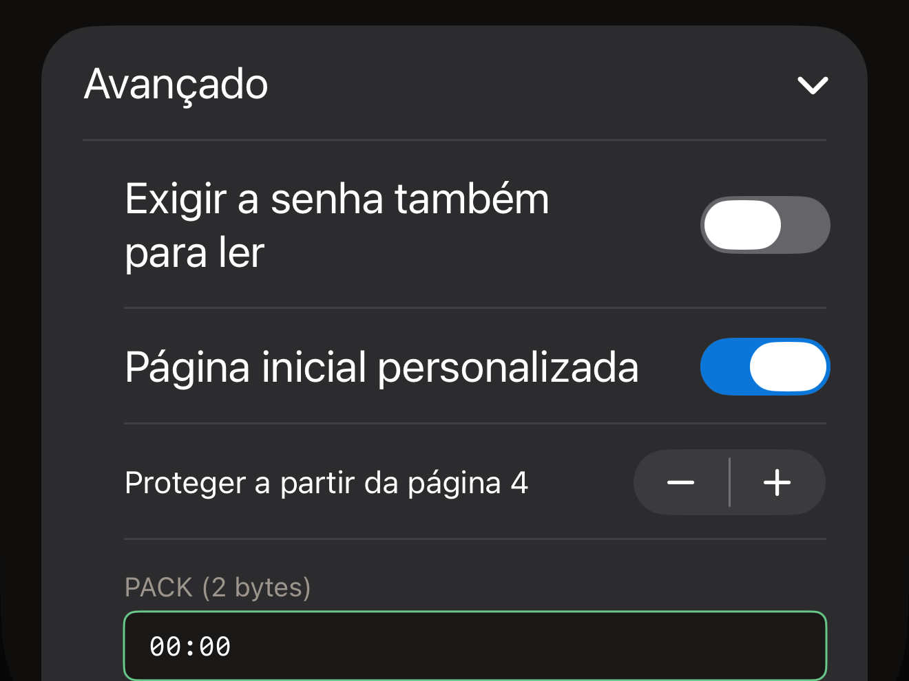

Uma senha em uma etiqueta protege a gravação. Os registros continuam podendo
ser lidos por qualquer pessoa, a menos que você proteja também a leitura.
Qualquer gravação é recusada até que a senha seja apresentada. O Hex NFC define
uma senha pelo iPhone de duas formas, e as duas atendem aos mesmos chips.
**Proteger com senha**, em **Operações…**, protege uma etiqueta sem fazer mais
nada. O cartão **Proteção** na tela Etiqueta coloca o segredo na etiqueta como
parte da próxima gravação. Use o caminho por Operações para proteger uma
etiqueta sem alterar mais nada, e o cartão Proteção quando você já ia gravar na
etiqueta de qualquer forma.

Antes de começar, leia a etiqueta que você quer proteger, para que ela fique
aberta na tela Etiqueta. Consulte [Ler uma etiqueta](scan-a-tag.md). O cartão
no alto dessa tela mostra o nome do chip na primeira linha. Esse nome indica
que tipo de segredo a etiqueta aceita.

O app pode proteger sete chips: NTAG213, NTAG215, NTAG216, MIFARE Ultralight
EV1, MIFARE Ultralight C, NTAG424 DNA e ICODE SLIX2. Para saber se a etiqueta
que você tem em mãos pode mesmo ser protegida, consulte a
[Matriz de compatibilidade de chips](../developer/chip-support-matrix.md). Em
qualquer outro chip, **Proteger com senha** termina em “Esta etiqueta não é
compatível com essa operação.” A tela Etiqueta também não mostra o cartão
**Proteção** para esses chips, a menos que a etiqueta informe um bloqueio.

::include[two-tap-confirmation]

## Proteger uma etiqueta em Operações

Este caminho não pede nada antes da primeira aproximação. Essa aproximação lê
qual é o chip da etiqueta, e então a tela pede o tipo de segredo que esse chip
aceita: uma senha de 4 bytes em um NTAG213, NTAG215, NTAG216, MIFARE Ultralight
EV1 ou ICODE SLIX2, e uma chave de 16 bytes em um NTAG424 DNA ou MIFARE
Ultralight C. Para saber o que cada chip aceita, consulte a
[Matriz de compatibilidade de chips](../developer/chip-support-matrix.md).

:::::steps
::::step[Abrir Proteger com senha]
Na tela Etiqueta, toque no botão de menu no canto superior direito, ao lado de
**Gravar**, e vá em **Operações…** > **Proteger com senha**.
::::

::::step[Aproximar a etiqueta para que o app a identifique]
Toque em **Proteger etiqueta**. O painel do iOS se abre e a tela
mostra “Etapa 1 de 2. Mantenha a etiqueta para identificá-la.” Encoste a
etiqueta na parte superior do iPhone até o painel fechar.
::::

::::step[Digitar a nova senha ou chave]
A tela mostra o nome do chip que leu, depois de “Etiqueta identificada:”, e
exibe os campos que esse chip aceita. Digite o segredo em hexadecimal, com ou
sem dois-pontos entre os bytes.

- Em um NTAG213, NTAG215, NTAG216 ou MIFARE Ultralight EV1, digite a senha em
  **Senha (4 bytes)**. Em uma etiqueta lida como sem proteção, o campo já vem
  com o padrão de fábrica, `FF FF FF FF`. Coloque a sua própria senha no lugar.
  O PACK são os 2 bytes que a etiqueta devolve quando aceita a senha. Um leitor
  confere esses bytes para ter certeza de que está falando com a etiqueta que
  espera. **PACK (2 bytes)** já vem com dois bytes zero, e deixá-lo assim é a
  escolha certa, a menos que algum sistema que você usa peça um valor
  específico.
- Em um NTAG424 DNA, digite a chave em **Chave (16 bytes)**.
- Em um ICODE SLIX2, digite a senha de gravação em **Senha (4 bytes)**. A
  leitura continua livre.
- Em um MIFARE Ultralight C, a chave vai em **Chave (16 bytes)**. Em uma
  etiqueta lida como sem proteção, o campo já vem com uma chave gerada
  aleatoriamente. Este chip recebe somente proteção contra gravação.

Em um NTAG21x, MIFARE Ultralight EV1 ou NTAG424 DNA, um botão de ativação
abaixo do campo protege também a leitura. Ele se chama **Exigir a senha também
para ler**, ou **Exigir a chave também para ler** em um NTAG424 DNA. Com ele
desativado, qualquer leitor continua podendo ler a etiqueta. Ative-o e nada sai
da etiqueta sem o segredo, então uma leitura posterior no Hex NFC pede o segredo
antes de tudo. A operação em si continua terminando em “Senha definida.”,
porque o app apresenta o segredo que acabou de gravar para fazer a própria
releitura.
::::

::::step[Digitar o UID da etiqueta]
Abaixo dos campos, o cartão com o título **Proteger etiqueta** pede: “Digite o
UID desta etiqueta para confirmar.” Ao lado de um campo vazio, ele mostra o UID
que o app leu naquela aproximação. Se a etiqueta já tiver uma senha ou chave,
um cartão com o título “A etiqueta está protegida” aparece acima dele e pede o
segredo que a etiqueta tem agora. Digite esse UID no campo, caractere por
caractere, e toque em **Proteger etiqueta**.

:::figure[O UID a copiar fica à esquerda no cartão **Proteger etiqueta**, e o campo em que você o digita fica à direita.]

:::
::::

::::step[Aproximar a mesma etiqueta de novo]
A tela mostra “Etapa 2 de 2. Encoste a mesma etiqueta novamente.” Encoste a
etiqueta no iPhone mais uma vez. “Senha definida.” aparece quando o app relê a
configuração da etiqueta e confirma que a proteção está ativada.
::::
:::::

:::warning[Guarde a senha]
Nada no app lê uma senha de volta de uma etiqueta, então a cópia que você guarda
é a única. O aviso na tela explica o motivo: “Se você perder a senha ou a chave
definida aqui, a memória protegida desta etiqueta não poderá ser recuperada.”
:::

Se a operação falhar, a tela oferece **Tentar de novo**, que a leva de volta ao
estado inicial para você repetir tudo desde a primeira aproximação. Enquanto o
cartão do UID estiver aberto, **Cancelar** devolve a tela ao estado inicial. A
etiqueta fica como estava, e o painel do iOS, se ainda estiver aberto, se
fecha mostrando “Cancelado.”

Em uma etiqueta que já está protegida, este caminho pede dois segredos: o novo,
nos campos, e o que a etiqueta tem agora, no cartão “A etiqueta está
protegida”. O segredo atual abre a etiqueta, e o novo o substitui.

## Definir uma chave pelo cartão Proteção {#protection-card}

Um NTAG424 DNA e um MIFARE Ultralight C usam uma chave de 16 bytes em vez de
uma senha. Um ICODE SLIX2 usa uma senha de gravação própria. Os três segredos
podem ser definidos no cartão **Proteção** da tela Etiqueta, e o segredo vai
para a etiqueta como parte da próxima gravação. A senha Type 2 também fica
nesse cartão.

:::::steps
::::step[Abrir o cartão Proteção]
Na tela Etiqueta, toque no cartão **Proteção**, abaixo do cartão que mostra o
nome do chip.
::::

::::step[Ativar a proteção]
Toque no botão de ativação no alto do cartão para ativá-lo. Ele se chama **Proteger esta
etiqueta com uma chave** em um NTAG424 DNA ou MIFARE Ultralight C, e
**Proteger esta etiqueta com senha** nos chips que usam senha.
::::

::::step[Digitar a chave ou a senha]
Preencha o campo que o cartão mostra para esse chip.

- Em um NTAG424 DNA, digite 16 bytes em **Chave (16 bytes)** ou toque em
  **Gerar uma chave aleatória**. Para proteger também a leitura, ative
  **Exigir a chave também para ler**.
- Em um MIFARE Ultralight C, escolha no seletor abaixo de **Chave 3DES** como
  a chave é criada. Em uma etiqueta que ainda não tem chave, o cartão abre em
  **Gerar**, com 16 bytes aleatórios já em **Chave (16 bytes)**, e **Gerar uma
  chave nova** os substitui. **Colar** permite usar 16 bytes seus em **Chave (16
  bytes)**. Uma **Frase secreta** produz a mesma chave toda vez que você a usa.
- Em um ICODE SLIX2, NTAG213, NTAG215, NTAG216 ou MIFARE Ultralight EV1,
  digite 4 bytes em **Senha (4 bytes)**.

Em um NTAG213, NTAG215, NTAG216 ou MIFARE Ultralight EV1, **Avançado**, abaixo
do campo, reúne a proteção contra leitura, o intervalo de páginas e o PACK.
Abra essa seção antes do próximo passo se quiser usar algum deles. Consulte
[Escolher quais páginas uma senha Type 2 protege](#pages-a-type-2-password-covers).

Quando o campo tiver uma chave ou senha completa, a nota abaixo do botão de
ativação no alto diz o que a próxima gravação vai exigir. O texto é: “A próxima
gravação exige dois toques: um para ler o ID da etiqueta, que você digita para
confirmar, e outro para fazer a alteração.”

:::figure[Em uma MIFARE Ultralight C sem proteção, o seletor abaixo de **Chave 3DES** começa em **Gerar**, então **Chave (16 bytes)** já tem uma chave aleatória.]

:::
::::

::::step[Salvar as configurações]
Toque em **Concluído** no canto superior direito. Nada foi enviado à etiqueta
ainda.
::::

::::step[Iniciar a gravação]
Toque em **Gravar** no canto superior direito da tela Etiqueta. Encoste a
etiqueta na parte superior do iPhone para a aproximação que lê o UID dela.
::::

::::step[Confirmar a etiqueta e aproximá-la de novo]
O cartão com o título **Proteger etiqueta** mostra o UID que o app leu naquela
aproximação, ao lado de um campo vazio. Digite esse UID no campo, toque em
**Proteger etiqueta** e aproxime a mesma etiqueta mais uma vez. Em seguida, o
cartão **Proteção** resume como a etiqueta está protegida.
::::
:::::

O aviso nesse cartão muda conforme o chip. Para uma chave de NTAG424 DNA, ele
diz “Se você perder esta chave, nunca mais poderá regravar esta etiqueta. Não
existe redefinição de fábrica para um NTAG424. Guarde-a em segurança.” Para uma
chave de MIFARE Ultralight C, ele diz “Se você perder esta chave, a memória
protegida nunca mais poderá ser regravada. O Ultralight C não tem redefinição
de fábrica. Guarde-a em segurança.” Para uma senha, ele diz “Se você perder esta
senha, a memória protegida desta etiqueta é irrecuperável.”

Uma etiqueta que já tem senha é aberta com a senha que está no cartão. Digite a
senha atual da etiqueta no cartão e a primeira aproximação desbloqueia a
etiqueta, sem mais nenhuma pergunta.

Quando o cartão não tem uma senha que abra a etiqueta, a primeira aproximação
encontra a proteção. A gravação para e pede essa senha, sob o título “A
etiqueta está protegida”. A nota acima do campo diz o que ainda falta. O texto
é: “Alterar a proteção exige aproximar a etiqueta duas vezes: a primeira lê o ID
dela para você confirmar, a segunda faz a alteração.”

Digitar a senha ali não custa nenhuma aproximação a mais, porque o UID da
etiqueta já foi lido. O botão mostra **Desbloquear e continuar**, e em seguida
vem o cartão do UID.

## Escolher quais páginas uma senha Type 2 protege {#pages-a-type-2-password-covers}

Antes de tocar em **Concluído** no cartão Proteção, abra **Avançado**. Em um
NTAG213, NTAG215, NTAG216 ou MIFARE Ultralight EV1, essa seção tem mais três
opções:

- Para proteger a leitura além da gravação, ative **Exigir a senha também para
  ler**. O cartão avisa que “Etiquetas protegidas contra leitura não podem ser
  lidas de volta, nem para verificação, sem a senha.”
- Para proteger uma parte da etiqueta, e não ela inteira, ative **Página
  inicial personalizada** e ajuste **Proteger a partir da página 4** para a
  primeira página que você quer proteger. Uma página é um bloco de 4 bytes da
  memória da etiqueta. A opção vai de 3 a 254. Esse é o intervalo de todos os
  chips que ela atende, e não o da etiqueta que você tem em mãos. O app não o
  ajusta ao chip. Uma página inicial além do fim da memória do chip grava a
  senha e não protege nada. Mesmo assim, a gravação termina na tela de sucesso,
  então nada nela indica que a etiqueta está aberta. É uma nova leitura que
  mostra que a etiqueta não protege nada. Escolha uma página dentro da memória
  do chip; a [Matriz de compatibilidade de chips](../developer/chip-support-matrix.md)
  informa quanta memória cada chip tem. Com a opção desativada, vale o que o
  app diz: “Protege toda a área de dados (a partir da primeira página de dados
  do chip).”
- Para escolher os 2 bytes guardados junto com a senha, digite-os em **PACK (2
  bytes)**.

:::figure[Com **Página inicial personalizada** ativada, **Avançado** mostra a página inicial e os botões de mais e menos acima de **PACK (2 bytes)**.]

:::

Quantas senhas incorretas o chip aceita é definido em outro lugar. Consulte
[Limitar as tentativas incorretas de senha](attempt-limit.md).

## Se o app não conseguir confirmar o resultado

Uma operação de proteção termina relendo a configuração da etiqueta, então ela
nunca é considerada um sucesso só porque a etiqueta confirmou o recebimento.
Quando só metade do resultado pode ser confirmada, a mensagem diz qual metade.

A etiqueta está protegida quando a tela mostra uma destas mensagens:

- “Senha definida.”
- “A proteção está ativada, mas este app não conseguiu confirmar que a senha
  foi aplicada. Guarde a senha que você digitou: é muito provável que seja a
  que está na etiqueta agora.”

A etiqueta não está protegida quando a tela mostra uma destas:

- “A etiqueta continua sem proteção, e a senha que você digitou não foi salva
  nela. Aproxime a etiqueta do telefone novamente para tentar de novo.”
- “Senha salva na etiqueta. A proteção continua desativada.”
- “A senha foi salva na etiqueta, mas a proteção não foi ativada. Aproxime a
  etiqueta do telefone novamente para terminar.”
- “A etiqueta continua sem proteção, e este app não conseguiu confirmar qual
  senha ela tem agora. Guarde tanto a senha que você digitou quanto a anterior
  e aproxime a etiqueta do telefone novamente.”

Nada está confirmado quando a tela mostra uma destas:

- “Não foi possível confirmar que a proteção foi ativada. Aproxime a etiqueta
  do telefone novamente para verificar.”
- “Não foi possível confirmar que a proteção foi ativada, nem qual senha a
  etiqueta tem agora. Guarde tanto a senha que você digitou quanto a anterior e
  aproxime a etiqueta do telefone novamente.”

Quando a mensagem pedir outra aproximação, aproxime a etiqueta de novo e guarde
as duas senhas até que uma delas tenha aberto a etiqueta. Duas das mensagens
não pedem nada, e cada uma tem o seu próprio próximo passo.

- Depois de “Senha salva na etiqueta. A proteção continua desativada.”, a
  etiqueta guarda a senha que você digitou e não protege nada. Não é preciso
  apresentar nenhuma senha para corrigir isso. Repita o procedimento com a
  mesma senha. Para tirar a senha guardada da etiqueta, consulte
  [Remover a senha de uma etiqueta](remove-password.md).
- Depois de “A proteção está ativada, mas este app não conseguiu confirmar que
  a senha foi aplicada. Guarde a senha que você digitou: é muito provável que
  seja a que está na etiqueta agora.”, a etiqueta está protegida. Guarde essa
  senha e saiba que a próxima gravação nessa etiqueta vai pedi-la.

## Ver também

- [Proteção de etiquetas](tag-protection.md)
- [Remover a senha de uma etiqueta](remove-password.md)
- [Limitar as tentativas incorretas de senha](attempt-limit.md)
- [Matriz de compatibilidade de chips](../developer/chip-support-matrix.md)
