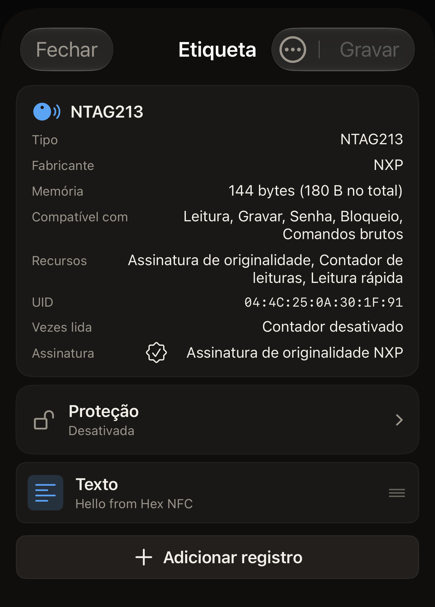

Em cerca de 5 minutos, você lê uma etiqueta NFC com o Hex NFC e vê o que ela
contém, na tela e no histórico do app. Você precisa do iPhone e de uma
etiqueta.

## Antes de começar

- Instale o Hex NFC pela [App Store](https://apps.apple.com/app/id6801457461) em um iPhone com iOS 17 ou posterior.
  Não há nada para configurar quando você abre o app pela primeira vez: ele
  abre direto na tela inicial do Hex NFC. [Perguntas frequentes](faq.md) informa quanto
  o app custa e em quais iPhones ele funciona.
- Tenha uma etiqueta à mão. Pode ser um adesivo, um cartão ou um chaveiro NFC.
- Uma etiqueta em branco também serve. O app a lê e mostra que ela não contém
  nada.
- Ler uma etiqueta não altera nada nela. Nada nesta página grava na sua
  etiqueta.

## Ler sua primeira etiqueta

:::::steps
::::step[Abrir a tela de leitura]
O app abre na tela inicial do Hex NFC, com quatro blocos abaixo do nome do
app: **Escanear**, **Criar**, **Biblioteca** e **Avançado**. Toque em
**Escanear**, o bloco no canto superior esquerdo. A tela de leitura se abre e
fica esperando, com a frase “Encoste a etiqueta na parte superior do iPhone”.
::::

::::step[Encostar a etiqueta no iPhone]
Encoste a parte superior do iPhone na etiqueta, bem rente, e mantenha-o
parado. Enquanto a leitura acontece, o iOS mostra um painel próprio na parte
de baixo da tela. O texto do app continua acima dele. A tela de leitura mostra
“Lendo…” e depois “Etiqueta detectada”. Quando “Etiqueta detectada” aparece, o
app já terminou de ler a etiqueta, e você pode afastar o iPhone. Se nenhuma
etiqueta for lida, a tela mostra “Falha ao escanear” e o motivo logo abaixo.
Toque em **Tentar de novo** e encoste a etiqueta na parte superior do iPhone,
sem mexer. [Se não for possível ler ou gravar uma
etiqueta](troubleshooting.md) ajuda quando uma etiqueta não responde.
::::

::::step[Ver o que o app encontrou]
Abaixo de “Etiqueta detectada”, o app mostra o nome do chip e conta o que leu.
Um registro é um item de conteúdo de uma etiqueta, como um link ou um texto, e
uma etiqueta com um registro mostra “1 registro encontrado”. Uma etiqueta sem
nenhum mostra “Nenhum registro NDEF nesta etiqueta”. A tela fica assim por
cerca de um segundo. O nome do chip e o UID da etiqueta aparecem de novo na
tela seguinte, então não é preciso decorar nada aqui.
[Ler uma etiqueta](scan-a-tag.md) explica os outros resultados.
::::

::::step[Abrir um registro]
A tela Etiqueta se abre sozinha. O cartão no topo mostra o nome do chip e tem
uma linha **UID**. Abaixo do cartão, cada registro é uma linha com o tipo e
uma prévia do conteúdo. Toque em uma linha para ver o registro inteiro e
depois toque em **Cancelar** para voltar. **Cancelar** fecha o registro sem
gravar nada, nem na etiqueta nem no app. Uma etiqueta em branco mostra
“Etiqueta vazia” no lugar das linhas, e isso é uma leitura completa, não uma
falha.

:::figure[Depois da leitura de uma etiqueta NTAG213, o cartão no topo da tela Etiqueta traz a linha **UID**, e o único registro da etiqueta aparece mais abaixo, como uma linha **Texto**.]

:::
::::

::::step[Fechar a etiqueta]
Toque em **Fechar**. A tela Etiqueta se fecha sem gravar nada, e você volta à
tela inicial do Hex NFC.
::::
:::::

## O que você aprendeu

Agora você consegue ler qualquer etiqueta que tiver em mãos e saber o que ela
contém. O app guardou essa leitura. Toque em **Biblioteca** na tela inicial do
Hex NFC e depois em **Histórico**, a segunda das duas abas no topo da tela
Biblioteca. A sua leitura está no topo da lista. Se você fixar uma leitura,
ela fica guardada além dos limites que [Encontrar uma etiqueta que você leu
antes](scan-history.md) explica. Abrir uma leitura salva traz de volta a
mesma tela Etiqueta, sem aproximar a etiqueta outra vez.

## Próximos passos

- Consulte [Ler uma etiqueta](scan-a-tag.md) para saber o que cada resultado
  de leitura significa e o que fazer quando uma etiqueta pede senha primeiro.
- Consulte [Encontrar uma etiqueta que você leu antes](scan-history.md) para
  reabrir, fixar e excluir leituras salvas.
- Consulte [Gravar um link em uma etiqueta](write-a-link.md) para colocar o
  endereço de um site em uma etiqueta em branco.
- Consulte [Etiquetas que funcionam com o Hex NFC](tags-that-work.md) para ver
  quais chips o app reconhece.
- Consulte [Se não for possível ler ou gravar uma etiqueta](troubleshooting.md)
  quando uma etiqueta não responder.
