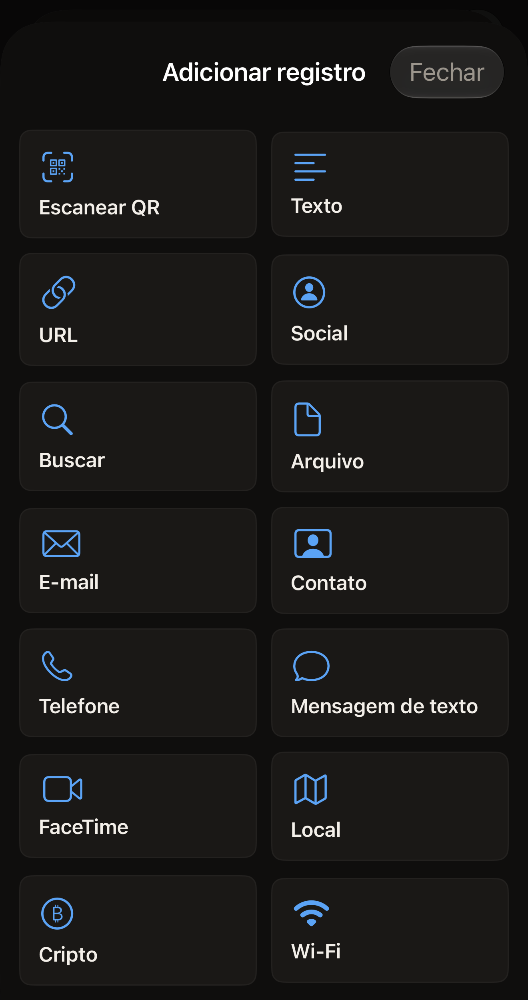
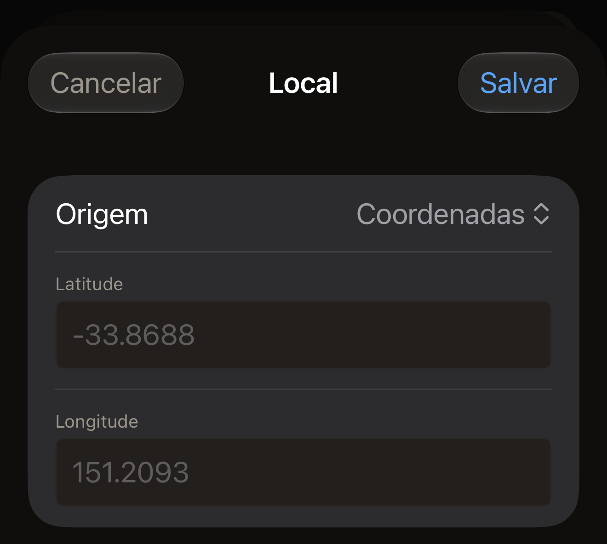

Uma etiqueta contém uma lista de registros, e cada registro tem um tipo. Leia
uma etiqueta com o iPhone ou toque em **Criar** na tela inicial do Hex NFC
para começar sem nenhum registro. Depois, toque em **Adicionar registro** na tela
Etiqueta. O app oferece 13 tipos, que [Editar os registros de uma
etiqueta](edit-records.md) apresenta passo a passo. O tipo que você escolhe
define quais campos o editor de registro mostra e também o que outro telefone
vai encontrar quando ler a etiqueta mais tarde. Uma etiqueta lida também pode
conter cinco tipos que o app abre, mas não oferece para adicionar, descritos
em [Tipos que você pode abrir, mas não
adicionar](#types-you-can-open-but-not-add).

:::figure[**Adicionar registro** oferece 13 tipos de registro, com **Escanear QR** em primeiro lugar, para transformar um código QR em registro.]

:::

## O que o tipo muda

Cada tipo é um formato para uma informação. Um número de telefone vai em um
registro **Telefone**, e uma rede, em um registro **Wi-Fi**. O app transforma
o que você digita nos bytes que o padrão NFC define para esse formato.
Escolha o tipo mais próximo em vez de colocar um número de telefone em um
registro **Texto**: o telefone que lê a etiqueta age conforme o formato, não
conforme a sua intenção.

O que acontece no telefone que lê a etiqueta é decisão desse telefone. Um
link é um link em qualquer lugar. Uma rede não é: como diz o formulário
**Wi-Fi**, “O iPhone não se conecta automaticamente via NFC, mas leitores
Android sim. Hex NFC grava o registro conforme a especificação para qualquer
leitor.”

Os registros ocupam espaço, e um chip pequeno fica sem espaço. Quanto cada
chip comporta está em [Etiquetas que funcionam com o Hex
NFC](tags-that-work.md).

## Texto e links

:::table[Tipos de registro para texto, links e buscas]
| Tipo | O que você preenche | O que vai para a etiqueta |
| --- | --- | --- |
| **Texto** | **Texto**, **Código de idioma**, **Codificação** | As suas palavras, marcadas com o código de idioma que você digitar e gravadas na codificação que você escolher. |
| **URL** | **URL** | O endereço como você o digitou. Os prefixos comuns da web são armazenados como um único byte, então o registro ocupa menos espaço. |
| **Social** | **Plataforma**, **Usuário** | Um link de perfil, montado a partir da plataforma que você escolher e do nome de usuário que você digitar. |
| **Buscar** | **Mecanismo**, **Consulta** | Um endereço de busca para o mecanismo que você escolher, com as suas palavras. |
| **Arquivo** | **Caminho** | Um endereço de arquivo. O formulário explica assim: “Armazenado como URL file://. O iOS limita os diretórios que isto pode apontar.” |
:::

Um novo registro **Texto** começa com o código de idioma en, e a observação
do próprio campo mostra o formato a usar: “ISO 639-1, ex.: en, fr, ja”.
**Codificação** tem duas opções, **UTF-8** e **UTF-16**, e um registro novo
começa em **UTF-8**.

Na maioria das plataformas, em **Usuário** vai o nome que termina o endereço
do seu perfil, digitado sem o @ na frente. Seis delas pedem outra coisa,
porque os endereços delas não são montados a partir de um nome de usuário.

- Para **Whatsapp**, digite o número de telefone que um link wa.me leva, ou
  seja, o número internacional completo, sem o sinal de mais.
- Para **Skype**, digite o nome do Skype.
- Para **Steam**, digite a URL personalizada do endereço do seu perfil.
- Para **Slack**, digite o nome do espaço de trabalho que inicia o endereço
  dele.
- Para **Facebook** e **Wechat**, digite o que o próprio link deles leva, que
  pode ser um nome ou um número.

O app coloca o que você digita no endereço de perfil da plataforma e não muda
mais nada nele.

**Mecanismo** tem as opções **Google**, **Google Images**, **Bing**,
**Yandex**, **DuckDuckGo**, **YouTube** e **Wikipedia**. **Plataforma** tem as
opções **Facebook**, **Bluesky**, **X**, **Github**, **Instagram**, **Line**,
**Linkedin**, **Medium**, **Pinterest**, **Skype**, **Slack**, **Snapchat**,
**Soundcloud**, **Steam**, **Telegram**, **Threads**, **Tiktok**, **Twitch**,
**Vk**, **Wechat**, **Whatsapp** e **Youtube**, cada uma escrita na tela do
mesmo jeito que aqui.

## Pessoas e mensagens

:::table[Tipos de registro que chegam a uma pessoa]
| Tipo | O que você preenche | O que vai para a etiqueta |
| --- | --- | --- |
| **E-mail** | **Para**, **Cc**, **Cco**, **Assunto**, **Corpo** | Um link de e-mail com os destinatários, o assunto e a mensagem. |
| **Contato** | **Nome completo** e **Organização** em **Identidade**, depois **Telefones**, **E-mails** e **Sites** em **Contato** | Um cartão de contato, que o telefone que lê a etiqueta pode adicionar aos próprios contatos. |
| **Telefone** | **Número de telefone** | Um endereço de telefone. O telefone que o lê oferece a opção de ligar para o número. |
| **Mensagem de texto** | **Destinatário**, **Mensagem** | Um endereço de mensagem com o número e o texto a enviar. |
| **FaceTime** | **Destino**, **Modo** | Um endereço do FaceTime, para vídeo ou áudio, conforme você escolheu. |
:::

Seis desses campos aceitam mais de uma entrada: **Para**, **Cc**, **Cco**,
**Telefones**, **E-mails** e **Sites** separam as entradas por vírgula, e é
por isso que **Para** e **Telefones** mostram a dica “separados por vírgula”.
Se você deixar **Organização** vazio, o campo fica fora do cartão.

## Lugares, dinheiro e redes

:::table[Tipos de registro para um lugar, um pagamento ou uma rede]
| Tipo | O que você preenche | O que vai para a etiqueta |
| --- | --- | --- |
| **Local** | **Origem** e, depois, **Latitude** e **Longitude** ou **URL do mapa** | Um endereço de mapa: um par de coordenadas ou o link do mapa que você colar. |
| **Cripto** | **Rede**, **Endereço**, **Valor**, **Mensagem** | Um endereço de pagamento na rede que você escolher. **Valor** e **Mensagem** ficam de fora quando você os deixa vazios. |
| **Wi-Fi** | **Nome da rede (SSID)**, **Senha**, **Autenticação**, **Criptografia**, **Rede oculta** | Um registro de rede com o nome, a senha e as configurações de segurança que você escolheu. |
:::

**Origem** define o resto do formulário **Local**. Ela tem as opções
**Coordenadas**, **URL do Apple Maps** e **URL do Google Maps**.
**Coordenadas** mostra **Latitude** e **Longitude**. Digite cada uma como
número decimal, como `-33.8688` e `151.2093`. A vírgula decimal também
funciona, então `48,8566` é lido como `48.8566`. As outras duas origens
mostram **URL do mapa** no lugar desses campos. Você mesmo fornece o
endereço. Copie o link do app de mapas ou do navegador em que encontrou o
lugar e cole-o no campo. A etiqueta recebe o link exatamente como você o
colou. A escolha entre as duas não é gravada na etiqueta. Escolha a que
descreve de onde veio o seu link. O app nunca lê onde o iPhone está. Todo
local é digitado ou colado por você, ou vem de um código QR ou de uma
etiqueta que você leu.

:::figure[Com **Origem** em **Coordenadas**, o formulário mostra **Latitude** e **Longitude**, cada um com um exemplo em cinza até você digitar.]

:::

Um registro **Local** precisa de uma latitude e uma longitude, ou de uma URL
de mapa. Enquanto não tiver, o formulário mostra “Informe uma latitude e uma
longitude, ou uma URL do mapa. Até lá, este registro não pode ser gravado em
uma etiqueta.”, e a linha do registro na tela Etiqueta mostra “Sem local”. Um
registro **Local** que você adiciona e depois fecha com **Cancelar** continua
na lista nesse estado. Se você gravar a etiqueta enquanto a lista tiver um registro
assim, a gravação é interrompida antes de o painel do iOS abrir, com a mensagem
“Um registro de local está sem as coordenadas ou a URL do mapa. Nada foi
gravado na etiqueta.” Preencha o registro ou exclua-o e grave de novo. O
mesmo vale para **Salvar como preajuste…**: enquanto a lista tiver um
registro assim, **Salvar** fica esmaecido e o painel de salvamento explica o
motivo. Um preajuste não pode ser alterado depois de salvo, então um
preajuste salvo com um **Local** vazio em uma versão anterior do app é
recusado toda vez que você tenta gravá-lo. Monte os registros dele de novo na
tela Etiqueta, salve-os como um novo preajuste e depois exclua o antigo.

**Rede** tem as opções **Bitcoin**, **Ethereum**, **Monero**, **Litecoin**,
**Dogecoin** e **Solana**. **Valor** é um campo de texto simples, sem dica e
sem nenhuma verificação. O app copia o que você digita para o link de
pagamento sem alterações. Digite o valor no formato que a sua carteira usa.
Confira o valor nessa carteira antes que alguém envie qualquer coisa.

No formulário **Wi-Fi**, **Autenticação** começa em **WPA2 Personal** e
**Criptografia** começa em **AES**, que é o que a maioria dos roteadores
domésticos usa. **Autenticação** também tem **WPA3 Personal**, **WPA
Personal**, **WEP** e **Aberta**. **Criptografia** também tem **TKIP**,
**TKIP + AES**, **WEP** e **Nenhum**. Escolha o par que a página de
configurações do seu roteador indica.

:::warning[Um registro Wi-Fi leva a senha em texto legível]
Todo telefone que lê a etiqueta lê junto a senha da rede. Coloque um registro
**Wi-Fi** somente em uma etiqueta que você não se importe que qualquer pessoa
leia.
:::

## Tipos que você pode abrir, mas não adicionar {#types-you-can-open-but-not-add}

Uma etiqueta lida, um preajuste ou um item do histórico pode conter cinco
tipos que **Adicionar registro** não oferece: **Link de app**, **Bluetooth**,
**Dados**, **Atalho** e **Bruto**. Nenhum deles tem formulário próprio. Tocar
em um deles abre um editor de texto com o registro em JSON, sob a
observação “Este tipo de registro é editado em JSON. Enquanto o texto não for
um registro válido, Salvar mantém a última versão válida.”

:::table[O que os cinco tipos colocam em uma etiqueta]
| Tipo | O que vai para a etiqueta |
| --- | --- |
| **Link de app** | Um endereço da App Store, gravado como link. |
| **Bluetooth** | Um registro de pareamento com um endereço e um nome de dispositivo. |
| **Dados** | Os bytes do registro, identificados com o tipo de mídia dele. |
| **Atalho** | Um endereço que executa um atalho pelo nome, com a entrada que o registro fornece a ele. |
| **Bruto** | Os bytes exatos do registro, gravados de volta sem alterações. |
:::

O editor abre com o registro já preenchido. As chaves que já têm um valor
aparecem na tela, e você altera esses valores ali mesmo. Uma chave que ainda
não tem valor não aparece. As chaves opcionais da tabela abaixo ficam
ausentes até que você as digite, escritas exatamente como estão listadas
aqui. Deixe `id` e `type` como o app os preencheu. As demais são estas:

:::table[As chaves de cada tipo editado só em JSON]
| Tipo | Chaves que você preenche |
| --- | --- |
| **Link de app** | `appStoreURL` e, se quiser, `universalLink` e `displayName` |
| **Bluetooth** | `deviceMAC` e, se quiser, `deviceName` |
| **Dados** | `mimeType`, e `payload` em base64 |
| **Atalho** | `shortcutName` e, se o atalho aceitar uma entrada, `input` |
| **Bruto** | `tnf`, como um número da lista abaixo, e depois `typeBytes`, `idBytes` e `payload` em base64 |
:::

Um registro **Dados** com a palavra Hello em texto simples fica assim:

```text title="Um registro Dados no editor JSON"
{
  "id" : "9E2B1C64-6A2F-4D0E-9A52-0B7F1C3D8E44",
  "mimeType" : "text/plain",
  "payload" : "SGVsbG8=",
  "type" : "data"
}
```

Não há nenhum conversor por trás desse `payload`. O valor precisa ser base64
gerado em outro lugar. Colar o texto puro não o codifica. Um `payload` que não
seja base64 válido impede que o registro inteiro seja lido. A observação a
seguir trata desse caso.

**Bruto** é o tipo que o app usa quando lê um registro que não consegue
classificar. O normal é gravá-lo de volta sem alterações. Para alterar um,
comece por `tnf`, o número que o padrão NDEF usa para dizer que tipo de nome
`typeBytes` contém. O valor é um destes números.

- 0 para um registro vazio.
- 1 para um nome da lista do próprio NFC Forum.
- 2 para um tipo de mídia.
- 3 para um endereço absoluto.
- 4 para um nome definido por um fabricante.
- 5 para desconhecido.
- 6 para a continuação de um registro que foi dividido.

`typeBytes`, `idBytes` e `payload` são todos em base64, e `idBytes` costuma
ficar vazio.

```text title="Um registro Bruto com um tipo definido pelo fabricante"
{
  "id" : "3F7A9D21-4C88-4B0A-BE13-52C0A7E6D915",
  "idBytes" : "",
  "payload" : "SGVsbG8=",
  "tnf" : 4,
  "typeBytes" : "ZXhhbXBsZS5jb206bm90ZQ=="
}
```

:::note[O editor ignora o texto que não consegue ler]
O editor aplica o seu texto assim que ele pode ser lido como registro. Até
lá, o registro mantém os valores que tinha, e nenhuma mensagem aparece. Também
não há nada no editor que confirme a mudança, então confira depois de tocar em
**Salvar**. A linha do registro na tela Etiqueta traz uma segunda linha de
texto, tirada do próprio registro.

- Para **Dados**, é o tipo de mídia.
- Para **Atalho**, é o nome do atalho.
- Para **Link de app**, é o endereço da App Store.
- Para **Bluetooth**, é o nome ou o endereço do dispositivo.
- Para **Bruto**, são os primeiros bytes do payload.

Se a segunda linha continuar como estava antes, o seu texto nunca virou um
registro.
:::

## Salvar, descartar e excluir um registro

**Salvar** mantém as suas alterações, e **Cancelar** as descarta. **Excluir
registro** tira o registro da lista e fecha o editor sem pedir confirmação.
Nesse momento, **Cancelar** já não está mais disponível, então um registro
excluído dessa forma precisa ser adicionado de novo. Os três agem sobre a
cópia que o app guarda, nunca sobre a etiqueta. A etiqueta só muda quando
você grava nela, o que [Editar os registros de uma etiqueta](edit-records.md)
explica.

Todo registro é montado a partir do que você digita. Nada no editor de
registro lê os seus contatos, a sua localização ou os dispositivos Bluetooth
ao seu redor. [Privacidade e seus dados](privacy.md) explica o que o app
guarda.

## Como o app classifica uma etiqueta lida

O app classifica o que lê no tipo mais próximo que conhece. Um endereço de
telefone, mensagem, e-mail, FaceTime, mapa, pagamento, atalho ou arquivo abre
como esse tipo, e qualquer outro link abre como registro **URL**. Um cartão
de contato, um registro de rede e um registro de pareamento voltam, cada um,
ao próprio tipo. Qualquer outro tipo de mídia vira um registro **Dados**, e o
que sobrar vira um registro **Bruto**, que é gravado de volta byte por byte.

## Ver também

- [Editar os registros de uma etiqueta](edit-records.md)
- [Gravar um link em uma etiqueta](write-a-link.md)
- [Salvar uma etiqueta como preajuste](presets.md)
- [Matriz de compatibilidade de chips](../developer/chip-support-matrix.md)
