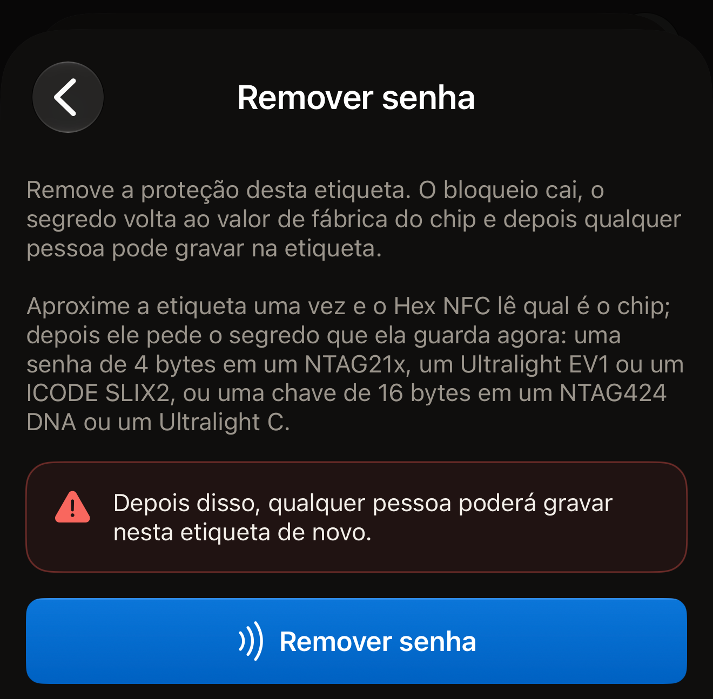
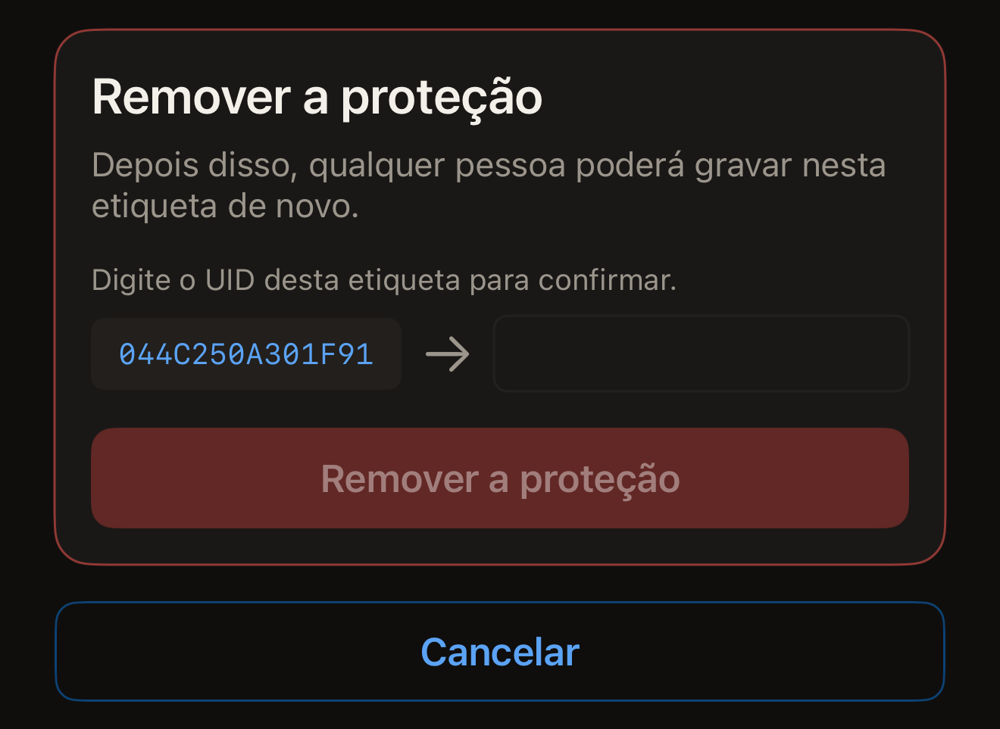
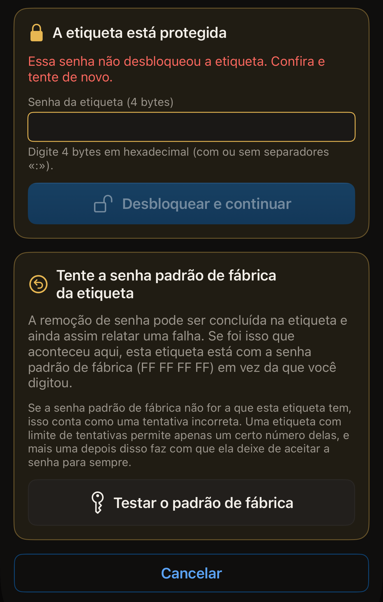

Uma senha que você colocou em uma etiqueta pode ser removida, desde que você
ainda consiga apresentar a senha que a etiqueta tem. Depois que ela sai,
qualquer pessoa pode ler e gravar na etiqueta, e a senha ou chave dela volta ao
padrão de fábrica do chip.

Antes de começar, abra o Hex NFC no iPhone e leia a etiqueta para que ela fique
na tela Etiqueta (consulte [Ler uma etiqueta](scan-a-tag.md)). Tenha à mão a
senha que ela tem. O cartão no alto dessa tela mostra o nome do chip na
primeira linha, acima do UID da etiqueta. Esse nome determina que tipo de
segredo a remoção vai pedir. Um chip que não aparece em nenhum dos dois caminhos
abaixo não tem senha que o Hex NFC possa remover, porque o app nunca coloca uma
nele.

## Remover uma senha em Operações

Este caminho atende a todos os chips que o app consegue proteger. Ele não pede
nada antes da primeira aproximação. Essa aproximação lê qual é o chip da
etiqueta, e então a tela pede o segredo que a etiqueta tem agora: uma senha de
4 bytes nos chips NTAG21x (NTAG213, NTAG213 TT, NTAG215, NTAG216), MIFARE
Ultralight EV1 ou ICODE SLIX2, e uma chave de 16 bytes em um NTAG424 DNA ou
MIFARE Ultralight C. O NTAG 210µ não tem senha para remover. A
[Matriz de compatibilidade de chips](../developer/chip-support-matrix.md) lista
o que cada chip aceita.

:::::steps
::::step[Abrir Operações]
Na tela **Etiqueta**, abra o menu no canto superior direito e toque em
**Operações…**.
::::

::::step[Abrir Remover senha]
Toque em **Remover senha**.
::::

::::step[Iniciar a remoção]
Toque em **Remover senha**. O aviso acima do botão diz o que a remoção custa:
“Depois disso, qualquer pessoa poderá gravar nesta etiqueta de novo.”

:::figure[O botão **Remover senha** em que você toca é o que fica na parte inferior da tela, abaixo do aviso.]

:::
::::

::::step[Encostar a etiqueta na parte superior do iPhone]
O app lê o UID da etiqueta e encerra a aproximação para que você possa digitar.
::::

::::step[Digitar o segredo que a etiqueta tem]
Um cartão com o título “A etiqueta está protegida” pede o segredo que a
etiqueta tem agora. Digite uma senha em **Senha da etiqueta (4 bytes)** como
oito caracteres hexadecimais. Em um NTAG424 DNA, o campo é **Chave da etiqueta
(AES, 16 bytes)**, e em um MIFARE Ultralight C é **Chave da etiqueta (3DES, 16
bytes)**. Os separadores são ignorados, então `FF FF FF FF` e `FFFFFFFF` são o
mesmo valor.
::::

::::step[Confirmar a etiqueta]
A tela mostra o UID da etiqueta ao lado do campo, abaixo de “Digite o UID desta
etiqueta para confirmar.” Digite esses caracteres no campo, sem separadores.
Maiúsculas ou minúsculas não fazem diferença. Toque em **Remover senha** e
encoste a etiqueta no iPhone mais uma vez.
::::
:::::

::include[two-tap-confirmation]

Quando a segunda aproximação termina, a tela mostra “Senha removida.” A etiqueta
está aberta. Qualquer telefone pode regravar os registros dela. Se a etiqueta
também pedia a senha antes de mostrar qualquer coisa, essa proteção sai junto
com a outra.

## Remover a proteção pela tela Etiqueta

Em qualquer chip que o app consegue proteger, a proteção também pode ser
removida como parte de uma gravação, e para isso você precisa da chave ou senha
que a etiqueta tem. A gravação coloca de volta na etiqueta os registros listados
na tela **Etiqueta**. Depois de uma leitura, essa lista é o que a etiqueta já
contém, então o conteúdo dela se mantém, a menos que você mesmo tenha editado a
lista.

:::::steps
::::step[Abrir Proteção]
Na tela **Etiqueta**, toque em **Proteção**.
::::

::::step[Desativar a proteção]
Desative **Proteger esta etiqueta com uma chave** em uma etiqueta NTAG424 DNA ou
MIFARE Ultralight C, ou **Proteger esta etiqueta com senha** em um chip que usa
senha: um NTAG21x, MIFARE Ultralight EV1 ou ICODE SLIX2. A nota abaixo diz que
a próxima gravação remove tanto a proteção contra leitura quanto a proteção
contra gravação e devolve o segredo ao padrão de fábrica.
::::

::::step[Manter a alteração]
Toque em **Concluído**.
::::

::::step[Gravar na etiqueta]
Na tela **Etiqueta**, toque em **Gravar** e encoste a etiqueta na parte superior
do iPhone. O app lê o UID da etiqueta e pede que você o digite de volta.
::::

::::step[Confirmar a etiqueta]
Digite o UID mostrado ao lado do campo, sem separadores e em maiúsculas ou
minúsculas, e toque em **Remover a proteção**. Encoste a etiqueta no iPhone mais
uma vez para fazer a alteração.

:::figure[O cartão **Remover a proteção** mostra o UID que o app leu, com uma seta apontando para o campo vazio em que você o digita.]

:::
::::
:::::

A gravação apresenta a chave ou senha que o app já tem para a etiqueta. É a que
você digitou no cartão **Proteção** ou a que usou quando protegeu a etiqueta. Em
uma etiqueta para a qual o app não tem nada, a gravação para em “A etiqueta está
protegida” e pede o segredo. O campo em que ela pede depende do chip:

- Em um NTAG424 DNA, digite-o em **Chave da etiqueta (AES, 16 bytes)**.
- Em um MIFARE Ultralight C, digite-o em **Chave da etiqueta (3DES, 16 bytes)**.
- Em um NTAG21x, MIFARE Ultralight EV1 ou ICODE SLIX2, digite-o em
  **Senha da etiqueta (4 bytes)**.

Depois, toque em **Desbloquear e continuar**. Não há nenhuma aproximação extra,
porque o app já leu o UID da etiqueta. Em seguida vem o cartão de confirmação.
Digite o UID, toque em **Remover a proteção** e aproxime a etiqueta mais uma
vez.

## Se a etiqueta recusar a senha

Em um NTAG21x ou MIFARE Ultralight EV1, cada aproximação apresenta uma única
senha.
Uma etiqueta que a recusa para de responder pelo resto daquela aproximação. O
app nunca tenta uma segunda senha na mesma aproximação.

Quando a etiqueta recusa a senha, o cartão “A etiqueta está protegida” volta e
mostra “Essa senha não desbloqueou a etiqueta. Confira e tente de novo.” O campo
dele começa vazio, então a senha recusada não é enviada de novo, a menos que
você a digite. Digite a senha, toque em **Desbloquear e continuar** e aproxime a
etiqueta mais uma vez. **Cancelar** devolve a tela ao estado inicial.

Se a remoção falhar por outro motivo, a tela oferece **Digitar outra senha**.
Essa opção leva a tela de volta ao início, e a próxima tentativa pede a senha de
novo em um campo vazio.

Quando a etiqueta recusa a senha que você digitou, e essa senha não era
`FF FF FF FF`, o app sugere uma tentativa específica. Um cartão com o título
“Tente a senha padrão de fábrica da etiqueta” aparece abaixo da falha na tela
**Remover senha**. Uma remoção pode ser concluída na etiqueta e mesmo assim
informar uma falha. Nesse caso, a etiqueta fica com `FF FF FF FF` em vez da
senha que você digitou. Esse é o valor com que todo NTAG21x e MIFARE Ultralight
EV1 sai de fábrica. Toque em **Testar o padrão de fábrica** para enviá-lo na
próxima aproximação. Até a aproximação acontecer, a tela diz qual senha vai
enviar. O texto é: “A próxima aproximação vai apresentar a senha padrão de
fábrica (FF FF FF FF) em vez da que você digitou.”

:::figure[Depois de uma senha recusada, o cartão da senha padrão de fábrica fica abaixo do cartão “A etiqueta está protegida”, com **Testar o padrão de fábrica** na parte inferior.]

:::

:::warning
Se a senha da etiqueta não for a padrão de fábrica, a aproximação conta como
uma tentativa incorreta. Uma etiqueta com limite de tentativas permite apenas um
certo número delas, e uma tentativa além desse limite faz com que ela deixe de
aceitar a senha para sempre. Consulte
[Limitar as tentativas incorretas de senha](attempt-limit.md).
:::

Quando o padrão de fábrica abre a etiqueta, o app avisa ao fim da operação. A
mensagem é: “Foi a senha padrão de fábrica que abriu esta etiqueta, ou seja,
uma remoção anterior já tinha sido aplicada. A senha que você guardava para
esta etiqueta não é a que ela tem.”

## Se a remoção não terminar

Duas aproximações significam duas chances de a etiqueta se afastar antes da
hora. O app relê a proteção da etiqueta antes de informar qualquer coisa, então
a mensagem diz em que estado a etiqueta ficou:

- “Senha removida.” é um sucesso onde quer que apareça, inclusive em uma tela
  que esteja informando uma falha. A releitura mostrou que a proteção saiu.
- “Esta etiqueta ainda está protegida. Nada foi perdido: aproxime-a do telefone
  novamente para terminar de remover a senha.” significa que a releitura mostrou
  a proteção ativada. Repita a remoção com a mesma senha.
- “Não foi possível confirmar se a senha foi removida. Aproxime a etiqueta do
  telefone novamente para verificar.” significa que a etiqueta saiu do alcance
  antes que o app pudesse ler a proteção dela. Repita a remoção para descobrir
  em que estado a etiqueta está.

Se nenhuma das senhas que você tem abrir a etiqueta, a memória protegida dela
continua como está. [Proteção de etiquetas](tag-protection.md) explica por que
uma senha perdida não pode ser recuperada.

## Ver também

- [Proteção de etiquetas](tag-protection.md)
- [Proteger uma etiqueta com senha](protect-a-tag.md)
- [Limitar as tentativas incorretas de senha](attempt-limit.md)
- [Se não for possível ler ou gravar uma etiqueta](troubleshooting.md)
