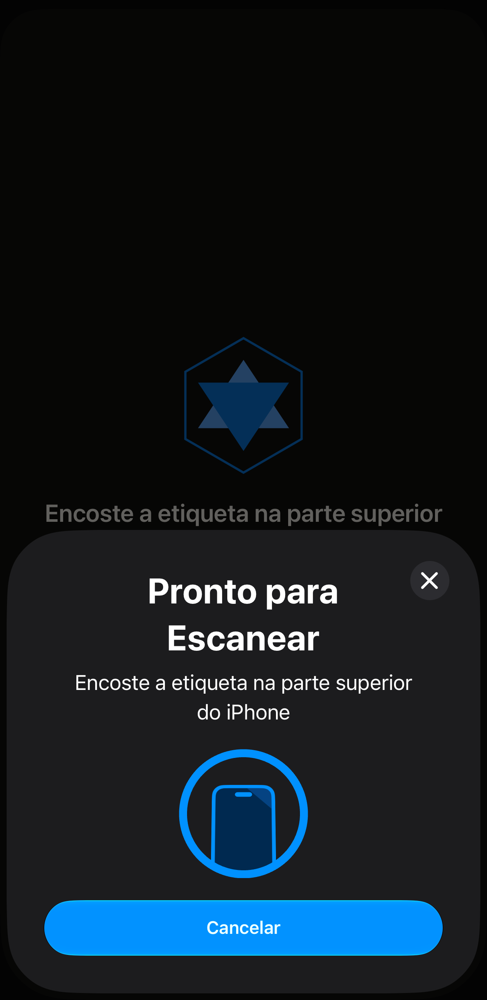
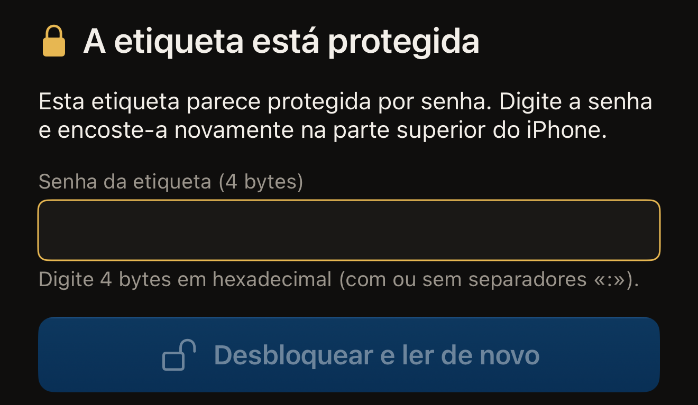
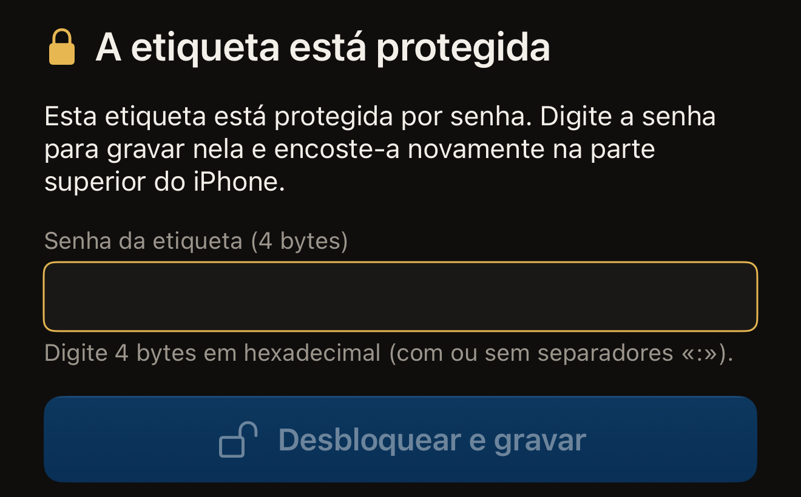

O Hex NFC lê uma etiqueta em uma única aproximação. Você toca em
**Escanear**, encosta a etiqueta na parte superior do iPhone, e o app mostra
qual chip encontrou e o que a etiqueta contém. A leitura só lê os dados, então
nada na etiqueta muda.

Uma etiqueta também pode ser configurada para exigir a senha antes de ser
lida. Uma etiqueta protegida assim se recusa a ser lida até que a senha seja
apresentada. Apresentar a senha exige duas aproximações em vez de uma. A
segunda metade desta página trata disso. A maioria das etiquetas protegidas
tem somente proteção contra gravação. Essas são lidas em uma aproximação, como
qualquer outra etiqueta. Se você nunca leu uma etiqueta,
[Ler sua primeira etiqueta](quick-start.md) mostra essa mesma aproximação
desde o início.

## Ler uma etiqueta

:::::steps
::::step[Abrir a tela de leitura]
Abra o app e toque em **Escanear** na tela inicial do Hex NFC. A tela de
leitura se abre com a frase “Encoste a etiqueta na parte superior do iPhone”.

:::figure[Enquanto o app espera uma etiqueta, o começo da linha dele aparece acima do painel do iOS, e Cancelar, no painel, interrompe a leitura.]

:::
::::

::::step[Encostar a etiqueta na parte superior do iPhone]
Encoste a parte superior do iPhone na etiqueta e mantenha-o parado. Enquanto a
etiqueta é lida, a tela mostra “Lendo…”.
::::

::::step[Ver o que o app encontrou]
“Etiqueta detectada” aparece com uma marca de confirmação, e o nome do chip
fica logo abaixo. Mais abaixo, o app diz o que leu. A linha “1 registro
encontrado” indica o número de registros na etiqueta. “Nenhum registro NDEF
nesta etiqueta” significa que a etiqueta está formatada, mas vazia. O UID da
etiqueta vem por último.
::::
:::::

O resultado fica na tela por cerca de um segundo, e depois o app abre a tela
**Etiqueta** com os registros listados, onde você pode alterá-los ou gravá-los
de novo. Nada do resultado se perde ali. O nome do chip é o título do cartão
de informações da etiqueta, e os registros são a lista abaixo dele. O UID é
uma linha desse cartão, e tocar nela copia o UID a qualquer momento. Cada
leitura também fica salva no seu histórico. Consulte
[Encontrar uma etiqueta que você leu antes](scan-history.md) e
[Editar os registros de uma etiqueta](edit-records.md).

Para parar antes que uma etiqueta seja lida, toque em Cancelar no painel do
iOS. A tela de leitura se fecha, e você volta à tela inicial do Hex NFC. Sem nenhuma etiqueta encostada no iPhone, o painel do iOS se fecha
sozinho depois de cerca de um minuto, e a tela de leitura mostra “Nenhuma
etiqueta encontrada”, com **Cancelar** e **Tentar de novo** abaixo.

Algumas etiquetas saem da tela de leitura por outro caminho. Um cartão de
transporte japonês abre um resultado próprio, somente leitura, descrito em
[Ler um cartão de transporte](transit-cards.md). Um passaporte eletrônico pede
primeiro os dados da página com a foto, como explica
[Ler um passaporte](passports.md). Um dispositivo de saúde NFC, como uma caneta
de insulina, abre a tela **Dispositivo de saúde**, somente leitura, e não é
salvo, como explica [Dispositivos de saúde](tags-that-work.md#health-devices).
Uma etiqueta protegida pede a senha, que é a próxima tarefa desta página.

Se o resultado disser “Esta etiqueta ainda não está formatada”, nada do que
você gravar na etiqueta poderá ser lido até que ela seja formatada.
[Apagar ou formatar uma etiqueta](erase-or-format.md) explica como fazer isso.

## Desbloquear uma etiqueta protegida {#unlock-a-protected-tag}

Uma etiqueta que exige a senha para ser lida interrompe a leitura. A tela de
leitura mostra “A etiqueta está protegida” acima desta frase: “Esta etiqueta
parece protegida por senha. Digite a senha e encoste-a novamente na parte
superior do iPhone.” Abaixo ficam o campo de senha, **Desbloquear e ler de
novo** e uma linha com **Cancelar** e **Tentar de novo**. A senha pertence à
etiqueta, não a uma conta, e só quem a definiu a conhece. A opção que produz
esse estado é **Exigir a senha também para ler**, descrita em
[Proteger uma etiqueta com senha](protect-a-tag.md).

:::::steps
::::step[Digitar a senha da etiqueta]
Em **Senha da etiqueta (4 bytes)**, digite a senha em caracteres
hexadecimais, de 0 a 9 e de A a F. Uma senha de 4 bytes tem 8 caracteres:
digite-a como `A1B2C3D4` ou como `A1:B2:C3:D4`, porque os dois-pontos entre os
bytes são opcionais e não contam para o comprimento. A observação abaixo do
campo mostra “OK” quando a entrada tem o comprimento certo.

:::figure[Uma etiqueta protegida interrompe a leitura em **Senha da etiqueta (4 bytes)**, e **Desbloquear e ler de novo** fica esmaecido até que a entrada tenha o comprimento certo.]

:::

Em um NTAG424 DNA, o campo se chama **Chave da etiqueta (AES, 16 bytes)**. Em
um MIFARE Ultralight C, ele se chama **Chave da etiqueta (3DES, 16 bytes)**.
Esses dois chips abrem com uma chave, não com uma senha. As duas chaves têm
16 bytes, ou seja, 32 caracteres.
::::

::::step[Iniciar a segunda aproximação]
Toque em **Desbloquear e ler de novo**. O botão fica esmaecido até que o que
você digitou tenha o comprimento certo para o chip.
::::

::::step[Encostar a etiqueta na parte superior do iPhone de novo]
O app apresenta a senha, lê a etiqueta e mostra “Etiqueta detectada”, como
faz com qualquer outra etiqueta.
::::
:::::

Uma senha que a etiqueta recusa leva você de volta a “A etiqueta está
protegida”, com a mensagem substituída por “Essa senha não desbloqueou a
etiqueta. Confira e tente de novo.” Em um NTAG424 DNA ou em um MIFARE
Ultralight C, a mensagem é “Essa chave não desbloqueou a etiqueta. Confira e
tente de novo.” Corrija a entrada e toque em **Desbloquear e ler de novo**
para uma nova aproximação. Uma senha recusada faz o chip parar de responder
pelo resto daquela aproximação. Cada tentativa é, de propósito, uma nova
aproximação. Para voltar a uma leitura comum, sem senha, toque em **Tentar de
novo**. **Cancelar** faz outra coisa: fecha a tela de leitura sem ler a
etiqueta, e o que você digitou é descartado. Nenhum dos dois altera a
etiqueta.

:::warning[Uma senha recusada pode custar uma tentativa]
Uma etiqueta pode ser configurada para aceitar só um certo número de senhas
incorretas antes de deixar de aceitar a senha para sempre. Em uma etiqueta que
informa esse limite, o app substitui a orientação acima pelo texto da própria
recusa. Conferir a senha de novo vale mais do que fazer outra tentativa.
Consulte [Limitar as tentativas incorretas de senha](attempt-limit.md).
:::

## Desbloquear uma etiqueta protegida antes de gravar nela

Uma gravação começa na tela **Etiqueta**. Uma etiqueta protegida chega à tela
**Etiqueta** pelo desbloqueio descrito acima. Termine essa leitura primeiro, e
o app abre a tela **Etiqueta** como faz com qualquer outra etiqueta. Dois
caminhos pulam essa leitura. Na tela **Biblioteca**, a aba **Histórico** lista as
etiquetas que você leu antes, e um toque em uma linha reabre aquela etiqueta
na tela **Etiqueta**. Na aba **Preajustes**, deslizar um preajuste da
esquerda para a direita mostra **Gravar**, que abre a tela de gravação na
hora, com os registros do preajuste.

Na tela **Etiqueta**, toque em **Gravar** na barra de ferramentas, e a tela de
gravação se abre. [Gravar um link em uma etiqueta](write-a-link.md) mostra uma
gravação do início ao fim; o que vem a seguir é o passo extra que uma etiqueta
protegida acrescenta.

A tela de gravação pede a senha de novo, mesmo em uma etiqueta que você
desbloqueou há pouco. Cada aproximação é uma sessão separada, e o app não leva
nenhuma senha de uma sessão para outra. Digitar a senha uma segunda vez é
normal e não indica que o desbloqueio falhou. Contando desde o início, uma
etiqueta protegida exige três aproximações: a leitura que ela recusa, a
leitura de desbloqueio que abre a tela **Etiqueta** e a gravação. A tela
mostra “A etiqueta está protegida” e depois pede a senha: “Esta etiqueta está
protegida por senha. Digite a senha para gravar nela e encoste-a novamente na
parte superior do iPhone.”

:::::steps
::::step[Digitar a senha na tela de gravação]
Em **Senha da etiqueta (4 bytes)**, digite a senha da etiqueta, os mesmos 8
caracteres hexadecimais que uma leitura pede. Nos dois chips que usam chave, o
campo pede uma chave em vez de uma senha, e uma chave tem 32 caracteres.

:::figure[Na tela de gravação, a mensagem pede a senha para gravar, e o botão mostra **Desbloquear e gravar** no lugar de **Desbloquear e ler de novo**.]

:::
::::

::::step[Iniciar a segunda aproximação da gravação]
Toque em **Desbloquear e gravar**. Se a gravação também alterar a proteção da
etiqueta, o botão mostra **Desbloquear e continuar**. Em seguida, o app mostra
o UID da etiqueta e pede que você o digite, abaixo de “Digite o UID desta
etiqueta para confirmar.”, antes de gravar. Consulte
[Proteger uma etiqueta com senha](protect-a-tag.md).
::::

::::step[Aproximar a etiqueta para gravar nela]
Encoste a etiqueta na parte superior do iPhone de novo. O app apresenta a
senha e depois grava.
::::
:::::

Uma recusa aqui também mostra “Essa senha não desbloqueou a etiqueta. Confira
e tente de novo.”, e a resposta é a mesma: confira o que você digitou e
aproxime a etiqueta de novo.

Uma leitura pode terminar em “Falha ao escanear”. Uma etiqueta que você
acredita estar em branco pode pedir senha. Em qualquer um dos casos, siga
[Se não for possível ler ou gravar uma etiqueta](troubleshooting.md).
