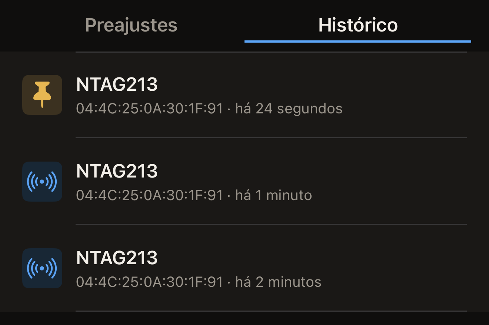

O Hex NFC guarda uma cópia das etiquetas que lê, para que você possa abrir uma
leitura de novo sem a etiqueta por perto. As leituras recentes ficam na
Biblioteca, no iPhone, das mais novas para as mais antigas. Fixe as que você
quiser manter.

## Abrir uma leitura feita antes

Você precisa de uma etiqueta que já tenha lido; até você ler uma, o
**Histórico** fica vazio. Consulte [Ler uma etiqueta](scan-a-tag.md).

:::::steps
::::step[Abrir o Hex NFC]
O app abre na tela inicial do Hex NFC, que tem os blocos **Escanear**, **Criar**,
**Biblioteca** e **Avançado**.
::::

::::step[Abrir a Biblioteca]
Toque em **Biblioteca**. A tela Biblioteca abre em **Preajustes**.
::::

::::step[Ir para as leituras]
No alto da tela Biblioteca, toque em **Histórico**, à direita de
**Preajustes**. O título de cada linha é o nome do chip, e logo abaixo vêm o
UID da etiqueta e há quanto tempo você a leu.

:::figure[Cada linha indica o chip, depois o UID da etiqueta e há quanto tempo você a leu, e um alfinete substitui o ícone em uma leitura fixada.]

:::
::::

::::step[Abrir a leitura]
Toque na leitura que você quer. A tela Biblioteca se fecha e a leitura abre na
tela Etiqueta, com os registros e os detalhes do chip da aproximação que a gerou.
::::
:::::

Já um cartão de transporte abre na tela Cartão de transporte, em modo
somente leitura, do mesmo jeito que abriu quando você leu o cartão. A leitura de um
passaporte nunca é salva, então nenhum passaporte aparece nesta lista. Consulte
[Ler um passaporte](passports.md). Um dispositivo de saúde também nunca é salvo.

## Fixar uma leitura que você quer manter

A lista guarda 50 leituras. Quando chega uma leitura nova e a lista está
cheia, a leitura não fixada mais antiga sai do fim da lista. Uma leitura não
fixada também é removida 90 dias depois da leitura que a gerou, por menor que
a lista esteja. Quando uma nova leitura da mesma etiqueta volta para uma linha que você
já tem, isso conta como uma leitura nova e os 90 dias recomeçam. Uma
leitura fixada fica fora das duas regras e permanece até você excluí-la.

As leituras aparecem das mais novas para as mais antigas, e nada na tela
permite buscá-las, então fixe as que você vai querer encontrar de novo.

- Para fixar uma leitura, deslize-a para a direita no **Histórico** e toque em
  **Fixar**.

Uma leitura fixada tem um alfinete à esquerda da linha, no lugar do ícone de
sempre. Ela mantém sua posição na lista em vez de ir para o topo. Em uma
leitura já fixada, a mesma ação de deslizar mostra **Desafixar**, e desafixar
coloca a leitura de volta na contagem das 50.

## Excluir uma leitura

- Para excluir uma leitura, deslize-a para a esquerda no **Histórico** e
  toque em **Excluir**. Deslizar até o fim exclui a leitura na hora.

:::warning
A leitura some no momento em que você toca em **Excluir**. Nada pede
confirmação, e não há como recuperá-la, embora ler a etiqueta de novo gere
uma nova leitura.
:::

## O que o histórico guarda

Antes de você ler qualquer coisa, o **Histórico** mostra “Nenhum histórico de
leitura”, acima da linha “As últimas 50 etiquetas que você ler aparecem aqui.
Fixe uma para mantê-la.”

- Ler a mesma etiqueta de novo, sem que nada nela tenha mudado, faz a leitura
  que você já tem voltar para o topo da lista. Não aparece uma segunda
  linha. Qualquer diferença nos detalhes do chip, nos registros ou na proteção
  por senha da etiqueta gera uma linha nova.
- As leituras ficam neste iPhone. Elas só chegam à sua conta do iCloud quando
  você ativa **Sincronizar com iCloud**, que vem desativado. Consulte
  [Privacidade e seus dados](privacy.md).

## Ver também

- [Ler uma etiqueta](scan-a-tag.md)
- [Editar os registros de uma etiqueta](edit-records.md)
- [Salvar uma etiqueta como preajuste](presets.md)
