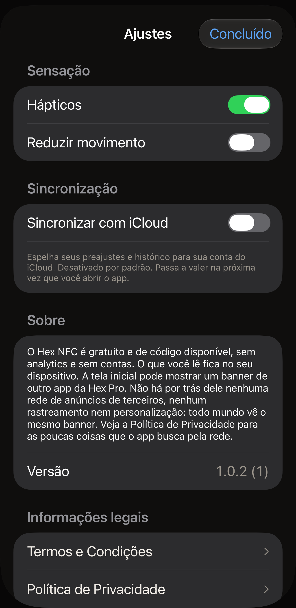

O Hex NFC tem três ajustes, que dividem uma mesma tela com o número de versão
do app, uma forma de enviar feedback ou avaliar o app, e os documentos
legais. Na tela inicial do Hex NFC, toque no botão de
engrenagem no canto superior direito; ele não tem texto, e o VoiceOver o lê
como **Ajustes**. O painel que se abre tem o título **Ajustes**. Os grupos
abaixo seguem a ordem em que a tela os mostra.

:::figure[O painel **Ajustes** abre em **Sensação** e **Sincronização**, com todos os botões de ativação no valor padrão.]

:::

## Sensação

:::table[Ajustes de Sensação]
| Ajuste | O que faz | Padrão |
| :--- | :--- | :--- |
| **Hápticos** | Faz o iPhone vibrar durante uma leitura, uma gravação e os outros momentos que o app destaca. Desativá-lo interrompe essas vibrações na hora. | Ativado |
| **Reduzir movimento** | Diminui as animações do app. :more[O app reduz o movimento quando este botão ou o ajuste Reduzir movimento do próprio iPhone está ativado, então desativar este não desfaz o ajuste do sistema.] | Desativado |
:::

Enquanto o ajuste Reduzir movimento do próprio iPhone estiver ativado, uma
linha abaixo da opção diz ‘“Reduzir movimento” está ativado no sistema: as
animações já estão no mínimo.’

## Sincronização

:::table[Ajustes de Sincronização]
| Ajuste | O que faz | Padrão |
| :--- | :--- | :--- |
| **Sincronizar com iCloud** | Espelha os seus preajustes e o seu histórico de leitura na sua conta do iCloud. As senhas das etiquetas nunca são espelhadas. Elas ficam no Chaveiro do iPhone que as definiu. | Desativado |
:::

O Hex NFC monta a biblioteca uma única vez, ao ser aberto, então ativar ou
desativar **Sincronizar com iCloud** não muda nada até você fechar o app e
abri-lo de novo. A linha abaixo da opção avisa isso. Fechar significa
encerrar o app. Voltar para a Tela de Início do iPhone deixa o Hex NFC
aberto, e o botão que você mudou continua sem efeito.

### Ativar a sincronização com o iCloud {#turn-on-icloud-sync}

::::steps
:::step[Abrir Ajustes]
Na tela inicial do Hex NFC, toque no botão de engrenagem no canto superior
direito.
:::

:::step[Ativar a sincronização com o iCloud]
Ative **Sincronizar com iCloud**. O botão muda de posição, e nada mais muda
por enquanto.
:::

:::step[Fechar o Hex NFC e abri-lo de novo]
Siga [Fechar e reabrir o app](#close-and-reopen-the-app). O app monta a
biblioteca de novo ao iniciar, desta vez com a sincronização funcionando.
:::

:::step[Verificar se há um aviso]
Toque no botão de engrenagem de novo e olhe abaixo de
**Sincronizar com iCloud**. A explicação ali diz “Espelha seus preajustes e
histórico para sua conta do iCloud. Desativado por padrão. Passa a valer na
próxima vez que você abrir o app.” Se houver um segundo parágrafo depois dela,
a sincronização não começou; consulte
[Quando a sincronização não começa](#when-sync-does-not-start).
:::
::::

### Fechar e reabrir o app {#close-and-reopen-the-app}

::::steps
:::step[Fechar o Hex NFC]
Deslize para cima a partir da borda inferior da tela e espere até que os apps
abertos apareçam. Em um iPhone com botão Início, pressione duas vezes o botão
Início. Depois, deslize para cima o cartão do Hex NFC, e ele sai da
tela.
:::

:::step[Abrir o Hex NFC de novo]
Toque no ícone do Hex NFC. O app monta a biblioteca de novo ao iniciar, com
**Sincronizar com iCloud** do jeito que estava quando você o fechou.
:::
::::

Desativar **Sincronizar com iCloud** também exige fechar e reabrir o app. Nos
dois casos, os seus preajustes e o seu histórico continuam neste iPhone. O
Hex NFC não apaga o que o iCloud já tem. Outro iPhone conectado à mesma conta
mantém tudo o que já recebeu. O que para é o envio de novas alterações a
partir deste iPhone.

### Quando a sincronização não começa {#when-sync-does-not-start}

Se o botão está ativado e o iCloud estava fora de alcance quando o app foi
iniciado, a sincronização não começa. Uma segunda linha aparece abaixo da
opção: “A sincronização não está funcionando. Sua biblioteca está segura
neste dispositivo, mas o iCloud não estava disponível quando o app foi
iniciado. Verifique se você entrou no iCloud e abra o app novamente.” Os seus
preajustes e o seu histórico continuam no iPhone. Só o espelhamento parou.

Três coisas fazem essa linha aparecer:

- O iPhone não tem uma sessão iniciada no iCloud.
- A conta não tem mais espaço livre no iCloud.
- O iPhone estava sem rede quando o Hex NFC foi iniciado.

Verifique cada uma, nesta ordem.

::::steps
:::step[Verificar a conta do iCloud]
Abra o app Ajustes do iPhone e toque no seu nome, no topo. Inicie a sessão se
isso for pedido, depois toque na linha iCloud e veja quanto espaço resta. Se
não restar nenhum, libere espaço ou mude o plano de armazenamento nessa
mesma tela.
:::

:::step[Verificar a rede]
Confira se o iPhone está conectado ao Wi-Fi ou aos dados móveis. Abrir uma
página no Safari tira a dúvida.
:::

:::step[Fechar o Hex NFC e abri-lo de novo]
Deixe **Sincronizar com iCloud** ativado e siga
[Fechar e reabrir o app](#close-and-reopen-the-app); depois, toque no botão de
engrenagem na tela inicial do Hex NFC. Se ainda houver um segundo parágrafo
abaixo de **Sincronizar com iCloud**, a sincronização ainda não começou.
:::
::::

## Sobre

A seção Sobre diz o que o app faz e o que não faz: não há analytics nem
contas, e o que você lê fica no seu dispositivo. Ela também fala do banner
que a tela inicial do Hex NFC pode mostrar para outro app da Hex Pro. Não há por trás
desse banner nenhuma rede de anúncios de terceiros, nenhum rastreamento e
nenhuma personalização. Todo mundo vê o mesmo banner. Para as poucas coisas
que o app busca pela rede, leia [Privacidade e seus dados](privacy.md).

Abaixo desse parágrafo, **Versão** mostra o número de versão do app seguido
do número da compilação entre parênteses.

## Feedback e avaliações {#feedback-and-ratings}

**Enviar feedback**, abaixo de **Versão**, abre um formulário para escrever uma
mensagem à Hex Pro.

1. Digite na caixa de mensagem o que não está certo ou o que poderia melhorar.
2. Para receber uma resposta, informe o seu e-mail em
   **Endereço para resposta (opcional)**. Se deixar o campo vazio, a mensagem
   vai sem endereço.
3. Confira a lista em **Enviado com sua mensagem**. Ela mostra a versão do app,
   a versão do iOS, o modelo do dispositivo e o idioma que acompanham a sua
   mensagem. Nada das suas etiquetas, das suas leituras ou do seu histórico de
   leitura é enviado.
4. Toque em **Enviar** no canto superior direito.

O formulário agradece assim que a mensagem sai. Se não conseguir falar com a
Hex Pro, ele guarda o que você digitou e oferece **Enviar por e-mail**, que
abre o seu app de e-mail com a mensagem e os mesmos dados já preenchidos.

**Avaliar o Hex NFC** abre a página do app na App Store, onde você pode dar uma
nota ou escrever uma avaliação.

De vez em quando, a tela inicial do Hex NFC pergunta **Curtindo o Hex NFC?** em
um cartão junto à borda inferior. Ele só aparece depois de algumas gravações ou
mudanças de proteção bem-sucedidas, ou depois da leitura de um cartão de
transporte ou de um passaporte inteiro, e só quando nenhuma das suas leituras
recentes falhou. Ele espera a tela inicial ficar dez segundos sem nenhum toque,
volta no máximo uma vez por mês e nunca cobre nada de que você precise: a tela
acima dele continua rolando e todos os botões funcionam.

Toque em **Amei!** e o painel de avaliação da Apple aparece, quando o iOS
decide mostrá-lo. Toque em **Mais ou menos.** e o cartão oferece
**Enviar feedback** no lugar. Qualquer uma das respostas é definitiva, e o
cartão não pergunta de novo. **Ocultar** guarda o cartão por um mês, e abrir
qualquer coisa a partir da tela inicial enquanto ele está à vista tem o mesmo
efeito.

## Informações legais

**Termos e Condições** e **Política de Privacidade** abrem cada um o documento
completo em um cartão de leitura, que você rola e depois fecha com
**Concluído**. Cada cartão traz duas linhas acima do primeiro título: a data
em que essa versão entrou em vigor e “Ars Vitae Pty Ltd, trading as Hex Pro
(Australia)”. Os dois documentos estão em inglês, qualquer que seja o idioma
do restante do app.

Os Termos dizem quanto o app custa, na seção intitulada “3. The app is free”,
e a página [Perguntas frequentes](faq.md) também responde a isso. A Política de
Privacidade é o documento por trás de [Privacidade e seus dados](privacy.md).

## Ver também

- [Salvar uma etiqueta como preajuste](presets.md)
- [Encontrar uma etiqueta que você leu antes](scan-history.md)
- [Privacidade e seus dados](privacy.md)
