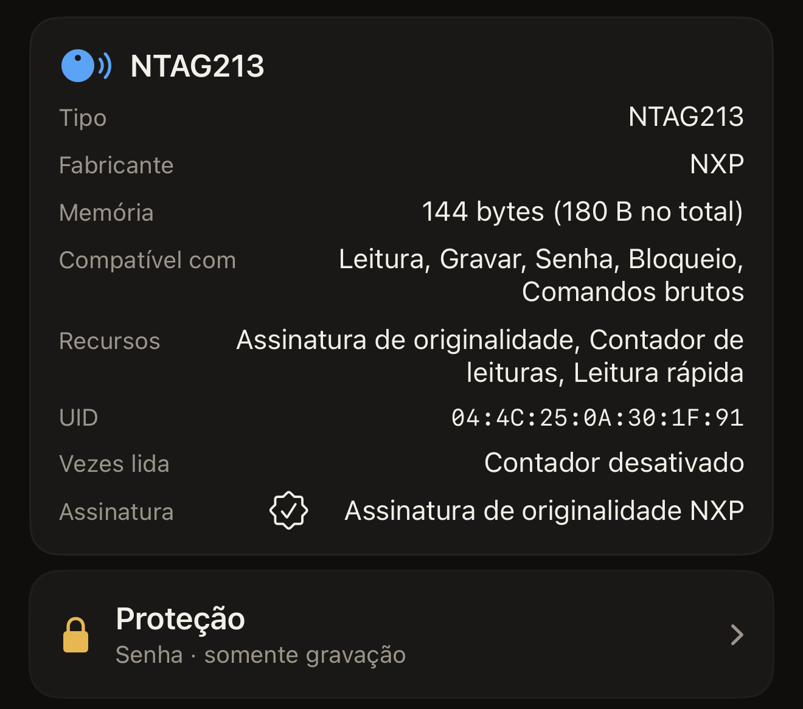

Uma etiqueta colada em um cartaz responde a qualquer telefone que se aproxime
dela, e um chip sem proteção deixa qualquer um deles sobrescrever o que você
gravou. A proteção é a resposta do próprio chip a esse problema. O segredo fica
nas páginas de configuração do chip, e o chip recusa qualquer alteração até que
o segredo seja apresentado. O Hex NFC pode definir esse segredo pelo iPhone,
apresentá-lo em uma leitura posterior e removê-lo depois. A proteção pertence à
etiqueta, não ao app.

## O que uma etiqueta protegida recusa

Por padrão, a proteção cobre a gravação. Uma etiqueta protegida dessa forma
continua podendo ser lida por qualquer telefone, que é o que você quer em um
cartaz ou em um cartão de visita. As pessoas aproximam o telefone e recebem o
link, e ninguém mais altera o conteúdo. Duas famílias de chips podem estender a
proteção também à leitura, o que muda o que qualquer leitura posterior consegue
fazer.

Leia a etiqueta, como mostra [Ler uma etiqueta](scan-a-tag.md). Em um chip compatível com proteção, a tela
Etiqueta abre com dois cartões. O cartão de informações da etiqueta mostra o
nome do chip que está na sua mão. A proteção fica no cartão **Proteção**. Toque
em **Proteção** e o painel de mesmo nome se abre com as configurações.
[Proteger uma etiqueta com senha](protect-a-tag.md) explica passo a passo como
configurar uma proteção.

A proteção contra leitura é exclusiva de duas famílias. Em um NTAG213, NTAG215,
NTAG216 ou MIFARE Ultralight EV1, a opção é **Exigir a senha também para ler**,
em **Avançado**. Ativá-la estende a proteção à leitura. O painel deixa a
consequência bem clara: “Etiquetas protegidas contra leitura não podem ser
lidas de volta, nem para verificação, sem a senha.” Em um NTAG424 DNA, a opção
é **Exigir a chave também para ler**. Ela fica ao lado da própria chave, e não
em **Avançado**. Um ICODE SLIX2 e um MIFARE Ultralight C não têm essa opção: o
segredo deles cobre a gravação, e a leitura continua livre.

O cartão **Proteção** na tela Etiqueta traz um resumo, em uma linha, do que a
leitura encontrou. “Desativada” significa que a leitura confirmou que não há
nenhum segredo definido. “Senha · somente gravação” significa que a gravação
está protegida e a leitura está livre, e “Senha · leitura e gravação”
significa que as duas estão protegidas. A quarta resposta é “Desconhecida ·
não foi possível ler a proteção desta etiqueta”, que não é o mesmo que
“Desativada”: a etiqueta não informou. Leia a etiqueta de novo, porque uma
aproximação interrompida antes da hora deixa o app sem resposta. Um chip cuja
proteção o app não consegue consultar dá a mesma resposta todas as vezes. Mesmo
assim, é seguro tentar gravar nessa etiqueta. Uma etiqueta protegida recusa a
gravação, e a tela de gravação pede o segredo em vez de alterar qualquer coisa.
Ao ler uma etiqueta protegida contra leitura sem ter a senha em mãos, aparece
“Esta etiqueta precisa da senha antes de mostrar qualquer coisa.”

:::figure[O cartão de informações da etiqueta mostra o nome do chip, e o cartão **Proteção**, logo abaixo, traz o resumo, aqui “Senha · somente gravação”.]

:::

## Quais chips podem ter um segredo

O formato do segredo depende do chip, assim como o campo em que o app o pede.
Esse campo fica no pedido de desbloqueio, que aparece quando uma etiqueta recusa
o acesso. Uma etiqueta protegida que não responde a uma leitura mostra “A
etiqueta está protegida” acima do campo, com **Desbloquear e ler de novo**
abaixo dele. Uma gravação em uma etiqueta protegida faz o mesmo pedido antes de
prosseguir.

:::table[Como é o segredo de cada família de chips]
| Chip | O segredo | O campo no pedido de desbloqueio |
| --- | --- | --- |
| NTAG213, NTAG215, NTAG216, MIFARE Ultralight EV1 | Uma senha de 4 bytes | **Senha da etiqueta (4 bytes)** |
| NTAG424 DNA | Uma chave AES de 16 bytes | **Chave da etiqueta (AES, 16 bytes)** |
| MIFARE Ultralight C | Uma chave 3DES de 16 bytes, somente gravação | **Chave da etiqueta (3DES, 16 bytes)** |
| ICODE SLIX2 | Uma senha de 4 bytes, somente gravação | **Senha da etiqueta (4 bytes)** |
:::

Cada um desses campos recebe o segredo em hexadecimal, com dois caracteres por
byte: 8 caracteres para uma senha de 4 bytes e 32 para uma chave de 16 bytes.
Espaços ou dois-pontos entre os bytes são aceitos, assim como letras maiúsculas
ou minúsculas, então `FF FF FF FF` e `ffffffff` são a mesma senha digitada de
duas formas. O campo mostra “OK” quando recebe o número certo de bytes e, até
lá, repete quantos bytes precisa.

Um chip lido que não tem nenhum mecanismo de senha não ganha o cartão
**Proteção**, a menos que a leitura encontre bits de bloqueio gravados. Um
resultado de bloqueio traz o cartão de volta para exibi-lo. Ele mostra
“Bloqueada permanentemente”, “Parcialmente bloqueada · parte desta etiqueta é
somente leitura para sempre” ou “Bloqueio gravado · escaneie novamente para
confirmar”. Em uma etiqueta bloqueada, o cartão informa o resultado sem se
abrir. O cartão também aparece na tela Etiqueta antes de qualquer etiqueta ser
lida, e é assim que um preajuste recebe configurações de proteção. O cartão de
informações da etiqueta continua mostrando qual chip você está segurando.
[Etiquetas que funcionam com o Hex NFC](tags-that-work.md) explica o que mais
cada um pode fazer. O panorama completo, chip por chip, está na
[matriz de compatibilidade de chips](../developer/chip-support-matrix.md).

Uma proteção contra leitura em um MIFARE Ultralight C esconde justamente as
páginas pelas quais o app identifica o chip. Uma etiqueta configurada assim
nunca mais seria reconhecida, muito menos desbloqueada. O app deixa esse limite
de somente gravação explícito: “O Hex NFC pode proteger esta etiqueta contra
gravação, mas não contra leitura.”

## Por que uma senha perdida não tem volta

Nada no segredo de uma etiqueta pode ser recuperado de fora. Para uma senha de
4 bytes, o próprio aviso do app diz tudo: “Se você perder a senha, a memória
protegida se perde. Não há recuperação.” Os chips com chave dizem o mesmo com
mais palavras: “Se você perder esta chave, nunca mais poderá regravar esta
etiqueta. Não existe redefinição de fábrica para um NTAG424. Guarde-a em
segurança.” e “Se você perder esta chave, a memória protegida nunca mais poderá
ser regravada. O Ultralight C não tem redefinição de fábrica. Guarde-a em
segurança.” Uma senha de SLIX2 só pode ser redefinida com a apresentação da
senha atual, então perdê-la termina do mesmo jeito.

O Hex NFC guarda o segredo que você salva com um preajuste em um único lugar:
“O segredo fica guardado apenas neste dispositivo (Chaveiro). Ele nunca
sincroniza nem viaja em uma exportação.” Por isso, um preajuste compartilhado
com outra pessoa, ou restaurado em outro iPhone, chega sem a senha.
[Salvar uma etiqueta como preajuste](presets.md) explica o que isso significa
quando você reutiliza um preajuste em várias etiquetas. Guarde a sua própria
cópia em um lugar de confiança.

## Alterar a proteção exige duas aproximações

::include[two-tap-confirmation]

Você não precisa procurar esse UID. O app o mostra ao lado do campo, abaixo de
“Digite o UID desta etiqueta para confirmar.”, como uma sequência simples de
caracteres hexadecimais, sem separadores. Tanto maiúsculas quanto minúsculas
são aceitas. Definir um segredo e removê-lo são duas alterações na etiqueta,
então ambas passam por essa confirmação.

## Ver também

- [Ler uma etiqueta](scan-a-tag.md)
- [Proteger uma etiqueta com senha](protect-a-tag.md)
- [Remover a senha de uma etiqueta](remove-password.md)
- [Limitar as tentativas incorretas de senha](attempt-limit.md)
- [Bloquear uma etiqueta permanentemente](permanent-lock.md)
