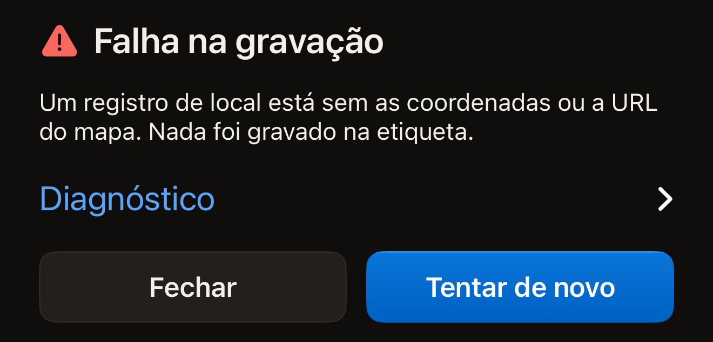
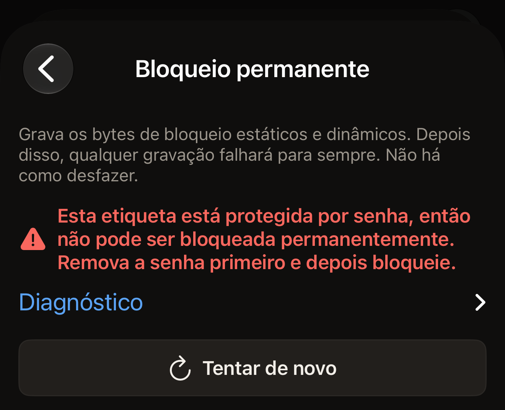

Quase toda leitura que falha é uma etiqueta que se mexeu. Encoste a parte
superior do iPhone na etiqueta, bem rente, mantenha-o parado por cerca de um
segundo e toque em **Tentar de novo**.

O Hex NFC descreve o que deu errado em uma frase em vez de mostrar um código.
Procure abaixo a frase que você viu. Logo abaixo de cada mensagem de falha há
uma linha fechada chamada **Diagnóstico**, com uma pequena seta à direita.
Toque na linha e os detalhes técnicos se abrem embaixo dela.

## Encontrar sua mensagem

- [Tempo esgotado, etiqueta perdida no meio da leitura ou leitura cancelada](#scan-stopped)
- [MIFARE Classic, sem NFC neste dispositivo, uma versão não autorizada, uma
  operação que a etiqueta não aceita ou um dispositivo de saúde](#tag-not-readable)
- [Registros grandes demais, ou a etiqueta devolveu algo diferente](#write-failed)
- [Outra etiqueta, depois que você digitou o UID de uma etiqueta](#different-tag)
- [Uma verificação de senha que não terminou](#password-check)
- [Ocorreu um erro inesperado](#unexpected)

## Tentar isto primeiro

- Encoste a parte superior do iPhone na etiqueta, e não o meio da parte de
  trás.
- Tire o iPhone de uma capa de metal e afaste a etiqueta de qualquer
  superfície metálica.
- Mantenha a etiqueta e o iPhone parados juntos até o app responder.
- Teste uma segunda etiqueta. Se a segunda for lida, é a primeira etiqueta que
  precisa ser examinada.

## O que significa “Falha ao escanear”? {#scan-failed}

“Falha ao escanear” é o título que aparece sobre uma leitura que o app não
conseguiu concluir. A frase abaixo dele informa o motivo, e as seções a seguir
estão agrupadas por esse motivo.

::::steps
:::step[Abrir o diagnóstico]
Toque em **Diagnóstico**, a linha logo abaixo da mensagem. Os detalhes se abrem
embaixo, e o texto pode ser selecionado para que você o copie.
:::

:::step[Iniciar uma nova leitura]
Toque em **Tentar de novo**. A tela de leitura abre uma nova sessão e espera
com “Encoste a etiqueta na parte superior do iPhone”.
:::

:::step[Manter a etiqueta parada]
Encoste a parte superior do iPhone na etiqueta, bem rente, e mantenha-o ali
até o app responder.
:::
::::

## Por que a leitura parou no meio? {#scan-stopped}

“O tempo de leitura se esgotou. Mantenha a etiqueta firme na parte superior do
telefone e tente de novo. Se o tempo se esgotar sempre com uma mesma etiqueta,
pode ser uma MIFARE Classic, que o iPhone não consegue ler (uma limitação do
iOS, não um defeito da etiqueta).”

O iOS encerrou a sessão porque nenhuma etiqueta respondeu antes que o tempo
da sessão se esgotasse. Você vê essa frase quando o iPhone já tinha encontrado uma
etiqueta na mesma tela, por exemplo na segunda aproximação de uma etiqueta
protegida, ou quando uma tentativa anterior nessa tela terminou em erro. Passe
a parte superior do iPhone devagar sobre a etiqueta e deixe-o ali.

Quando o iPhone não encontra nenhuma etiqueta, a tela mostra, em vez disso,
“Nenhuma etiqueta encontrada”, com **Tentar de novo** logo abaixo. Isso não é
uma falha, então não há diagnóstico abaixo. A solução é a mesma: encoste a
parte superior do iPhone na etiqueta, bem rente, e mantenha-o parado.

Uma etiqueta que começa a responder e depois para recebe outra frase: “A
etiqueta se perdeu no meio da leitura. Mantenha-a encostada na parte superior
do telefone e tente de novo.” A etiqueta saiu do campo no meio de um comando.

“Leitura cancelada.” significa que a leitura foi fechada antes de terminar,
por você ou pelo app. Ela aparece depois que o iPhone já encontrou uma
etiqueta na mesma tela, ou depois que uma tentativa anterior ali terminou em
erro. Fechar o painel do iOS antes de encontrar alguma etiqueta só fecha o
painel, sem mensagem. Uma leitura só lê, então nada mudou na etiqueta.

## Por que o iPhone não consegue ler esta etiqueta de forma alguma? {#tag-not-readable}

Três mensagens dizem que a leitura não pode acontecer de forma alguma, seja
qual for a maneira de segurar a etiqueta. Outras duas também aparecem aqui, e
nenhuma delas é uma falha de leitura.

“Parece uma etiqueta MIFARE Classic. O iPhone a detecta, mas não consegue ler
sua memória criptografada: o iOS não expõe as chaves MIFARE Classic que
qualquer app precisaria.” O chip respondeu o suficiente para o app reconhecer
a família. Não foi além disso.

:::important[Nenhum app no iPhone lê uma MIFARE Classic]
O iOS não entrega a nenhum app as chaves que desbloqueiam a memória desse
chip, então nenhum ajuste do Hex NFC muda o resultado. Use, no lugar dela, uma
etiqueta de [Etiquetas que funcionam com o Hex NFC](tags-that-work.md).
:::

“Este dispositivo não é compatível com NFC.” O app não conseguiu abrir nenhuma
sessão NFC neste iPhone. O iPhone não tem nenhum botão de ativação de NFC que
possa ser ativado de novo. Nenhum ajuste do Hex NFC muda isso. Segurar a
etiqueta de outro jeito não vai ajudar. [Perguntas frequentes](faq.md)
explica do que o app precisa para funcionar. Se a mensagem aparecer em um
iPhone em que o Hex NFC funciona normalmente, abra **Diagnóstico** e copie o
texto. Envie-o como explica
[Se você precisar de mais ajuda](#if-you-need-more-help).

“Esta versão ainda não está autorizada para esse tipo de etiqueta.” A sua
cópia do app não está registrada para ler esse tipo de etiqueta. Nada na
etiqueta nem na forma como você a segura muda isso. Primeiro, procure na App
Store uma atualização do Hex NFC. Se a mensagem voltar, abra **Diagnóstico** e
envie o texto como explica
[Se você precisar de mais ajuda](#if-you-need-more-help).

“Esta etiqueta não é compatível com essa operação.” é a mensagem que não tem a
ver com leitura. A etiqueta foi lida. O que ela não faz é a operação que você
pediu, pelo caminho que você escolheu. O cartão de informações da etiqueta
mostra o nome do chip. Quando o chip informa esses dados, as linhas
**Compatível com** e **Recursos** dizem o que ele consegue fazer.

**Operações** > **Proteger com senha** e o cartão **Proteção** na tela Etiqueta
protegem os mesmos sete chips: NTAG213, NTAG215, NTAG216, MIFARE Ultralight EV1,
MIFARE Ultralight C, NTAG424 DNA e ICODE SLIX2.
[Proteger uma etiqueta com senha](protect-a-tag.md) mostra os dois caminhos. [Etiquetas que funcionam com o Hex NFC](tags-that-work.md)
trata dos chips que o app reconhece. A
[matriz de compatibilidade de chips](../developer/chip-support-matrix.md) traz
todos os detalhes técnicos, chip por chip.

“Este é um dispositivo de saúde. O Hex NFC nunca grava em dispositivos de saúde
nem envia comandos a eles.” significa que o que você aproximou é um dispositivo
médico, como uma caneta de insulina. Uma gravação, uma operação ou um comando do
console do **Avançado** dirigido a ele para antes que qualquer coisa seja gravada
ou que o seu comando saia, então o dispositivo não muda. Escaneá-lo com
**Escanear** abre a tela **Dispositivo de saúde**, descrita em
[Dispositivos de saúde](tags-that-work.md#health-devices).

## O que significa “Falha na gravação”? {#write-failed}

“Falha na gravação” é o título que aparece sobre uma gravação, uma releitura
ou uma alteração de proteção que não terminou. Três controles ficam abaixo
dele. **Diagnóstico** contém os detalhes, **Fechar** leva você de volta ao
editor, e **Tentar de novo** executa a gravação outra vez, mantendo a senha
que você digitou. Em uma gravação iniciada na tela Etiqueta que ativa ou
desativa a proteção, a nova tentativa lê o UID da etiqueta de novo. Ela pede
que você o digite uma segunda vez. O seu consentimento para alterar uma
etiqueta não vale depois de uma falha. Um preajuste gravado a partir da tela
**Biblioteca** não é confirmado dessa forma: a etiqueta que você aproximar,
seja qual for, é a instrução, então a nova tentativa volta direto a uma única
aproximação.

:::figure[Uma gravação que falhou informa o motivo abaixo de “Falha na gravação”, com **Diagnóstico** embaixo e **Fechar** ao lado de **Tentar de novo**.]

:::

Duas das mensagens têm uma solução própria.

“Estes registros são grandes demais para esta etiqueta.” Os seus registros
precisam de mais espaço do que a área de dados do chip comporta. Encurte ou
remova um registro, ou grave em uma etiqueta com mais memória.
[Tipos de registro](record-types.md) mostra quanto espaço cada tipo de
registro ocupa.

“A etiqueta devolveu algo diferente do que foi enviado. Tente gravar de novo.”
O app releu a etiqueta depois de gravar, e os bytes não correspondiam ao que
ele tinha enviado. Toque em **Tentar de novo** com a etiqueta parada.

## Por que a etiqueta foi recusada depois que eu digitei o UID dela? {#different-tag}

::include[two-tap-confirmation]

“Essa é outra etiqueta.” significa que a etiqueta que você aproximou não é a
que o app esperava. A linha **Diagnóstico** informa qual aproximação gerou a
mensagem e qual etiqueta era esperada.

Na tela **Operações**, ela aparece na segunda aproximação. A etiqueta que você
aproximou não é aquela cujo UID você digitou. Aproxime a mesma etiqueta de
novo ou recomece com a etiqueta que você queria alterar.

Uma alteração de proteção feita na tela Etiqueta pode gerá-la em qualquer uma
das duas aproximações. Na segunda aproximação, ela significa a mesma coisa. Na
primeira, nada foi digitado ainda. Nesse caso, a etiqueta que você aproximou
não é a etiqueta a partir da qual o editor foi aberto. Aproxime aquela
etiqueta, e não esta.

Na tela **Operações**, uma operação que falhou mostra a mensagem, depois
**Diagnóstico** logo abaixo e, mais abaixo, **Tentar de novo**. Duas telas
substituem esse botão: **Limite de tentativas** mostra **Começar de novo**, e
**Remover senha** mostra **Digitar outra senha**. Cada uma pede a senha de
novo, então a próxima tentativa envia o que você digitar em seguida, e não a
senha que a etiqueta acabou de recusar.

:::figure[Na tela **Bloqueio permanente**, um bloqueio recusado mostra a mensagem, depois **Diagnóstico** e depois **Tentar de novo**.]

:::

## E se a verificação da senha não terminar? {#password-check}

“Não foi possível verificar a senha: a etiqueta parou de responder. Mantenha-a
parada na parte superior do telefone e tente de novo.” A etiqueta ficou em
silêncio enquanto o app verificava a senha. Nada ficou decidido sobre ela,
nem num sentido nem no outro. O app não está dizendo que a senha está errada.
Mantenha a etiqueta parada e execute a operação de novo.
[Remover a senha de uma etiqueta](remove-password.md) trata da senha que de
fato não abre mais uma etiqueta.

## Por que uma mensagem diz que ocorreu um erro inesperado? {#unexpected}

“Ocorreu um erro inesperado.” aparece na tela de leitura, na tela de gravação
e na tela **Operações**. Ela aparece quando o app não reconhece a falha
como um erro da etiqueta. “Aconteceu algo inesperado. Tente de novo.”
vem da camada NFC pelo mesmo motivo.

Outras duas descrevem uma etiqueta que responde de uma forma que o app não
esperava:

- “A etiqueta respondeu fora do protocolo esperado.”
- “A etiqueta respondeu com dados que este app não conseguiu interpretar.”

As quatro pedem o mesmo próximo passo. Abra **Diagnóstico**, copie o texto e
aproxime a etiqueta de novo. Quando a mesma mensagem voltar para a mesma
etiqueta, o diagnóstico copiado identifica o problema.

## Se você precisar de mais ajuda {#if-you-need-more-help}

Envie o diagnóstico copiado para a Hex Pro pelo app: na tela inicial, toque no
botão de engrenagem e depois em **Enviar feedback**, e cole-o na mensagem.
Inclua o nome do chip se a etiqueta chegou a ser lida o bastante para mostrar
um cartão de informações. Se ela nunca foi lida, diga isso, e diga quais
etiquetas são lidas e quais não são. O formulário inclui sozinho a versão do
app, a versão do iOS, o modelo do dispositivo e o idioma. Para receber
resposta, coloque seu e-mail em **Endereço para resposta (opcional)**.
[Feedback e avaliações](settings.md#feedback-and-ratings) descreve o
formulário.

Você também pode escrever para `support@hex.pro`, o endereço que aparece na
**Política de Privacidade** e nos **Termos e Condições**, em
**Informações legais** nos **Ajustes**. Por e-mail, inclua a versão do app que
aparece em **Versão** nos **Ajustes**, e o modelo do iPhone e a versão do iOS,
que o app Ajustes do iPhone mostra em Geral e depois em Sobre.

Em seguida, leia [Ler uma etiqueta](scan-a-tag.md) para ver como é uma leitura
que dá certo, ou [Perguntas frequentes](faq.md) para saber do que o app
precisa para funcionar.
