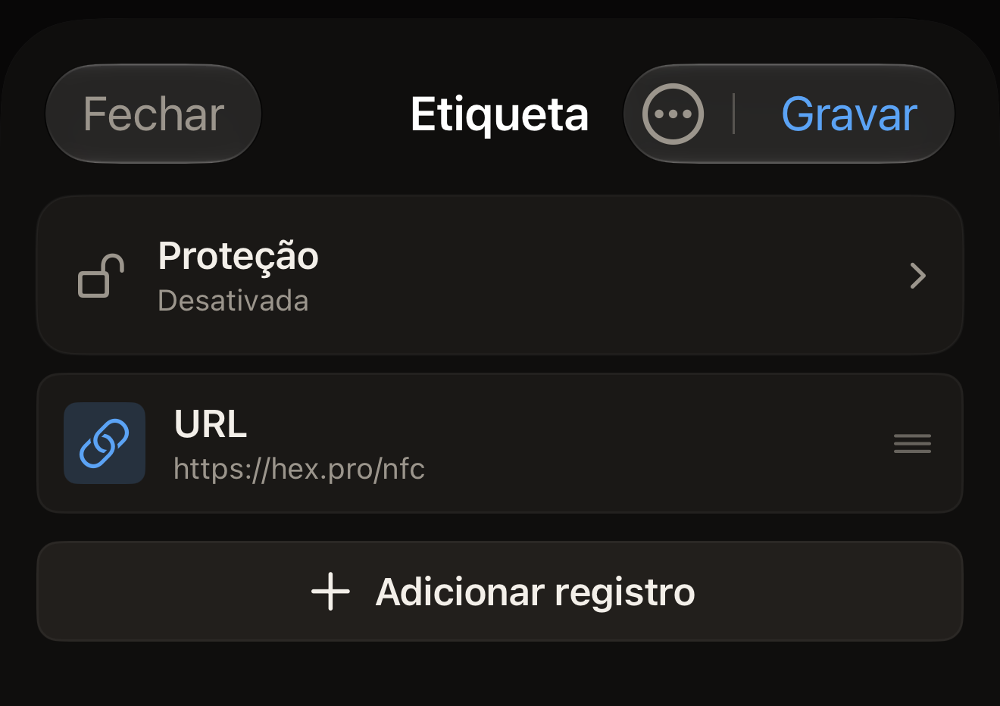
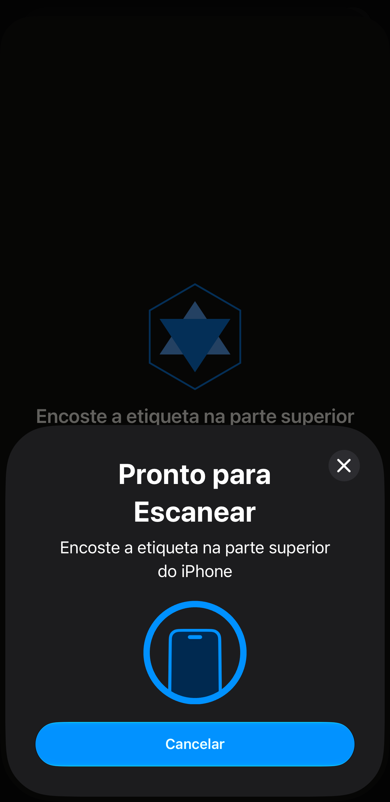

Uma etiqueta pode conter o endereço de um site, e o telefone que lê a
etiqueta recebe a sugestão de abrir esse endereço. No Hex NFC, o endereço é
um registro URL. Você monta o registro no iPhone e depois encosta a etiqueta
nele uma vez para transferir o registro.

Antes de começar, tenha a etiqueta à mão. Se você não tiver certeza de que uma
etiqueta ainda aceita gravação, leia-a primeiro, como descreve
[Ler uma etiqueta](scan-a-tag.md). A leitura abre a tela Etiqueta. Ali,
**Gravar** fica disponível em uma etiqueta que ainda aceita gravação. O botão
fica esmaecido em uma etiqueta que o app, ao ler, identifica como bloqueada
permanentemente, já que ela recusa qualquer gravação. Toque em **Fechar** para
sair dessa tela e voltar à tela inicial do Hex NFC, e então comece pelo passo 1.

## Gravar um link em uma etiqueta em branco

:::::steps
::::step[Começar uma nova montagem]
Na tela inicial do Hex NFC, toque em **Criar**. A tela Etiqueta se abre sem
registros, sob o título “Etiqueta vazia”.
::::

::::step[Adicionar um registro URL]
Toque em **Adicionar registro** > **URL**. O editor de registro se abre no
novo registro.
::::

::::step[Digitar o endereço]
Em **URL**, digite o endereço com o esquema no início, por exemplo
`https://hex.pro`, e toque em **Salvar**. O registro aparece na lista. O app
grava o endereço exatamente como você o digitou e não acrescenta nada. Um
endereço que chega à etiqueta sem o `https://` não é um link que funcione. O
telefone que ler essa etiqueta não tem nenhuma página para abrir.

:::figure[Depois que você toca em **Salvar**, a tela Etiqueta mostra o novo registro **URL**, e **Gravar**, no canto superior direito, está pronto para ser tocado.]

:::
::::

::::step[Enviar o registro para a etiqueta]
Toque em **Gravar**, no topo da tela Etiqueta. A tela de gravação se abre com
a frase “Encoste a etiqueta na parte superior do iPhone”. O iOS coloca o
próprio painel sobre o app, com a mesma frase.

:::figure[O começo da linha da tela de gravação continua visível acima do painel do iOS, que repete a frase e tem o próprio botão Cancelar.]

:::
::::

::::step[Encostar a etiqueta no iPhone]
Encoste a parte superior do iPhone na etiqueta e mantenha-o ali. A tela
mostra “Gravando…” e depois “Verificando…”. Nada neste passo bloqueia a
etiqueta. Você pode gravar nela de novo quantas vezes quiser. A mensagem de
sucesso, “Gravação concluída”, indica apenas que os registros foram gravados e
relidos intactos. A tela se fecha sozinha, e a tela Etiqueta volta.
::::
:::::

A gravação substitui tudo o que a etiqueta continha. Se quiser manter parte
do que já está em uma etiqueta, leia-a primeiro. Edite essa lista em vez de
montar uma nova, como descreve
[Editar os registros de uma etiqueta](edit-records.md).

:::tip[Qualquer tipo de registro é gravado da mesma forma]
Um link é o que mais se coloca em uma etiqueta, e ele é um dos 13 tipos de
registro que você pode adicionar. [Tipos de registro](record-types.md) lista
todos, e os passos acima são os mesmos, seja qual for o tipo escolhido.
:::

## O que o app verifica antes de dizer que deu certo

O app nunca se fia só no que a etiqueta responde a uma gravação. Ele envia os
registros, lê a etiqueta de novo e compara o que voltou com o que enviou.
“Gravação concluída” significa que, ao reler a etiqueta, o app encontrou
exatamente o que você gravou.

Um estado interrompe a gravação em vez de concluí-la. Em uma etiqueta cuja
senha protege os registros, a tela de gravação mostra “A etiqueta está
protegida” e pede essa senha antes de gravar qualquer coisa. Digite a senha em
**Senha da etiqueta (4 bytes)** e toque em **Desbloquear e gravar**. Depois,
encoste a etiqueta na parte superior do iPhone de novo. É essa segunda
aproximação que autentica e grava. O app pula o pedido quando já tem a senha
guardada desde que você protegeu a etiqueta. Nesse caso, a gravação acontece
em uma única aproximação. Se você não souber a senha, toque em **Cancelar**:
os seus registros continuam na tela Etiqueta. Consulte
[Proteção de etiquetas](tag-protection.md) para saber o que uma senha faz com
uma etiqueta.

Uma etiqueta sem cabeçalho onde os registros possam ficar não é barrada antes
da gravação. O app envia os registros, a releitura não encontra nada legível
na etiqueta, e a gravação termina em “Falha na gravação”.

O que evita essa situação é uma leitura. Em uma etiqueta que o app leu como
não formatada, a tela Etiqueta mostra “Esta etiqueta não está formatada”
acima da lista de registros. Abaixo, a tela diz “Ela não tem Capability
Container, então os registros gravados agora não serão legíveis. Formate-a
primeiro.” Toque nesse aviso para abrir a tela Operações e formatar a
etiqueta. Uma etiqueta que você começou a partir de **Criar** não passou por
nenhuma leitura, então a tela Etiqueta não tem com que avisar você.

Os registros que você montou não se perdem com o reparo. Toque no botão de
menu no canto superior direito da tela Etiqueta e depois em **Operações…**. A
tela Operações se abre sobre a tela Etiqueta. Os seus registros continuam lá
quando você a fecha. Consulte
[Apagar ou formatar uma etiqueta](erase-or-format.md).

Para interromper uma gravação antes que ela comece, toque em **Cancelar** na
tela de gravação enquanto ela ainda espera uma etiqueta. Os seus registros
continuam na tela Etiqueta. Tocar em Cancelar no painel do iOS antes que
alguma etiqueta seja lida tem o mesmo efeito. Sem nenhuma etiqueta encostada
no iPhone, o painel do iOS se fecha sozinho depois de cerca de um minuto, e a
tela de gravação mostra “Nenhuma etiqueta encontrada”, com **Fechar** e
**Tentar de novo**.

## Se a gravação falhar

Uma gravação que falha, ou uma releitura diferente do que foi enviado,
termina em “Falha na gravação”, com o motivo logo abaixo. A partir daí:

- Para enviar os mesmos registros de novo, toque em **Tentar de novo**. Você
  mantém tudo o que já tiver digitado.
- Para voltar à tela Etiqueta sem gravar, toque em **Fechar**.

Uma etiqueta que continua recusando talvez seja do tipo errado para o que você
está gravando. [Etiquetas que funcionam com o Hex NFC](tags-that-work.md)
indica quais chips o app reconhece, e a
[matriz de compatibilidade de chips](../developer/chip-support-matrix.md) traz
os detalhes de cada chip.

## Ver também

- [Editar os registros de uma etiqueta](edit-records.md)
- [Salvar uma etiqueta como preajuste](presets.md)
- [Se não for possível ler ou gravar uma etiqueta](troubleshooting.md)
