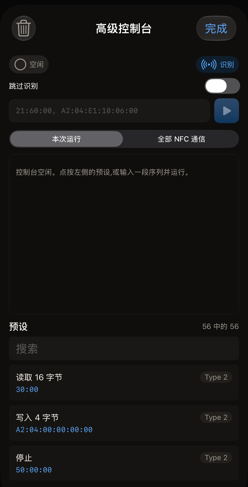
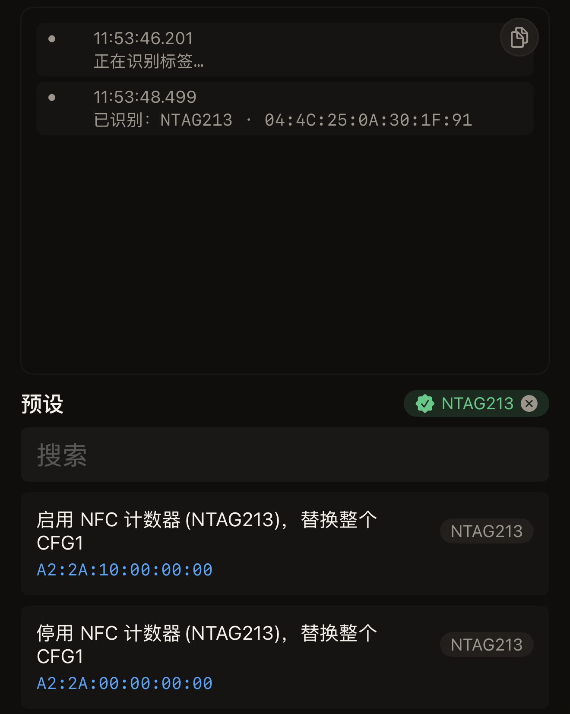
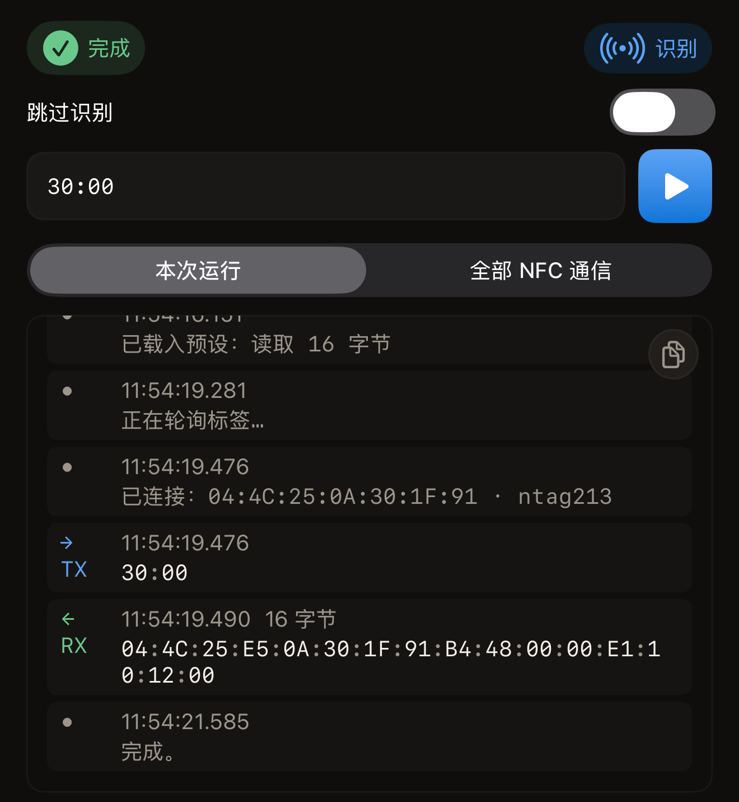

Hex NFC 的高级控制台将字节从 iPhone 直接发送到标签。它会列出发出的命令、收到的应答，以及每一条的时间。如果你想看的是帧本身，而不是帧的摘要，就打开它。

开始之前，请准备好标签，并打开该芯片的数据手册。数据手册是芯片制造商为该芯片编写的文档，以芯片名称发布在制造商的网站上，下面的识别步骤会报告这个名称。本手册没有任何页面转载数据手册，而无论你是否读过，控制台都会发送你输入的内容。

控制台占满一个界面，本页提到的每个控件都在这个界面上。顶部是状态指示及其旁边的**识别**，还有**跳过识别**开关。接着是**命令**栏和旁边的**运行**按钮，以及在**本次运行**和**全部 NFC 通信**之间切换的控件。再往下是输出区，底部是**预设**，预设行上方是**搜索**。

## 识别芯片

:::::steps
::::step[打开 Hex NFC]
打开 Hex NFC，屏幕上会显示 Hex NFC 主屏幕。
::::

::::step[打开控制台]
在主屏幕上，点按四个图块中的最后一个**高级**。该图块的第二行文字是“原始命令控制台”。控制台随即打开，空白的输出区显示“控制台空闲。点按左侧的预设,或输入一段序列并运行。”预设列表位于界面底部，而不在左侧。

:::figure[控制台刚打开时，状态指示显示“空闲”，输出区为空，**预设**位于界面底部。]

:::
::::

::::step[开始识别扫描]
点按状态指示右侧的胶囊形按钮**识别**。输出区新增一行“正在识别标签…”，同时 iOS 扫描面板出现，显示“贴近标签以识别。”
::::

::::step[将标签贴近 iPhone]
将 iPhone 顶部平贴在标签上，保持不动。输出区会列出芯片名称和标签的 UID，芯片名称也会出现在**预设**旁边。这一行显示为“已识别：NTAG213 · 04:4C:25:0A:30:1F:91”。

:::figure[识别扫描后，输出区列出芯片名称及其 UID，芯片名称显示在**预设**旁边，列表顶部是该芯片的预设。]

:::
::::
:::::

识别出芯片后，预设列表会重新排序。为该芯片编写的预设排在最前，下面是仍然适用于它的预设：

- 为整个芯片类型编写的预设
- 为同一系列中相近芯片编写的预设，例如识别出 NTAG216 时的 NTAG215 预设

这两类预设都不会呈灰色。不过，相近芯片的预设字节仍可能指向你这枚芯片上错误的页，因此请先在**命令**中查看这些字节。只有当预设属于其他芯片系列，或者完全属于另一类标签时，才会呈灰色。呈灰色的预设点按后仍会载入**命令**。要让控制台忘记这枚芯片，请点按**预设**旁边的芯片名称，列表会恢复平常的顺序。

如果应用无法确定芯片名称，控制台会显示“已连接标签，但芯片未知 · 04:BA:4A:92:1B:21:90”，然后列出标签对自身的描述。第一行类似于“报告值：NXP · NTAG · 128-256 bytes · v1.0”，包含芯片制造商、产品系列、芯片声明的内存大小以及产品版本。第二行是第一行所依据的原始字节，例如“GET_VERSION: 00:04:04:02:01:00:0F:03”。点按某一行即可复制。屏幕上会出现约一秒的“已复制”提示，这些字节已复制到剪贴板，可用于错误报告。

## 预设包含的内容

**预设**下的每个预设都是应用自带的一段已保存的命令序列。每一行只包含三项内容：预设名称、标明其适用芯片系列的标记，以及字节本身。有些预设读取标签，有些则写入标签，其中包括芯片只允许写入一次的页。

预设行背后没有任何说明，因此字节是了解预设作用的唯一依据。运行任何命令之前，请在**命令**中对照芯片的数据手册阅读这些字节。在大多数贴纸和卡片使用的 Type-2 芯片上，以 `30` 或 `3A` 开头的命令用于读取，以 `A2` 开头的命令用于写入。如果想在不更改标签的情况下看看控制台如何工作，可以从名为**读取 16 字节**的行开始，它的字节是 `30:00`。

## 运行命令

:::::steps
::::step[载入预设]
在**预设**下的列表中点按一个预设。它的字节会填入**命令**，控制台也会记下你载入的预设名称。此时还没有发送任何内容。
::::

::::step[检查要发送的内容]
阅读**命令**中的序列，需要时可以修改。每两个十六进制数字为一个字节，同一条命令内的字节用冒号分隔，命令与命令之间用逗号分隔。栏为空时会显示示例“21:60:00, A2:04:E1:10:06:00”。这只是占位文字，并不在栏中。栏为空时不会发送任何内容，在你载入预设或输入序列之前，**运行**一直呈灰色。如果把它当作示例来读，它是分别为 3 字节和 6 字节的两条命令，其中第二条向某一页写入 4 个字节。
::::

::::step[发送命令]
点按**运行**按钮。状态指示显示“正在轮询…”，输出区新增“正在轮询标签…”，同时 iOS 扫描面板出现，显示“贴近标签以发送命令。”
::::

::::step[将标签贴近 iPhone]
将 iPhone 顶部平贴在标签上，保持不动。输出区会新增一行连接信息，包含标签的 UID 和芯片，例如“已连接：04:4C:25:0A:30:1F:91 · ntag213”。命令发出期间，状态指示显示“正在运行…”。

如果要在任何字节到达标签之前停止，请点按 iOS 面板上的取消。运行随即结束，状态指示恢复为“空闲”，输出区显示“在找到标签之前已取消。未发送任何内容。”如果一直没有标签贴近，面板会自行关闭，状态指示显示“未找到标签”。一旦控制台通过**运行**或**识别**读取过标签，之后再运行时的取消或超时都会改为以一行错误显示。
::::

::::step[查看应答]
每条命令都会新增一个发送行和一个接收行，接收行会注明返回了多少字节。收到最后一个应答后，状态指示显示“完成”，输出区以“完成。”结束。

:::figure[运行**读取 16 字节**后，输出区有一个发送行和一个 16 字节的接收行，状态指示显示“完成”。]

:::
::::
:::::

:::warning[控制台在发送前不做任何检查]
写入命令一经发出就会更改标签。芯片上有些页在标签的整个寿命中只接受一次写入，写错的字节无法用之后的命令改回来。
:::

要在众多预设中找到某一个，请在**预设**标题下的**搜索**中输入其名称或字节的一部分。你也可以不用预设列表，在**命令**中输入自己的序列。标签拒绝某条命令时，本次运行和这次贴合都会结束，输出区中已有的各行保持不变。

## 查看所有帧，不限于本次运行

在输出区上方点按**全部 NFC 通信**，控制台就会显示应用与标签交换的每一帧。除了本界面的帧，扫描、写入和标签操作产生的帧也会显示出来。新帧会实时出现。点按**本次运行**即可返回控制台自己的日志。

## 访问拒绝探测的芯片

如果标签连接后不作任何应答，请打开位于状态指示和**命令**之间的**跳过识别**开关。这样应用会直接发送你的命令，而不先询问芯片的型号。运行时会将标签报告为未知，而不列出芯片名称。这个开关会一直保持打开，直到你将它关闭；运行结束时它不会自动复原。开关打开期间，其下方会显示原因：“命令直接发送到芯片。适用于拒绝 GET_VERSION 的芯片:探测会使其停止响应,之后的所有命令都会失败。”

开关打开时仍有一项检查会执行：当标签可能是 NFC 健康设备（例如胰岛素笔）时，应用只读取足以作出判断的内容，并且不会向健康设备发送你的任何命令。

## 控制台报告错误时

出现错误行时，本次运行和这次贴合都会结束，iOS 扫描面板也随之关闭。要继续发送内容，请再次点按**运行**并贴近标签。

- “无法解析该命令。”表示**命令**中的文字不是应用能识别的序列，因此没有发送任何内容。请检查以下三条规则：每个字节是两个十六进制数字，同一条命令的字节之间用冒号分隔，命令与命令之间用逗号分隔。
- “无法识别该标签。”表示识别扫描结束时没有得到结果。请点按**识别**，然后再次贴近标签。
- “这是一台健康设备。Hex NFC 从不向健康设备写入数据，也不会向它们发送命令。”表示该标签是一台医疗设备，例如胰岛素笔。你的命令一条都没有发送给它。
- “发生了意外错误。”表示运行因故停止，而应用无法更准确地描述原因。该行的其余部分包含详细信息。
- 错误行上的其他提示，都是应用对标签行为的描述，措辞与扫描或写入时给出的提示相同。

这些提示在实际中通常意味着什么，请参阅[标签无法扫描或写入时](troubleshooting.md)。

## 另请参阅

- [保存标签内存的副本](memory-dump.md)
- [适用于 Hex NFC 的标签](tags-that-work.md)
- [芯片支持矩阵](../developer/chip-support-matrix.md)
