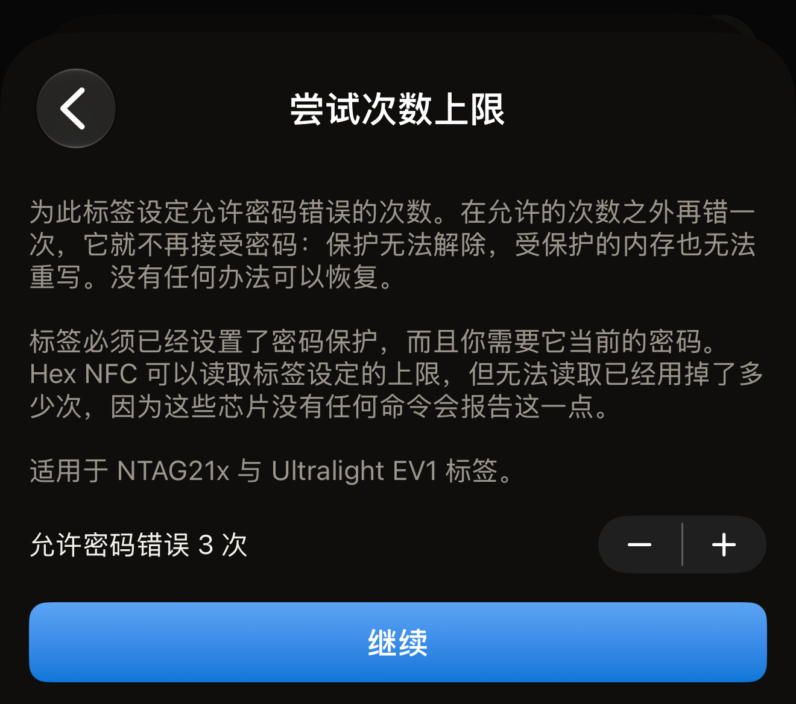
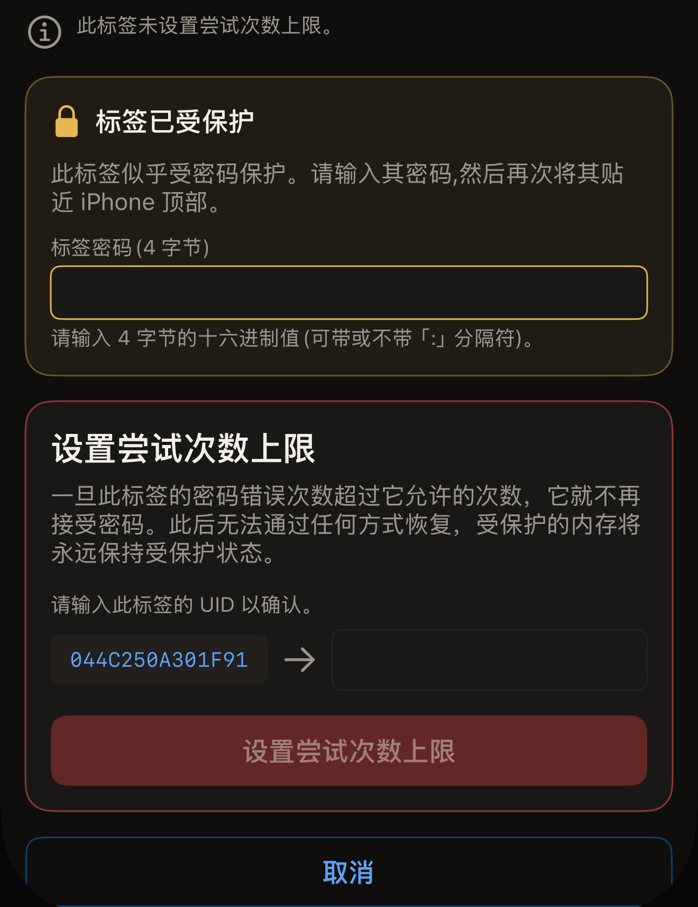

尝试次数上限告诉受密码保护的标签可以容忍多少次密码错误，Hex NFC 会在 iPhone 上把这个数字写入标签。设为 3，标签就接受三次密码错误；再错一次，它就永远不再接受密码。从那以后，保护再也无法解除，受保护的内存也再也无法重写。没有任何挽回的办法。

开始之前：

- 标签必须已经受密码保护。
- 你需要知道它当前的密码。
- 芯片必须是 NTAG21x 或 MIFARE Ultralight EV1，这项设置就位于这些芯片上。

要了解某种芯片支持什么，请阅读[适用于 Hex NFC 的标签](tags-that-work.md)或[芯片支持矩阵](../developer/chip-support-matrix.md)。

尝试次数上限不在**保护**卡片中，而是位于「操作」界面的**危险操作**下，因为它一次只针对一枚标签设置，而且无法撤销。

::include[two-tap-confirmation]

打开标签的那次扫描不算在这两次贴合之内。因此这里一共要贴合标签三次：一次用于扫描，然后是这项操作的两次贴合。

:::warning[输错密码可能会用掉一次尝试机会]
如果标签已经设置了上限，你在这里输入的密码一旦被标签拒绝，就会计入上限。Hex NFC 会报告标签设定的上限，但这些芯片上没有任何命令能说明已经用掉了多少次。也没有任何办法能在不用掉一次尝试机会的情况下测试密码。应用从不向你显示标签的密码，也没有任何芯片会交出密码。要输入的密码，就是你保护标签时保存的那个。
:::

## 设置尝试次数上限

:::::steps
::::step[扫描标签]
在 Hex NFC 主屏幕上点按**扫描**，然后将标签贴近 iPhone 顶部。标签的内容会在「标签」界面中打开。顶部卡片的标题是芯片名称，**保护**卡片就在它的正下方、记录的上方。

密码只保护写入的标签，扫描起来与其他标签无异，它的**保护**卡片显示“密码 · 仅写入”。

密码同时保护读取的标签则会让扫描停下来。扫描界面会显示“标签已受保护”并要求输入密码。输入密码，然后点按**解锁并重新扫描**。之后「标签」界面会打开，它的**保护**卡片显示“密码 · 读取与写入”。这次解锁会向标签发送密码，所以输错一次，就会用掉本页所说的一次尝试机会。[扫描标签](scan-a-tag.md#unlock-a-protected-tag)详细介绍了解锁。
::::

::::step[打开「尝试次数上限」界面]
在「标签」界面上，点按右上角**写入**旁边的菜单按钮，然后点按**操作…**。在「操作」界面中，点按**危险操作**卡片里的**尝试次数上限**。
::::

::::step[选择允许的密码错误次数]
这一行显示**允许密码错误 3 次**，按旁边的加减按钮，数字就会随之变化。可以选择 1 到 7 之间的任意数字，初始值为 3。加减按钮不能设为不限次数，所以这个界面可以更改标签的上限，但永远无法取消上限。移除标签的密码会连同上限一起清除，而这需要一个标签仍然接受的密码。

:::figure[**尝试次数上限**界面打开时上限为 3，加减按钮在这一行旁边，下方是**继续**。]

:::
::::

::::step[点按「继续」]
点按**继续**。加减按钮不再接受更改，界面会提示进行第一次贴合。
::::

::::step[进行操作的第一次贴合]
点按**设置尝试次数上限**，然后将标签贴近 iPhone 顶部。这次贴合会读取标签的 UID 和标签当前设定的上限。

如果在贴近标签之前关闭了 iOS 扫描面板，界面会回到加减按钮和**继续**，你可以另选一个上限。如果面板在没有标签贴近 iPhone 的情况下自行关闭，界面会显示“未找到标签”，并提供**重试**和**重新开始**。
::::

::::step[输入密码和标签的 UID]
标题为“标签已受保护”的卡片会要求输入标签当前的密码。在**标签密码(4 字节)**栏中以十六进制输入密码，可以带 `:` 分隔符，也可以不带。然后将界面上显示的 UID 输入它旁边的栏中。

:::figure[密码填在“标签已受保护”卡片中，UID 填在它下方的卡片中，位于**设置尝试次数上限**上方。]

:::
::::

::::step[用同一枚标签进行第二次贴合]
点按**设置尝试次数上限**，然后再次将标签贴近 iPhone 顶部。应用会写入新的上限并回读。界面会报告“此标签现已设置为允许密码错误 3 次。”

下方还会补充“在允许的次数之外再错一次，它就永远不再接受密码。”
::::
:::::

## 两次贴合之间应用报告的内容

第一次贴合会读取标签自身的设置，所以在你输入 UID 之前，界面就会说明标签当前的设置。它会报告以下三种情况之一：

- “此标签未设置尝试次数上限。”无论密码错误多少次，它都不会因此停止接受密码。
- “此标签已设置为允许密码错误 3 次。”这个数字是标签当前的上限，新的上限会取代它。
- “此标签受读取保护，在提交密码之前无法读取它当前的上限。”没有可报告的内容，因为配置页受密码保护。操作会从这里继续：输入 UID，第二次贴合就会发送密码并写入新的上限。

标签已经用掉了多少次尝试机会，应用从不报告，因为这些芯片上没有任何命令会透露这一点。

## 标签没有密码时

尝试次数上限保护的是密码，所以对于没有密码的标签，应用会拒绝执行这项操作。拒绝时会显示“此标签未设置密码，因此尝试次数上限没有任何可保护的内容。”

拒绝发生在写入任何内容之前，标签完全保持原样。请先按照[用密码保护标签](protect-a-tag.md)中的说明设置密码，然后再回到这里。

## 应用无法回读上限时

如果标签在写入过程中滑开，标题会显示“已写入尝试次数上限。”

说明文字为“标签已确认写入，但本次贴合未能读回该字节。请重新开始此操作：第一次贴合会显示标签当前的上限。”芯片已经接受了写入，只是这次贴合无法证明写入了什么。

此时操作已经结束，所以界面不提供重试。请返回「操作」界面，再次打开**尝试次数上限**，并完整执行一遍：新一轮操作的第一次贴合会报告标签当前的上限。

## 之后密码不再有效时

在设置了上限的标签上，被标签拒绝的密码会报告为“标签拒绝了该密码。此标签设置了尝试次数上限，因此即使密码正确，它也可能已被锁死。”

未能完成的检查会显示“该密码未能打开标签。此标签设置了尝试次数上限，每一次错误尝试都会被计入。再次尝试前，请先核对密码。”

对你的下一步来说，两者的意思相同：再次贴近标签之前，先找到正确的密码。这两条提示都可能取代“标签已受保护”卡片上的提示。卡片中的栏是空的，所以除非你重新输入，被拒绝的密码不会第二次发送。如果操作以失败结束，界面上则会留下**重新开始**，它会把表单交还给你，并再次要求输入密码。一旦标签的密码错误次数超过允许的次数，就再也无法打开它，它受保护的内存也会永远处于受保护状态。

## 另请参阅

- [移除标签的密码](remove-password.md)
- [标签保护](tag-protection.md)
- [标签无法扫描或写入时](troubleshooting.md)
