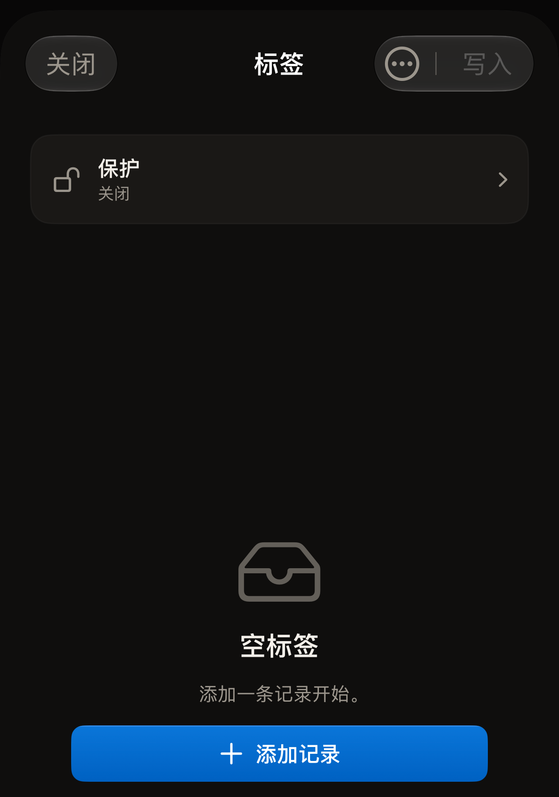
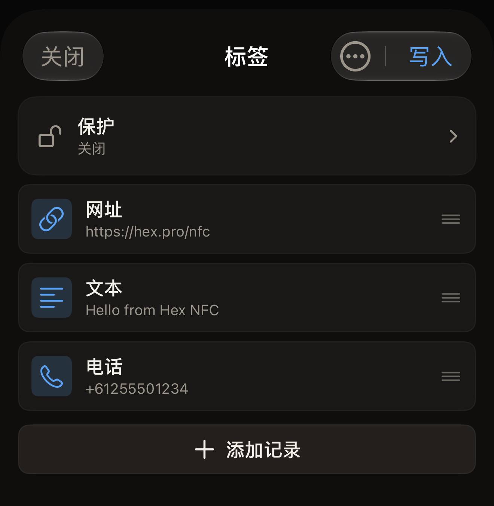

标签中存有一个记录列表，Hex NFC 会在「标签」界面上显示这个列表。你可以添加、更改、在列表中上移或删除记录，等列表符合你的要求后，再从 iPhone 写入标签。

## 打开记录列表

执行以下任一操作：

- 要处理手中的标签，请扫描它。它的记录会出现在「标签」界面上。请参阅[扫描标签](scan-a-tag.md)。
- 要在手边没有标签的情况下创建一组记录，请在 Hex NFC 主屏幕上点按**创建**。

还没有任何内容的标签或新建记录组会显示“空标签”，下方是“添加一条记录开始。”

:::figure[没有记录的新建记录组显示“空标签”，提示下方是**添加记录**。]

:::

## 添加记录

::::steps
:::step[打开记录选择器]
在「标签」界面上点按**添加记录**。它位于记录列表的末尾；标签中没有任何内容时，它位于“空标签”下方。「添加记录」界面随即打开，你可以添加的每种类型各有一个图块。
:::

:::step[选择类型]
点按你需要的图块，例如**文本**、**网址**、**联系人**或 **Wi-Fi**。应用会添加一条该类型的记录，并打开它供你填写。
:::

:::step[填写记录]
输入这条记录所需的信息，然后点按**保存**。这条记录会出现在「标签」界面列表的末尾。
:::
::::

共有 13 种类型可供选择。[记录类型](record-types.md)介绍了每种类型存储什么内容，以及手机读取标签时会如何处理它。

## 从二维码添加记录

::::steps
:::step[打开二维码读取器]
在「添加记录」界面上点按**扫描二维码**。「扫描二维码」界面随即打开。
:::

:::step[允许使用相机]
第一次使用时，界面会显示“允许相机扫描二维码”和“图像在本机处理,不会上传任何内容。”点按**允许相机**，然后在 iOS 询问时允许访问。如果你之前拒绝过相机访问，界面会改为显示“需要相机访问权限”。点按**打开设置**，为 Hex NFC 重新打开相机权限。
:::

:::step[将相机对准二维码]
让二维码处于框内。应用会读取它看到的第一个二维码，将其转换为一条记录，并打开这条记录供你检查。
:::
::::

应用选择的类型与二维码的内容相符：Wi-Fi 网络、联系人、电子邮件、短信、电话号码或位置。网址会成为网址记录。其他任何内容都会成为文本记录。

## 更改、移动或删除记录

在「标签」界面上执行以下任一操作：

- 要更改记录，请点按它所在的行，编辑各栏，然后点按**保存**。
- 要移动记录，请向上或向下拖动它所在的行。列表的顺序就是记录写入标签的顺序。
- 要删除记录，请在它所在的行上向左轻扫，然后点按**删除**。如果将这一行一直轻扫到底，记录会直接删除，不需要再点按一次。

:::figure[记录按写入的顺序排列，列表末尾是**添加记录**。]

:::

在这里删除的记录只会从列表中消失，不会从标签上删除。在下一次写入之前，标签会保留原有的内容，所以即使误清空了列表，也不会有任何损失。如果要真正清空标签，请参阅[擦除或格式化标签](erase-or-format.md)。

## 完成编辑

在你写入之前，这个界面上的任何改动都不会传到标签上。列表确认无误后，执行以下操作之一：

- 要将记录写入标签，请点按**写入**。请参阅[将链接写入标签](write-a-link.md)。
- 要保存这组记录以后再用，请打开「标签」界面顶部的菜单，然后点按**另存为预设…**。请参阅[将标签另存为预设](presets.md)。
- 要离开，请点按**关闭**。你的标签保持原样，既未写入也未保存的修改会被丢弃。

## 另请参阅

- [记录类型](record-types.md)
- [将链接写入标签](write-a-link.md)
- [将标签另存为预设](presets.md)
