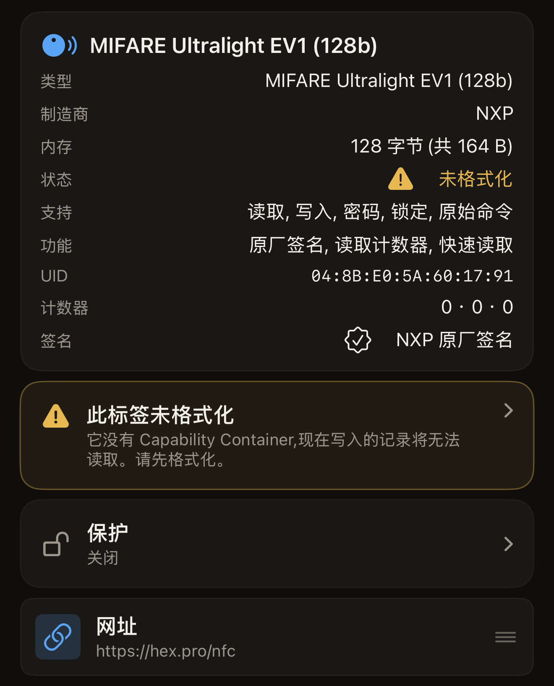
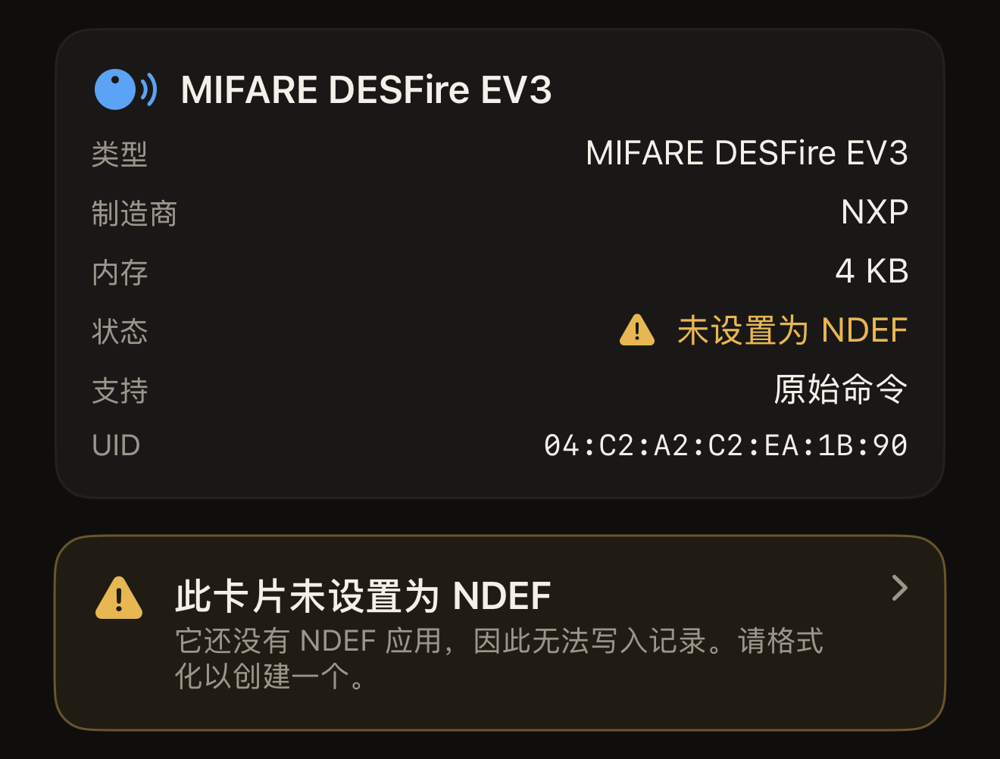
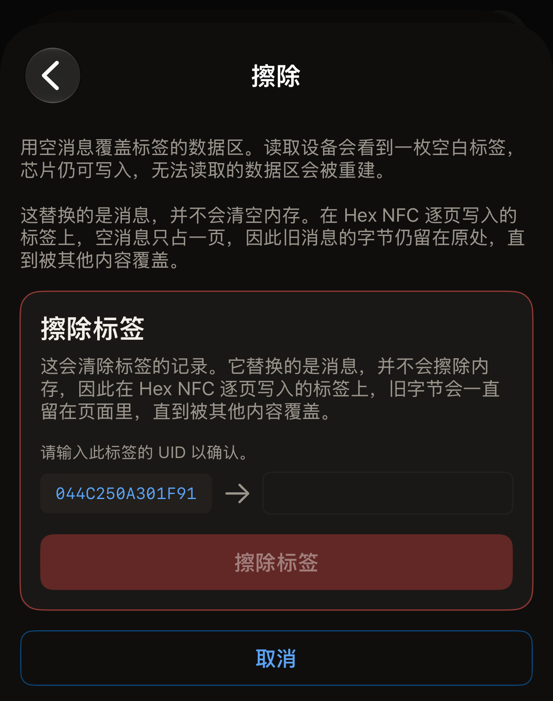
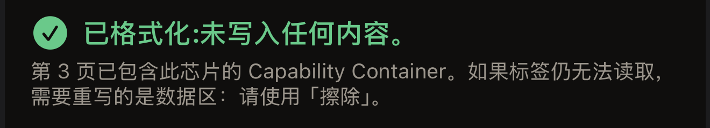
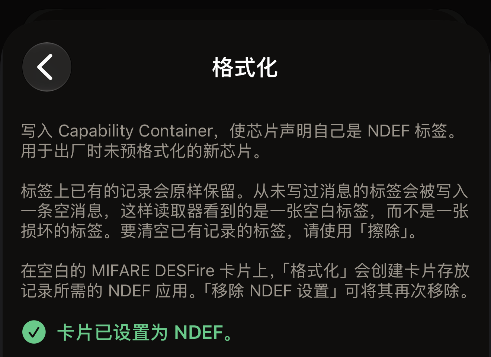
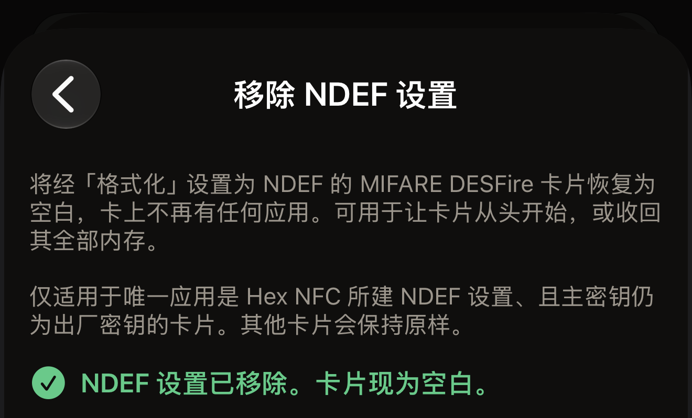

标签无法读取时，Hex NFC 提供两种修复方法，二者的作用正好相反。擦除会用空消息覆盖标签的数据区，读取设备看到的是一枚空白标签，芯片仍可写入。格式化会写入 Capability Container，这是一段简短的头部信息，读取设备在读取标签上的其他任何内容之前都会先查找它。

开始之前，先扫描标签：在 Hex NFC 主屏幕上点按**扫描**，然后将标签贴近 iPhone 顶部。应用读取标签后会打开**标签**界面。标签未格式化、标签的数据无法读取，或者 MIFARE DESFire 卡片尚未设置为 NDEF 时，这个界面同样会打开。在这几种情况下，它都会在扫描后自动打开，无需再点按任何内容。扫描界面上的警告是对问题的诊断，并不意味着无路可走。在**标签**界面上，点按右上角**写入**旁边的菜单按钮，然后点按**操作…**。两种修复都位于**操作**界面底部的**危险操作**下。**移除 NDEF 设置**就在它们旁边，用于撤销 MIFARE DESFire 卡片上的格式化。这里的每项操作在更改标签之前都会先确认标签：

::include[two-tap-confirmation]

## 判断需要哪种修复

应用会在你遇到问题的界面上指出故障，每种故障名称都指明了所需的修复。

- 扫描界面显示“此标签尚未格式化”，或者**标签**界面显示“未格式化”时，请格式化标签。这枚标签没有 Capability Container，因此写入的任何内容都无法读取。
- 扫描界面显示“无法读取此标签的数据”，或者**标签**界面显示“数据无法读取”时，请擦除标签。Capability Container 已经就位，格式化在这里没有可修复的东西。
- 扫描界面显示“此卡片尚未设置为 NDEF”，或者**标签**界面显示“未设置为 NDEF”时，请格式化卡片。这是一张空白的 MIFARE DESFire 卡片，或者之前的格式化没有完成对它的设置，因此暂时还不能向它写入记录。交通卡或门禁卡不会出现这条提示。

如果标签仍可写入，**标签**界面还会显示一条可点按的警告，内容为“此标签未格式化”“无法读取此标签的数据”或“此卡片未设置为 NDEF”。点按这条警告即可打开**操作**。已永久锁定的标签只显示状态，不显示警告，因为两种修复都需要写入。

:::figure[没有 Capability Container 的标签在**状态**旁显示“未格式化”，卡片下方是“此标签未格式化”警告。]

:::

:::figure[空白的 MIFARE DESFire 卡片在**状态**旁显示“未设置为 NDEF”，标签信息卡片下方是“此卡片未设置为 NDEF”警告。]

:::

## 擦除标签

擦除会清除标签的记录，芯片仍可写入。它还能重建已无法读取的数据区。

:::::steps
::::step[打开「擦除」界面]
在**操作**界面上，点按**擦除**。打开的界面会说明擦除将写入什么，并在任何内容写入标签之前向你发出警告。
::::

::::step[开始擦除]
点按**擦除标签**。iPhone 随即提示你贴近标签。
::::

::::step[将标签贴近 iPhone]
将 iPhone 顶部贴在标签上。界面先显示“第 1 次(共 2 次)。贴住标签以识别它。”随后显示标签的 UID。
::::

::::step[输入 UID]
界面显示“请输入此标签的 UID 以确认。”并在一个空白栏旁列出 UID。在栏中输入相同的字符，字符之间不加冒号，大小写均可，然后点按**擦除标签**。如果标签的密码保护着数据区，栏上方会出现一张标题为“标签已受保护”的卡片，要求你输入标签当前使用的密码或密钥。填写之前，点按**擦除标签**不会有任何反应。

:::figure[第一次贴合后，标签的 UID 显示在空白栏左侧，输入 UID 之前**擦除标签**一直呈灰色。]

:::
::::

::::step[再次贴近标签]
再次将标签贴近 iPhone 顶部。应用从标签回读到空消息后，界面会显示“标签已擦除。”
::::
:::::

擦除有两种结果。空消息回读成功后，它会报告“标签已擦除。”否则它会报告一个指明故障的错误，错误下方附有可用于错误报告的详细信息。接下来可以尝试的办法见[标签无法扫描或写入时](troubleshooting.md)。

:::note
擦除替换的是标签的消息，并不会清空其内存。在 NTAG 和 MIFARE Ultralight 标签（大多数贴纸和卡片使用的芯片）上，空消息只占一页。旧消息的字节会留在原处，直到被其他内容覆盖。如果要把标签转交他人，请先在上面写入一条你自己的消息。
:::

## 格式化标签 {#format-a-tag}

格式化适用于出厂时未预先格式化的新芯片。格式化会写入 Capability Container，标签上已有的记录会原样保留。在 ICODE SLIX2 等 ISO 15693 标签上，如果标签从未存放过消息，格式化还会为它写入一条空消息，这样读取设备看到的是一枚空白标签，而不是一枚损坏的标签。要清空已有记录的标签，请改用擦除。在空白的 MIFARE DESFire 卡片上，格式化会将卡片设置为 NDEF，本节最后一部分会具体介绍。

::::steps
:::step[打开「格式化」界面]
在**操作**界面上，点按**格式化**。
:::

:::step[开始格式化]
点按**格式化标签**。iPhone 随即提示你贴近标签。
:::

:::step[将标签贴近 iPhone]
将 iPhone 顶部贴在标签上。界面先显示“第 1 次(共 2 次)。贴住标签以识别它。”随后显示标签的 UID。
:::

:::step[输入 UID]
界面显示“请输入此标签的 UID 以确认。”并在一个空白栏旁列出 UID。在栏中输入相同的字符，字符之间不加冒号，大小写均可，然后点按**格式化标签**。
:::

:::step[再次贴近标签]
再次将标签贴近 iPhone 顶部。应用回读头部信息后，界面会显示“标签已格式化。”在 MIFARE DESFire 卡片上，界面显示的则是“卡片已设置为 NDEF。”
:::
::::

在 NTAG 或 MIFARE Ultralight 标签上，格式化会以下列三种报告之一结束：

- “标签已格式化。”表示头部信息已写入、已回读并且就位，标签可以接收消息了。
- “已格式化:未写入任何内容。”表示标签上已有正确的头部信息，因此没有向它写入任何内容。应用会引导你使用**擦除**，因为如果标签仍然无法读取，故障出在数据区。
- “此标签已有不同的 Capability Container。”表示标签上的头部信息与应用识别出的芯片不符。没有写入任何内容。

:::figure[如果格式化时发现头部信息已经就位，会报告“已格式化:未写入任何内容。”并引导你改用擦除。]

:::

ISO 15693 标签的 Capability Container 块始终可以重写，应用每次运行都会写入它，因此这类标签每次都会报告“标签已格式化。”

:::warning
在 NTAG 和 MIFARE Ultralight 标签上，Capability Container 在标签的整个寿命中只能写入一次，写错了也无法更正。因此应用会先读取该页，只在它为空时写入。对于无法识别的芯片，应用会拒绝操作，而不是去猜测头部信息。应用读到的芯片名称显示在**标签**界面顶部，[适用于 Hex NFC 的标签](tags-that-work.md)说明了应用对每种芯片能做什么。
:::

### 格式化 MIFARE DESFire 卡片

空白的 MIFARE DESFire EV1、EV2 或 EV3 卡片上没有任何应用。卡片要先有 NDEF 应用才能存放记录，格式化就是为它创建这个应用。操作步骤与上文相同，同样需要贴合两次并输入 UID。应用会根据卡片的可用内存确定 NDEF 文件的大小，在 4K 卡片上最大为 4 KB。设置完成后，iOS 会像对待其他 NDEF 标签一样读取和写入这张卡片。

在 MIFARE DESFire 卡片上，第二次贴合会以下列两种报告之一结束：

- “卡片已设置为 NDEF。”表示 NDEF 应用已经在卡片上，并且能够回读，卡片可以存放记录了。
- “已设置为 NDEF：未写入任何内容。”表示 Hex NFC 之前已经设置过这张卡片，因此没有向它写入任何内容。

:::figure[空白的 MIFARE DESFire 卡片经格式化完成设置后，会报告“卡片已设置为 NDEF。”]

:::

遇到下列卡片时，应用会拒绝操作，不向卡片写入任何内容：

- “此卡片上已有其他应用，因此无法在此设置为 NDEF。未写入任何内容。”交通卡和门禁卡得到的就是这条提示。
- “此卡片需要主密钥才能添加任何内容，因此无法在此设置为 NDEF。未写入任何内容。”
- “此卡片已由其他 App 设置为 NDEF，Hex NFC 会保持原样。未写入任何内容。”

如果第二次贴合时，卡片在设置写入任何内容之前就离开了 iPhone，界面会显示“读取过程中丢失标签。请将其贴紧手机顶部后重试。”此时卡片上没有写入任何内容。如果设置已经开始写入，界面会显示“卡片只完成了部分设置。请再次轻点「格式化」以完成。”或“卡片可能只完成了部分设置。请扫描确认，或再次轻点「格式化」。”再格式化一次，就会从上次停下的地方接着完成。

如果卡片的可用内存不够，第一次尝试时界面会显示“此卡片的可用内存不足以容纳 NDEF 文件。请使用「移除 NDEF 设置」清除已开始的设置。”之后在同一张卡片上再次尝试时，界面会显示“此卡片的可用内存不足以容纳 NDEF 文件。未写入任何内容。”无论哪种情况，都可以用**移除 NDEF 设置**清空卡片，下一节会介绍具体做法。

## 移除卡片的 NDEF 设置 {#remove-ndef-setup}

**移除 NDEF 设置**会把经格式化设置过的 MIFARE DESFire 卡片恢复为空白。它会删除卡片上的 NDEF 应用及其中的所有记录，并让卡片收回全部内存。这项操作只适用于同时满足以下两个条件的卡片：卡上唯一的应用是 Hex NFC 创建的 NDEF 设置（包括格式化中途留下的未完成设置），并且主密钥仍是出厂密钥。其他卡片都会保持原样。

::::steps
:::step[打开「移除 NDEF 设置」界面]
在**操作**界面上的**危险操作**下，点按**移除 NDEF 设置**。
:::

:::step[开始移除]
点按**移除 NDEF 设置**。iPhone 随即提示你贴近卡片。
:::

:::step[将卡片贴近 iPhone]
将 iPhone 顶部贴在卡片上。界面先显示“第 1 次(共 2 次)。贴住标签以识别它。”随后显示卡片的 UID。
:::

:::step[输入 UID]
界面显示“请输入此标签的 UID 以确认。”并在一个空白栏旁列出 UID。在栏中输入相同的字符，字符之间不加冒号，大小写均可，然后点按**移除 NDEF 设置**。
:::

:::step[再次贴近卡片]
再次将卡片贴近 iPhone 顶部，保持不动，直到结果出现。应用回读卡片、确认卡上已没有任何应用后，界面会显示“NDEF 设置已移除。卡片现为空白。”
:::
::::

:::figure[NDEF 设置移除后，卡片会报告“NDEF 设置已移除。卡片现为空白。”]

:::

已经是空白的卡片会报告“此卡片已经是空白的：未做任何更改。”遇到下列卡片时，应用会拒绝操作，不做任何更改：

- “此卡片上有其他应用。移除设置也会删除它们，因此未做任何更改。”
- “此卡片的 NDEF 设置由其他 App 创建，Hex NFC 不会移除它。未做任何更改。”
- “此卡片的主密钥不是出厂密钥，因此本 App 无法移除其设置。未做任何更改。”

如果第二次贴合时，卡片在移除操作更改任何内容之前就离开了 iPhone，界面会显示“读取过程中丢失标签。请将其贴紧手机顶部后重试。”卡片上的内容没有任何变化。如果卡片在移除开始之后才离开，界面会显示“卡片可能已经是空白的。请扫描确认。”如果扫描结果显示卡片仍设置为 NDEF，请再执行一次**移除 NDEF 设置**：每次移除都会先读取卡片，已经是空白的卡片会报告“此卡片已经是空白的：未做任何更改。”

设置移除后，扫描时**标签**界面的**状态**旁会再次显示“未设置为 NDEF”，再格式化一次就能重新设置这张卡片。

## 从记录列表清空标签

你也可以在**标签**界面上清空标签，而不必经过**操作**。清空写入不涉及保护更改，因此只贴合一次，也不要求输入 UID。如果写入时还要启用或移除密码，就需要贴合两次并输入 UID。这与**危险操作**下每项操作要求的两次贴合确认相同。

::::steps
:::step[删除所有记录]
在**标签**界面上，将记录向左轻扫并点按**删除**，直到界面显示“没有剩余记录”。此时这些删除还没有写入标签。
:::

:::step[写入清空后的内容]
界面此时显示“你已删除全部记录。写入即可清空标签,或者再添加一条。”在这行文字下方、**添加记录**上方，点按**写入以清空标签**。iPhone 随即提示你贴近标签。
:::

:::step[将标签贴近 iPhone]
将 iPhone 顶部贴在标签上，保持不动，直到写入完成。
:::
::::

## 另请参阅

- [扫描标签](scan-a-tag.md)
- [编辑标签的记录](edit-records.md)
- [将链接写入标签](write-a-link.md)
- [标签无法扫描或写入时](troubleshooting.md)
- [适用于 Hex NFC 的标签](tags-that-work.md)
